# Gemini 4 Carbon

## TL;DR

Google made Gemini 4 Carbon generally available on 11-10, two weeks after a restricted release to cyber defenders through its Fairwind Program. Carbon is built on Gemini 4 Argon and spends more thinking tokens to explore, reason and run verification loops, with configurable thinking levels. Context is 1M tokens combined input and output; knowledge cutoff March 2026. Launch price is Argon's introductory $2/$10 per million input/output tokens, which Simon Willison reports doubles to $4/$20 on December 1. Google claims #1 on CursorBench 4.0, Perplexity's WANDR and Zapier's AutomationBench at more than 2x lower cost per task than the next-best outside model, and #2 on the new Multimodal Knowledge Agent (MKA) benchmark at over 6x lower cost per task than the leader. It ships with a /swarm preview in Antigravity: Carbon takes planning, coordination and audit roles while lighter models work in parallel isolated workspaces under adversarial verifiers.

```mermaid
flowchart LR
  P["One prompt<br/><small>large project</small>"] --> C["Carbon lead<br/><small>design, coordination</small>"]
  C --> W["Light workers<br/><small>parallel workspaces</small>"]
  W --> V["Adversarial verifiers<br/><small>test every change</small>"]
  V -->|fail| W
  V -->|pass| A["Carbon audit<br/><small>final review</small>"]
  A --> O["Shipped artifact<br/><small>app, analysis, patch</small>"]
  classDef input fill:#d0ebff,stroke:#1971c2,color:#1b1b1b,stroke-width:2px
  classDef core fill:#e5dbff,stroke:#6741d9,color:#1b1b1b,stroke-width:2px
  classDef loop fill:#fff3bf,stroke:#f08c00,color:#1b1b1b,stroke-width:2px
  classDef exit fill:#d3f9d8,stroke:#2f9e44,color:#1b1b1b,stroke-width:2px
  class P input
  class C,A,W core
  class V loop
  class O exit
  linkStyle 3 stroke:#f08c00,stroke-width:2px
  linkStyle 4 stroke:#2f9e44,stroke-width:2px
```

Carbon plans and audits, lighter models do the work

/swarm is model routing packaged as a product feature.

Blue is the request, purple is a model, amber is the verification loop, green is the result.

## Model card benchmarks (as of October 2026; vs Argon / GPT-6 Astra / Opus 5.5 / Fable 5.1)

- AA Index v5.0: 59 (50 / 57 / 58 / 49). Vals Index v2.2: 70.4%.
- Terminal-Bench 4.0: 65.2% (57.1 / 59.1 / 59.6 / 52.0). FrontierSWE 2: 61.2%, behind GPT-6 Astra's 65.5% and Opus 5.5's 62.3%.
- OSWorld-2.1 offline: 81.5%, behind Opus 5.5's 87.2%.
- GraphWalks 256K to 1M BFS: 96.2% (84.2 / 71.8 / 66.8 / 65.0). The largest margin on the card, on long context.
- Vending-Bench 2: $16,484 vs $9,235 for Opus 5.5.
- Cyber (via Fairwind): ExploitGym 54.8%, SEC-bench Pro 88.2%, CWE-bench 71.0%.
- Fable 5.2 (released 11-09) is not in the table.

## Safety section

Automated content-safety deltas vs Argon: text +3.50pp, multilingual +3.55pp, image-to-text -1.00pp, tone +1.10pp, unjustified refusals +1.10pp. Child-safety launch thresholds met. Frontier Safety safeguards were strengthened for CBRN and cyber misuse, with dual-use cyber capabilities gated to verified defenders. Details sit in a separate Safety & Security Report not captured here. Deployment stories: Project Fortify (100% scanning recall, 95% triage precision on an internal benchmark), Wiz finding 0-days in two SaaS providers in under two hours, and AlphaProof Code ([summary](../agentic-systems/2026-11-11-verified-optimization-alphaproof-code-lean-quantum.md)).

## Relation to prior wiki

- **Second frontier release in two days to ship a gated twin for cyber.** Anthropic's Fable 5.2 / Mythos 5.2 (11-10, [summary](2026-11-10-claude-fable-mythos-5-2.md)) split one model into public and verified-org envelopes. Carbon's Fairwind access is the same pattern. Two labs, one deployment design.
- **The lead-plus-workers pattern reaches a first-party product.** The 11-08 [lead plus cheap workers](../ai-routing/2026-11-08-lead-plus-workers-agent-teams.md) page (Cohere: frontier lead plus cheaper workers nears an all-frontier team at about 70% lower cost) predicted this shape. /swarm is it.
- Arena's Agent Arena says Carbon's savings over GPT-6 Astra and Opus 5.5 grow on the most expensive sessions. That fits a model that spends more tokens but finishes in fewer turns.

## Links

- [Announcement](https://deepmind.google/blog/gemini-4-carbon-is-now-available/) · [Model card](https://deepmind.google/models/model-cards/gemini-4-carbon/) · [Simon Willison on pricing](https://simonwillison.net/2026/Nov/10/llm-gemini/)
