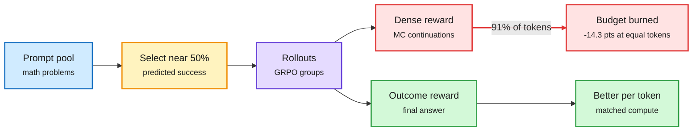

# Dense rewards vs GRPO at matched compute

## TL;DR

GRPO (group-relative policy optimization, the standard RLVR algorithm) gives every token of a solution the same credit based on the final answer. Dense process rewards try to credit intermediate steps; a common one scores each step by sampling continuations from it (a Monte-Carlo reward). This paper (2611.13560) notes that those continuations are not free: in its setup they are 91% of all generated tokens. It runs 1,668 preregistered runs on six models with a matched-compute protocol, giving every method the same budget in generated tokens and training GPU-hours. Matching compute reverses the ranking. On Qwen2.5-1.5B the Monte-Carlo reward wins per update but ends 14.3 points lower at equal tokens and 7.8 points lower at equal training time, and none of four dense-reward variants beats plain GRPO. What does help at matched compute is choosing prompts whose predicted success rate is nearest 50% (+1.7 points on Qwen3-0.6B, +0.8 on Qwen2.5-1.5B), but plain GRPO with twice the learning rate gets within half a point of that too. A per-token gradient test, often used to vet rewards, orders them correctly but overestimates each by one to two points, which is as large as the gains it is meant to detect.

Count the tokens and the ranking flips

Per update, dense rewards look better. Per token spent, plain GRPO wins.

Blue is the data, amber is the selection rule that helps, purple is the rollout, red is the dense-reward cost, green is the outcome-reward path.

## Relation to prior wiki pages

- **Same move as the 11-11 harness-cost papers** (Agency: harness choices swing agent cost 2.6x at the same accuracy): report results per unit of compute, not per step. The field keeps finding that "better" results disappear once the bill is counted.
- **Tension with a Scale AI result circulating on X:** PPO beats GRPO at small batch sizes and GRPO needs large batches to catch up ([@Xudong07452910](https://x.com/Xudong07452910/status/2120414121334063289)). That argues a learned critic (a form of dense credit) can pay for itself. This paper tested sampled process rewards, not a learned critic, so the two do not directly conflict. Open.
- **Fits the 11-03 "hidden costs of RL" thread** (training-inference mismatch, async lag).
- **Gaps:** small models (0.6B-1.5B) and math only; long-horizon agent RL, where credit assignment is harder, is exactly where dense rewards might still win.

Concept page: [RL for LLMs](rl-for-llms.md).
