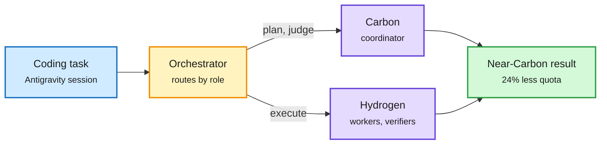

# Gemini 4 Hydrogen

## TL;DR

Google DeepMind shipped Gemini 4 Hydrogen on 11-12, a fast "execution" model adapted from Gemini 4 Carbon (the frontier model covered on 11-11). It replaces the Flash line, becomes the free-tier model, and now powers AI features in Google Search. Context is 1M tokens with flat pricing across the whole window: $1.50 per million input, $0.075 cached, $7.50 output. Output is 64K by default or up to 1M via background long decode. There are four thinking levels, with a new xhigh. On the Artificial Analysis Intelligence Index it scores 51 at high (Argon 50) and 54 at xhigh. Against Gemini 3.8 Flash it is 2.5x faster and moves Terminal-Bench 4.1 from 18.2% to 57%. Claude Sonnet 5.5 still leads on Terminal-Bench (63.9%), OSWorld-2.1 (83.9 vs 77.6) and TB-Science. The Antigravity Orchestrator pairs Carbon as coordinator with Hydrogen as workers and verifiers: near-Carbon Terminal-Bench 4.0 success at 24% less quota and 19% faster.

The cheap model is the worker, the frontier model is the manager

Google ships the role split as a product, with a measured quota saving.

Blue is the task, amber is the router, purple is the two models, green is the outcome.

## Pricing context (Simon Willison)

Carbon and Argon both cost $2/$10 per million through 11-30 and double to $4/$20 on 12-01. Hydrogen at $1.50/$7.50 is only a 25% discount until then and a 75% discount after. It is still 15x Claude Haiku 5.5 and GPT-6 Luna ($0.10/$0.50). The Decoder notes Hydrogen nearly matches Sonnet 5.5 on the AA index for less money but costs about 2.5x more per task than GPT-6.1 Sol.

## Safety and evaluation (model card)

- Automated safety vs 3.8 Flash: text-to-text +0.80pp, multilingual +1.10pp, image-to-text +7.00pp; refusal tone -0.65pp; unjustified refusals +5.57pp (a regression, worst on multimodal prompts).
- Frontier Safety Framework: no material capability increase over Argon. Targeted CBRN and cyber checks found Hydrogen does not reach the critical capability levels but does reach the alert thresholds in both domains. The full safety report is promised "in the coming days".

## How it relates to prior wiki pages

- **Confirms** the role-routing pattern in [LLM routing](../ai-routing/llm-routing.md): Cohere's lead-plus-workers (11-08, about 70% lower cost near all-frontier quality) and AgentBaton (11-10, capable-to-cheap handoff saves 65.9% API cost) now have a hyperscaler product with its own number. See [PISA-E and PolyRoute](../ai-routing/2026-11-13-pisa-ensemble-routing-and-polyroute.md).
- **Extends** [Gemini 4 Carbon](2026-11-11-gemini-4-carbon.md). Ken Huang's comparison of Fable 5.2 and Carbon notes both labs moved thinking out of prompt text into an effort dial in config, and both name a cheaper model as the default with the top model as escalation. Hydrogen is that default.
- The flat price across 1M context is a [KV cache](../inference-efficiency/kv-cache.md) economics signal: Google is absorbing long-context memory cost rather than tiering it.
