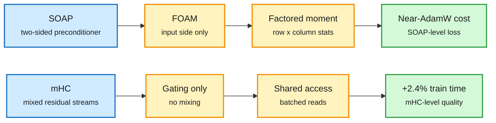

# FOAM and SimpleHC: cheaper training plumbing

## TL;DR

- **FOAM (2611.16905).** Second-order optimizers like Shampoo and SOAP converge faster per step than AdamW but cost optimizer-state memory and eigendecompositions. FOAM keeps SOAP's benefit at near-AdamW cost with two changes. (1) **One-sided preconditioning:** drop the output-side Kronecker factor, which removes memory and one eigendecomposition; the Kronecker structure of the Hessian makes this exact when output curvature is diagonal and nearly lossless when near-diagonal. (2) **Factored second moment:** replace SOAP's dense rotated second moment with a row-by-column Adam-moment estimate, exact under K-FAC with diagonal output curvature; measured K-FAC violation is only 15-20%. FOAM matches strong SOAP and Muon baselines in validation loss.
- **SimpleHC (2611.05984).** Hyper-Connections (an expanded, multi-stream residual stream now used in frontier LMs, mHC being the popular variant) add training overhead. Two interaction groups each match mHC alone: learned read/write gating without mixing, or unconstrained mixing with fixed gates. The real overhead is **repeated access to the expanded residual state**. SimpleHC drops residual mixing and shares memory access (batched reads, deferred writes, shared gate inputs), costing **2.4% extra end-to-end training time** over a plain residual at the largest tested scale while staying comparable to mHC.

Keep the benefit, delete the expensive half

Both papers find one component carries the gain and another carries the cost.

Blue is the prior method, amber is the simplification, green is the result.

## Relation to prior wiki pages

- Both are memory-traffic results more than math results: FOAM removes optimizer state, SimpleHC removes residual-state reads. That is the same bottleneck shape as Inkling's 4-bit training (same day), where the speedup was capped by bytes over NVLink rather than FLOPs.
- Other 11-13 HF efficiency items, for the record: **G-STAR** (2611.13004) scales token-group size quadratically with spatial compression to reach 32-64x compressed autoregressive image generation, 20x faster at 1024x1024. **Unbundling Multimodal Vision Encoding** (2611.17334, 200+ models trained from scratch) finds a pretrained visual prior unnecessary; dedicated vision capacity is what matters, and it can sit in-fusion in early backbone layers, which can lower time to first token.
