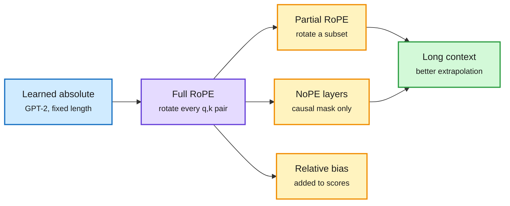

# How modern LLMs encode position, and where they skip it

**TL;DR.** Raschka's long tutorial builds positional encoding from first principles and then surveys what 2026 open-weight models actually do. Attention without position information cannot tell "the red fox jumps over the gray fox" from the swapped sentence. A causal mask gives implicit order but cannot tell a gap of one token from a gap of ten. GPT-2 adds a learned vector per position before the first block. That does not scale: at a 100K context the table would be over 22% of GPT-2 Medium's weights. Modern models use RoPE (rotary position embedding, which rotates query and key vectors by an angle set by position, inside every attention layer). The 2026 trend is to use *less* RoPE: partial RoPE, NoPE layers, and learned relative biases.

Position moved from the input to inside attention, and is now being thinned out

Each step trades a little explicit position signal for cheaper or longer context.

Blue is the original method, purple is today's default, amber are the 2026 variants, green is what they aim for.

## Key points

- **Partial RoPE.** MiniMax-M3 rotates 64 of 128 dimensions per head. That halves the precomputed sine/cosine tables (128 MiB saved at 1M context in BF16), but the KV cache still stores full keys and values. A cited 1B-8B study found rotating about 10% of features gave similar loss to full RoPE, though full RoPE won some evaluations. Raschka's verdict: "hardly worth it."
- **NoPE layers.** The causal mask alone can encode position (a uniform-attention feature equals one over prefix length). In the original NoPE study, a 107M model length-generalized best on ten toy tasks. SmolLM3 skips RoPE in every fourth of 36 layers and its authors credit that with better long context.
- **Learned relative bias.** Thinky's Inkling adds a learned relative-position bias to attention scores in both sliding-window and global layers.

## How it relates to prior wiki pages

- **KV cache link.** Raschka is explicit that partial RoPE does not shrink the KV cache. Methods that compress keys (see [kv-cache](../inference-efficiency/kv-cache.md)) interact with the position scheme, because rotated and unrotated dimensions compress differently.
- **Fills a gap.** The wiki tracks long-context and hybrid attention papers but had no page on the position layer itself. This is the reference for it.

## Links

- Article: https://magazine.sebastianraschka.com/p/understanding-positional-embeddings
- Post: https://x.com/rasbt/status/2121958665989083253
- Raw: `raw/rss/2026-11-15-ahead-of-ai-*.md` · `raw/gmail/2026-11-16-newsletters.md`
