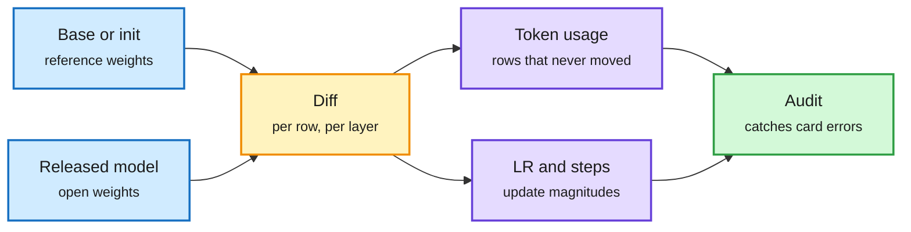

# Weight forensics: what the checkpoint says about how it was trained

**TL;DR.** Alapan Chaudhuri lays out how much of a model's training history can be recovered from open weights alone: which tokens appeared in the data, the learning-rate schedule and the number of steps. With the training data in hand you can go further: the step at which most documents were seen, the shuffle seed, the context window and the number of passes. The examples are checkable against public configs:

- **OLMo 2's first instruct release** had 20,341 embedding rows that never moved, including the token that closes every chat-turn marker. AI2 later traced it to a tokenizer mismatch and retrained.
- **Pythia-1B** trained at a peak learning rate of 2.5e-4, not the 3.0e-4 on its model card. The training config agrees with the weights.
- **Pythia's schedule** sat flat for its last 28,000 steps: a cosine aimed at zero, clipped at a tenth of the peak. That is not the scheduler in today's gpt-neox.
- **Qwen2.5's instruct tuning** touched exactly 4 of its 22 control tokens, the same four at 7B, 14B, 32B and 72B.

Untouched rows and update sizes are a training log

Compare a checkpoint to its init or its base model and the training process shows through.

Blue is the two checkpoints, amber is the comparison, purple is what it reveals, green is the use.

## Why it matters

- A cheap audit for open-weight releases. Model cards can be wrong. The weights record what training actually touched.
- For distillation and quantization work, untouched embedding rows are dead weight a compressor can drop, and a broken special token is a silent bug a benchmark may never surface.

## Links

- Thread: https://x.com/alapanchaudhuri/status/2121439269772492848
- Raw: `raw/twitter/feed/` (11-15 captures)
- Concepts: [responsible-ai](../responsible-ai/responsible-ai.md)
