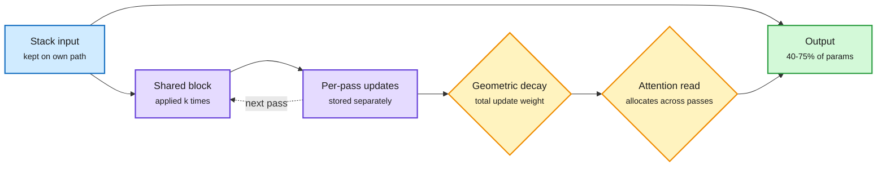

# Qwen4-Max (2.4T total, 71B active) and the Loopback Transformer (2611.07226)

**Sources:** [The Decoder on Qwen4-Max](https://the-decoder.com/alibabas-qwen4-max-takes-on-opus-5-5-gpt-6-and-kimi-k3-1-pro-at-much-lower-prices/) (2026-11-16) · [WorldofAI hands-on video](https://youtube.com/watch?v=5vPXJiy83Sg) · [arXiv:2611.07226](https://arxiv.org/abs/2611.07226) (HF Daily Papers 2026-11-16) · raw: `raw/rss/2026-11-16-the-decoder-alibaba-s-qwen4-max-takes-on-opus-5-5-gpt-6-and-kimi-k3.md`, `raw/huggingface/2026-11-16-loopback-transformer-towards-a-unified-view-of-residual-loop.md`

## Qwen4-Max

Alibaba's new flagship has 2.4 trillion parameters and activates 71 billion per token (a sparse MoE, mixture-of-experts: each token is routed through a small subset of expert sub-networks). A hybrid architecture (attention mixed with cheaper linear or recurrent layers) is what The Decoder credits for sharply lower long-context cost. It lands just behind Kimi K3.1 Pro on the Artificial Analysis Intelligence Index, is priced well below Opus 5.5 and GPT-6, and debuted at #14 on Agent Arena on 11-16. Alibaba says smaller Qwen4 models will be open-sourced. The lab watcher's Qwen feed timed out this run, so no model card was captured; parameter and pricing figures come from The Decoder.

*Why it matters for efficiency:* the active ratio is about 3% (71B of 2.4T). That is sparser than DeepSeek-V3's 37B of 671B (about 5.5%). Serving cost is set by active parameters and KV cache; memory footprint by total parameters. A 2.4T model needs multi-node serving even at FP4, so it pushes the capacity problem onto HBM and interconnect.

## Loopback Transformer

Looped transformers reuse one shared block several times to save parameters. This paper asks a narrower question: after each pass, what gets stored and how do later reads weight it? A standard residual stores the full block output, which already contains its input, so reweighting an output also reweights all earlier history. Loopback instead stores each pass's **update** separately and keeps the shared stack's input on its own path. That gives three separate knobs: input strength, total update weight, and how weight is spread across passes. Geometric decay sets the total and adds a recency prior; attention learns the allocation. On ClimbMix it reaches lower validation loss than standard Transformers using 40-75% of their non-embedding parameters at 191M to 3B, at matched training tokens and executed depth, and wins a 13-task average at 1.4B and 3B. It also beats seven other looped residual designs at 191M-778M.

Store the updates, not the sums

Keeping each pass's update separate lets the model weight history without double counting.

Blue is input, purple is the looped computation, amber is a weighting control, green is the result.

## How this relates to prior wiki pages

- **Looped transformers** ([concept page](looped-transformers.md)): the page's standing caution is that matched FLOPs is not matched wall-clock, and that a looped model needing a larger KV cache is not a drop-in. Loopback matches executed depth, so its parameter saving does not reduce compute per token, and its stored per-pass updates are extra activation memory. Serving latency is not reported, the same gap SMELT left open.
- **Qwen4-Max** continues the 2026 pattern of hybrid attention in frontier MoEs (Raschka's 11-16 essay noted the trend toward less RoPE and partial attention). See [attention mechanisms](attention-mechanisms.md).
