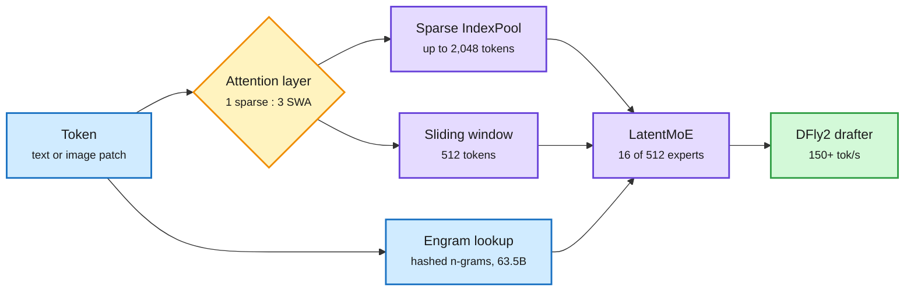

# Open models of the day: Tencent Hy4 flash and MBZUAI K2-Horizon

**Sources:** [tencent/Hy4-flash](https://huggingface.co/tencent/Hy4-flash) (model card, 2026-11-17) · [K2-Horizon, arXiv:2611.21003](https://arxiv.org/abs/2611.21003) · AI Weekly Espresso (Gmail, 2026-11-17) · raw: `raw/labs/2026-11-18-103604-labs.md`, `raw/huggingface/2026-11-17-k2-horizon-a-frontier-fleet-of-open-source-language-models.md`

## TL;DR

Two open-weight releases, both built around cost.

**Hy4 flash (Tencent)** is a 220B-total MoE with ~11.3B text parameters active per token, 1M context and text+image input. Of the 220B, 63.5B are **Engram** parameters: learned bigram and trigram embeddings looked up by hashing at four backbone layers, a form of conditional memory that adds capacity without adding active compute. Three architecture moves cut cost: **hybrid attention** (sparse IndexPool layers interleaved with 512-token sliding-window layers 1:3, sparse layers selecting up to 2,048 tokens by group, all in MLA), **LatentMoE** (16 of 512 routed experts per token, operating in a 1,536-dim latent space) and Engram. Tencent says the KV cache is **1/24 of Hy3 and 1/6 of Hy4**. RL cut average output tokens 50%. Megakernels, 4-bit quantization and a built-in 0.85B 5-layer drafter (DFly2) push decode past 150 tokens/s. On Tencent's internal WorkIndex it scores 42.1 vs Hy4 preview's 39.7 at **1/13 the cost per task** (1/20 of Hy4). FP8 and GGUF variants shipped.

**K2-Horizon (MBZUAI)** is six fully open models from 0.9B dense to a 375B-A23B MoE, released with every intermediate checkpoint, about 10T synthetic pretraining tokens, logs and pipelines (LLM360 definition of open). Two attention ideas: **Mixture-of-Value Attention** (MoE applied to the value projections) and **softplus attention gating**. Its 36B-A4B nearly matches a 32B dense model trained on the same data with one-seventh the active parameters. **Uno** diffusion adapters give up to 2.2x lossless decoding without a separate draft model.

Hy4 flash spends parameters where they cost no compute

Engram tables and latent experts add capacity; hybrid attention removes most of the KV cache.

Blue is input or lookup memory, amber is the layer-type choice, purple is compute, green is the serving path.

## Relation to prior pages

- **Engram-style n-gram memory is now in a third major release.** See [conditional memory embeddings](../inference-efficiency/conditional-memory-embeddings.md); Qwen3.8-Flash-Next also carries a PLE n-gram embedding ([NVFP4 QAD summary](../inference-efficiency/2026-11-18-qwen38-nvfp4-qad-checkpoint.md)).
- **Hybrid sparse + SWA attention follows NVIDIA's same-day indexer rules** ([summary](../inference-efficiency/2026-11-18-nvidia-sparse-attention-indexer-codesign.md)): group-level selection and a minority of sparse layers keep the indexer cheap.
- **Uno** first appeared on [speculative decoding](../inference-efficiency/speculative-decoding.md) on 09-07 as lossless diffusion sampling; K2-Horizon ships it as a product feature.
- **"RL cut output tokens 50%"** joins the pattern of labs reporting token efficiency as a headline number (OpenAI's 6.2 launch, Fireworks' Ember-1 with 40% fewer reasoning tokens in the [Pragmatic Engineer piece](../ai-routing/2026-11-18-routing-goes-cache-aware-and-open-weight.md)).

## Gaps

- WorkIndex is Tencent-internal; no public benchmark backs the 1/13 cost claim.
- K2-Horizon's MoVA comparison is same-data, but the abstract gives no wall-clock serving cost for value-side MoE.
