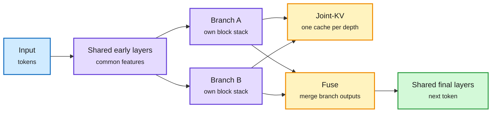

# Multi-Branch Transformer with Joint-KV (2611.19800), plus TPHC (2611.23026)

**TL;DR.** Transformers usually scale by getting wider or deeper. MBT adds a third axis: branching. The input goes through shared early layers, then through several independently parameterized stacks of blocks in parallel, which are fused before shared final layers. At matched parameters and training compute (MoE models from 0.8B to 2.1B total parameters), two-branch Wide-Shallow MBTs beat sequential Transformers, and Balanced MBTs do better still. For inference, Joint-KV builds one shared KV cache from the branch representations at each depth. Fitted scaling curves say a standard Transformer needs up to 1.26x the training compute to match the final model's loss. The final models store up to 34% less KV cache and decode up to 51.4% faster on a single H200.

Parallel branches can share one cache

Branching buys quality; Joint-KV makes sure it does not multiply the cache.

Blue is input, purple the compute stacks, amber the two merge points (cache and output), green the result.

## Key findings

- **Branching is not just width or depth in disguise.** Ablations show gains beyond matched width/depth changes, robustness to the fusion function, and best placement of branches in the middle layers.
- **Balanced MBTs keep quality as branch count grows**, which is what makes Joint-KV pay: more branches, same shared cache.
- **The inference engine matters**: the throughput numbers rely on branch grouping and shared-cache reuse in a custom engine.
- **TPHC (2611.23026)** attacks a neighboring problem. Hyper-Connections widen the residual stream into N parallel streams; manifold-constrained HC (mHC) stabilizes them but gains little beyond four streams because each sublayer writes one output to all streams. TPHC maps each tensor-parallel shard to its own mixture of streams and keeps shard outputs separate on write-back. No extra FLOPs in attention or FFN. Training cost: +9% over mHC at 4 streams on 8B, +19% going from 4 to 16 streams. On 1.1B / 100B tokens: validation loss down 0.7-1.0%, zero-shot accuracy up 0.3-0.7 points.

## How it relates to prior wiki pages

- **KV cache sharing as an architectural choice** continues the [11-12 cross-layer sharing as a regularizer](../inference-efficiency/kv-cache.md) thread: there, sharing KV across layers cost little quality; here, sharing KV across parallel branches lets a quality-improving topology avoid a cache penalty.
- **Same direction as [Hy4 flash (11-18)](2026-11-18-hy4-flash-k2-horizon-open-models.md)**, which cut KV to 1/24 of its predecessor with hybrid sparse/sliding-window attention: architecture papers now report KV bytes as a headline metric, next to loss.
- Concept pages: [kv-cache](../inference-efficiency/kv-cache.md), [attention-mechanisms](attention-mechanisms.md), [scaling-laws](scaling-laws.md).

## Gaps

MBT is tested only up to 2.1B total parameters; the 1.26x compute claim is extrapolated from fitted curves. The 51.4% throughput number is single-GPU and engine-specific. TPHC is shown at 1.1B quality and 8B cost only.

**Raw sources:** [MBT](../../raw/huggingface/2026-11-18-multi-branch-transformer.md) · [TPHC](../../raw/huggingface/2026-11-18-tphc-improving-hyper-connections-with-tensor-parallel-groupe.md) · [arXiv MBT](https://arxiv.org/abs/2611.19800) · [arXiv TPHC](https://arxiv.org/abs/2611.23026)
