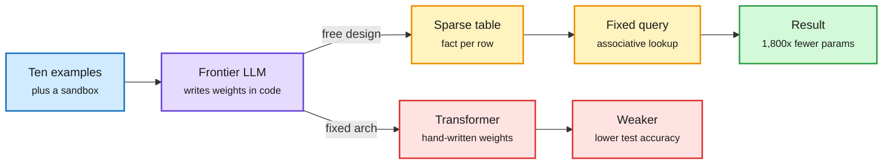

# Weight-space programming becomes a field (2026-11-18)

**TL;DR.** Weight-space programming (WSP) means an LLM writes, reads or edits another network's weights directly, with no gradient descent. Three new papers plus a viral Microsoft thread turn it from a curiosity into a research area with a benchmark.

- **Weight-Space Programming Doesn't Need Transformers (2611.22055, 51 HF upvotes).** Transformers were chosen because they train well with gradients and run fast on GPUs. If an LLM writes the weights by hand, neither reason applies. Given ten labeled examples and a sandbox (mostly multiple-choice questions), three frontier LLMs free to design the architecture all compile plain-text facts into a **sparse table queried by a fixed procedure**, reaching up to 54.4% test accuracy. An LLM-designed model beats the best Transformer the same LLM wrote while using about **1,800x fewer parameters**. Tables are editable: each wrong answer points to one row, and removing a row changes about one other answer. The authors derive an associative-memory model up to **17x faster on GPUs** than a same-sized Transformer. Pretrained LLMs remain more accurate; the claim is about what to build when writing weights.
- **WeightBench (2611.18553).** 42 tasks across five tracks: reading, fixing and writing weights, recognizing impossible edits, and data-free compression, on networks from 2K-parameter control policies to 7B LLMs. Frontier agents can read small networks and write working control policies without running them, but cannot yet patch LLMs, compress them without data, or tell an impossible edit from a hard one. Macro scores: Claude Opus 5.5 0.535, Sonnet 5.5 0.466, Haiku 5.5 0.402, DeepSeek v4-flash 0.215; on 38 tasks GPT-6.1-sol 0.568 vs Opus 0.546.
- **Language Models Can Rewrite Their Own Weights (2611.21885, via X).** A 27B open model (Qwen3.5) diagnoses its errors, reads its internal state and rewrites its own weights without gradients, improving on unseen tasks. Hype-wrapped on X ("killed backpropagation"); the paper's claim is narrower.
- **Interpretable WSP (Microsoft, Johns Hopkins, Columbia, NYU; via X).** Writes readable logic into weights as code; amplified with heavy hype, no primary text captured.

Without gradients, the LLM picks a lookup table

Freed from trainability, the designer chooses structure it can explain and edit.

Blue is the input, purple the LLM designer, amber the structure it chooses, green the result, red the Transformer path it rejects.

## How it relates to prior wiki pages

- **N-of-a-kind, now four:** the [11-17 digest](../daily-digest/2026-11/2026-11-17.md) covered the first WSP paper (2611.18114, Opus 5.5 wrote Transformer weights in code; all 26 algorithmic runs hit 100% held-out accuracy at a median 166 parameters) and Kurate cs.AI #10 this week is another WSP paper on unseen games. Today adds the benchmark, the architecture question and self-editing.
- **Compression intersection:** WeightBench's data-free compression track (agents fail it) and the 1,800x parameter gap make WSP a compression question: a model you can write is a model you can prune row by row. See [model-pruning-sparsity](../inference-efficiency/model-pruning-sparsity.md).
- **Interpretability intersection:** a table whose rows mean something is the strongest form of the "weights you can read" goal on the [responsible-ai](../responsible-ai/responsible-ai.md) page.

## Gaps

Accuracy ceilings are low (54.4%) and pretrained LLMs still win. WeightBench tasks are small. The self-rewrite and iWSP claims are known here only through secondary posts.

**Sources:** [2611.22055](https://arxiv.org/abs/2611.22055) · [2611.18553](https://arxiv.org/abs/2611.18553) · [2611.21885 via arXivBangers](https://arxivb.org/abs/2611.21885) · [WeightBench GitHub](https://github.com/Aayush-Marasini/WeightBench) · [iWSP thread](https://x.com/thesupermannx/status/2123023351035924832) · raw: [HF WSP](../../raw/huggingface/2026-11-18-weight-space-programming-doesn-t-need-transformers.md), [HF WeightBench](../../raw/huggingface/2026-11-18-weightbench-evaluating-language-models-as-weight-space-progr.md)
