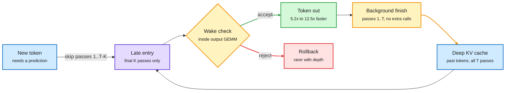

# Late Entry in Looped Language Models (2611.24576)

**TL;DR.** A looped language model runs the same stack of layers T times per token, so it gets depth without extra parameters, but each pass adds sequential latency. The usual speed-up is early exit: stop a token after a few passes. That leaves its cached keys and values (the KV cache) shallow, which hurts every later token. This paper does the opposite. New tokens skip the first passes and enter only the last K of T passes, reading a context cache that was built at full depth. After a light fine-tune fixes a hidden-state norm mismatch at the entry point, deep cached context substitutes for the skipped passes. To avoid stalling while the deep cache is built, committed tokens finish their remaining passes in the background alongside later steps, and "Wake verification" checks candidate blocks inside the existing output GEMM. One tolerance knob, tau, spans greedy-exact decoding (tau = 0) to lossy no-rollback decoding (tau = infinity), all in one static CUDA graph.

Skip the early passes, not the late ones

The context cache stays deep; only the new token takes a shortcut.

Blue is input and cache, purple is the shortened compute, amber is verification and background completion, green is output, red is rollback.

## Key findings
- Ouro-2.6B (T = 4), K = 2: 5.2x greedy-exact speed-up (+26% over K = 4 block decoding on GSM8K) and 6.8x at tau = infinity, +16.9 points over trained early exit at matched speed.
- Huginn-3.5B, T from 8 to 64: rollbacks at K = T/4 fall 21.5x with depth. Greedy-exact speed-ups reach 6.1x (T = 32) and 8.4x (T = 64); lossy speed-ups 10.6x to 12.5x.
- The deeper the loop, the better late entry works, because the cache carries more of the computation.

## Relation to prior wiki pages
- **Competes with** [LoopFill (11-18)](../inference-efficiency/2026-11-18-looped-and-speculative-decoding-shorts.md), which gave looped models 5.85x exact speculative decoding on the same Ouro-2.6B. Late entry reaches 5.2x exact at T = 4 and scales further with depth; the two have not been compared head to head.
- **Opposite bet to** Dory (11-05, last-loop-only KV) and [LoopVQ (11-06)](../inference-efficiency/2026-11-06-loopvq-and-multi-layer-indexer.md), which shrink the loop-axis KV. Late entry needs the full-depth cache, so it spends memory to save latency.
- Fills the latency gap the [looped transformers page](looped-transformers.md) has tracked since June.

## Gaps
- Only up to 3.5B. KV memory cost of keeping full-depth caches is not reported against compressed-loop-KV methods.

## Sources
- [Paper](https://arxiv.org/abs/2611.24576) · raw: `raw/huggingface/2026-11-19-late-entry-in-looped-language-models.md`

Concept pages: [looped transformers](looped-transformers.md) · [speculative decoding](../inference-efficiency/speculative-decoding.md) · [KV cache](../inference-efficiency/kv-cache.md)
