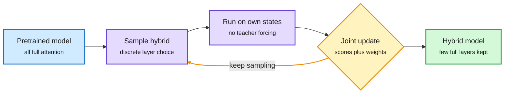

# FlashMorph2: On-Policy Morphing into Hybrid Attention Models (2611.24809)

**TL;DR.** A hybrid attention model keeps full attention in a few layers and uses linear attention (a fixed-size running state instead of a growing KV cache) everywhere else. Converting a pretrained Transformer into one means choosing which layers keep full attention under a budget. FlashMorph, the prior method, scored layers off-policy: it blended the full and linear branches continuously, used teacher-forced hidden states, and froze the weights. But the real hybrid is discrete, runs on its own hidden states, and gets fine-tuned afterwards. FlashMorph2 samples discrete hybrid architectures and evaluates them end to end on their own activations, and it learns the layer-selection scores jointly with the weights under the recovery objective. On Qwen3 models from 0.6B to 8B it beats FlashMorph by +2.42 on RULER, +1.08 on LongBench and +0.76 on recall-heavy tasks, and layer selection costs only 0.72-3.57 GPU-hours.

Pick the full-attention layers the way the model will actually run

Sample real hybrids and score them after adaptation, not as soft blends of a frozen model.

Blue is the starting model, purple is the on-policy evaluation, amber is the joint selection loop, green is the result.

## Relation to prior wiki pages
- **On-policy wins again.** The [knowledge distillation page](../inference-efficiency/knowledge-distillation.md) has tracked for months that training on the student's own outputs beats teacher forcing. FlashMorph2 applies the same lesson to architecture search: evaluate the hybrid on its own hidden states.
- **Extends** "Rethinking efficient attention for hybrids" (06-17) and the massive-activations hybrid paper (08-14), which both found that which layers keep full attention matters more than how many.
- Every converted layer removes a growing KV cache, so this is a KV-memory lever as much as an architecture one ([KV cache](../inference-efficiency/kv-cache.md)).

## Gaps
- Tested up to 8B. The interesting conversions are 70B+ and MoE models, where layer roles differ.
- Throughput and memory numbers for the converted models are not in the abstract.

## Sources
- [Paper](https://arxiv.org/abs/2611.24809) · raw: `raw/huggingface/2026-11-20-on-policy-morphing-into-hybrid-attention-models.md`

Concept pages: [attention mechanisms](attention-mechanisms.md)
