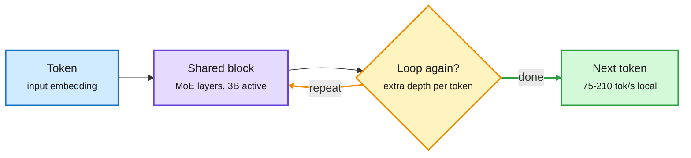

# Inkling 2 Mini: a looped MoE that runs on a laptop (Thinking Machines)

**Sources:** [@thinkymachines via @Thom_Wolf](https://x.com/Thom_Wolf/status/2123910558705717327) · [@miramurati via @Miles_Brundage](https://x.com/Miles_Brundage/status/2123872887681785873) · [@soumithchintala](https://x.com/soumithchintala/status/2123878334895436115) · [@exolabs via Soumith](https://x.com/soumithchintala/status/2123976002338427043) · [@arena](https://x.com/arena/status/2123914021883756728) · LinkedIn (Thinking Machines Lab post) · raw: `raw/twitter/feed/2026-11-21-morning-ranked.json` (private, gitignored)

**TL;DR.** Two weeks after Inkling 2 Small (594B total, 17B active, trained in NVFP4), Thinking Machines released Inkling 2 Mini. It is a looped transformer MoE (mixture-of-experts, where each token uses a few expert sub-networks) with about 26-27B total parameters and 3B active. "Looped" means the same block of layers runs several times per token, so the model gets extra depth without extra weights. In Mira Murati's words, looping lets a model "think more and write less." It fits on a 32GB-memory machine. Soumith Chintala reports evals roughly matching Qwen 3.8 27B and about 75 tokens/s decode on a DGX Spark. Exo Labs reports 210 tokens/s decode and 3,620 tokens/s prefill on a 96GB M5 Mac. It is live on Prime Inference and in Arena (Agent, Code and Text).

Depth from repetition, not from parameters

A small set of shared layers runs several times; only 3B parameters are active per pass.

Blue is input, purple is the shared expert block, amber is the loop, green is the output.

## Why it matters
- **Memory, not FLOPs, is the local bottleneck.** On unified-memory boxes, decode speed tracks bytes read per token. Looping reuses the same weights, so extra compute costs no extra memory traffic for weights. A 3B-active, 27B-total model reads few bytes per pass.
- **First frontier-lab looped model aimed at laptops.** Looped models have been a research thread (Ouro, Huginn); this is the first one shipped by a frontier lab for local use.

## Relation to prior wiki pages
- **Same family as Late Entry (11-20)**, which showed looped models can skip early passes on new tokens and read a full-depth KV cache for 5-12x faster decoding ([summary](2026-11-20-late-entry-looped-lms.md)). If Inkling 2 Mini's loop count is fixed per token, Late Entry is the obvious next speedup.
- **Follows Inkling 2 Small (11-06)** ([summary](2026-11-06-inkling-2-small-and-open-moe-wave.md)), which was too big for local use. Mini answers that complaint directly.
- Tracked on the [looped transformers page](looped-transformers.md).

## Gaps
- No technical report in the window: loop count, whether looping is adaptive per token, KV layout across loops, and license are not confirmed.
- Speed numbers are community reports on different hardware, not a controlled benchmark.
