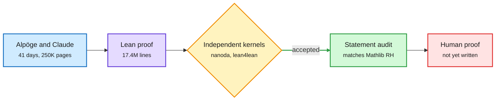

# The Riemann Hypothesis claim: Claude, Levent Alpöge, and a 17-million-line Lean proof

**Sources:** [Alpöge's note](https://alpo.ge/remark.pdf) · [Quantum Zeitgeist explainer](https://quantumzeitgeist.substack.com/p/anthropic-mathematician-claims-proof) · [The Information](https://www.theinformation.com/briefings/anthropic-mathematician-says-proved-riemann-hypothesis) · [Simon Willison](https://simonwillison.net/2026/Nov/20/levent-alpoge/) · [unpacked Lean (Tomodovodoo)](https://github.com/Tomodovodoo/Riemann) · [kernel-check update](https://x.com/atulit_gaur/status/2124028966373916967) · [Ravi Vakil on Masullo's human GRH draft](https://math216.wordpress.com/2026/11/20/hurried-announcement-alessandro-masullo-grh/) · raw: `raw/gmail/2026-11-21-newsletters.md` (private), `raw/rss/2026-11-20-simon-willison-quoting-levent-alp-ge.md`

**TL;DR.** On 11-20 Levent Alpöge, a number theorist at Anthropic, posted a four-page note: "I believe I have, working with Claude, discovered a proof of the Riemann Hypothesis." He says the method also proves the Generalized RH for Dirichlet L-functions. The proof is not a paper. It is a Lean formalization (Lean is a proof assistant in which a computer checks every logical step), shipped as 14 archives: about 175,000 modules and 17.4M lines. The sketched route extends Stepanov's method, which proved the function-field analogue by building an auxiliary function that vanishes to high multiplicity at many points. The missing ingredient over the integers was that multiplicity. The note says long chains of theta lifts supply it, about √X lifts for a prime sum of length X, a length Claude suggested. The work took 41 days and produced over 250,000 pages of material. By the US evening, MIT's Andrew Sutherland had exported the proof and run independently written kernels: nanoda (Rust) accepted it in about 28 minutes, con-leche accepted all 1.47M declarations and matched the five headline theorems against Mathlib-only statements, lean4lean passed all 175,187 modules, and Lean's own kernel replay had zero rejections. Two slower checks were still running. No human-readable proof exists yet. Hours later, Ravi Vakil announced an unrelated all-human GRH draft by Alessandro Masullo.

Verification moved from people to kernels

Independent checkers agree the code compiles; understanding why it is true is still open.

Blue is the work, purple is the artifact, amber is machine checking, green is what has passed, red is what is still missing.

## What has and has not been shown
- **Shown (per community checks):** the code compiles under several independent kernels, has no `sorry` placeholders, and its top statements match Mathlib's definitions. A shared Lean bug would have to affect every checker.
- **Not yet shown:** a readable argument; the remaining slow checks; acceptance by number theorists. The Clay prize needs publication and two years of review.
- **Skeptic points:** the note calls Claude's prose writeup a "massive unreadable travesty of slop"; Timnit Gebru relayed mathematician Arturo Magidin's view that a giant Lean dump is "an Oracle saying yes and no"; Gary Marcus asked what system (harness, tools, symbolic provers) was actually used.

## Relation to prior wiki pages
- **Extends the "models help do frontier research" thread** from 11-19 (OpenAI's research-acceleration post: zero-intervention success on 2-4 hour internal research tasks rose from 23% to 46%) and DeepMind's AlphaProof Code verifying Signal's protocol in four weeks. Formal verification is the common thread: the claims that land are the ones a machine can check.
- **Tension with the Resolution Hypothesis (11-20)**, which argued that self-improving agents stall because evaluation cannot tell real improvements from noise. Mathematics is the one domain with a perfect evaluator, and it is where the biggest claim landed. That fits the hypothesis rather than refuting it.

## Gaps
- No description of the system: model version, harness, tool use, compute.
- Readable proof promised later.
