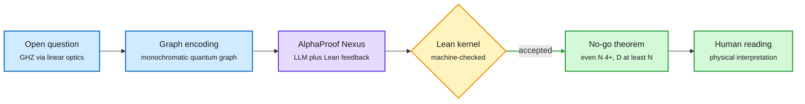

# Formal proof search leaves pure math: AlphaProof Nexus settles a quantum-optics question, and the Riemann claim on day two (2611.26300)

**TL;DR.** Tübingen and Google DeepMind used AlphaProof Nexus (formal proof search in Lean that combines frontier LLMs with Lean compiler feedback) to settle a quantum-optics question the authors first posed in 2017. Can high-dimensional GHZ states (a kind of maximally entangled multi-photon state) be built with only linear optics and probabilistic pair sources? In the graph picture of these experiments, building an N-photon, D-dimensional GHZ state equals building a "monochromatic quantum graph". The answer is no for every even N of 4 or more when D is at least N. The machine-found proof builds a weighted sum of amplitudes whose coefficients factor vertex by vertex, which reduces the problem to an (N-1) by N matrix of effective edge weights. The authors then extracted the physical meaning by hand. Separately, the Riemann Hypothesis claim (11-20, Levent Alpöge with Claude, a 17M-line Lean proof) moved into its second day: the Lean FRO and Mathlib Initiative issued a joint statement on its verification, Drew Sutherland's MIT page reports independent kernel checks, Alpöge and NYU's Tristan Buckmaster posted an AI-aided proof of finite-time blowup for the unforced 3D Navier-Stokes equations, and a rival all-human GRH draft by Alessandro Masullo (reviewed for months by Brian Conrad) circulated, with Ravi Vakil later noting AI-assisted checks found problems in it.

The machine finds the proof, people find the meaning

Lean makes the result checkable; interpretation is still human work.

Blue is the problem, purple the search system, amber the Lean check, green the result and its reading.

## How it relates to prior wiki pages

- **Extends** the [Riemann claim summary (11-21)](2026-11-21-riemann-hypothesis-claude-lean-proof.md): the pattern is now "formal checking gives the result, humans supply insight", and it has crossed from number theory into physics in the same week.
- **Answers part of** the Gary Marcus critique circulating this window ("we've learned almost nothing mathematically"): the GHZ paper shows a short enough machine proof can be read and explained. The 17M-line RH proof has not reached that stage.
- **Verification thread:** the 11-21 Global View argued verification is the bottleneck in research, safety and finance at once. Lean kernels are the one verifier the field fully trusts.

**Sources:** [arXiv 2611.26300](https://arxiv.org/abs/2611.26300) · [DAIR Academy](https://academy.dair.ai/papers/) via [@dair_ai](https://x.com/dair_ai/status/2124187341141283117) · [MIT GRH verification page](https://math.mit.edu/~drew/grh/) · [The Decoder on the rival human draft](https://the-decoder.com/hours-after-anthropic-claims-a-claude-proof-of-the-riemann-hypothesis-stanford-releases-an-all-human-competing-draft/) · [Algorithmic Bridge](https://www.thealgorithmicbridge.com/p/ai-just-cracked-the-hardest-problem). Raw: `raw/twitter/feed/`, `raw/rss/2026-11-21-*`.
