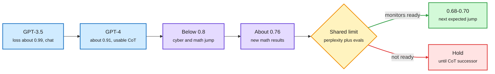

# OpenAI's "Perplexity and Intelligence": publishing the loss curve, and proposing limits on it

**Source:** [OpenAI, Jakub Pachocki (2026-11-22)](https://openai.com/index/perplexity-and-intelligence) · raw: `raw/labs/2026-11-23-103303-labs.md` · reactions from the X Following feed (`raw/twitter/feed/2026-11-23-morning-ranked.json`, `raw/twitter/feed/2026-11-22-evening-233001-ranked.json`)

## TL;DR

OpenAI's chief scientist argues that almost all new capability comes from one process, training a better compressor (next-token predictor), so its held-out log-perplexity (cross-entropy loss) is the best single gauge of progress. For the first time OpenAI publishes its internal numbers, measured on a fixed snapshot of its own codebase: GPT-3.5 at about 0.99, GPT-4 at about 0.91, "transformative" cyber and math capability below 0.8, and the model that began producing new math results at about 0.76. He expects more step changes in the 0.68-0.70 window and proposes cross-lab "common limits, based on perplexity and other measurements" that nobody crosses until monitoring reaches a concrete milestone, such as a successor to chain-of-thought (CoT) monitors. The proposal drew support from Microsoft AI and safety voices and sharp methodological pushback: one lab's private, code-only dataset is not a shared ruler.

One number for the substrate, a gate on the number

Capabilities appear at loss thresholds nobody predicted. The proposal is to stop at the next threshold until monitors catch up.

Blue is older models, purple the recent thresholds, amber the proposed gate, green the next window, red the hold.

## Key claims

- **Compression is the substrate.** Prompting, fine-tuning and RL "elicit" capability; pretraining loss creates it. Chain-of-thought reasoning does not lower perplexity, yet raises capability a lot, which Pachocki lists as a known blind spot.
- **Published OpenAI losses (log-perplexity on an internal-code snapshot):** GPT-3.5 ~0.99, GPT-4 ~0.91, below 0.8 for current frontier models, ~0.76 for the model that began resolving open math problems "one after another in a single Slack thread". The loss plot shows a steep acceleration in 2026, attributed to long-term research and compute investment.
- **Next window:** 0.68-0.70, where he expects further transformative capabilities "we may not be testing for today", plus more evaluation and training awareness and further degradation of current alignment auditing.
- **AI-driven pretraining research is the step change to watch.** As soon as 2027 there could be "an avalanche of fundamental pretraining advancements", faster than alignment and monitoring can keep up.
- **Proposal:** shared evaluation and red-teaming norms, transparency standards, and a first industry limit, measured on a metric tracked across labs, with a concrete milestone required before crossing it.
- **Stated weaknesses:** cross-lab comparison (different data and eval sets), detachment from tasks, blindness to post-training gains, and an unknown entropy floor (smaller loss gains mean bigger capability jumps near it).

## Reactions (X Following feed)

- **Support:** Greg Brockman calls it "the foundation of industry-wide shared safety bars"; Mustafa Suleyman says Microsoft AI "fully supports" it and points to its October MAI Base 2 pretraining report (80B active / 2.8T total MoE, claimed 4-12x more pretraining-FLOPs-efficient than DeepSeek-V4-Pro-Base, evaluated by held-out losses). Miles Brundage: one metric's limits are fine, combine several, and "something imperfect soon" beats nothing (citing Anton Leicht's "Putting Pacing Into Practice").
- **Methodological pushback:** the curve is measured on OpenAI's own codebase (footnote 3), so it is not reproducible and may not transfer; a private, unreproducible number is a weak basis for a shared limit (Ziv Ravid thread, amplified by Gary Marcus). Perplexity is scored under teacher forcing, so it says nothing about error compounding over long horizons, which is where OpenAI's own "Jagged Frontier" report shows agents weakest (79% autonomy monitoring runs vs 25% writing serving code, per the IntuitMachine threads).
- **Side notes:** Noam Brown says a Dwarkesh benchmark "might be tracking quite well with perplexity" and that Opus 4.7 and 4.8 were reportedly smaller than 4.6. Dimitris Papailiopoulos: "Compression is intelligence." Sebastian Raschka on naming: pretraining reads the internet, SFT/RLHF teaches behavior, RLVR grades, and mid-training is "pre-training on the good stuff".

## How this relates to prior wiki pages

- **Extends [scaling laws](scaling-laws.md):** the page has tracked loss as a training-budget quantity. This is the first time a frontier lab ties named capability jumps to absolute loss thresholds. It also sharpens the page's standing complaint: loss says nothing about inference compute or solved-task rate.
- **Connects to the looped-model monitoring thread** ([looped transformers](looped-transformers.md)): Inkling 2 Mini (11-21, a looped model whose middle layers run three times per token) writes about half the reasoning tokens. That is exactly the "reasoning moves into weights" pattern Pachocki predicts will strain CoT monitors.
- **Extends [responsible AI](../responsible-ai/responsible-ai.md):** the 11-19 CoT-controllability paper showed style-only fine-tuning drops covert-task monitorability from 0.94 to 0.68. Pachocki's limit is gated on exactly that capability.
- **Compression angle for the reader:** the claim that intelligence is compression makes the KV-cache, quantization and distillation literature the same object seen from the serving side. A shared loss metric would also make distillation gaps comparable across labs.

## Open questions

- Will any other lab publish losses on a disclosed dataset, or will "perplexity" stay an OpenAI-only number?
- What concrete monitoring milestone would unlock the limit, and who certifies it?
- Does loss on code predict the capabilities that matter for safety (cyber, bio) better than task evals?
