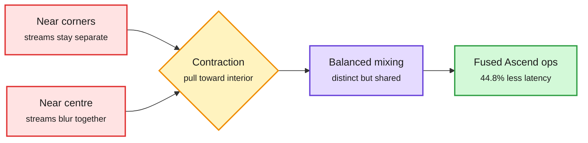

# cmHC and DCA: the residual stream becomes a routing problem

## TL;DR

**cmHC (2611.27193)** is the day's top Hugging Face paper. Hyper-connections widen the residual stream (the "skip" path that carries each layer's input forward) into several parallel streams mixed by learned matrices. Manifold-constrained hyper-connections (mHC) keep training stable by forcing those mixing matrices to be doubly stochastic (rows and columns each sum to one, the "Birkhoff polytope"). cmHC finds a trade-off inside that constraint. If the matrices sit near the polytope's corners (close to permutations), streams barely mix and act like independent copies. If they sit near the centre (uniform averaging), streams blur together. cmHC **contracts the polytope toward its interior** so matrices must mix more, with a provable bound and no new parameters. It applies only moderate contraction in shallow layers, where over-mixing is the risk. Tested on dense and MoE models at several scales. The authors also wrote fused operators for Huawei Ascend NPUs that cut hyper-connection latency by up to 44.8%.

**DeepCrossAttention (Google Research blog, 11-23)** popularises Google's ICML 2025 DCA paper and places it in the same family. DCA gives each layer learned, input-dependent weights over all previous layers' outputs plus a depth-wise cross-attention (split Q/K/V across layers). Google reports standard-transformer quality in up to 5x fewer training steps on C4/LM1B, a 30-layer DCA model beating a 42-layer baseline (29% fewer parameters), under 0.2% parameter overhead, and retrofitting onto a pretrained model. The post names Moonshot's attention residuals, hyper-connections and mHC as relatives, and says Thinking Machines' Inkling 2 uses attention residuals plus DCA's split Q/K/V ([Google Research](https://research.google/blog/supercharging-transformer-residual-connections/)).

Mix the streams, but not all the way

cmHC keeps mixing matrices away from both extremes of the doubly stochastic set.

Red is a failure mode, amber is the cmHC constraint, purple is the result, green is the kernel payoff.

## Relation to prior wiki pages

- **Extends** [SimpleHC (11-14)](2026-11-14-foam-simplehc-training-efficiency.md), which made hyper-connections cost only 2.4% overhead. cmHC is about where in the constraint set to mix, not about cost.
- **Same family as** [MHAR (07-31)](2026-07-31-mhar-multi-head-attention-residuals.md), which split attention residuals' single depth query into per-subspace heads.
- **Connects to looping.** Loopback Transformer (11-17) and GLM-5.4's per-token gates (same day) are residual-stream designs too: they decide how much each pass writes. The residual stream is now where architecture work concentrates, per [attention-mechanisms.md](attention-mechanisms.md).
- **Hardware angle.** The Ascend fused-operator result sits next to AscendGYM (Import AI 482, covered 11-19): Chinese labs are writing kernels for every new architecture primitive on domestic NPUs.

## Gaps

cmHC's abstract gives no headline loss or downstream numbers. DCA results are on C4/LM1B at modest scale; Google gives no frontier-scale ablation, and the blog's "3x faster" figure is training steps, not wall-clock.
