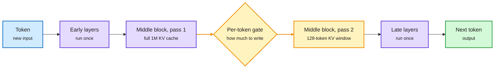

# GLM-5.4, SenseNova-Loop-9B and the looped-flagship week

## TL;DR

Z.ai released GLM-5.4, its first looped transformer and its new flagship. A looped transformer runs a block of weight-shared layers more than once per token, so the model gets more depth without more stored weights. GLM-5.4 is about 750B parameters. It loops 28 middle layers of the GLM-5 base twice, and Z.ai claims it matches 2-3T-parameter models. It was not trained from scratch: it was adapted from the pretrained base through continued training. Per-token gates set how much the first pass writes before the second pass refines it, and the extra loop attends over a 128-token KV window instead of the full 1M-token cache ([The Decoder](https://the-decoder.com/z-ai-follows-openai-into-loop-transformer-territory-with-its-new-750b-flagship-model/), [TheTuringPost](https://x.com/TheTuringPost/status/2124992248207270017)). Benchmarks so far cover only a 30B test model. Weights are not open, and API access currently needs the Coding Plan ([Simon Willison](https://simonwillison.net/2026/Nov/23/glm-54/)).

The same day SenseTime put SenseNova-Loop-9B on Hugging Face: 4 unshared layers at each end and a 24-layer middle block run twice, which gives 56 layer computations from 32 stored layers. A 4-bit AWQ build is about 4.9GB, and context is 512K. In SenseTime's own sweep, code generation kept improving up to four loops while data QA and office tasks peaked at three. They shipped two loops as a cost compromise ([@rohanpaul_ai](https://x.com/rohanpaul_ai/status/2124904314024186073)). Inkling 2 Mini (Thinking Machines, 11-20) entered Arena's Agent Arena Index at #18 among open models and #3 among US open-weight models ([@arena](https://x.com/arena/status/2124981167279546382)).

The second pass gets a short memory, not the whole context

GLM-5.4 reuses its middle layers, but only the first pass reads the full 1M-token cache.

Blue is input, purple is a normal pass, amber is the reused loop and its gate, green is the output.

## Key points

- **Three looped releases in four days.** Inkling 2 Mini (11-20, 26.4B total, 3.4B active, middle 12 of 24 layers run three times), SenseNova-Loop-9B (11-23) and GLM-5.4 (11-23, 750B). The looped design went from research papers to a frontier-scale flagship in about five months.
- **The KV design is the interesting part.** The wiki's 11-22 LoopCache summary found that the hidden cost of looping is memory traffic: each loop keeps its own KV cache, and decoding has to read all of them. GLM-5.4's 128-token window for the extra loop caps that cost at a small constant. It is the same idea in production that LoopCoder-v2 (06-17) used in research, where loops shared KV through gated sliding-window attention.
- **Loop count is task-dependent.** SenseNova's sweep (code improves to 4 loops, office and data QA peak at 3) adds evidence against the wiki's earlier "two loops is optimal" result from LoopCoder-v2 and SMELT. Those papers found two loops optimal at matched budgets. SenseNova shows the best count depends on task when you do not match budgets.
- **Latency is still the weak point.** A day-one user report on GLM-5.4 at High effort measured 1.04M reasoning tokens over 431 minutes on one task, against 70K tokens and 109 minutes for Gemini 4 Neon, plus 529 overload errors ([@superalesha](https://x.com/superalesha/status/2124760699188441227)). One report, single task, but it fits the wiki's open thread: looping saves parameters, not wall-clock time.
- **A deployment thesis.** Zhengyao Jiang argues MoE is a datacenter architecture (huge weights, few active, needs big batches) and looping is a laptop architecture (few weights, more compute, little memory). Local and cloud models may split into different designs ([@zhengyaojiang](https://x.com/zhengyaojiang/status/2124292767274713218)).

## Relation to prior wiki pages

- **Extends** [looped-transformers.md](looped-transformers.md): the page tracked loops as a research axis since June. This is the first frontier-scale closed flagship and the third production looped model.
- **Confirms** the KV-traffic diagnosis in [LoopCache (11-22)](../inference-efficiency/2026-11-22-loopcache-looped-speculative-decoding.md): GLM-5.4 solves it by architecture (a short window) rather than by a serving trick.
- **Connects** to [Inkling 2 Mini (11-21)](2026-11-21-inkling-2-mini-looped-moe.md) and to the monitorability concern in [OpenAI's perplexity post (11-23)](2026-11-23-openai-perplexity-and-intelligence.md): loops move reasoning out of written text.

## Gaps

No paper, no model card, no open weights for GLM-5.4. The 2-3T-class claim rests on a 30B test model. No numbers on decode latency per loop.
