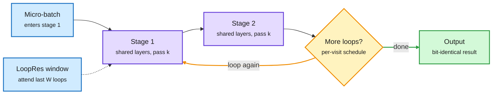

# LoopRes and Loop-PP

## TL;DR

Two papers on the same day fill the two gaps left by last week's looped-model releases. A looped (depth-recurrent) model runs a shared block of layers several times per token, so it gets more depth without more parameters.

- **LoopRes** ([2611.31094](https://arxiv.org/abs/2611.31094)) answers "can you loop a model you already have?" Until now, fine-tuning a pretrained LLM into a loop gave only marginal gains over plain SFT. LoopRes lets each looped layer attend directly to the outputs of earlier loops (building on Attention Residuals). Because those outputs come from the same weights and look alike, each loop gets a trainable **loop-aware key** that tags its identity. Each layer only sees a **residual window of the latest W loops**, which forces every loop to build on the last ones. At 2x compute it lifts Qwen3-1.7B-Base by 29.1% over SFT, more than double the best prior baseline, across 6 models from 3 families up to 30B and 9 benchmarks. From 1.7B to 8B it scales more steeply than SFT as compute grows.
- **Loop-PP** ([2611.30581](https://arxiv.org/abs/2611.30581)) answers "how do you train a big looped model across GPUs?" Standard interleaved 1F1B pipeline schedules assume each micro-batch visits each stage once. In a looped model the same stage is visited several times and later stages feed earlier ones, so 1F1B stalls or fires out of order. Loop-PP schedules each iteration of a stage separately, builds one globally consistent order over those visits, and emits a static instruction stream per rank that separates posting a send from waiting on it, so communication overlaps compute. It is bit-identical to a single-stage reference. On 8B to 60B MoE models it cuts peak memory by up to 32.8% and raises best throughput by 12.7% at fixed compute.

A looped model sends work backwards through the pipeline

Loop-PP adds the back edge that 1F1B lacks and schedules each visit as its own slot.

Blue is input and the LoopRes window, purple are the shared stages, amber is the loop decision and back edge, green is the output.

## Relation to prior wiki pages

- **Extends** [GLM-5.4 and the looped-flagship week (11-24)](2026-11-24-glm-5-4-and-looped-flagships.md). GLM-5.4 was adapted from a non-looped GLM-5 base by continued training, which is exactly the "loop a pretrained model" problem LoopRes targets with a cheap fine-tune instead. LoopRes's "latest W loops" window is a residual-stream cousin of GLM-5.4's 128-token KV window for the extra pass: both bound what a later loop reads.
- **Fills a systems gap** on [looped-transformers.md](looped-transformers.md). The page tracked three decoding papers for loops (LoopFill 11-18, Late Entry 11-20, LoopCache 11-22) and no training-systems paper. Loop-PP is the first.
- **Relates to** [cmHC and DCA (11-24)](2026-11-24-cmhc-and-dca-residual-routing.md): another paper where how the residual stream mixes earlier outputs is the lever.

## Open questions

- LoopRes reports gains at 2x compute. Does it also hold at matched compute, where prior work (LoopCoder-v2, SMELT) found two loops optimal?
- Loop-PP's 12.7% is "best observed" throughput. What is the gap to a non-looped model of the same effective depth?
