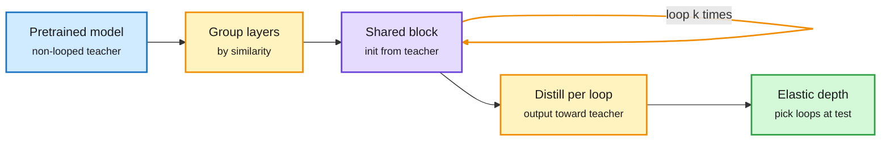

# Loops leave language

**TL;DR.** Three papers in one HuggingFace list take the looped-transformer idea (reuse one block of shared weights several times along depth, so depth costs compute but not parameters) out of language models. All three convert or compress rather than pretrain, which is the same shift LoopRes made for LLMs on 11-25.

Store few blocks, run many: the same trade in three new domains

Each paper starts from a pretrained non-looped model or a fixed budget and buys parameters back with repeated depth.

Blue is the starting model, amber are the conversion steps, purple is the shared block, green is the deployable elastic model.

## The three papers

- **LoopedWAM** ([2611.25595](https://arxiv.org/abs/2611.25595)): a world action model (video generation plus robot action prediction) that runs 30 transformer layers while storing only 12 blocks per expert (a shared six-block core). Video and action experts loop to different depths, because visual features are computed once per query while action computation repeats at every sampling step. **Elastic self-distillation** trains one checkpoint across action-depth and sampling-step budgets. 0.58B policy parameters, no robot pretraining: 96.1% LIBERO, 91.9% RoboTwin 2.0, 52.2% RoboCasaGR1, and **7.4x less peak GPU memory than Fast-WAM**. One checkpoint gives 96.0% at 27.6 ms or 95.2% at 24.7 ms on an H100.
- **LoopDVR** ([2611.32067](https://arxiv.org/abs/2611.32067)): converts pretrained ViT dense-recognition models (backbone and decoder) into looped networks. Sharing groups are picked by inter-layer representation dissimilarity, each shared block is initialized from its group's last layer, the final backbone block stays independent for multi-scale features, and a small per-layer **Loop Adapter** keeps depth-specific behavior. Best accuracy-per-parameter trade-offs across dense tasks.
- **Distill to Loop (Dooop)** ([2611.31977](https://arxiv.org/abs/2611.31977)): distills a pretrained diffusion transformer into a looped student initialized from the teacher. Distillation is framed as a **fixed-point iteration toward the teacher**: every loop's output is trained toward the teacher, so each loop is one ODE step in depth and the student runs any loop count at test time. Diffusion's higher-order ODE solvers can then be applied along depth, and **loop guidance** between outputs at different loop counts improves samples cheaply. On SD3-medium a student with **~37% of the teacher's parameters matches the teacher** on GenEval, ImageReward, PickScore and HPSv2.1 at 2-4 loops.

## Relation to prior wiki pages

- **N-of-a-kind, now cross-domain.** The [looped transformers](looped-transformers.md) page logged GLM-5.4 (11-24), Inkling 2 Mini (11-21) and LoopRes (11-25) for language. Today's three show the same "convert, don't pretrain" recipe in robotics, dense vision and diffusion. The loop is becoming a general compression primitive, not an LLM architecture bet.
- **Confirms** the 09-28 LoopFormer elastic-depth idea: train once across loop counts and pick depth per request. LoopedWAM and Dooop both ship a single elastic checkpoint.
- **Dooop's fixed-point framing** matches the 10-07 "looped fixed points" page, which argued looped models converge toward a fixed point; Dooop uses that to justify ODE solvers along depth.
- **Memory, not FLOPs, is the win.** LoopedWAM's 7.4x is peak memory. That matches the hardware page's view that memory capacity, not compute, is the binding deployment constraint on edge devices.

## Gaps

- LoopedWAM compares to Fast-WAM; no comparison with a same-memory non-looped distilled model.
- LoopDVR's gains are reported as trade-off curves; latency (looping costs compute) is not in the abstract.
- Dooop tests one teacher (SD3-medium).

Raw: [LoopedWAM](../../raw/huggingface/2026-11-25-loopedwam-looped-world-action-models-for-elastic-inference.md) · [LoopDVR](../../raw/huggingface/2026-11-25-loopdvr-looped-transformer-for-efficient-dense-visual-recogn.md) · [Dooop](../../raw/huggingface/2026-11-25-distill-to-loop-turning-pretrained-diffusion-transformers-in.md)
