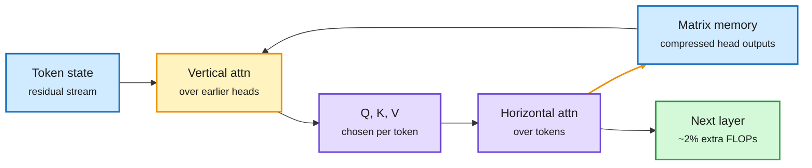

# Non-uniform depth: FFN PCA width allocation and LoomFormer

**TL;DR.** Two papers attack the same convention from different sides: every Transformer layer gets the same FFN width and the same fixed wiring. The PCA paper measures how much capacity each layer actually uses and finds a stable middle-heavy profile across 58 models, then uses it to allocate width when pruning (+2.3 to +2.5 points over uniform width at the same parameter count). LoomFormer lets each head choose, per token, which earlier heads' outputs to read, and matches Transformers trained with over 3x the compute.

## Layer-wise FFN intrinsic dimensionality ([2611.32782](https://arxiv.org/abs/2611.32782))

- **Measurement.** Run PCA on the input to each FFN down-projection. A layer's intrinsic dimensionality is the smallest number of principal components needed to reconstruct the activation up to a fixed cosine similarity.
- **Finding.** Across 58 open-weight LLMs, 14 families, 70M to 72B parameters: middle layers carry higher intrinsic dimensionality than edge layers. Robust to the calibration corpus (even English vs Chinese) and largely preserved through post-training.
- **Test.** Use the profile to allocate widths when width-pruning a knowledge-distilled student at a matched parameter budget: **+2.3 points on Qwen3-8B and +2.5 on Qwen2.5-3B** over uniform width; smaller gaps for flatter teachers (+0.9 Gemma-3-4B, +0.5 LLaMA-3-8B); an inverted (edge-heavy) control does worst on all four. The gap tracks a one-number unevenness summary, sigma_99, so you can predict whether non-uniform pruning will pay before running it.

## Loom attention / LoomFormer ([2611.30634](https://arxiv.org/abs/2611.30634), code: [Caiyun-AI/LoomFormer](https://github.com/Caiyun-AI/LoomFormer))

Two streams: one for which circuit, one for what content

Vertical attention over earlier heads picks the wiring per token; horizontal attention over tokens does the usual job.

Blue are the two streams, amber is the per-token rewiring, purple is standard attention, green is the output.

- Each head gets its query, key and value by attending **vertically** over the outputs of earlier heads, then attends **horizontally** over tokens as usual. Vertical attention is implemented as normalized, gated linear attention over a per-token matrix memory that stores compressed head outputs, which acts as a second residual stream.
- **Results:** matches Transformers trained with over 3x compute, and residual-stream baselines (HC/mHC, MUDDFormer, AttnRes) trained with about 1.7-2.8x. On 300B tokens with ~2% extra FLOPs, LoomPythia-2.8B gets ~1.6x the downstream gain of mHC-Pythia-2.8B and matches or beats Pythia-12B.

## Relation to prior wiki pages

- **Confirms** [Model Carving (11-24)](../inference-efficiency/2026-11-24-model-carving-and-efficiency-shorts.md), which let training delete its own sublayers via scalar gates and found carved models beat dense models given 1.7x more compute. Model Carving says some sublayers are unnecessary; the PCA paper says which layers need the width. Three results in three days against the uniform stack (Carving, PCA width, Loom) is a pattern for [model pruning](../inference-efficiency/model-pruning-sparsity.md): allocation, not size, is where the free capacity is.
- **Extends** the 11-24 residual-stream-as-routing thread (cmHC, Google's DeepCrossAttention 3x faster training with under 0.2% extra parameters). LoomFormer is the third and most aggressive: routing over earlier heads per token, not per layer.
- **Serving question.** The matrix memory is per-token state. It adds to what must be cached at decode, the same KV-traffic concern LoopCache raised for loops on 11-22. Not addressed.

## Gaps

- PCA allocation tested only on distilled students, not on pruning a served model directly.
- LoomFormer tested to 2.8B; decode-time memory and kernel cost of vertical attention unreported.

Raw: [FFN PCA](../../raw/huggingface/2026-11-25-measuring-layer-wise-intrinsic-dimensionality-of-ffns-in-llm.md) · [Loom attention](../../raw/huggingface/2026-11-25-rewirable-circuits-in-transformers-with-loom-attention.md)
