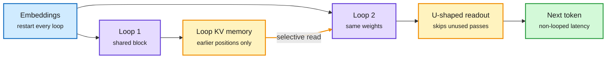

# Mixture-of-Loops Transformer (MoLT) and DyLoMo-DiT

**TL;DR.** MoLT asks what a looped transformer should pass from one loop to the next. Its answer is keys and values: each loop's KV becomes memory that later loops read selectively. The KV variant (MoLT-KV) restarts every loop from the embeddings and only reads earlier loops' KV at earlier positions. That removes same-position dependence across loops, which allows parallel training ("loop forcing") and single-traversal decoding. A U-shaped version (U-MoLT) separates memory building from the readout and skips unused decoder passes. In 400B-token pretraining it beats OLMo3 at 700M/1.5B dense and 3B MoE, with 1.7x token efficiency at 700M, and matches non-looped latency (996.6 vs 1,000.6 ms). DyLoMo-DiT applies loops plus sparse experts to diffusion transformers.

The loop hands over its cache, not its residual stream

MoLT-KV restarts each loop from embeddings and reads earlier loops only through their KV.

Blue is input, purple is the shared block, amber is the cross-loop memory and readout, green is the output.

## Key findings (MoLT, 2611.34923)

- Two variants. **MoLT-R** keeps the residual stream and reads local KV across loops (more expressive). **MoLT-KV** restarts from embeddings and reads current-loop local KV plus preceding-loop memory KV at earlier positions (more efficient).
- Because no position depends on its own earlier-loop state, training parallelizes and decoding can run past the trained loop horizon in a single traversal.
- 400B-token pretraining: U-MoLT beats OLMo3 at 700M and 1.5B dense and 3B MoE. 1.7x validation cross-entropy token efficiency at 700M. The 3B MoE gains 0.75 perplexity across 10 domains and +2.1 points on 10 tasks.
- Retrofit: 100B-token continued pretraining of Qwen3.5-0.8B-Base lowers CE on all 11 domains, 1.4x mean token efficiency.
- Latency: U-MoLT with MoL-Hybrid-2 matches non-looped OLMo3 at about 113M (996.6 vs 1,000.6 ms).

## DyLoMo-DiT (2611.30844)

A weight-shared loop repeats the middle layers of a diffusion transformer, and sparse experts spread capacity across tokens. Loop count varies with noise level; more passes on low-noise steps help. ImageNet 256: FID 11-24% lower than DiT and 36-56% lower than DiT-MoE at matched parameters and compute. Text-to-image GenEval 0.714 vs FLUX.1's 0.673 with 1.05B vs 12B active parameters.

## How it relates to prior wiki pages

- **Gap-filling.** LoopCache (11-22) named per-loop KV memory traffic as the hidden cost of looped decoding. GLM-5.4 (11-24) bounded it with a 128-token KV window for the extra pass. LoopRes (11-25) let each loop attend to earlier loops' outputs. MoLT makes the cross-loop channel the KV cache itself and shows it can run at non-looped latency, the first pretraining-scale paper to do so.
- **Pattern, now at N=4:** every recent loop paper bounds what a later pass may read (GLM-5.4 in the cache, LoopRes in the residual window, Loop-PP in the schedule, MoLT in position-restricted KV).
- **DyLoMo-DiT confirms** the 11-26 "loops leave language" page: loops plus MoE now in diffusion, with compute varied by noise level, the diffusion analogue of per-token adaptive depth.
- Kurate cs.LG lists "Scaling Looped MoE Language Models under Matched Budgets" (2611.34276) the same week; the Kurate tournament had not ranked the week yet, so treat that as presence, not a quality signal.

## Gaps

Latency parity shown only at ~113M. No KV memory footprint numbers at 3B: reading earlier-loop KV still stores it. No long-context test.

Related: [looped-transformers](looped-transformers.md) · [kv-cache](../inference-efficiency/kv-cache.md)
