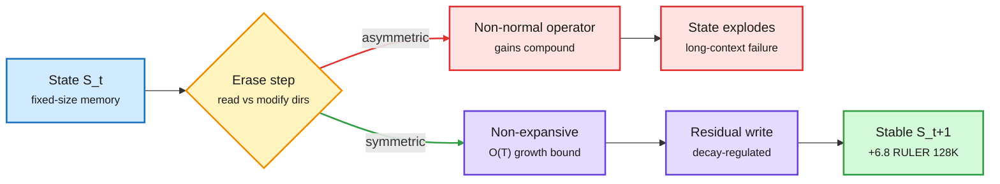

# Stable Gated DeltaNet-2

**TL;DR.** Linear-attention models keep a fixed-size recurrent state instead of a growing KV cache. Gated DeltaNet-2 (GDN-2) gave each channel separate control over erasing and writing, which improved in-context retrieval but made long-context training fail. The paper traces the failure to an asymmetry: the direction the model reads from when erasing differs from the direction it modifies. That makes the erase operator non-normal, so small directional gains compound across tokens and the state grows exponentially even with no new writes. The fix uses symmetric erasure (provably non-expansive) plus decay-regulated residual writing to keep write flexibility. It proves an O(T) bound on state growth, keeps chunkwise parallel training, and at about 1.6B parameters lifts 128K RULER by 6.80 points (pure recurrent) and nine-task accuracy by 0.62 (hybrid). It was the top Hugging Face paper of the day (128 upvotes).

Asymmetric erase compounds; symmetric erase cannot grow

The bug is in the erase step, not the write step.

Blue is the state, amber is the erase decision, purple is the fix, green is the stable result, red is the failure path.

## Key findings

- Training instability in GDN-2 comes from the erase operator, not from writes: the state can blow up with zero new information.
- Symmetric erasure makes propagation non-expansive; decay-regulated residual writing recovers the expressiveness that symmetric erase gives up.
- O(T) upper bound on state norm, chunkwise-parallel kernel retained (no training-throughput penalty claimed).
- ~1.6B models: +6.80 avg RULER at 128K (recurrent), +0.62 avg on nine downstream tasks (hybrid).

## Gaps

- Only ~1.6B parameters; no result at the 7B+ scale where hybrid linear attention ships (Ling/Ring 2.6, Nemotron 3).
- The hybrid gain is small (+0.62); the big gain is in the pure-recurrent setting, which few production models use.
- No reported end-to-end throughput or kernel timing vs GDN-2.

## How this relates to prior wiki pages

- **Fills a stability gap in the linear-attention line** on [attention-mechanisms](attention-mechanisms.md). The 08-04 [RAVEN](2026-08-04-raven-sparse-memory-routing.md) page organized the zoo by memory-write policy (dense-write-with-forgetting like DeltaNet vs sparse-write). Today's paper says the *erase* operator's geometry is a third axis that decides whether long-context training survives at all.
- **Complicates the 11-24 Canon-layers result** (Allen-Zhu: plain gated linear attention plus local mixing matches Gated DeltaNet). If richer DeltaNet variants need special erase geometry to train stably, the simpler GLA-plus-Canon recipe looks even more attractive.
- **Efficiency link.** A stable fixed-size state is the alternative to the KV cache. See [kv-cache](../inference-efficiency/kv-cache.md): every recurrent layer that trains reliably at 128K is one fewer layer paying KV memory.
