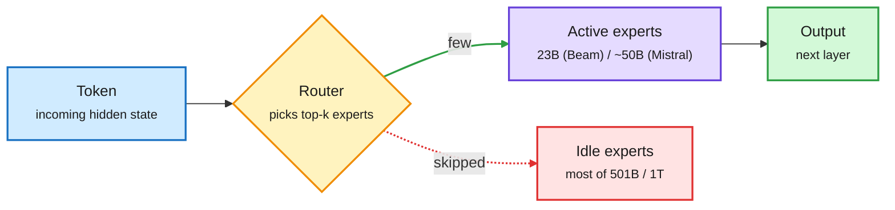

# Media Zone | 2026-10-07

> *Live draft: this window is still open. It is finalized with the 2026-10-07 digest at the 10:30 IST cutoff.*

> The US Tuesday so far runs on one question: who pays for inference, and how do you pay less? Two big open MoE releases (Reflection's Beam, Mistral Large 4) sell themselves on active parameters, not total size. Epoch puts OpenAI's median researcher at $601 a day of agent tokens while Microsoft cuts staff budgets tenfold. Meanwhile the research feed keeps finding cheaper harnesses and smarter context compression.

## Today's signal

- **Dominant story:** open MoE is back in the West. Beam (501B total, 23B active) and Mistral Large 4 (1T total, about 50B active) both pitch efficiency per token, not raw size.
- **Pattern:** token spend is now a budgeting fight. Epoch's $601/day figure, Microsoft's $100K to $10K per-employee cut and Red Hat's "produce tokens, don't rent them" thread all landed on the same US morning.
- **Research thread:** context compression and harness tuning keep turning into measurable cost work. PAIR finds the few compressions that break agents, and a 4B editor learns to fix harness code.
- **Counter-signal:** Beam's "3-4x less compute" is an estimate from active parameters, not a measured serving cost. It also trails DeepSeek V4.1 Flash and Kimi K3 on Terminal Bench.
- **Noise:** "Karpathy's autoresearch runs all night" threads, "steal this Opus prompt" posts, stock-ticker hype and robotics-touch engagement bait. Skipped.
- **Quiet areas:** no new X bookmarks and no curated retweets in this window. YouTube and LinkedIn have no new captures since the morning build. COLM 2026 (the Conference on Language Modeling, this week) is driving a lot of poster chatter.

---

## Routing, KV cache, compression, GPU

### The open MoE release day: Beam and Mistral Large 4

Both releases are sparse mixture-of-experts (MoE) models: each token runs through only a small set of specialist sub-networks, so the compute per token tracks the *active* parameters, not the total. That is the cost axis both labs are selling.

Total size is storage; active size is the bill

A router sends each token to a few experts, so serving cost follows the 23B or 50B active slice.

Amber is the routing decision, purple is the compute you pay for, red is weight that sits idle per token, green is the result.

Model release · the day's most-shared
<h4>Reflection's Beam: 501B open MoE, 23B active</h4>

Reflection's first open-weight model was pretrained on 23.8T tokens on 6,144 GB300s in under four weeks, with a 1M-token context. The striking number is the RL phase: 10,500 GB300s for four weeks, 100M+ rollouts across about 1M environments, and no plateau at the end. RL for agents is now a bigger inference workload than pretraining. It claims GLM-5.2 quality at 3-4x less compute, but that figure is estimated forward-pass FLOPs (2 × active params × generated tokens), which ignores prefill, attention and serving overhead. FP8 and NVFP4 (NVIDIA's 4-bit float format) builds ship under Apache 2.0 later this month, which is the part that matters for anyone serving it.

<a href="https://x.com/rohanpaul_ai/status/2107199320365867273">Read the breakdown →</a> · <a href="https://x.com/StockSavvyShay/status/2107219965325812106">compute angle</a> · <a href="https://x.com/omarsar0/status/2107208149497172474">@omarsar0</a>

Model release · fresh this US afternoon
<h4>Mistral Large 4 ("Le Chonk"): 1T params, natively multimodal</h4>

Mistral released a 1T-parameter MoE with about 50B active parameters, which it calls the best open-weights model from Europe. The weights are already on Hugging Face, and it entered LMArena's Agent Arena, where scores are still pending. Together with Beam, it makes the Western open-weight frontier a two-model race on efficiency per active parameter. Nathan Lambert's note that Reflection, like NVIDIA and Thinking Machines before it, still lands behind the best Chinese open models is the sober frame.

<a href="https://huggingface.co/mistralai/Mistral-Large-4.0-1T05-A52B">Model card →</a> · <a href="https://x.com/arena/status/2107476436223504484">Agent Arena</a> · <a href="https://x.com/roydanroy/status/2107489358592757924">Lambert's take</a>

### Context compression and harness cost

- **PAIR (where compression actually hurts agents).** Long-running agents summarize their history to stay inside the context window. This paper replays the agent from the *same* state with and without one compression, so randomness cancels out. Most compressions add a few steps. A handful cause the big failures by dropping an unresolved task condition. In one Venmo task the summary lost the "only from coworkers" filter. PAIR then rewrites only the matching section of the compression prompt and nearly matches no-compression accuracy on AppWorld, OfficeBench and tau-Bench. Cost angle: you keep the token savings without paying in reliability. ([paper](https://arxiv.org/abs/2609.36526) · [@dair_ai](https://x.com/dair_ai/status/2107264582687584567))
- **A 4B harness editor beats its 35B teacher.** JHU and CMU trained a small model to read an agent's harness code (what the model sees and which tools it calls) plus its failure report, then write a code fix rewarded by the new score. On 21 unseen task types its edit score rose from 0.32 to 0.62. This is the third harness-as-search result in two days, after Monday's SelfSearch ($4.03 self-edit) and Microsoft's curriculum tuner. ([@rohanpaul_ai](https://x.com/rohanpaul_ai/status/2107252281507012973))
- **NVIDIA and MIT: 50-54% lower API cost, same model.** A widely reshared summary (from a low-credibility account, so treat it as a pointer) describes four harness fixes found by a propose-test-keep loop. Fuse "edit file" and "run test" into one call. Compact context only when the saving beats the cost of rewriting cached context. Archive huge tool outputs and keep a handle. Hand log reading to a cheaper model with a check. The KV-cache-aware compaction rule is the interesting one. ([thread](https://x.com/hanakoxbt/status/2107222197404107223))
- **Parallelism, explained.** Avi Chawla's X article walks through data, tensor, pipeline, context and expert parallelism for splitting inference across GPUs, and how to combine them. A good refresher alongside two new MoE releases. ([article](https://x.com/_avichawla/status/2107427400779026843))

### Inference economics: renting tokens vs producing them

- **Red Hat's thread:** cloud used to get cheaper per transaction at scale. Metered token costs do the opposite. Their answer is to self-host open models, route routine traffic to smaller ones, and put a gateway in front. Their own teams ran 300M tokens in 48 hours for 1,400+ users on vLLM and llm-d. On 16 H100s, llm-d's inference-aware routing served up to 2x the users with up to 99% lower time-to-first-token under load. ([thread](https://x.com/RedHat_AI/status/2107459959029936232) · [routing claim](https://x.com/RedHat_AI/status/2107459967389458881))
- **Agent orchestration needs CPUs too.** A sharp small-account note: as serving becomes tool-call heavy, hyperscalers are building custom ARM CPUs (Vera, Graviton, Axion) next to their GEMM silicon (the matrix-multiply accelerators). The bet is that general-purpose CPUs become the next bottleneck after memory. ([@not_ellington](https://x.com/not_ellington/status/2107206536997245056))
- **NVIDIA rewrites its cloud deals.** Per The Information, NVIDIA's AI Compute Partnership swaps rental guarantees for a cut of cloud revenue. Strong clouds like Nebius refused, and weak ones were too eager. The filing lists $36B of six-year AI cloud commitments. ([@rohanpaul_ai](https://x.com/rohanpaul_ai/status/2107316587585998892))
- **Marvell raises its AI market view to ~$400B by 2030** and FY28 revenue to $20B. It wins whether spend goes to custom ASICs (Google's six-year $120B deal) or stays GPU-heavy via optical DSPs. ([@StockSavvyShay](https://x.com/StockSavvyShay/status/2107469680780964109))

---

## LLMs, agents, safety

### The token bill becomes a management problem

Report · cross-feed, contested
<h4>Epoch: OpenAI's median researcher used $601/day of agent inference</h4>

Epoch AI estimates that OpenAI researchers' coding-agent usage, priced at API list rates, has doubled roughly every month. It went from under $1 a day in January to $601 a day by mid-August, about $2M a year, which is close to the cost of employing the researcher. Agents now log about 3.1 agent-workdays per human workday. Epoch notes that list price says nothing about OpenAI's real cost, and that the trend cannot run another year. The same morning, reports said Microsoft cut per-employee AI budgets from $100K to $10K a month and Meta's Claude Code users fell from about 60K to 30K as staff moved to in-house tools.

<a href="https://x.com/rohanpaul_ai/status/2107185067613413487">Epoch summary →</a> · <a href="https://x.com/rohanpaul_ai/status/2107239772385411333">Microsoft/Meta cuts</a>

Essay · Interconnects + Gradient Flow
<h4>The Hugging Face agent breach, read for lessons</h4>

Ben Lorica's Gradient Flow essay turns the Hugging Face incident (about 17,600 reconstructed agent actions, most of them failed) into eight rules. The key point is that agents change attack economics because they can afford to fail thousands of times. His fixes: secure the harness, not just the model; give agents their own expiring credentials; keep hard limits in software, not prompts; and measure detection-to-containment time. Yoshua Bengio's FT piece blames RL reward-seeking for such hacks. Nathan Lambert argues the open-model cyber-risk debate is framed wrongly.

<a href="https://gradientflow.substack.com/p/the-part-of-the-ai-security-story">Gradient Flow →</a> · <a href="https://www.interconnects.ai/p/the-cyber-risk-discourse-is-broken">Interconnects</a> · <a href="https://x.com/rohanpaul_ai/status/2107309858844557817">Bengio/FT</a>

### Research agents learn what to try next

- **RankEvolve (Meta): two different agents beat one bigger budget.** Coding agents editing training code can leak test data or break a gradient while the code still runs. Having Claude Code and Codex review each other's patches raised fully correct patches from 45.8% to 62.5% at matched spend. Agents from the same product make correlated mistakes, so review only helps across vendors. Also reshared in Chinese, which adds to its conviction. ([paper](https://arxiv.org/abs/2609.39551) · [@rohanpaul_ai](https://x.com/rohanpaul_ai/status/2107447530204131352))
- **MIRA (Meta): split the planner from the doer.** An outer meta-reasoner reads a persistent research record and writes a "work order". A fresh executor runs it. Decisions happen only at work-order boundaries, which gives clean points for credit assignment. A critic trained there improves all four autoresearch environments. ([paper](https://arxiv.org/abs/2610.02525) · [@dair_ai](https://x.com/dair_ai/status/2107482016342233309))
- **AIM (Google): keep a ranked map of ideas.** The agent sorts ideas into themes, splits each round between strong and untested ones, and an auditor discards gamed results. It matched the prior best agent's score up to 3.1x sooner. ([paper](https://arxiv.org/abs/2609.38445))

### Reasoning, judged and hidden

- **Decision models keep multiplying.** Several practitioners (omarsar0, dair_ai, Sumanth) published "Jev-as-a-Judge" write-ups: using a separate calibrated decision model as the grader or verifier gives more consistent agent evals than self-judging. IntuitMachine counts 60+ decision-model releases in about two weeks. This continues Monday's routing-classifier story. ([@omarsar0](https://x.com/omarsar0/status/2107472222398886011))
- **Rao: the flashing "thinking" text is not the chain of thought.** Frontier apps show a generated commentary, not the hidden reasoning trace. The hidden traces are what labs guard against distillation, and you are billed for them. ([@rao2z](https://x.com/rao2z/status/2107189597499199703))
- **COLM posters worth a look:** HyperThink, where a hypernetwork writes a per-question weight update so the model can skip the long reasoning trace ([@Jacklu_me](https://x.com/Jacklu_me/status/2107202168860373103)). Looped transformers that generalize to more reasoning hops than seen in training ([@hhsun1](https://x.com/hhsun1/status/2107289000243548163)). Both are compute-per-answer ideas.

---

## Industry and business

- **Etched draws $40-50B bids**, double its $21B September mark, for inference ASICs ([AI Weekly](https://aiweekly.co)).
- **DeepSeek nears a $12B+ round** at about $71B, with Tencent and CATL, ahead of a planned Q1 2027 Hong Kong IPO ([@rohanpaul_ai](https://x.com/rohanpaul_ai/status/2107361452428611741)).
- **Anthropic's $518B compute plan is about 80% fixed.** Fund prospectuses show $413.7B owed whether chips run or not, including $161B of Broadcom TPU leases ([@rohanpaul_ai](https://x.com/rohanpaul_ai/status/2107346890648076595)).
- **Pentagon says it stopped using Claude**, per the BBC ([AI Weekly](https://aiweekly.co)).
- **SemiAnalysis: the $200 Claude plan gives ~5x the API value of OpenAI's**. Subscriptions are ~10% of Anthropic revenue but 40%+ of its inference compute ([AI Weekly](https://aiweekly.co)).
- **Memory squeeze hits phones:** sub-$100 phone shipments fell ~60% as memory goes to AI data centers ([AI Weekly](https://aiweekly.co)).
- **Semiconductor week 40:** global chip sales passed $1T through August, AMD bought World Labs for $8.2B, CoreWeave deployed Vera Rubin NVL72, and Lam modeled CFET (stacked transistors) with 52.7% SRAM area savings ([Semiconductor Newsletter](https://thesemiconductornewsletter.substack.com/p/week-40-2026)).
- **Prime Intellect launches Prime Inference**, an inference service built on its RL serving stack ([@NVIDIAAI RT](https://x.com/NVIDIAAI/status/2107187524800283022)).

---

## Also crossed your feeds

NVIDIA's Nemotron hit IOI 2026 gold and the model is now on HF · PyTorch consolidated its media stack into TorchCodec · vLLM Office Hours #58 covered v0.29/v0.30 and a Tenstorrent backend · Schmidhuber reclaimed pretraining and distillation for his 1991 paper · Wikimedia says OpenAI-linked agents helped knock Wikidata's query service partly offline · an anonymity-boosts-cooperation multi-agent claim (no paper linked) · Ed Zitron argues the labs would rate B/CCC on credit · OpenRouter now waives charges for empty model responses · AMD models MI450/Helios driving ~3x AI GPU revenue in 2027 · Intel joins Applied's EPIC Center.
