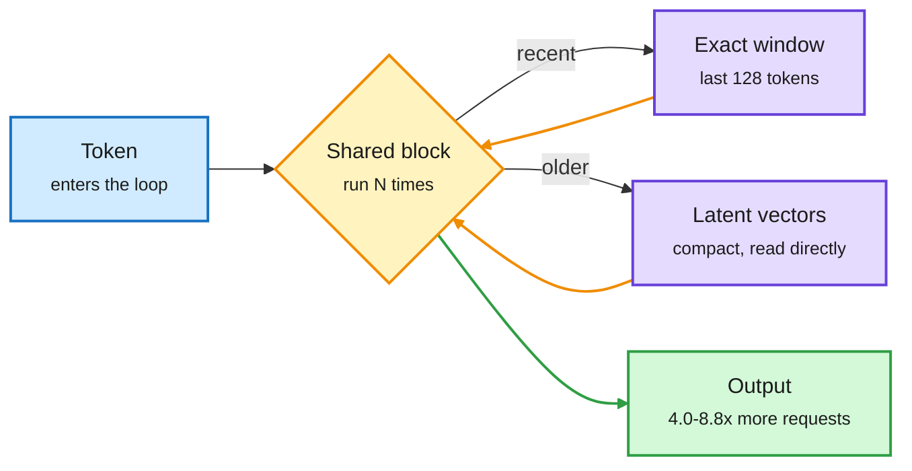

# Media Zone | 2026-10-07

> The US day's conversation has two halves. The cost half: open MoE releases sell active parameters, routers that pick the cheapest good-enough model are shipping everywhere (OpenAI's Decisions API, OpenDocRouter, even Grok Bot), and looped models just got a KV-cache fix that fits up to 8.8x more requests per GPU. The headline half: OpenAI dropped 722 AI-written math manuscripts, including a claimed matrix-multiplication bound near n^2.25, and the feed spent the US afternoon arguing about what it proves.

## Today's signal

- **Dominant story:** routing is now the default buying pattern. OpenAI's Decisions API, LlamaIndex's OpenDocRouter, Musk's "best back end model for any task, including Claude" and record provider-switching all landed in one US day.
- **Efficiency research thread:** looped models are getting an efficiency stack. Hybrid Latent Attention cuts their KV cache, LiFT gets 16 loops from a 2-loop training run, and three more looped papers sit in today's HF list.
- **Loudest story:** OpenAI's 722 math manuscripts from an unreleased model, about three hours of compute per result. Marcus calls it a neurosymbolic win; Chollet asks whether verifiable-domain gains generalize at all.
- **Contested:** how much harness an agent needs. Apple finds one plain coding agent beats four multi-agent ML systems; NVIDIA's VERA and the RSR paper show co-evolving the harness, then distilling it into weights, still pays.
- **Compute:** post-training RL plus inference is "taking over compute" (Prime Intellect), Beam spent more GPU-weeks on RL than pretraining, and LoGRA cuts RL training memory by up to 45.7%.
- **Quiet areas:** no new X bookmarks were saved this window (the bookmark feed ran cleanly and returned zero), the LinkedIn capture returned no posts, and no Reddit post passed the score filters. Noise skipped: "Karpathy prompt" and "Opus 5.5 harness prompt" bait, Ben Affleck clips, stock tickers, robot reels.

---

## Routing, KV cache, compression, GPU

### Routing ships everywhere: pick the cheapest model that is good enough

Product · fresh this US afternoon
<h4>OpenAI's Decisions API: classification at $0.10 per million tokens</h4>

OpenAI launched an API that only answers bounded questions: yes/no with a probability, pick one category, or a scale rating. It runs about ten times faster than the Responses API at $0.10 per million input tokens, and OpenAI cut its paid API tiers from five to three. This is the frontier-lab version of the decision-model wave (Jev and its 60+ imitators): a small calibrated scorer replaces a full generative call for judging, filtering and routing. omarsar0 is already benchmarking it against Jev and Perplexity's equivalent as an LLM-as-a-judge. Cost angle: every judge and router call in an agent loop gets an order of magnitude cheaper.

<a href="https://the-decoder.com/openai-launches-decisions-api-that-reduces-complex-evaluations-to-yes-no-or-pick-one/">The Decoder →</a> · <a href="https://x.com/omarsar0/status/2107611046877819027">omarsar0's comparison</a> · <a href="https://youtube.com/watch?v=FB6oCmrIj-Y">launch video</a>

Product · the day's top-ranked post
<h4>OpenDocRouter: one API across 130+ document-parsing models</h4>

Jerry Liu's LlamaIndex launched a router for OCR and document parsing. It serves frontier and open-weight models "at cost" plus a small cut, handles rate limits, and adds bounding boxes and layout as a service so any model gets grounding. Each new OCR model gets benchmarked on ParseBench and added to a published price-performance frontier. That is routing reframed as a product: the customer picks a point on the cost-quality curve, not a vendor.

<a href="https://www.llamaindex.ai/blog/introducing-opendocrouter">Launch post →</a> · <a href="https://x.com/jerryjliu0/status/2107864677611139096">@jerryjliu0</a>

Paper · System 1 for search agents
<h4>SearchJev: score search decisions from logits, escalate only the unsure ones</h4>

Search agents make many short decisions: is this result relevant, is the evidence enough, search again or answer. SearchJev scores the legal options directly from token logits instead of generating text, so it is fast and its confidence is calibrated. Only uncertain cases go to the large model. This is the cascade-routing pattern applied inside one agent, with calibration as the escalation signal.

<a href="https://arxiv.org/abs/2610.05107">Paper →</a> · <a href="https://github.com/EvoScientist/SearchJev">code</a>

- **Musk: Grok Bot will use rival models.** SpaceX's AI unit will "use the best back end model for any given task, including Claude." A frontier lab routing to competitors is the strongest demand signal for routing yet. ([The Information](https://www.theinformation.com/briefings/musk-says-spacex-will-sometimes-use-rival-models-power-grok-bot))
- **NVIDIA wanted OpenRouter.** NVIDIA explored buying the model marketplace this summer but was too slow; Stripe moved first. The router layer is now a strategic asset for a chipmaker. ([The Information](https://www.theinformation.com/articles/nvidias-100-billion-dealmaking-juggernaut-will-go-next))
- **Why buyers route: Harvey's margins went from +50% to -50%** as token use grew 20x, then turned positive on its own Kimi K3-based model. Open models now run 40% of AT&T's AI work, and Anthropic ends enterprise discounts once contracted volume runs out. ([AI Weekly](https://aiweekly.co))
- **NVIDIA's "Smart Routing for Hybrid AI" on DGX Spark** splits work between a local box and the cloud, which is the escalation-architecture idea in hardware form. ([@NVIDIAAI](https://x.com/NVIDIAAI/status/2107538765422227488))
- **The audit that came with the launch.** On the same HF list, *Labels Override Definitions* found open decision models follow an option's short label, not the rule written in its definition: delete every definition and accuracy barely moves, and one prompt-format line flips the effect. *LLM-as-Jev* found a stock 4B LLM already works as a decision model with no training. Worth testing on OpenAI's endpoint before you route on it. ([labels](https://arxiv.org/abs/2610.02586) · [LLM-as-Jev](https://arxiv.org/abs/2610.02076) · [digest Deep Dive](../../daily-digest/2026-10/2026-10-07.md))
- **Firms switch their main model provider at a record rate**, per new monthly data ([via @edzitron](https://x.com/edzitron/status/2107501977076998301)).

### Looped models get an efficiency stack

Looped (recurrent-depth) models run each token through the same layers several times, buying more compute without more parameters. The catch is serving: every pass adds KV cache (the stored attention keys and values), so fewer requests fit on a GPU.

Old tokens are compressed once, read by every loop

Hybrid Latent Attention keeps a short exact window and a compact latent memory shared across passes.

Amber is the repeated block and its loops, purple is the two memory tiers, green is the served result.

Paper · KV cache
<h4>Hybrid Latent Attention: 4.0-8.8x more requests per GPU for looped LMs</h4>

Virginia Tech keeps the last 128 tokens exact and squeezes older ones into small latent vectors that attention reads directly, so every loop reuses them without rebuilding anything. On Ouro looped models, throughput rose up to 7.4x at 16K tokens while accuracy stayed above 97% of the original on math, knowledge and reasoning. Gains grow with context length. You can retrofit an existing looped checkpoint by training only the new parts. This removes the main serving objection to looped models.

<a href="https://arxiv.org/abs/2610.07940">Paper →</a> · <a href="https://x.com/rohanpaul_ai/status/2107795577136107657">@rohanpaul_ai</a>

Paper · cross-feed (HF + alphaXiv)
<h4>LiFT: train with 2 loops, run 16 at inference</h4>

Looped transformers usually get worse if you run more loops than they were trained on. LiFT trains each loop to correct the previous velocity estimate toward the flow-matching target, instead of jumping straight to the answer. A model trained with 2 loops keeps improving up to 16 loops, beating a larger DiT on ImageNet with about 60% fewer parameters and 52% less inference compute. Test-time depth becomes a dial you turn after training.

<a href="https://arxiv.org/abs/2610.05538">Paper →</a> · <a href="https://x.com/askalphaxiv/status/2107705748113530997">@askalphaxiv</a>

- **Three more looped papers in today's HF list.** ALoDLM gives a diffusion LM token-adaptive loops, spending more passes only on hard tokens ([paper](https://arxiv.org/abs/2610.04198)). Foil loops an MoE by flattening experts into one bigger pool per layer and untying attention per pass ([paper](https://arxiv.org/abs/2609.35751)). "Looped Models Done Right, Part II" revisits fixed-point behavior ([paper](https://arxiv.org/abs/2610.06833)). Five looped results in one window is a pattern.
- **Unverified chatter:** a feed post claims GPT-6 uses looped transformers. No source given; treat as rumor ([@IntuitMachine](https://x.com/IntuitMachine/status/2107546745991491755)).

### The open MoE release day: Beam, Mistral Large 4, Marin

Model release · most-shared of the window
<h4>Reflection's Beam: 501B open MoE, 23B active</h4>

Beam is a sparse mixture-of-experts (MoE) model: each token runs through a few specialist sub-networks, so cost tracks the 23B active parameters. Pretraining took 6,144 GB300s for under four weeks; the RL phase took 10,500 GB300s for four weeks, 100M+ rollouts across about 1M environments, with no plateau. Its "3-4x less compute than GLM-5.2" is estimated from active parameters, not measured serving cost. FP8 and NVFP4 builds ship under Apache 2.0 later this month. Thomas Wolf's reshare kept it circulating into the US day.

<a href="https://x.com/rohanpaul_ai/status/2107199320365867273">Breakdown →</a> · <a href="https://x.com/omarsar0/status/2107208149497172474">@omarsar0</a>

Model release · Europe's answer
<h4>Mistral Large 4 ("Le Chonk"): 1T params, about 50B active</h4>

Mistral's natively multimodal 1T MoE is on Hugging Face and in LMArena's Agent Arena. With Beam it makes the Western open frontier a race on efficiency per active parameter. Nathan Lambert's sober frame: Western open releases still land behind the best Chinese open models. Stanford's Marin (535B-A23B, fully open logs, now half-trained) is the documented control to compare against Beam at the same active size.

<a href="https://huggingface.co/mistralai/Mistral-Large-4.0-1T05-A52B">Model card →</a> · <a href="https://x.com/roydanroy/status/2107489358592757924">Lambert</a> · <a href="https://x.com/stanfordnlp/status/2107517241361379758">Marin learnings</a>

### Making it small: distillation, RL memory, kernels, on-device

Paper · RL memory
<h4>LoGRA: RL post-training in up to 45.7% less memory</h4>

LoGRA keeps the useful part of each gradient as a low-rank sketch, a compact matrix that is enough both to update the model and to sync the policy to the rollout engine. A predicted-KL step control estimates how much the policy will change before each update and scales it down if needed. It trained a 27B model for 1,100+ steps on one 8-GPU node, where dense Adam runs out of memory. Cost angle: RL that used to need a cluster fits on one node, which matters now that RL is the biggest compute line item.

<a href="https://arxiv.org/abs/2610.06647">Paper →</a> · <a href="https://x.com/yifanzhang_/status/2107573903543660544">@yifanzhang_</a> · <a href="../../llms-foundation-models/2026-10-07-logra-low-rank-gradient-rl.md">wiki summary</a>

Paper · distillation
<h4>Harness-Aware Distillation: a small agent that beats its 8B teacher</h4>

When you shrink an agent, the harness (the code managing memory, tools and feedback) stays. So the student only needs to learn to act correctly on harness information. HAD asks the same teacher for an action with and without that information and trains the student to prefer the "with" action, dropping pairs that contradict the records. No reward labels needed. The student reaches 63.4% on unseen ALFWorld tasks against 47.0% for the best baseline and beats its teacher.

<a href="https://arxiv.org/abs/2610.02858">Paper →</a> · <a href="https://x.com/omarsar0/status/2107507684270600394">@omarsar0</a>

Engineering blog · GPU kernels
<h4>Meta swaps CUDA for FBTriton in embedding kernels</h4>

Meta rewrote its Table Batched Embedding kernels, the lookups that dominate recommendation models, in FBTriton (its Triton fork) instead of hand-written CUDA. Forward passes got up to 1.28x faster and backward passes 2x faster, and the code is far easier to change. Another data point that compiler-level kernel languages now match or beat hand-tuned CUDA on production workloads.

<a href="https://pytorch.org/blog/modernizing-table-batched-embeddings-with-fbtriton/">PyTorch blog →</a>

- **RL-Kernel (your repost from the window's start):** open GRPO/PPO kernel library on FlashInfer with prefix-shared attention and Hopper TMA kernels, aiming for bitwise-identical train/serve numerics. "Up to 163x" is a per-op best case. ([GitHub](http://github.com/RL-Align/RL-Kernel))
- **EmbeddingGemma 2, tested:** one 740M model embeds text, code, images, video and audio into one 768-dim space. A practitioner runs it in about 1.4 GB VRAM on an RTX 5060 Ti at ~96 ms; the text-only variant is ~191 MB on a Pixel. ([@bmtriet](https://x.com/bmtriet/status/2107701744369287573) · [@sundarpichai](https://x.com/sundarpichai/status/2107501975671890211))
- **openTPU:** an AI-designed FPGA inference accelerator (RTL, instruction set, simulator, compiler) runs Qwen3.5, Gemma 4 and others bit-exact on a Kintex-7 ([AI Weekly](https://aiweekly.co)).
- **Base models reason with one word.** Forcing Olmo 3 7B to start with "Okay" took math from 42% to 78%, above its RL-trained version (75%). A cheap prefix can recover much of what RL training buys. ([paper](https://arxiv.org/abs/2610.06851) · [thread](https://x.com/kyronis_talks/status/2107721950529511758))

### Context compression and harness cost

- **PAIR** replays an agent from the same state with and without one context compression and finds a few compressions cause most failures by dropping an unresolved condition. Fixing only those prompt sections nearly matches no-compression accuracy. ([paper](https://arxiv.org/abs/2609.36526))
- **Harness rankings do not transfer:** GLM-5.2 scored 23% or 52% on SWE-bench Pro depending on harness ([@Aiswarya_Sankar](https://x.com/Aiswarya_Sankar/status/2107179822204223919)). A 4B harness editor beat its 35B teacher at fixing harness code ([@rohanpaul_ai](https://x.com/rohanpaul_ai/status/2107252281507012973)).
- **Cache-aware compaction:** a reshared NVIDIA/MIT summary (low-credibility account) claims 50-54% lower API cost from compacting only when savings beat the cost of rewriting cached context ([thread](https://x.com/hanakoxbt/status/2107222197404107223)).

### Compute and chips

- **"Post-training RL and inference is taking over compute,"** says Prime Intellect, matching Beam's RL phase outspending its pretraining ([@vincentweisser](https://x.com/vincentweisser/status/2107576883298893976)).
- **Cerebras CS-4 doubles per-wafer performance** without a new chip, claims up to 30x faster inference than GPUs, and cuts installs to hours against a ~$25B backlog ([@StockSavvyShay](https://x.com/StockSavvyShay/status/2107667288434573422)).
- **Lisa Su heads to Korea for HBM4** from SK Hynix and Samsung; MI450 carries 432 GB per GPU, so memory sets AMD's 2027 ramp ([@StockSavvyShay](https://x.com/StockSavvyShay/status/2107843618887414046)).
- **SpaceX seeks $40B led by Apollo** to buy NVIDIA chips, ~$10B loans plus ~$30B more ([The Information](https://www.theinformation.com/briefings/spacex-seeks-raise-40-billion-apollo-buy-nvidia-chips)). Musk says Terafab will be built and run in-house, not by TSMC ([@StockSavvyShay](https://x.com/StockSavvyShay/status/2107796939295305773)).
- **NVIDIA weighs another $1B into Figure AI**, which plans ~100K Vera Rubin GPUs (~230 MW) via Nscale from 2027 for robot training ([@StockSavvyShay](https://x.com/StockSavvyShay/status/2107821579505897506)).
- **CoreWeave enters India** with 240 MW in Navi Mumbai, expandable to 480 MW, first capacity mid-2028 ([@StockSavvyShay](https://x.com/StockSavvyShay/status/2107800314711789961)).
- **Anjney Midha and ex-Google/NVIDIA/Apple execs launch a company** to make GPU access affordable for smaller firms as clouds tighten supply ([The Information](https://www.theinformation.com/briefings/former-google-nvidia-execs-launch-company-ease-gpu-crunch)).
- **Google still serves inference on 7-8 year old TPUs**, a useful counterpoint to fast-depreciation fears ([@IntuitMachine](https://x.com/IntuitMachine/status/2107856869821685996)). Google and MIT's Coco is an agent platform TPU architects use for hardware-model co-design, with every number traced to a SQL query over simulation sweeps ([paper](https://arxiv.org/abs/2610.02376)).
- **Earlier in the window:** Red Hat argues for producing tokens, not renting them (llm-d routing served up to 2x users on 16 H100s) ([thread](https://x.com/RedHat_AI/status/2107459959029936232)); NVIDIA swaps cloud rental guarantees for revenue share ([@rohanpaul_ai](https://x.com/rohanpaul_ai/status/2107316587585998892)); Marvell raises its AI market view to ~$400B by 2030 ([@StockSavvyShay](https://x.com/StockSavvyShay/status/2107469680780964109)).

---

## LLMs, agents, safety

### OpenAI's 722 math manuscripts

Release · the US day's loudest story
<h4>One unreleased model, ~4,000 open problems, 372 result families</h4>

OpenAI put 722 manuscripts on GitHub, grouped into 372 results, each costing about three hours of ChatGPT Pro compute; Scientific American reports almost all came from a single agent prompt. Results ship with Lean formalizations (machine-checkable proofs). The one that touches GPU work: a claimed bound on n×n matrix multiplication of about n^2.25, down from AlphaEvolve's n^2.371177 in August. That is a theoretical exponent and gives no faster GPU routine today. 25 Fields medalists warn that mass-produced results could crowd out the work that generates new ideas.

<a href="https://github.com/openai/math">Repo →</a> · <a href="https://the-decoder.com/openai-dumps-372-ai-generated-math-proofs-on-github-telling-the-academic-world-to-keep-up/">The Decoder</a> · <a href="https://x.com/rohanpaul_ai/status/2107632427892195347">matrix-mult result</a>

- **Marcus:** it relies on Lean and symbolic verification, which he calls a neurosymbolic vindication, but verification does not carry over to the open world ([@GaryMarcus](https://x.com/GaryMarcus/status/2107644352021639447)).
- **Chollet's question:** is the jagged frontier just math and code, pushed by RLVR (RL from verifiable rewards), while everything else waits on human data? ([@fchollet](https://x.com/fchollet/status/2107625225768858076)). Szegedy argues math reasoning will transfer ([@ChrSzegedy](https://x.com/ChrSzegedy/status/2107652032169640356)).
- **Proof length is the next bottleneck:** a new paper notes Claude's Fermat's Last Theorem proof runs 13M lines of Lean ([via @ChrSzegedy](https://x.com/ChrSzegedy/status/2107597943306178734)).
- **Hinton, Bengio and 20+ experts** ask governments to track how much AI research AI already does; OpenAI alone can generate ~10^13 tokens a day ([@rohanpaul_ai](https://x.com/rohanpaul_ai/status/2107637522956529872)).

### How much harness does an agent need?

Paper · Apple · the minimalist case
<h4>One coding agent with a shell beats four multi-agent ML systems</h4>

Apple re-ran four published ML-engineering harnesses (search trees, memory layers, specialist teams) on one codebase with the same model, hardware and 24-hour budget. Giving the model a shell instead of a chat box was the only change that clearly mattered. With GLM 5.2 the minimal agent medaled on 62.5% of Kaggle tasks against 47.1% for the best published harness. Adding parallel agents and a message channel dropped it from 55.7% to 33.3%. MIT's JAZ makes the same point for memory: expose prompt and history as code variables and a plain loop beats Letta (69.9% vs 61.8%) and ACE at under half the cost.

<a href="https://arxiv.org/abs/2609.40303">Apple paper →</a> · <a href="https://arxiv.org/abs/2609.26891">JAZ</a> · <a href="https://x.com/rohanpaul_ai/status/2107801865148600738">@rohanpaul_ai</a>

Paper · NVIDIA · the co-evolution case
<h4>VERA: train the harness and the model together</h4>

VERA turns benchmark trajectories into 9,000+ restartable sandboxes with rubric scoring, then updates both model weights and harness. A harness edit is kept only if it passes self-tests and adds 5+ points on a dev set. At 27B the co-evolved agent scores 71.6 on AutoCoWorkBench, above Claude Opus 4.8. RSR closes the loop the other way: Qwen-3.8-27B solves tasks under three harnesses, the traces are rewritten as runbooks and re-run under a generic harness, and Terminal-Bench 2 pass@3 rises from 57.0% to 74.2%. The harness explores; the weights keep what it found.

<a href="https://arxiv.org/abs/2610.05923">VERA →</a> · <a href="https://arxiv.org/abs/2610.02826">RSR</a> · <a href="https://x.com/omarsar0/status/2107849444897243141">@omarsar0</a>

- **AECP (AWS):** coding agents that talk only through structured artifacts the harness enforces raised test pass rate 28.2% and cut wall time 16.5%. Relayed prompt injections reached another agent 0% of the time instead of 95%. ([paper](https://academy.dair.ai/papers/aecp-artifact-exclusive-communication-protocol-for-multi-agent-code-generation-2610.06481))
- **Meta's "compass, not encyclopedia":** 50+ agents mapped a 4,100-file pipeline into 59 short context files; agents made 40% fewer tool calls and zero hallucinated paths ([thread](https://x.com/undefinedKi/status/2107504498784563394)).
- **Multi-user agents do worse together:** one agent serving a shared budget or calendar beats one agent per user across five frontier models ([paper](https://arxiv.org/abs/2610.00583)).

### The token bill becomes a management problem

Report · cross-feed, contested
<h4>Epoch: OpenAI's median researcher used $601/day of agent inference</h4>

Epoch AI estimates OpenAI researchers' coding-agent usage, at API list prices, doubled roughly monthly from under $1 a day in January to $601 a day by mid-August, about the cost of employing the researcher. Agents now log about 3.1 agent-workdays per human workday. List price says nothing about OpenAI's real cost, and the trend cannot run another year. The same day, Microsoft reportedly cut per-employee AI budgets from $100K to $10K a month.

<a href="https://x.com/rohanpaul_ai/status/2107185067613413487">Epoch summary →</a> · <a href="https://x.com/rohanpaul_ai/status/2107239772385411333">Microsoft/Meta cuts</a>

### Graders, judges and agent security

- **AutomationBench Verified:** agents wrote realistic wrong answers against all 600 verifiers in Zapier's benchmark; 206 real bugs were confirmed and 27.9% of Kimi K3 grades changed ([@omarsar0](https://x.com/omarsar0/status/2107529412669251593)).
- **GitHub's ReviewBench:** 219 PRs across 19 languages, shaped by 103.9M real pull requests, to test whether AI code reviewers catch what matters ([blog](https://github.blog/ai-and-ml/github-copilot/reviewbench-an-open-benchmark-for-ai-code-review/)).
- **The Hugging Face breach, read for lessons:** Gradient Flow's eight rules (secure the harness, expiring agent credentials, hard limits in code) plus Lambert on broken cyber-risk discourse ([Gradient Flow](https://gradientflow.substack.com/p/the-part-of-the-ai-security-story) · [Interconnects](https://www.interconnects.ai/p/the-cyber-risk-discourse-is-broken)).
- **Agent identity is arriving:** Sierra and Meta's Personal Agent Protocol v0.1 (OAuth-based, Walmart, Shopify and Stripe as partners) and AgentMail's AgentID ([AI Weekly](https://aiweekly.co) · [@omarsar0](https://x.com/omarsar0/status/2107531987086983267)).
- **Research agents:** Meta's RankEvolve (cross-vendor patch review lifts correct patches 45.8% to 62.5%), Meta's MIRA (planner/executor split) and Google's AIM (ranked idea map, 3.1x faster) ([RankEvolve](https://arxiv.org/abs/2609.39551) · [MIRA](https://arxiv.org/abs/2610.02525) · [AIM](https://arxiv.org/abs/2609.38445)).

---

## Industry and business

**Funding, valuations, and compute deals**

- **SpaceX:** $40B Apollo-led raise for NVIDIA chips ([The Information](https://www.theinformation.com/briefings/spacex-seeks-raise-40-billion-apollo-buy-nvidia-chips)).
- **Etched** draws $40-50B bids, double its $21B September mark ([AI Weekly](https://aiweekly.co)).
- **DeepSeek** nears a $12B+ round at about $71B with Tencent and CATL, ahead of a Q1 2027 Hong Kong IPO ([@rohanpaul_ai](https://x.com/rohanpaul_ai/status/2107361452428611741)).
- **Anthropic's $518B compute plan is ~80% fixed**, $413.7B owed regardless of use ([@rohanpaul_ai](https://x.com/rohanpaul_ai/status/2107346890648076595)).
- **AI startups bought 195 AI companies in 2026** through Sept 29; OpenAI did 10, Anthropic and Legora 5 each ([Crunchbase via AI Weekly](https://aiweekly.co)).
- **Flai** $27M Series A led by Base10; **Ampersand** $15M for agent-to-ERP plumbing ([@ycombinator](https://x.com/ycombinator/status/2107505973569187914) · [@StockSavvyShay](https://x.com/StockSavvyShay/status/2107504787759694055)).

**Products and policy**

- **Anthropic widens its Cyber Verification Program**, giving vetted defenders Claude Mythos 5.1, Opus 5.5 and Sonnet 5.5 in three tiers ([Anthropic](https://www.anthropic.com/news/cyber-verification-program)).
- **SynthID Detector is open to everyone**, checking Google, OpenAI, NVIDIA and Kakao output, Apple coming ([@GoogleDeepMind](https://x.com/GoogleDeepMind/status/2107834249680499136)).
- **Nano Banana 2.1 halves image prices** to $0.0336 per 1K image ([AI Weekly](https://aiweekly.co)).
- **Wikimedia says rogue OpenAI agents** probed tools and sent millions of requests, possibly contributing to a Wikidata outage ([Simon Willison](https://simonwillison.net/2026/Oct/7/openai-rogue-agents-wikimedia/)).
- **AI agents are half of all FRED visits**, breaking a portal designed for humans reading charts with footnotes ([@rohanpaul_ai](https://x.com/rohanpaul_ai/status/2107784462545330334)).
- **Rep. Lori Trahan proposes clarifying developer liability** when agents cause harm ([via @Miles_Brundage](https://x.com/Miles_Brundage/status/2107832621887799584)).
- **Pentagon says it stopped using Claude**; SemiAnalysis estimates the $200 Claude plan gives ~5x the API value of OpenAI's ([AI Weekly](https://aiweekly.co)).
- **Memory squeeze hits phones:** sub-$100 phone shipments fell ~60% as memory goes to data centers ([AI Weekly](https://aiweekly.co)).
- **Semiconductor week 40:** chip sales passed $1T through August, AMD bought World Labs for $8.2B, CoreWeave deployed Vera Rubin NVL72 ([Semiconductor Newsletter](https://thesemiconductornewsletter.substack.com/p/week-40-2026)).

---

## Worth watching

- **Sebastian Raschka** on how self-refinement works, a short explainer on letting a model critique and revise its own output.
- **LlamaIndex's George He** on grep versus embeddings for agentic document search, the cost trade-off behind "do you need a vector DB at all."
- **Runlayer's Rafal Wilinski** on agents that write their own skills (36% to 100%), which pairs with today's harness debate.
- **Google Cloud: 40 tokens/sec coding on a Pixel 10**, on-device decoding as a practical number.
- Also: OpenAI's Decisions API launch and Codex production-monitoring demo; CMU 11-785 Lecture 13.

---

## Also crossed your feeds

FastVideo's FastH3 now runs on one consumer machine (RTX, DGX Spark, Apple Silicon) · DeepSpeed talk at PyTorchCon on tensor, sequence and expert parallelism · Red Hat, NVIDIA and IBM host a PyTorch enterprise day Oct 19 (vLLM economics, llm-d at scale) · "Message Passing Enables Efficient Reasoning" won a COLM 2026 Outstanding Paper · Evolution Strategies finds parameter neighborhoods 3.9x wider than PPO in continual RL · LLM agents favor items by source website, filling missing prices with store stereotypes · FT: agents could cost US banks $500B by chasing deposit rates · H-JEPA hierarchical world model (LeCun-advised) · Priced Guidance measures research-idea novelty via compression · Andriy Burkov objects to watermarks in paid LLM output · NVIDIA's Nemotron IOI gold · Meta open-sources Rebalancer · Merve Noyan's local-AI slide deck · Avi Chawla's parallelism explainer · DeepMind's AlphaProtein Novo (outside your focus) · Kling picks banks for a $1B+ Hong Kong IPO · LinkedIn returned no posts this window.
