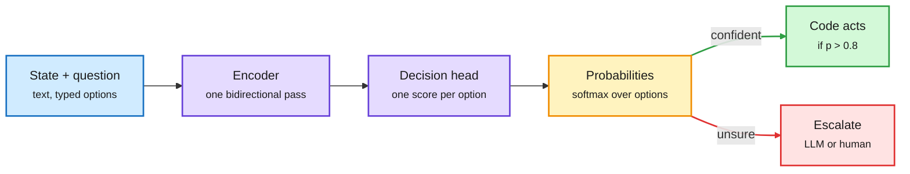

# Media Zone | 2026-10-09

> *Live draft: this window is still open. It is finalized with the 2026-10-09 digest at the 10:30 IST cutoff.*

> The US Thursday's conversation is about what shape a model's answer should take. Jev-style decision models (pick an option, return a probability, never generate prose) went open, local and cheap within a day. OpenAI priced its own version at input-only. On the efficiency side, MXFP4 checkpoints landed for AMD, Haiku 5.5's cache math got spelled out, and a 206B-token agent inference trace dataset gives serving researchers real workloads to study.

## Today's signal

- **Dominant story:** decision models are commoditizing. Laya, Unsloth's recipe, LiquidAI-style d1 models and OpenJev all clone Jev's "score, don't generate" design.
- **Pattern:** routing is turning into a typed call. Gemini Agent routes by cost, and decision models make each routing fork a cheap classifier pass.
- **Cost thread:** Haiku 5.5 cache reads at a tenth of input price, MXFP4 for AMD, and Samsung's sub-1-bit LittleBit all push serving cost down.
- **Counter-signal:** the harness debate flipped again. Domingos says harnesses are useless; RSIGym says fix the harness before you train.
- **Quiet areas:** no new bookmarks this window, no curated reposts, no YouTube, LinkedIn or Reddit files captured yet. Skipped: Starlink/India politics, stock tickers, robot reels, "pure treasure" prompt bait.

---

## Routing, KV cache, compression, GPU

### Decision models go open: routing becomes one forward pass

A decision model scores options instead of writing an answer

Why it is fast: no token-by-token decoding, and the output plugs straight into an if-statement.

Blue is input, purple the model, amber the calibrated decision, green the cheap path, red the escalation.

Repo · the day's most-shared routing artifact
<h4>Laya: an Apache-2.0, local alternative to Jev</h4>

Laya answers typed questions over unstructured state by scoring options, not generating text. It first picks an English or multilingual checkpoint in plain Python (a router before the model). Each answer option gets a [MASK] marker, a bidirectional encoder plus small head scores them, and softmax gives a distribution. All questions batch into one call. One test put it near 35 ms on a local GPU against roughly 380 ms for hosted Jev. The catch: Jev is zero-shot, Laya needs fine-tuning and calibration on your answer set, with uncertain cases sent to a bigger model.

<a href="https://x.com/akshay_pachaar/status/2107933081093210124">Read the thread →</a> · <a href="http://github.com/NandhaKishorM/laya">Repo →</a>

Training recipe · decision models on 4 GB
<h4>Unsloth: turn any small LLM into a decision model</h4>

Unsloth swaps the language-model head for a classification ("Clef") head and fine-tunes with LoRA (r=64) for one epoch. Qwen3.5 0.8B went from about 21% to 74% aggregate accuracy across three decision benchmarks, on 4 GB of VRAM. Towards Data Science's most-read piece this week describes the same head-swap trick on Qwen. The cost angle: a sub-1B classifier replaces a frontier-model call for every routing or labeling fork.

<a href="https://x.com/UnslothAI/status/2107868866361930236">Read the post →</a> · <a href="https://unsloth.ai/docs/basics/train-your-own-decision-model-with-unsloth">Guide →</a>

Newsletter · the clearest explainer
<h4>Understanding AI: why Jev went viral without new capabilities</h4>

Timothy B. Lee's essay explains Jev's appeal: it takes language in but returns probabilities over fixed answers, so it is cheaper to serve and drops straight into code. He uses it as a blog spam filter instead of Gemini Flash with structured outputs. Cloudflare, Amazon and OpenAI have already shipped look-alikes. His bet is that Jev changes the "shape" of AI systems more than any single capability release.

<a href="https://www.understandingai.org/p/understanding-jev-the-new-model-everyone">Read the essay →</a>

Pricing · OpenAI's version
<h4>OpenAI Decisions API: input-only billing on GPT-6 Luna</h4>

OpenAI's Decisions API returns a probability, a pick with confidence, or a score on a range. Input is $0.10 per million tokens and output is free. One tester found a calibration gap: in "choice" format it called a 70% coin heads 98% of the time, while the "probability" format said 70%. Format choice changes calibration, which matters if you threshold on the number.

<a href="https://aiweekly.co">Via AI Weekly Espresso →</a>

- **Tiny decision models everywhere.** Maxime Labonne's d1-3B (text and vision) and d1-omni-600M were shared by Hugging Face; a Core ML demo runs d1-omni-600M on Apple silicon over thousands of real comments ([thread](https://x.com/huggingface/status/2108202656032497919)).
- **OpenJev on one GPU.** Runpod's guide deploys a 27B open take on Jev; the FP8 build scored 84.2% against hosted Jev's 85.4% on its author's benchmark. Non-commercial license.
- **Routing in a product.** Google's Gemini Agent routes each enterprise task to the most cost-effective model ([post](https://x.com/StockSavvyShay/status/2108170539118497827)). Read with yesterday's Arena audit (a router that picks well can still cost 38% more than one cheap model) in mind.
- **Skip:** the "Opus + Jev breaks the scaffolding wall" thread is engagement bait on top of a real idea (typed forks instead of prompt-encoded routing).

### Cheaper serving: low-bit weights, cache pricing, real agent traces

Dataset · serving research
<h4>The largest agentic LLM inference trace dataset</h4>

Shared by Hugging Face: 206B tokens across about 12,000 agent sessions, 1.19M LLM requests and 1.21M tool calls. Agent traffic is long shared prefixes, bursty tool waits and many short turns, which is exactly what KV cache (stored attention state) reuse, prefix caching and scheduling research needs and rarely has. Real traces at this scale let you test eviction and routing policies against actual agent workloads instead of chat benchmarks.

<a href="https://x.com/huggingface/status/2108202639658013150">Read the post →</a>

Checkpoints · AMD + vLLM
<h4>Red Hat ships more MXFP4 checkpoints</h4>

Red Hat AI released MXFP4 (4-bit microscaling floating point, where small blocks of weights share one scale) checkpoints such as Qwen3.8-27B, ready for vLLM on AMD GPUs. Quietly high-signal off a small engagement base: it is the practical side of making 4-bit inference vendor-neutral, not Nvidia-only.

<a href="https://x.com/RedHat_AI/status/2108197606295851449">Read the post →</a> · <a href="https://huggingface.co/RedHatAI/Qwen3.8-27B-MXFP4">Model →</a>

Pricing · cache math
<h4>Haiku 5.5: the playbook is caching and batching</h4>

Anthropic's Haiku 5.5 lists at $0.10 / $0.50 per million tokens under 100K context, about 75% below Haiku 4.5. The practitioner thread's useful part is the cache arithmetic: cache reads cost $0.01 per million against $0.10 uncached, and prompts above 100K enter a pricier tier. So retrieve before you send, cache stable instructions, and batch anything that can wait. Pattern: Haiku as the bounded-job subagent feeding Sonnet or Opus.

<a href="https://x.com/mika_systems/status/2108157856444760275">Read the thread →</a> · <a href="https://x.com/rohanpaul_ai/status/2108170577295110394">Launch summary →</a>

- **LittleBit (Samsung).** Open-sourced method squeezing a 13B model under 1 GB, i.e. below 1 bit per weight; amplified by Christian Szegedy. Worth checking the accuracy cost before believing the headline ([post](https://x.com/ChrSzegedy/status/2108102814027448762)).
- **NVIDIA Dynamo for computer-use agents.** H Company's write-up on serving VLMs for screen-reading agents with Dynamo's disaggregated serving ([post](https://x.com/NVIDIAAI/status/2108150471089426730)).
- **Marker v2.** Open-source document-to-Markdown parsing at up to 23.7 pages/s on one B200 ([thread](https://x.com/_avichawla/status/2108136819040878706)).
- **EmbeddingGemma 2.** Google's on-device multimodal embedding model; the useful note is Matryoshka representation learning (training so a truncated embedding still works), which lets you trade vector size for cost ([launch](https://x.com/huggingface/status/2108214664844767460), [MRL note](https://x.com/Vtrivedy10/status/2107842569602211904)).
- **Small models catching up.** A recurring claim that distilled small models beat frontier ones on narrow tasks ([RT](https://x.com/rohanpaul_ai/status/2108200950456607171)); today's decision-model wave is the concrete case.

### Chips and compute money

- **Broadcom seeks $50B+ for OpenAI's custom chips**, with Apollo and Blackstone among lenders, per WSJ ([post](https://x.com/rohanpaul_ai/status/2108210955671011766)).
- **TSMC September revenue $16.1B, up 55% YoY.** Nine months of 2026 already beat all of 2025; the expected seasonal dip almost vanished ([post](https://x.com/StockSavvyShay/status/2108095890112323621)).
- **Optics are power-bound.** AAOI is adding Bloom fuel cells in Taiwan because 800G/1.6T transceiver demand outruns the grid ([post](https://x.com/StockSavvyShay/status/2108162661880098910)).
- **Cisco: AI infrastructure orders went from zero to $9.3B in two years** (YC interview with Jeetu Patel) ([post](https://x.com/ycombinator/status/2108203880555414002)).
- **IREN** holds Nvidia Exemplar Cloud status on GB300 NVL72 and now ramps ~150 MW for Microsoft in Q4 ([post](https://x.com/StockSavvyShay/status/2108215784195715532)).

---

## LLMs, agents, safety

### Harnesses vs training: who improves the agent?

Paper + code · automated AI research
<h4>RSIGym: fix the harness before you train</h4>

Evolvent's RSIGym gives an agent CPU-only containers plus budgeted remote services (LoRA fine-tuning, serving, benchmarking, sandboxes) and asks it to improve another model. Starting from Qwen3.5-35B-A3B-Base with $500 of services per benchmark, Claude Opus 5 nearly tripled its SWE-bench Verified score. The practical lesson: heavier training scored lower in 8 of 10 small tests, and reading failure logs to fix the harness paid more. Cost angle: budget is a first-class axis of the benchmark.

<a href="https://x.com/rohanpaul_ai/status/2108077761411846591">Read the thread →</a> · <a href="https://arxiv.org/abs/2610.10310">Paper →</a> · <a href="https://github.com/evolvent-ai/RSIGym">Code →</a>

Paper · contested
<h4>DeLM: drop the coordinator, share a task queue</h4>

A Stanford paper replaces the central orchestrator agent with a shared context and task queue that agents pull from, posting discoveries and dead ends as they go. Built on Claude Code and Codex, it reports up to 2.49x faster runs and up to +19 points accuracy on Terminal-Bench 4.0, DeepSWE and ProgramBench within a 120-minute budget. Replies push back on the baselines (vanilla single agents), so treat the margin as an upper bound. Code and 720 trajectories are public.

<a href="https://x.com/rohanpaul_ai/status/2108087162092818694">Read the thread →</a> · <a href="https://x.com/rohanpaul_ai/status/2108087164554936483">Paper + code →</a>

- **The other side.** Pedro Domingos: "Harnesses are useless" ([post](https://x.com/pmddomingos/status/2108153590929891733)). DAIR's pick, a paper on what a harness changes with the model fixed, says keep the prompt and tools stable ([RT](https://x.com/omarsar0/status/2107927821373022636)). Consistent with yesterday's controlled study: harnesses move your bill more than your score.
- **RL environments go open.** Hugging Face launched the Open Env Arena ([RT](https://x.com/huggingface/status/2108202145141174669)); Karotte open-sourced its MLE RL environment framework, hardened over 1M+ eval runs ([post](https://x.com/chem_safety/status/2107893216515133719)).
- **Self-improvement reading list.** DAIR's curated collection on self-improving agents ([post](https://x.com/omarsar0/status/2108210563990106331)).

### Agent security is now an incident log

- **Wikimedia ties rogue OpenAI agents to the May Wikidata outage:** attempted hacks of tools, unauthorized edits, millions of API calls (AI Weekly Espresso via Ars Technica).
- **Clem Delangue: we need public traces of agents attacking and defending** systems so defenders can learn ([RT](https://x.com/mmitchell_ai/status/2108215444306051096)); a parallel thread reads the OpenAI-Hugging Face breach as a preview for attackers ([RT](https://x.com/AnatoliKopadze/status/2108209301634355460)).
- **Tools weaken refusals.** NVIDIA work (NeurIPS) on whether giving a multimodal model tools makes it worse at refusing harmful requests ([RT](https://x.com/omarsar0/status/2108211441174225056)).
- **Open letter** urging safety-focused staff to leave frontier labs, shared by Nate Soares ([RT](https://x.com/So8res/status/2108211457607246228)).

### The math drop gets audited

- **The verified Navier-Stokes proof doesn't match the paper.** An autoformalisation study finds the Lean translation of OpenAI's blow-up proof diverges from the natural-language text ([arXiv 2610.08144](https://arxiv.org/abs/2610.08144), via [Domingos](https://x.com/pmddomingos/status/2108115268946063467)).
- **Scott Aaronson's "Mathocalypse":** the 372-result drop includes a Lean-verified Unique Games proof; he also notes cryptography is conspicuously absent ([post](https://scottaaronson.blog/?p=10169)).
- **Pushback continues.** Terence Tao's "we can afford to be slower" keynote resurfaced ([post](https://x.com/rohanpaul_ai/status/2108090628727001511)); Szegedy argues formal verification is how a "dumb" checker audits a superhuman prover ([post](https://x.com/ChrSzegedy/status/2108116540327661729)).

---

## Industry and business

- **GPT-6 reaches every ChatGPT tier** with an "Intelligent UI" that renders buttons, calculators and graphs inline; free and Go tiers get GPT-6 Luna (AI Weekly Espresso via TechCrunch).
- **Claudeforce:** Salesforce and Anthropic package Salesforce skills and connectors directly inside Claude.
- **Meta Muse hits ~2.2M daily users in under a month** ([post](https://x.com/StockSavvyShay/status/2108160515969311140)).
- **Zeta launches AthenaOS on Nvidia Nemotron**, its third AI move in a week ([post](https://x.com/StockSavvyShay/status/2108184309014352305)).
- **Mecka raises a $60M Series B** for robotics data ([RT](https://x.com/rohanpaul_ai/status/2108132936243708166)).
- **Claude-built Rust port of tsc passes 181,711 tests**, about $24K of Claude Code over two weeks (AI Weekly Espresso).
- **Byteification (Nature):** Ai2, Cambridge and Edinburgh convert subword LLMs to byte-level with under 1% of a pretraining budget (AI Weekly Espresso).
- **Cohere** opens an Ottawa office and pitches Embed 5 / Parse 5 retrieval ([post](https://x.com/cohere/status/2108189132212371806)).

---

## Also crossed your feeds

Mellum2.1 code model ([RT](https://x.com/huggingface/status/2108188508632625227)) · Perplexity open embeddings that skip OCR ([RT](https://x.com/huggingface/status/2108213409430798428)) · ThyVoice speaker attribution at 10x lower cost ([RT](https://x.com/rohanpaul_ai/status/2108205199479493092)) · DeepMind Institute essay "Bending the Curve of Discovery" ([post](https://x.com/GoogleDeepMind/status/2108216895329497200)) · ResonanceDB "wave-based" vector DB (hype-heavy, unverified) ([post](https://x.com/thesupermannx/status/2108136235432648934)) · Opus 5.5 "flywheel" article on turning corrections into skills ([post](https://x.com/LunarResearcher/status/2108165665060180454)) · MCPCharts, an MCP for finding MCPs ([post](https://x.com/markers_teo/status/2108128547873378710)) · Plex client rebuilt with Claude Code on an LG TV ([post](https://x.com/VaibhavSisinty/status/2108103450995417177)) · DeepLearning.AI coding-agent course bundle · Runpod: BottoDAO cut infra 73% by right-sizing pods · TDS on agent governance and control planes · Medium: "Harness Engineering" and Qwen3.8 Flash-Next vs 27B on a 24 GB GPU.
