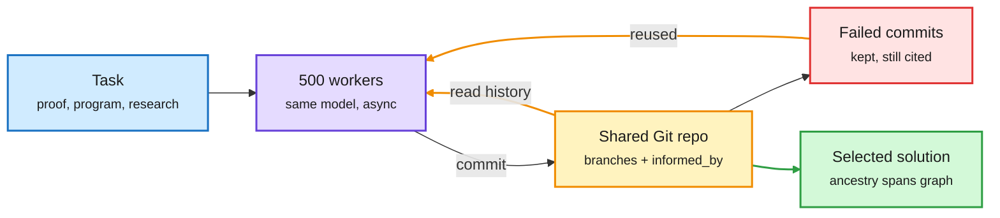

# Media Zone | 2026-10-12

> The US Sunday conversation was about not wasting compute you already paid for. Meta's GitSwarm keeps every agent attempt, failures included, in one shared Git repo; Amazon's Research World Models use experiment logs to decide which runs deserve GPU hours; Vals AI priced the opposite case, agent teams that only message each other, at up to 5.1x the bill for one real win in four. The routing gate kept shrinking and learned to see (Decision 3.0, THX-01), and by the US evening the money story was Amazon's reported ~$7B Decart talks, a buy of the software that keeps Trainium busy.

## Today's signal

- **Dominant story (agents, cost):** GitSwarm, "compounding inference". 500 agents sharing one Git repo beat one long-running Codex agent on ProgramBench, 79.4% vs 65.1%, and reused 70% of failed commits.
- **Counter-signal:** Vals AI found agent teams of GPT-6 Sol or Opus 5.5 cost 1.8-5.1x more, with one significant gain in four tests. Persistent artifacts compound; chatter does not.
- **Routing:** Decision 3.0 makes open decision models multimodal (0.6B-26B), and THX-01 publishes the category's first calibration error (ECE 0.003, self-reported). Two vendors claim the same vision-board lead.
- **Hardware and money:** Amazon in talks for Decart (~$7B; video 26 to ~101 fps on Trainium); IREN reportedly signs Anthropic for B300 capacity; investors call inference hosting a reverse auction.
- **Quiet areas:** no new saved posts in any run this window (feed capture worked, so this is no saves, not an auth failure); LinkedIn posts came without text; YouTube subscriptions had no AI videos; no Reddit posts passed filters.

---

## Routing, KV cache, compression, GPU

### Smaller gates, cheaper cache

Open weights · multimodal decision models
<h4>Decision 3.0: the routing gate learns to see</h4>

The vLLM Semantic Router team (vllm-sr) released Decision 3.0, open multimodal decision models from 0.6B to 27B. A decision model is a small model that answers one typed question (which model, which tool, is this done) so the expensive model is only called when needed. Decision 2.0 (10-05) was text only, in six sizes. Version 3.0 adds image and screen input, which matters for computer-use agents, where the routing decision often depends on what is on screen. The team claims first place on both Jev Decision Index boards "in our evaluation" and a new size-versus-accuracy frontier. Cost angle: a 0.6B gate that reads a screenshot is far cheaper than sending every step to a frontier vision model.

<a href="https://huggingface.co/collections/vllm-sr/decision-30">HF collection →</a> · <a href="https://x.com/XunzhuoLiu/status/2109207207284027737">Post →</a>

Open weights · rival claim
<h4>JEV-27B-VL passes 1.5M downloads and also claims the vision board</h4>

AutoTrust says its open multimodal decision model JEV-27B-VL went from 179K to 1.54M downloads and leads the Jev Decision Index vision board at 77.8% across 13,695 examples. It takes screens, images and text and returns calibrated probabilities over actions, for computer use, recommendation and agent evaluation. That directly conflicts with Decision 3.0's "#1 on both boards". The two claims may use different evaluation runs. Until the board publishes one table, treat both as vendor numbers. The download count is the stronger signal: people are actually pulling decision models into stacks.

<a href="https://huggingface.co/autotrust/JEV-27B-VL">Model card →</a> · <a href="https://x.com/AutoTrustAI/status/2109156672698786002">Post →</a>

Open weights · decision model
<h4>THX-01: a 322M decision model with calibrated outputs</h4>

HAL-X released THX-01, a non-generative model built on an mmBERT encoder with a small decision head. You give it a state (a ticket, email, document or agent trace) and typed questions. In one pass of about 10 ms it returns a choice, a yes/no probability, a score, an extracted number or a verbatim quote with citation. It was trained with "RL for Calibrated Decisions", where the reward is a proper scoring rule, so the only way to score well is to report honest probabilities. That matters for routing, because a confidence you can trust lets you send low-confidence cases on to a bigger model. It is the smallest member yet of the decision-model category that formed on 10-11 (Microsoft-Decision-1, Liquid d1, Vega). Apache 2.0. The "beats Jev" claim is the authors' own.

<a href="https://huggingface.co/doofz/THX-01">Model card →</a> · <a href="https://x.com/reversedoofz/status/2109228322752471304">Post →</a>

Pricing · prompt cache
<h4>Anthropic halves Sonnet 5.5 cache-read prices</h4>

A Sunday newsletter quick hit says Anthropic cut the price of cache reads (re-using a stored prompt prefix instead of recomputing it) on Sonnet 5.5 by half. For agent workloads that resend the same long system prompt and tool list on every turn, cache reads are a large share of the bill. Combined with Haiku 5.5's roughly 4x price cut from 10-07, the cost of a cached agent turn on Anthropic dropped noticeably this week. Only one source so far, so check the official pricing page before relying on it.

<a href="https://mail.google.com/mail/u/0/#inbox/1a12b043b52e36b8">Via Future &amp; AI →</a>

Explainer · cross-source (X + newsletter)
<h4>Speculative decoding, explained right</h4>

A widely shared explainer walks through why speculative decoding works. Plain decoding reads all weights from memory for every token, so compute sits idle. A small draft model guesses several tokens ahead, and the big target model checks all of them in one pass. Each guess is accepted with probability min(1, p/q), where p is the target's probability and q the draft's. On the first rejection, the token is resampled from the leftover difference between the two distributions. That rule is why the output distribution matches the target model exactly, so the speedup is free in quality. The post points to Uzu, the Apple Silicon engine that hit 92 tokens/s on a 9B model (10-10). The Sunday newsletter also ran a speculative decoding explainer, so the topic is going mainstream.

<a href="https://x.com/akshay_pachaar/status/2109321447604982026">Thread →</a> · <a href="https://github.com/trymirai/uzu">Uzu repo →</a>

Practitioner checklist · serving
<h4>The AI infra engineer's project list</h4>

This post reached far more people than its author's usual audience. It lists the core serving projects: tune vLLM/SGLang chunked prefill and batching for one GPU, build a KV-cache prefix-routing proxy that sends a request to the replica already holding its system-prompt cache, write a fused Triton RMSNorm/RoPE kernel, and run a 2B-draft/70B-target speculative decoding pipeline. Its numbers ("60% VRAM wasted", "80% lower time to first token") are rules of thumb, not measurements. Prefix-aware routing is the item most likely to pay off at scale.

<a href="https://x.com/suraj_sharma14/status/2109252678387724559">Thread →</a>

---

## Hardware and semiconductors

M&amp;A · custom silicon utilization
<h4>Amazon in talks to buy Decart for about $7B</h4>

The WSJ reports Amazon is negotiating to buy Decart after Nvidia talks and a $6B Anthropic deal both fell through. Decart builds real-time world models, but the asset Amazon wants is its DOS optimization stack, which moves workloads across chips and took real-time video from 26 fps on GPUs to about 101 fps on Trainium. Custom silicon only beats Nvidia on cost per token if software keeps it busy, so this is a utilization purchase. The price is about 75% above Decart's $4B May valuation. The speedups are Decart's own, on its own video models, so the open question is whether they carry over to customers' LLMs.

<a href="https://x.com/rohanpaul_ai/status/2109479701689565297">Report →</a> · <a href="https://x.com/StockSavvyShay/status/2109400560827068496">Trainium numbers →</a>

Compute deal · inference market
<h4>IREN signs Anthropic; inference as a reverse auction</h4>

IREN reportedly signed a multiyear cloud deal with Anthropic, possibly 50 MW of B300 capacity at Childress, and the stock rose nearly 8%. On the same evening, investor Jaya Gupta argued hosted inference is a "permanent reverse auction": data centers justify giant rounds, neolabs rent out spare compute, and app companies switch providers with one line of code. The two fit together: capacity keeps arriving, so price per token keeps falling, and the winners are whoever owns cheap, busy capacity.

<a href="https://x.com/StockSavvyShay/status/2109443155255005364">IREN →</a> · <a href="https://x.com/JayaGup10/status/2109414688924856810">Reverse auction →</a>

Edge compute · demand signal
<h4>Qualcomm: labs want 100B-parameter models on phones by 2028</h4>

Qualcomm's CEO reportedly said leading AI companies are asking for phones that can run 100B-parameter models continuously by 2028, and that some labs are building their own phones. Running 100B parameters always-on is mostly a memory-capacity and bandwidth problem, which points to aggressive quantization (storing weights in fewer bits) and on-device KV-cache compression. Second-hand quote, no transcript linked.

<a href="https://x.com/VaibhavSisinty/status/2109290474599297312">Post →</a>

Fabs · chip supply
<h4>Terafab starts on conventional tools; AMD's World Labs logic; Vera as a CPU business</h4>

Musk says Terafab's roughly $17B first phase will use standard ASML and Applied Materials equipment before moving to custom high-throughput tools, and he is recruiting chip engineers in public. Separately, investor accounts frame AMD's $8B World Labs deal as owning a memory-heavy workload to steer HBM roadmaps, and project Nvidia's Vera CPU reaching about $60B by 2028 as agent orchestration increases CPU demand. All three are investor framing, not filings.

<a href="https://x.com/StockSavvyShay/status/2109255508553056418">Terafab →</a> · <a href="https://x.com/StockSavvyShay/status/2109299862202163409">AMD →</a> · <a href="https://x.com/StockSavvyShay/status/2109303815874748600">Vera →</a>

---

## LLMs, agents, safety

### Compounding inference: making compute accumulate

Every attempt becomes a commit the next agent can build on

No planner. Workers choose to explore, verify, refine or combine, and they cite the commits they build on.

Blue is the task, purple is the agent pool, amber is the shared memory loop, red is failed work that still gets reused, green is the result.

Paper · cross-source (X + DAIR)
<h4>GitSwarm: Decentralized Compounding Inference (Meta Superintelligence Labs)</h4>

Most extra inference compute goes into separate attempts, and when an attempt ends its partial work and dead ends are lost. GitSwarm gives hundreds of identical asynchronous agents one branchable Git repo. Each contribution is an atomic commit with an <code>informed_by=</code> field naming the earlier commits it builds on. With GPT-5.5 Codex workers it solved all 30 IMOProofBench-Advanced problems in one run on under 1M output tokens. On ProgramBench it scored 79.4% vs 65.1% for one Codex agent told to keep going at a similar budget, and it improves with more workers (73.1% at 100, 79.4% at 500). The key number for cost: 94.7% of contributions get built on, and 70.1% of failed research commits are cited by later accepted work, so failures are not wasted spend. The open question is the wall-clock and dollar cost of 500 frontier workers compared with a better-routed single agent.

<a href="https://arxiv.org/abs/2610.04862">Paper →</a> · <a href="https://x.com/omarsar0/status/2109287161199812802">@omarsar0 →</a> · <a href="https://academy.dair.ai/papers/gitswarm-decentralized-compounding-inference-2610.04862">DAIR take →</a>

Paper · compute allocation
<h4>Language Models as Research World Models (Amazon)</h4>

Research agents can propose experiments much faster than anyone can pay to run them. This paper asks an LLM to predict an experiment's gain before it runs. It is tested on 2,600+ real experiment records from nine setups (pretraining, post-training, inference) representing 171K H100-hours. Feeding in past records from the same setup raised ranking correlation from 0.506 to 0.774. Pretraining experience from OLMo3, Marin and Nanochat cut selection regret on Qwen3 by 78%. Across 13 models, adding experimental history helped more than switching to a stronger model or raising reasoning effort. The takeaway: log every run, failures included, because the log is what makes the next GPU hour pay off. It pairs with GitSwarm and with Meta FAIR's research-preference-model line (2608.13940).

<a href="https://arxiv.org/abs/2610.12235">Paper →</a> · <a href="https://x.com/rohanpaul_ai/status/2109243398628708619">Post →</a>

Benchmark · cost counter-signal
<h4>Vals AI: agent teams cost 1.8-5.1x for one win in four</h4>

Vals AI ran GPT-6 Sol and Claude Opus 5.5 alone and as teams, at medium and maximum reasoning effort, on Vibe Code Bench. Teams cost 1.8x to 5.1x more, and only one comparison was significant: Sol at medium effort, +7.3 points. At maximum effort teams added nothing, so team size and reasoning effort act as substitutes. Anthropic's own Opus 5.5 numbers agree that gains flatten after about 10 agents. Read it next to GitSwarm: messaging teams pay a coordination tax, while artifact-sharing swarms seem to compound.

<a href="https://the-decoder.com/ai-agent-teams-waste-massive-tokens-for-barely-measurable-quality-gains-research-finds/">The Decoder →</a> · <a href="https://www.vals.ai/blogs/multi-agent-vibe-code-bench">Vals AI →</a>

Paper · self-improvement
<h4>MASS: a model that trains on its own best team runs (Sakana)</h4>

Sakana's Multi-Agent Self-Supervision (with UC Berkeley) had the day's most-shared research post. One shared 27B open model works as a team of virtual subagents, searches for better team workflows, judges the results itself, and trains on the best team's executions. After two cycles, score per output token reached 1.2-1.6x the base model. Training only the solver role also improved the model as optimizer and evaluator. Sakana itself flags the risk: a model grading itself can reinforce its own blind spots as progress. First covered 10-11; today it went wide.

<a href="https://arxiv.org/abs/2610.12176">Paper →</a> · <a href="https://x.com/SakanaAILabs/status/2109385006603006435">Post →</a>

Weekly picks · harness theme
<h4>DAIR Top Papers (Oct 5 to 11): Harness Learning leads</h4>

DAIR's weekly list puts Harness Learning first. In that CMU paper, a proposer model learns to revise the harness (the code that organizes model calls, tools and information flow) instead of the model weights. Also listed: VERA, HERMES, CorpusMap, VeriHarness, Sharpening Tax and Multi-Agent Self-Supervision. Two of the seven are harness papers, continuing the harness-engineering pattern from HarnessSQL (10-11).

<a href="https://x.com/dair_ai/status/2109270533640433878">List →</a> · <a href="https://x.com/dair_ai/status/2109270464962916674">Harness Learning →</a>

Paper · agent benchmark
<h4>AAArena: agents learning game bots from replays (Tsinghua)</h4>

A coding agent with frozen weights reads the rules, studies match replays and rewrites its bot across 12 contest games, competing against 1,920 archived human programs. Detailed replays beat win/loss feedback in every game tested (a Pacman bot went from rank 11 to rank 1). Tripling the match budget did not get any of four stuck bots to rank 1, so more compute did not fix the bots that stalled on complex rules.

<a href="https://arxiv.org/abs/2610.12341">Paper →</a> · <a href="https://x.com/rohanpaul_ai/status/2109268277805629760">Post →</a>

---

## Industry and business

- **Swarms force metered pricing:** child agents do narrow, checkable jobs that route to the cheapest passing model, so agent token volume outruns frontier revenue and per-seat pricing breaks. ([post](https://x.com/rohanpaul_ai/status/2109345465838006445))
- **Karpathy's capability funnel:** about 6B people barely use LLMs, ~20M use frontier models professionally, ~5,000 inside labs see weeks-long agent swarms. The understanding gap is widening. ([post](https://x.com/karpathy/status/2109361546505966046))
- **Uber's MCP gateway** fronts 800+ servers and 5,000+ auto-generated tools; every server starts disabled until its owner enables it. ([post](https://x.com/stretchcloud/status/2109352834802258326))
- **White House restores UK access** to frontier models for safety testing, per a Tony Diver exclusive. ([repost](https://x.com/Miles_Brundage/status/2109397921603178850))
- **Harness talk:** Domingos reads Harness Learning as "the model swallows the harness"; Musk compares it to Tesla FSD eating its C++. Garry Tan argues the reverse: swap LLM calls for deterministic code. ([Domingos](https://x.com/pmddomingos/status/2109420932955804040) · [Tan](https://x.com/garrytan/status/2109410082769482174))
- **Tab** exits stealth at a $300M valuation; **Meta Muse** day-7 retention tops ChatGPT. ([Tab](https://x.com/Ronald_vanLoon/status/2109370706030903803) · [Muse](https://x.com/deedydas/status/2109474596366004417))
- **REA** (agents that reverse-engineer apps down to native binaries for Claude Code/Codex) is still the top trending repo, now about 92K stars, and Garry Tan amplified it this afternoon. First covered 10-10; the "death of software" framing is hype. ([repo](https://github.com/morluto/rea) · [RT](https://x.com/garrytan/status/2109341633800229114))
- **Satya Nadella:** "separate the supply of intelligence from the authority over it." Treat agents as insider risks with separate identity, permissions and kill switches. This continues Microsoft's containment push from 10-11. ([post](https://x.com/StockSavvyShay/status/2109279196975435996))
- **Microsoft Execution Containers (MXC)** went GA on 10-07: policies on files, network and processes enforced outside the agent. Frontier Research reads the containment rhetoric as a sales pitch for this layer. ([analysis](https://www.thisisfrontier.ai/news/microsoft-makes-execution-containers-ga-moving-agent-trust-into-the-runtime))
- **Anthropic's AI-native SDLC playbook** (from August) is recirculating: versioned specs, skills for policy, hooks for enforcement, continuous evals. It fits the harness theme. ([playbook](https://claude.com/resources/articles/the-ai-native-sdlc-playbook))
- **AWS** CEO says agents need "new building blocks", which points to serverless compute and Graviton CPU demand. ([post](https://x.com/StockSavvyShay/status/2109228189037756451))
- **Nvidia and Reflection AI:** FT reports early talks for Nvidia to acquire or invest further in the $25B open-weight lab. ([repost](https://x.com/rohanpaul_ai/status/2109260111067971603))
- **Ed Zitron, "Dead Money":** AI firms need about $400B a year in revenue for hyperscalers to break even on 2026-27 capex and are at least $260B short. ([essay](https://www.wheresyoured.at/dead-money/))
- **Nano Banana 2.1** (Gemini 3.6 Flash based, mask editing, 4K) and **MAI-Code-1.1-Flash** (Microsoft, about a quarter of the cost) are recapped in the Sunday newsletter. ([Future &amp; AI](https://mail.google.com/mail/u/0/#inbox/1a12b043b52e36b8))
- **Deedy Das** lists Indian-born founders behind US AI companies (Perplexity $20B, Baseten $13B, Together $8B, Modal $5B) and argues US capital markets keep pulling founders across. ([post](https://x.com/deedydas/status/2109258111265751391))

## Also crossed your feeds

Sander Dieleman on diffusion-LM evaluation with sliced Wasserstein distances ([post](https://x.com/sedielem/status/2109268932943028475), [blog](https://sander.ai/2026/08/24/continuous-dlms.html)) · Meta FAIR hiring research engineers for recursive self-improvement ([post](https://x.com/xl_nlp/status/2108670775809220928)) · Claude Code Opus-plans/Sonnet-codes/Haiku-searches settings recipe ([post](https://x.com/cyrilXBT/status/2108867649086300218)) · Agent Standup VS Code extension for watching sub-agents ([post](https://x.com/VaibhavSisinty/status/2109252948064874662)) · Terence Tao, "Math 2.0": optimizing only for problem-solving now harms mathematics ([post](https://x.com/rohanpaul_ai/status/2109224043929026862)) · reverse-engineered ChatGPT Intelligent UI (custom DIL language, about 70 components) · MIT/Meta DREAM unified image model · Exa ATLAS shows search agents still struggle · Liquid open decision models and NVIDIA LongLive (newsletter recaps) · Tesla Cybercab fleet at 300+ in Austin · Baidu "Unlimited OCR", a 3B model said to parse 100-page PDFs in one 32K-context pass (hype-framed, unverified) ([post](https://x.com/BrooksWhaleX/status/2109080341642363349)) · NVIDIA PersonaPlex-7B full-duplex voice model ([post](https://x.com/oliviscusAI/status/2109245289798549819)) · JEPA paper on which parts of a learned state stay invariant ([post](https://x.com/zhuokaiz/status/2108929304788975790)) · McKinsey slide on 2030 AI workloads ([post](https://x.com/Omercheema/status/2109019571885625556)) · repost of SemiAnalysis's estimate that Anthropic subscribers get 4x the compute per dollar of API buyers (covered 10-11) · AlphaProof Nexus "9 Erdős problems" thread, recycled from May ([post](https://x.com/HowToPrompt__/status/2108982457815240859)) · PyTorchCon NA on-device and compiler track · GitHub Security Lab Fuzzing Taskflow agent ([post](https://x.com/github/status/2109364666237350135)) · Simons talk on agent failure attribution ([post](https://x.com/SharonYixuanLi/status/2108940784011796887)) · Northwestern math students question their field after OpenAI's paper dump ([post](https://x.com/rohanpaul_ai/status/2109358434177180101)). Skipped: a fabricated-looking "Karpathy: prompting is out, keep Graphs" talk promo, one-person-company prompt packs, "Claude books your sales calls, $30 free" ads, a memecoin "quantum radar", politics and stock tips.
