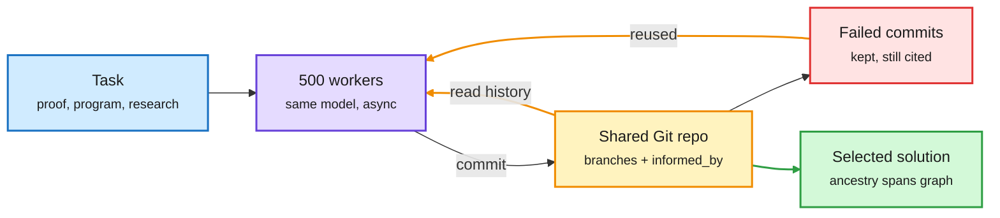

# Media Zone | 2026-10-12

> *Live draft: this window is still open. It is finalized with the 2026-10-12 digest at the 10:30 IST cutoff.*

> The US Sunday conversation so far is about making inference compute add up over time instead of being thrown away. Meta's GitSwarm keeps every agent attempt, failures included, in one shared Git repo. Amazon's Research World Models use logged experiment history to decide which runs deserve GPU hours. Both treat past compute as an asset you invest, not a cost you burn.

## Today's signal

- **Dominant story (agents, cost):** GitSwarm, "compounding inference". 500 agents sharing one Git repo beat one long-running Codex agent on ProgramBench, 79.4% vs 65.1%.
- **Pattern:** reuse past compute. GitSwarm reuses failed commits and Research World Models reuse experiment logs. Both are ways to cut wasted GPU spend.
- **Routing thread continues:** THX-01, a 322M open decision model (a small model that returns one calibrated choice in a single forward pass), extends Saturday's decision-model wave down to phone size.
- **Hardware:** Qualcomm says AI labs want phones that can run 100B-parameter models continuously by 2028. Musk says Terafab starts on standard ASML/AMAT tools. Both are single-source posts.
- **Counter-signal:** Ed Zitron's "Dead Money" argues AI firms are at least $260B short of the revenue needed to justify 2026-27 hyperscaler capex. Unverified "10,000 agents solved Navier-Stokes" hype is also circulating.
- **Quiet areas:** this window holds one X capture and one newsletter so far. No new bookmarks, YouTube or LinkedIn captures yet. Hugging Face and lab-release captures are stale, so expect a paper backlog at the 10:30 run.

---

## Routing, KV cache, compression, GPU

### Smaller gates, cheaper cache

Open weights · decision model
<h4>THX-01: a 322M decision model with calibrated outputs</h4>

HAL-X released THX-01, a non-generative model built on an mmBERT encoder with a small decision head. You give it a state (a ticket, email, document or agent trace) and typed questions. In one pass of about 10 ms it returns a choice, a yes/no probability, a score, an extracted number or a verbatim quote with citation. It was trained with "RL for Calibrated Decisions", where the reward is a proper scoring rule, so the only way to score well is to report honest probabilities. That matters for routing, because a confidence you can trust lets you send low-confidence cases on to a bigger model. It is the smallest member yet of the decision-model category that formed on 10-11 (Microsoft-Decision-1, Liquid d1, Vega). Apache 2.0. The "beats Jev" claim is the authors' own.

<a href="https://huggingface.co/doofz/THX-01">Model card →</a> · <a href="https://x.com/reversedoofz/status/2109228322752471304">Post →</a>

Pricing · prompt cache
<h4>Anthropic halves Sonnet 5.5 cache-read prices</h4>

A Sunday newsletter quick hit says Anthropic cut the price of cache reads (re-using a stored prompt prefix instead of recomputing it) on Sonnet 5.5 by half. For agent workloads that resend the same long system prompt and tool list on every turn, cache reads are a large share of the bill. Combined with Haiku 5.5's roughly 4x price cut from 10-07, the cost of a cached agent turn on Anthropic dropped noticeably this week. Only one source so far, so check the official pricing page before relying on it.

<a href="https://mail.google.com/mail/u/0/#inbox/1a12b043b52e36b8">Via Future &amp; AI →</a>

Practitioner checklist · serving
<h4>The AI infra engineer's project list</h4>

This post reached far more people than its author's usual audience. It lists the core serving projects: tune vLLM/SGLang chunked prefill and batching for one GPU, build a KV-cache prefix-routing proxy that sends a request to the replica already holding its system-prompt cache, write a fused Triton RMSNorm/RoPE kernel, and run a 2B-draft/70B-target speculative decoding pipeline. Its numbers ("60% VRAM wasted", "80% lower time to first token") are rules of thumb, not measurements. Prefix-aware routing is the item most likely to pay off at scale.

<a href="https://x.com/suraj_sharma14/status/2109252678387724559">Thread →</a>

---

## Hardware and semiconductors

Edge compute · demand signal
<h4>Qualcomm: labs want 100B-parameter models on phones by 2028</h4>

Qualcomm's CEO reportedly said leading AI companies are asking for phones that can run 100B-parameter models continuously by 2028, and that some labs are building their own phones. Running 100B parameters always-on is mostly a memory-capacity and bandwidth problem, which points to aggressive quantization (storing weights in fewer bits) and on-device KV-cache compression. Second-hand quote, no transcript linked.

<a href="https://x.com/VaibhavSisinty/status/2109290474599297312">Post →</a>

Fabs · chip supply
<h4>Terafab starts on conventional tools; AMD's World Labs logic; Vera as a CPU business</h4>

Musk says Terafab's roughly $17B first phase will use standard ASML and Applied Materials equipment before moving to custom high-throughput tools, and he is recruiting chip engineers in public. Separately, investor accounts frame AMD's $8B World Labs deal as owning a memory-heavy workload to steer HBM roadmaps, and project Nvidia's Vera CPU reaching about $60B by 2028 as agent orchestration increases CPU demand. All three are investor framing, not filings.

<a href="https://x.com/StockSavvyShay/status/2109255508553056418">Terafab →</a> · <a href="https://x.com/StockSavvyShay/status/2109299862202163409">AMD →</a> · <a href="https://x.com/StockSavvyShay/status/2109303815874748600">Vera →</a>

---

## LLMs, agents, safety

### Compounding inference: making compute accumulate

Every attempt becomes a commit the next agent can build on

No planner. Workers choose to explore, verify, refine or combine, and they cite the commits they build on.

Blue is the task, purple is the agent pool, amber is the shared memory loop, red is failed work that still gets reused, green is the result.

Paper · cross-source (X + DAIR)
<h4>GitSwarm: Decentralized Compounding Inference (Meta Superintelligence Labs)</h4>

Most extra inference compute goes into separate attempts, and when an attempt ends its partial work and dead ends are lost. GitSwarm gives hundreds of identical asynchronous agents one branchable Git repo. Each contribution is an atomic commit with an <code>informed_by=</code> field naming the earlier commits it builds on. With GPT-5.5 Codex workers it solved all 30 IMOProofBench-Advanced problems in one run on under 1M output tokens. On ProgramBench it scored 79.4% vs 65.1% for one Codex agent told to keep going at a similar budget, and it improves with more workers (73.1% at 100, 79.4% at 500). The key number for cost: 94.7% of contributions get built on, and 70.1% of failed research commits are cited by later accepted work, so failures are not wasted spend. The open question is the wall-clock and dollar cost of 500 frontier workers compared with a better-routed single agent.

<a href="https://arxiv.org/abs/2610.04862">Paper →</a> · <a href="https://x.com/omarsar0/status/2109287161199812802">@omarsar0 →</a> · <a href="https://academy.dair.ai/papers/gitswarm-decentralized-compounding-inference-2610.04862">DAIR take →</a>

Paper · compute allocation
<h4>Language Models as Research World Models (Amazon)</h4>

Research agents can propose experiments much faster than anyone can pay to run them. This paper asks an LLM to predict an experiment's gain before it runs. It is tested on 2,600+ real experiment records from nine setups (pretraining, post-training, inference) representing 171K H100-hours. Feeding in past records from the same setup raised ranking correlation from 0.506 to 0.774. Pretraining experience from OLMo3, Marin and Nanochat cut selection regret on Qwen3 by 78%. Across 13 models, adding experimental history helped more than switching to a stronger model or raising reasoning effort. The takeaway: log every run, failures included, because the log is what makes the next GPU hour pay off. It pairs with GitSwarm and with Meta FAIR's research-preference-model line (2608.13940).

<a href="https://arxiv.org/abs/2610.12235">Paper →</a> · <a href="https://x.com/rohanpaul_ai/status/2109243398628708619">Post →</a>

Weekly picks · harness theme
<h4>DAIR Top Papers (Oct 5 to 11): Harness Learning leads</h4>

DAIR's weekly list puts Harness Learning first. In that CMU paper, a proposer model learns to revise the harness (the code that organizes model calls, tools and information flow) instead of the model weights. Also listed: VERA, HERMES, CorpusMap, VeriHarness, Sharpening Tax and Multi-Agent Self-Supervision. Two of the seven are harness papers, continuing the harness-engineering pattern from HarnessSQL (10-11).

<a href="https://x.com/dair_ai/status/2109270533640433878">List →</a> · <a href="https://x.com/dair_ai/status/2109270464962916674">Harness Learning →</a>

Paper · agent benchmark
<h4>AAArena: agents learning game bots from replays (Tsinghua)</h4>

A coding agent with frozen weights reads the rules, studies match replays and rewrites its bot across 12 contest games, competing against 1,920 archived human programs. Detailed replays beat win/loss feedback in every game tested (a Pacman bot went from rank 11 to rank 1). Tripling the match budget did not get any of four stuck bots to rank 1, so more compute did not fix the bots that stalled on complex rules.

<a href="https://arxiv.org/abs/2610.12341">Paper →</a> · <a href="https://x.com/rohanpaul_ai/status/2109268277805629760">Post →</a>

---

## Industry and business

- **REA** (agents that reverse-engineer apps down to native binaries for Claude Code/Codex) is still the top trending repo, now about 92K stars. First covered 10-10; the "closed source is dead" framing is hype. ([repo](https://github.com/morluto/rea))
- **Satya Nadella:** "separate the supply of intelligence from the authority over it." Treat agents as insider risks with separate identity, permissions and kill switches. This continues Microsoft's containment push from 10-11. ([post](https://x.com/StockSavvyShay/status/2109279196975435996))
- **AWS** CEO says agents need "new building blocks", which points to serverless compute and Graviton CPU demand. ([post](https://x.com/StockSavvyShay/status/2109228189037756451))
- **Nvidia and Reflection AI:** FT reports early talks for Nvidia to acquire or invest further in the $25B open-weight lab. ([repost](https://x.com/rohanpaul_ai))
- **Ed Zitron, "Dead Money":** AI firms need about $400B a year in revenue for hyperscalers to break even on 2026-27 capex and are at least $260B short. ([essay](https://www.wheresyoured.at/dead-money/))
- **Nano Banana 2.1** (Gemini 3.6 Flash based, mask editing, 4K) and **MAI-Code-1.1-Flash** (Microsoft, about a quarter of the cost) are recapped in the Sunday newsletter. ([Future &amp; AI](https://mail.google.com/mail/u/0/#inbox/1a12b043b52e36b8))
- **Deedy Das** lists Indian-born founders behind US AI companies (Perplexity $20B, Baseten $13B, Together $8B, Modal $5B) and argues US capital markets keep pulling founders across. ([post](https://x.com/deedydas/status/2109258111265751391))

## Also crossed your feeds

Sander Dieleman on diffusion-LM evaluation with sliced Wasserstein distances ([post](https://x.com/sedielem/status/2109268932943028475), [blog](https://sander.ai/2026/08/24/continuous-dlms.html)) · Meta FAIR hiring research engineers for recursive self-improvement ([post](https://x.com/xl_nlp/status/2108670775809220928)) · Claude Code Opus-plans/Sonnet-codes/Haiku-searches settings recipe ([post](https://x.com/cyrilXBT/status/2108867649086300218)) · Agent Standup VS Code extension for watching sub-agents ([post](https://x.com/VaibhavSisinty/status/2109252948064874662)) · Terence Tao, "Math 2.0": optimizing only for problem-solving now harms mathematics ([post](https://x.com/rohanpaul_ai)) · reverse-engineered ChatGPT Intelligent UI (custom DIL language, about 70 components) · MIT/Meta DREAM unified image model · Exa ATLAS shows search agents still struggle · Liquid open decision models and NVIDIA LongLive (newsletter recaps) · Tesla Cybercab fleet at 300+ in Austin. Skipped: "Claude books your sales calls, $30 free" ads, a memecoin "quantum radar", politics and stock tips.
