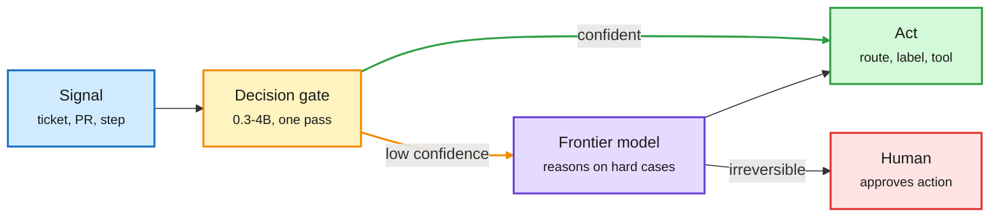

# Media Zone | 2026-10-13

> *Live draft: this window is still open. It is finalized with the 2026-10-13 digest at the 10:30 IST cutoff.*

> The US Monday conversation is about where the cheap tokens come from. Microsoft says Maia 300 will be its main inference chip at 40% more tokens per watt, AMD ships an agent rack with a built-in token router, and on the software side the routing gate keeps moving down: onto a Mac, into a 300M encoder, into Claude Code's own advisor setup. Under it runs a five-paper thread on agents that improve themselves, and a careful null result on agent memory that cuts against the hype.

## Today's signal

- **Dominant story (hardware, cost):** Microsoft makes Maia its primary inference silicon. Maia 300 claims 40% more tokens per watt than leading GPU systems, multi-GW from 2027.
- **Pattern (routing):** the decision gate goes local. Decision 3.0 runs on Core ML at 0.12 s per call; a 300M EmbeddingGemma 2 model lands ~6 points behind a 27B LLM.
- **Pattern (agents):** five self-improvement papers in one US day: Agent Plasticity, Double Ratchet, RSI-Anything, MASS, Fork-and-Flush. The field is now measuring learning, not just scores.
- **Counter-signal:** a UCLA paper finds agent persistent memory adds KV cost with no detectable accuracy gain. Decomposition helps; the memory tier does not, on these benchmarks.
- **Money:** Schmidt and Hock Tan both say capital, not power, is the next wall. Micron dipped below $1,000 on CXMT DRAM news.
- **Quiet areas:** no new saved posts this window (feed capture worked, so no saves, not an auth failure); no newsletters yet; no new YouTube, LinkedIn or Reddit captures in this window.

---

## Routing, KV cache, compression, GPU

### Tokens per watt becomes the headline spec

Custom silicon · cross-source (Nadella + Suleyman + analysts)
<h4>Microsoft: Maia becomes the primary inference system</h4>

Satya Nadella called Maia Microsoft's "biggest bet yet" on its own silicon, with multi-gigawatt deployments starting next year. Maia 300 is a multi-chiplet design: compute, memory control and I/O are split into separate dies packaged as one chip, so the compute dies spend their area on math. A rack holds 96 accelerators in 167 kW with 27.6 TB of HBM (high-bandwidth stacked memory), claimed at up to 7x the token throughput of a Maia 200 rack. Microsoft's framing is that moving data, not arithmetic, now limits large inference. Maia 200 already serves Copilot. All numbers are Microsoft's own; the useful read is that a hyperscaler now quotes tokens per watt, not FLOPs, as the competitive metric.

<a href="https://x.com/rohanpaul_ai/status/2109643277930795246">Breakdown →</a> · <a href="https://x.com/mustafasuleyman/status/2109655335250366752">Suleyman →</a>

Hardware · routing in the rack
<h4>AMD Helion: a CPU rack for agents, with a token router</h4>

AMD launched Helion, an agent-serving rack with up to 33K EPYC cores, backed by Dell, HPE, Cisco and Supermicro. The bet is that agent loops (tool calls, sandboxes, orchestration) burn CPU, not just GPU. AMD says it is also building in a token router that sends each request to the most cost-effective model. That is routing moving from a software library into a hardware vendor's pitch. Details on the router are thin so far.

<a href="https://x.com/StockSavvyShay/status/2109631805011927480">Post →</a>

Networking + memory
<h4>Spectrum-6 at Meta, 400G optics, and a CXMT scare</h4>

Meta is adopting Nvidia Spectrum-6 switches for its Vera Rubin clusters, using its own open-source software to connect 100K+ GPUs with fewer network layers, even while it builds MTIA chips. Nvidia and Cisco also introduced a pluggable optics standard at 400 Gb/s per lane, up to 6.4 Tb/s per module, and Nvidia is backing both pluggable and co-packaged optics. Separately, Micron fell below $1,000 on reports that China's CXMT will ship denser server DRAM by year-end despite equipment controls. The near-term risk is commodity DRAM pricing, not HBM.

<a href="https://x.com/StockSavvyShay/status/2109665282788900999">Meta →</a> · <a href="https://x.com/StockSavvyShay/status/2109661544829325332">Optics →</a> · <a href="https://x.com/StockSavvyShay/status/2109640675910471984">CXMT →</a>

### The routing gate moves down the stack

Most calls never wake the big model

Today's posts all describe the same shape: a tiny gate answers, and only low-confidence cases escalate.

Blue is input, amber is the cheap gate, purple is the frontier model, green is the action, red is the human stop.

Open weights · on-device
<h4>Decision 3.0 on Core ML: routing without leaving the Mac</h4>

FluidInference converted the vLLM Semantic Router team's Decision 3.0 models (lite 0.8B, nano 2B, mini 4B, built on Qwen3.5) to Core ML for Apple silicon, including the vision tower. A decision model reads a prompt and returns a probability for every option in one forward pass, with no text generated. The demo triages 1,000 vLLM pull requests into workgroups at 0.12 s per PR on an M5 Pro, all local. Decision 3.0 itself was covered on 10-12; the news here is that the gate now fits on a laptop, which removes the network hop from every routing call.

<a href="https://huggingface.co/FluidInference/d3-coreml">Model →</a> · <a href="https://github.com/FluidInference/FluidUse">FluidUse →</a> · <a href="https://x.com/Alex_tra_memory/status/2109343807854493724">Post →</a>

Open weights · tiny decision model
<h4>Typed Decision on EmbeddingGemma 2</h4>

Manuel Romero fine-tuned EmbeddingGemma 2, an embedding encoder, into a typed decision model: give it a state plus a schema of questions and it returns a choice, a score or a null, calibrated, with no output parsing. It scores 76.4% on a typed-decisions eval, about 6 points behind a 27B LLM with roughly 100x fewer parameters. Self-reported, single eval. It is another point on the size-versus-accuracy curve that THX-01 (322M, 10-12) opened: the gate is shrinking toward encoder size.

<a href="http://huggingface.co/mrm8488/embeddinggemma-2-ft-typed-decision">Model →</a> · <a href="https://x.com/mrm8488/status/2109406679045423394">Post →</a>

Practice · Claude Code advisor pattern
<h4>Sonnet builds, Haiku explores, Opus advises</h4>

Two widely shared threads walk through Claude Code's advisor tool: run the session on Sonnet, send file search and grep to read-only Haiku subagents, and keep Opus on call. Opus is consulted before a plan locks, when the same error hits twice, and before declaring done. Isolated worktrees keep hundreds of thousands of discovery tokens out of the main context. This is model routing done by role inside one harness. A builder replied with Campfire, which runs several vendors' coding agents side by side with per-backend cost tracking. Treat the hype framing loosely; the docs are the source.

<a href="http://code.claude.com/docs/en/advisor">Advisor docs →</a> · <a href="https://x.com/thedelost/status/2109369295860035641">Thread →</a> · <a href="https://github.com/stretchcloud/campfire">Campfire →</a>

Distillation in production · cross-source
<h4>Coinbase: a fine-tuned 9B beats a frontier model on fraud</h4>

Brian Armstrong says Coinbase fine-tuned Qwen3.5-9B on its internal fraud labels and it outperformed a frontier model; a follow-up thread cites up to 35 points better recall, 0.68 s per answer versus 1.5-3.3 s, on one GPU. The reason is simple: proprietary fraud patterns are not in any pretraining data. The cost lesson is the one this wiki keeps logging: high-volume, narrow calls move to small owned models, and the frontier model designs the system. Numbers come from the company and a commentator, not a paper.

<a href="https://x.com/aakashgupta/status/2109603235640361028">Thread →</a> · <a href="https://x.com/Thom_Wolf/status/2109562569136488925">Armstrong (via Wolf) →</a>

### Agent memory: what it costs, what it buys

Paper · KV cache · DAIR pick
<h4>Persistent memory in multi-agent inference adds cost, not accuracy</h4>

UCLA and colleagues measure a three-tier chain-of-agents system on long-context tasks. Splitting the work across agents works: peak KV cache (the stored attention state that grows with context) drops to 14.3 MiB per query versus about 35 MiB for single-pass and RAG, and latency falls from 52-67 s to 29 s. The persistent tier that stores and recalls reasoning traces does not pay off: +0.368 MiB of cache and +0.015 accuracy with a confidence interval crossing zero. The authors argue the null is structural, since single-question benchmarks give each item its own evidence, so there is nothing useful to recall. They also report four measurement corrections, three of which had inflated the benefit. A useful check on the many viral "agents with memory" claims.

<a href="https://arxiv.org/abs/2610.07782">Paper →</a> · <a href="https://x.com/omarsar0/status/2109643758228869175">Post →</a>

---

## LLMs, agents, safety

### Self-improvement gets measured

Five papers on agents that improve from their own experience landed in one US day. The common move: stop asking "how good is the agent" and ask "how efficiently does it get better, and who checks."

Paper · Meta and others
<h4>Agent Plasticity: how well does an agent learn?</h4>

Weights stay frozen. The agent may only edit its memory, skills, strategy and Python tools after successes and failures, and is then tested on new held-out tasks. Agent plasticity measures held-out gain per unit of learning cost. Across Chess, Go, Hex and NetHack, frontier models with similar feedback show very different curves: one reaches the highest final skill, another learns more efficiently, and some stay flat or get worse. A common failure is that weak agents store the right skill and then never retrieve it. That echoes today's memory null result from the other direction.

<a href="https://arxiv.org/abs/2610.08902">Paper →</a> · <a href="https://x.com/Xudong07452910/status/2109487471730032943">Post →</a>

Paper · AWS + HSBC
<h4>Double Ratchet: the grader evolves with the agent</h4>

Self-improving agents usually need a human-written grader. Here the grader is built from small, mostly rule-based checks, one per failure type, and evolves alongside the agent's skills. A grader version is chosen only for agreeing with 10 labeled examples, never for raising the agent's score, which blocks the obvious reward hack. It kept 88-110% of the gain that ground truth or a rubric gave, across code, SQL and reports. Oddly, with safeguards removed the grader passed 97-100% of outputs yet still trained skills well, which deserves a closer look.

<a href="https://arxiv.org/abs/2610.11464">Paper →</a> · <a href="https://x.com/rohanpaul_ai/status/2109527405715161230">Post →</a>

Paper · test-time search
<h4>Fork-and-Flush: escaping "idea basins"</h4>

Dimitris Papailiopoulos and Microsoft collaborators found that long-running research agents develop tunnel vision, polishing one family of ideas like gradient descent stuck in a local minimum. They map these "idea basins" by having an LLM compare thousands of experiment pairs and embedding the result in 2D. The fix is basin hopping: periodically fork the agent into several copies in the same workspace with empty context, let them run, and continue from the best. At equal compute it beats single runs and best-of-N on 12 of 13 long-horizon tasks, some running 4+ days. It is a cheap, harness-level fix.

<a href="https://x.com/DimitrisPapail/status/2109661202733212136">Thread →</a>

Papers · world models + multi-agent RSI
<h4>RSI-Anything and Sakana's MASS</h4>

RSI-Anything uses a predictive world model (JEPA-Anything) to pick which actions and training data to try, then keeps policy updates only if they pass compatibility checks. Code repair rises from 26.3% to 31.2% with the coder fixed; lab planning more than doubles over five policy versions. Sakana and Berkeley's MASS has one base model propose, run and grade multi-agent workflows, then fine-tunes on the best trajectories; two cycles on Qwen3.6-27B give 1.2-1.6x more performance per output token. Both are claims on their own benchmarks.

<a href="https://arxiv.org/abs/2610.13912">RSI-Anything →</a> · <a href="https://arxiv.org/abs/2610.12176">MASS →</a> · <a href="https://x.com/SakanaAILabs/status/2109547739034108168">Sakana →</a>

### Harnesses and agent evaluation

Docs · Anthropic dynamic workflows
<h4>Fan out, then combine: 66 of 70 bugs, every run</h4>

Anthropic's docs for dynamic workflows report a test with 70 planted bugs in a 116K-line codebase. A single agent found 14, 15 and 27 across three runs; a multi-agent workflow found 66 every time. The workflow writes a plan, hands work to many agents in phases, then merges results. A run can launch up to 1,000 agents, all billed against your limits. Contrast with Vals AI (10-12), which found chatty agent teams cost up to 5.1x for rare gains: structured fan-out over a whole repo is the case where parallel agents pay.

<a href="https://code.claude.com/docs/en/workflows">Docs →</a> · <a href="https://x.com/Voxyz_ai/status/2109237583704445140">Post →</a>

Papers · benchmarks
<h4>Benchmarks that look like real work: SWE-TaskFlow and MiniCorp</h4>

JetBrains studied 4,782 real coding-agent sessions: features and bug fixes were well under half of requests, versus 93.8% of SWE-Bench Pro. Splitting 700 benchmark tasks into multi-turn flows roughly doubled agent cost with no stable change in success. MiniCorp (Microsoft and others) is an office simulator where a firm of agents runs an e-commerce company against a simulated market checked against real studies; checkpoints let the same state replay under a different decision, giving counterfactual enterprise data real records cannot.

<a href="https://arxiv.org/abs/2610.09633">SWE-TaskFlow →</a> · <a href="https://arxiv.org/abs/2610.05912">MiniCorp →</a>

---

## Multimodal / vision / audio

- **Tencent Youtu-Parsing (5B):** one local model turns PDFs, charts, audio and video into the same JSON schema; claims 96.96 on OmniDocBench v1.6. Custom license excludes the EU ([post](https://x.com/TeksEdge/status/2109313080807051742)).
- **Feature information dynamics in diffusion:** Westlake measures when each feature emerges during denoising; only diffusion in RAE representation space resolves abstract before concrete, and it converges fastest. Flagged by Sander Dieleman ([project](https://panjiashu.github.io/feature-information-dynamics/)).

---

## Industry and business

- **Capital is the next wall:** Eric Schmidt says $50B per gigawatt makes cash, not power, the limit; Broadcom's Hock Tan says investors "have no clue" as it backs a ~$60B chip-tied debt package ([Schmidt](https://x.com/rohanpaul_ai/status/2109638191934513541), [Tan](https://x.com/StockSavvyShay/status/2109625426817740826)).
- **Sora spin-out talks:** Katzenberg, ex-Sora lead Bill Peebles and ex-Dropbox CFO Sujay Jaswa's startup is negotiating deep access to OpenAI's shuttered Sora, with OpenAI taking equity, per The Information ([post](https://x.com/rohanpaul_ai/status/2109653202681659808)).
- **M&A:** AMD's $8B World Labs acquisition keeps circulating; IonQ buys Elisity for ~$1.3B; WSJ says Amazon is in ~$7B talks for Decart (covered 10-12) ([AMD](https://x.com/StockSavvyShay/status/2109527600720920925), [IonQ](https://x.com/StockSavvyShay/status/2109604046566985809), [Decart](https://x.com/rohanpaul_ai/status/2109615626516050372)).
- **Palantir + Ondas launch Regna AI**, sovereign AI stacks for governments on open models ([post](https://x.com/StockSavvyShay/status/2109616046319747295)).
- **Microsoft closes at $4T** the same day as the Maia announcement ([post](https://x.com/StockSavvyShay/status/2109652103002255633)).
- **Meta Muse retention** reportedly above ChatGPT at D7 (>30%); Alexandr Wang credits a deliberately small team ([retention](https://x.com/deedydas/status/2109653270579085538), [Wang](https://x.com/rohanpaul_ai/status/2109667055377019070)).

---

## Also crossed your feeds

OpenCode 2.0 shipped ([notes](https://anoma.ly/notes/opencode-2-0/)) · ManimGX, a Rust/wgpu 3D animation engine for agents, ~90x faster than ManimCE ([RT via Wolf](https://x.com/Thom_Wolf/status/2109619839341842480)) · a practitioner note that prompt caching is the hardest part of a production harness ([post](https://x.com/owengretzinger/status/2109402760500424755)) · DigitalOcean Signals turns frustrated production sessions into evals (sponsored framing) ([post](https://x.com/omarsar0/status/2109666287429255516)) · Gary Marcus on harnesses plus verifiers versus 2022 "pure LLMs" ([post](https://x.com/GaryMarcus/status/2109544001317880047)) · Stanford CS336 and CS329Z lectures going public ([CS329Z](https://cs329z.stanford.edu)) · DAIR's top papers of the week (Oct 5-11) ([RT](https://x.com/omarsar0/status/2109270977238696315)) · UCSD theory-of-mind reward for a 7B agent ([post](https://x.com/rohanpaul_ai/status/2109543088159174915)) · Nokia's Quillion-chip fiber card ([post](https://x.com/StockSavvyShay/status/2109602571534864500)) · skipped: free-token aggregators, "Claude can do WHAT" growth bait, politics, robot-video reposts.
