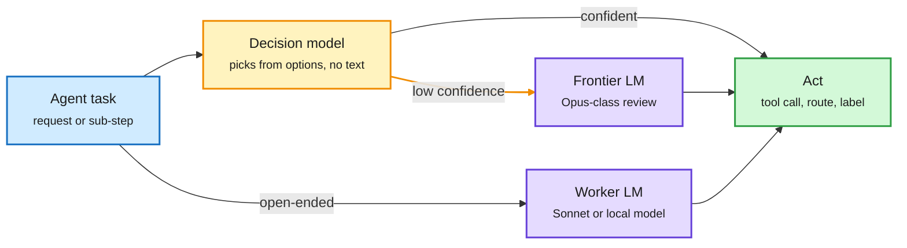

# Media Zone | 2026-10-14

> *Live draft: this window is still open. It is finalized with the 2026-10-14 digest at the 10:30 IST cutoff.*

> The US Tuesday conversation is about the cheapest place to make a decision. Decision models now read 1M tokens and answer without generating, Claude Code splits a session across three model sizes, and NVIDIA ships a local-to-cloud router with its new laptops. Underneath, memory is the bill: a KAIST paper cuts looped-transformer KV cache by 80%, AMD and Credo bolt cheap LPDDR onto HBM, and IBM shows a 98% prefix-cache hit rate is what makes open-model agent search 11x cheaper. On the agent side, harnesses are starting to train the models that run inside them.

## Today's signal

- **Dominant story (routing, cost):** decision models go long-context. ScaleDown claims 1M-token classify/extract/summarize at ~467x below frontier APIs; Jev, SubQ Snap and Claude Code's advisor all push the same split.
- **Pattern (memory):** KV cache and HBM are the constraint everyone is engineering around: ResidualQuant, a VRAM explainer going wide, HBM+LPDDR tiering from AMD/Credo and Intel's 480GB LPDDR5X D270.
- **Pattern (agents):** the harness learns. Google DeepMind's Evo² trains the model on its own harness edits; Meta/MIT's ReHarness rewrites old reflections after seeing outcomes.
- **Counter-signal:** a practitioner who has fine-tuned small models for three years says it "is a surefire way to experience the bitter lesson": cheap per call, expensive to maintain.
- **Safety, round two:** Anthropic's self-replication study keeps spreading as panic ("months away"), while skeptics push "read the actual research."
- **Quiet areas:** no new saved posts this window (bookmark run returned zero, no auth error logged); no YouTube, LinkedIn or Reddit captures in this window yet; the DAIR farmer is stale, though two DAIR picks arrived via X.

---

## Routing, KV cache, compression, GPU

### The decision gate gets a 1M-token window

The big model only sees the forks that need thinking

Every post in this cluster draws the same tree: a cheap gate first, escalation on low confidence.

Blue is the incoming task, amber is the cheap gate, purple is a generating model, green is the action taken.

Decision models · cross-source (omarsar0 + rohanpaul + several reposts)
<h4>ScaleDown: classify, extract, summarize over 1M tokens without generating</h4>

ScaleDown released three small "constrained decoding" models for the dull jobs agents usually hand to an expensive LLM: pull a due date out of a 300-page PDF, label a ticket, summarize a document. They read text and images once and point straight to the answer span or label, instead of writing tokens one at a time. The claims are 200x faster and ~467x cheaper than frontier APIs, around $0.04 per million tokens, with a 1M-token window. That window is the new part: yesterday's SubQ Snap stopped at 384K. All numbers are vendor claims; no independent eval yet.

<a href="https://x.com/omarsar0/status/2109984234018332879">Post →</a> · <a href="https://x.com/rohanpaul_ai/status/2109988217000976781">Breakdown →</a>

Routing in practice · open harness
<h4>Jev inside TrueForge: 150x cheaper matching, Opus only on low confidence</h4>

Akshay Pachaar built a client follow-up agent where every "pick one GitHub issue for this request" step goes to Jev, a decision model that returns a structured choice plus a calibrated confidence score. On 40 requests it matched Opus accuracy at 150x lower decision cost, and the low-confidence cases routed back to Opus caught 5 wrong matches. The harness, TrueFoundry's MIT-licensed TrueForge, keeps context small by loading tool definitions on demand and writing large outputs to files; it claims Claude-Managed-Agents-level task success on DevRev's Enterprise Bench at about a third of the tokens. A small test, but the escalation-on-confidence pattern is exactly what routing research proposes.

<a href="https://x.com/akshay_pachaar/status/2109909532352917658">Post →</a> · <a href="https://github.com/truefoundry/trueforge">Repo →</a>

Claude Code · model-tier routing
<h4>The advisor flag: Sonnet builds, Haiku explores, Opus reviews</h4>

Claude Code's experimental advisor tool pairs the main session model with a stronger model that is consulted only at key moments. The setup going around runs Sonnet as the driver, read-only Haiku subagents for repo search, grep and docs, and Opus as the advisor that reads the whole transcript before a plan locks, when the same error repeats, and before declaring done. It is a hand-built router: Opus context is spent only on decisions that need it. A related tip: subagents default to a 5-minute prompt cache, and a frontmatter setting extends it to an hour for long jobs, at a higher cache-write price.

<a href="https://code.claude.com/docs/en/advisor">Docs →</a> · <a href="https://x.com/skunzu/status/2109727705709084960">Thread →</a> · <a href="https://x.com/Retik_S/status/2110010351773245542">Cache tip →</a>

Local + cloud routing · cross-source (NVIDIA blog + Gradient Flow essay)
<h4>NVIDIA Switchyard and "local AI is a routing problem"</h4>

NVIDIA's RTX Spark laptops (128GB unified memory, 1 PFLOP, on sale Oct 16) ship with Switchyard, an open-source router that sends agent queries to a local model or a cloud model to minimize cloud spend, plus PAIR, which spreads inference across PCs on a local network. The same day, Ben Lorica argued that local AI is really a placement question: which tasks belong on a laptop, an internal server, or a provider. He cites a coding-agent study where cached cloud inference was cheaper per token but shared on-prem hardware had ~40% lower modeled total cost, and says to measure cost per correctly completed task, not per token.

<a href="https://blogs.nvidia.com/blog/local-ai-rtx-spark-laptops-software-updates/">NVIDIA →</a> · <a href="https://gradientflow.substack.com/p/the-local-ai-question-i-had-backwards">Essay →</a>

- **Swarm economics:** Rohan Paul's thread argues agent swarms push most new token volume to the cheapest model that passes a narrow check, so token counts will outgrow frontier revenue and flat per-seat pricing will give way to metering.
- **Pushback worth keeping:** a practitioner reply says fine-tuned small models win on high-volume, low-latency tasks but trap you in a spiral of dataset curation, eval upkeep and model-release chasing. The cost lives in maintenance, not inference ([post](https://x.com/trashpandaemoji/status/2109959474978930940)).
- **Benchmarks are still vendor-run:** SubQ Snap claims a lead over Jev on 13 of 16 Decision Index tasks, and nisten posted a vLLM/LiquidAI vs Jev comparison. Papers with Code now lists "decision model" as a method ([svpino](https://x.com/svpino/status/2109680496733274135) · [nisten](https://x.com/nisten/status/2109657244254048442)).

### Memory is the bill: KV cache, VRAM and cheaper tiers

Paper · KV cache quantization · cross-source (X + HF Daily Papers)
<h4>ResidualQuant: share a 4-bit anchor, store 2-bit differences</h4>

Looped transformers reuse the same weights across several passes to get more depth without more parameters. But each pass still writes its own KV cache (the stored keys and values that later tokens attend to), so memory grows with loop count. ResidualQuant (KAIST, Yonsei, SNU) notices the per-loop caches are nearly redundant. It stores one shared 4-bit anchor and only 2-bit residuals for each loop's difference, with least-squares scaling and shared rotations to make those residuals easy to quantize. On Ouro-1.4B it keeps BF16-level MATH500 accuracy at 80.7% less KV storage, fitting a 4x larger batch for 3.27x peak decode throughput at 8K context on an RTX 5090. Tested on one small model; the idea of quantizing deltas across loops should carry to any weight-shared recurrent depth.

<a href="https://huggingface.co/papers/2610.10381">Paper →</a> · <a href="https://seal-kaist.github.io/projects/ResidualQuant">Project →</a> · <a href="https://x.com/sehoonkim418/status/2109640877169914007">Thread →</a>

Explainer · widely shared
<h4>Why a model that loads still runs out of memory</h4>

Avi Chawla's post walks through the four VRAM allocations: weights (a 70B model is ~140GB in BF16, ~35GB in INT4), KV cache (2 × layers × KV heads × head dim × bytes per token, growing with context and concurrency), activations and kernel workspace, and engine overhead. The point is that loading proves only the first one fits. The KV term is the one that scales with traffic, which is why grouped-query attention and KV quantization matter more for serving than weight quantization.

<a href="https://x.com/_avichawla/status/2109915529104482662">Post →</a>

Hardware · memory tiering · cross-source (X + AI Weekly Espresso)
<h4>HBM plus cheap LPDDR: AMD/Credo Weaver and Intel D270</h4>

Credo and AMD demonstrated OmniConnect Weaver, which gives AI accelerators terabytes of extra LPDDR capacity next to fast HBM (stacked high-bandwidth memory), reportedly without software changes. Intel formally launched its inference GPU D270 at OCP with up to 480GB of LPDDR5X, 1.3 PFLOPS FP8 and 1.5 TB/s in a 350W PCIe card. Both bet that agent workloads need capacity for long KV caches more than peak bandwidth while HBM supply stays tight. On the other side, an investor thread argues Cerebras wins agent inference because its on-chip SRAM avoids HBM entirely; treat that as a position, not evidence.

<a href="https://x.com/StockSavvyShay/status/2109995749597712623">Weaver →</a> · <a href="https://x.com/StockSavvyShay/status/2110016698862727670">Cerebras thesis →</a>

- **Long context:** "Frayed RoPE" offers a geometric account of why RoPE (rotary position embeddings) collapses past the training length, rather than the usual "rotations drift out of distribution" story ([burkov](https://x.com/burkov/status/2109764930761335171)).
- **Looped models, broader:** IntuitMachine frames looped transformers as a new inference regime "alien to human intuition," which is exactly why their KV cost (above) matters.

### Open models, cache-aware serving, kernels

Lab post · IBM Research · agents for chip design
<h4>An agent factory found a 52x faster decoder for $26</h4>

IBM ran a coordinator agent plus four worker agents that propose and test high-level-synthesis changes to a quantum error correction decoder (Relay-BP), with a verifier and synthesis results guiding each round. With 100 hypotheses, an all-open-model setup reached a 52x speedup for ~$26 of inference; a proprietary frontier setup reached 204x but cost $299. The open run used more tokens (241M vs 216M), yet was cheaper because llm-d's cache-aware routing hit a ~98% prefix-cache rate, giving ~$0.11 per million tokens. Doubling the budget to 200 hypotheses only moved 52x to 60x. The lesson: for agent loops that reread the same code and reports, serving efficiency sets how much search you can afford.

<a href="https://research.ibm.com/blog/open-agent-factories-and-distributed-inference-for-chip-design">IBM blog →</a>

Open-weight model · 2-bit QAT
<h4>Nemotron 3.5 Bolt 74B-A9B in 24GB</h4>

NVIDIA's local-agent model, out Oct 15, is a 74B mixture-of-experts (each token uses only ~9B parameters) packed into 24GB with 2-bit quantization-aware training, meaning the model is trained knowing it will be stored at 2 bits. NVIDIA says it is faster than popular dense models and smarter than MoEs of similar footprint, with open data, weights and recipes, running on llama.cpp, vLLM, Ollama and LM Studio at launch. A real test of whether 2-bit QAT holds up for agent work.

<a href="https://blogs.nvidia.com/blog/local-ai-rtx-spark-laptops-software-updates/">NVIDIA blog →</a>

- **Batch-invariant vLLM, checked independently:** on a vLLM PR you starred, a reviewer applied its Inductor settings to a released build (Qwen3-4B, one RTX 4090). Default config: 0/48 requests bit-identical between decode and rescoring. PR settings: 48/48, max logprob difference 0. Reproducible logprobs matter for RL training, where rollout and trainer must agree ([PR #60074](https://github.com/vllm-project/vllm/pull/60074)).
- **Kernels on the Hub:** Hugging Face pushed a kernels cookbook covering Hub-hosted kernels and Triton ([HF](https://x.com/huggingface/status/2109909023491547600)); PyTorch and IBM explain extending Inductor to the Spyre accelerator's data movement and memory layout ([PyTorch](https://bit.ly/4dCdqxW)).
- **On-device speed:** MiniCPM-V 4.7 claims frontier-of-six-months-ago quality at 3B active parameters on an iPhone ([post](https://x.com/itsPaulAi/status/2109939477372092706)).

### Chips, compute and money

- **China's chip exposure:** Epoch AI estimates semiconductors are 2.7x as large a share of Chinese spending as US spending ($15.2 vs $5.7 per $1,000), rising to 4.7x for Taiwan-made chips; domestic supply covered 23% of demand in 2022 ([rohanpaul](https://x.com/rohanpaul_ai/status/2109878243474210873)).
- **Anthropic in Japan:** NTT Data is in final talks to build Anthropic's first Japan data center in Osaka, up to $6.3B and 500MW, partial operations in 2028 (AI Weekly Espresso via Nikkei).
- **Neoclouds sell off:** a thread lists six-month drops from -31% (NBIS) to -69% (WYFI); Cipher fell 12% on a $1B 0% convertible to fund new data center sites ([list](https://x.com/StockSavvyShay/status/2110009663110713677) · [CIFR](https://x.com/StockSavvyShay/status/2109987865526775955)).
- **Buy vs rent:** a YC-backed founder argues a 3-year GPU commitment now costs more than owning the servers, since on-demand capacity is gone ([YC](https://x.com/ycombinator/status/2109767461218435158)).
- **Macro risk:** the IMF's October stability report lists an AI equity correction among its top three risks, with non-US exposure to US AI assets at historic highs (AI Weekly Espresso via The Guardian).

---

## LLMs, agents, safety

### The harness starts training the model

Paper · Google DeepMind · DAIR pick via X
<h4>Evo²: co-evolving an agent's harness and its weights</h4>

Self-improving agents usually change either the weights (train on own experience) or the harness (rewrite prompts, tools, context rules). Evo² does both with one policy in two roles: a Proposer writes harness edits, a Reflector diagnoses what each edit changed. The logged edits and outcomes then train both roles, with SFT followed by interleaved GRPO (a reinforcement learning method that scores groups of sampled answers against each other). It reaches 48.3% on SWE-bench Verified and 82.1% on Polyglot versus 41.0% and 62.6% for the best baselines. The harness half alone lifts a GPT-5-mini agent from 24.4% to 48.3%, and evolved harnesses transfer to other benchmarks. Practical read: if you already log harness changes, those logs are training data.

<a href="https://arxiv.org/abs/2610.13025">Paper →</a> · <a href="https://x.com/omarsar0/status/2110006902331769049">Thread →</a>

Paper · Meta + MIT · DAIR pick via X
<h4>ReHarness: memory that gets corrected after the fact</h4>

Agent memory harnesses mostly write forward: a lesson goes into the bank and is never checked against whether it helped. ReHarness takes each finished task's trajectory and uses it to rewrite the specific reflections that were retrieved for that task, so overgeneralized or outdated lessons get fixed. It runs strictly online, with no replay or validation set. Across three continual-learning benchmarks (16 tasks) and three backbones it beats raw-context, memory, reflection and prompt-optimization baselines, and gains survive multiple-comparison correction. This answers part of yesterday's UCLA finding that persistent memory adds cost with no accuracy gain: memory may need revision, not just storage.

<a href="https://arxiv.org/abs/2610.12668">Paper →</a> · <a href="https://x.com/dair_ai/status/2110017231778373722">Thread →</a>

Essay · Ken Huang · harness engineering
<h4>Keep control flow out of the prompt</h4>

Ken Huang argues classic software engineering assumes a deterministic machine, and agents break that contract: the model samples, context drifts, tools change the disk. His answer is Agent = Model + Harness, with deterministic hooks, sandboxes and workflow state wrapped around a probabilistic model. He gathers evidence: Anthropic found users approved ~93% of permission prompts while attention faded, and an OS sandbox cut prompts 84%; a "blueprint first" agent doubled TravelPlanner pass rate on the same model and cut constraint violations 96%. The thesis fits Evo² and ReHarness: the harness is where reliability and learning now live.

<a href="https://kenhuangus.substack.com/p/why-software-engineering-for-deterministic">Essay →</a>

- **More self-improvement:** Sakana and Berkeley proposed a multi-agent approach to recursive self-improvement ([Turing Post](https://x.com/TheTuringPost/status/2110027809854996937)); a "6 harness terms" explainer and a "12 rules" file from a 2,500-PR-a-month agent workflow also circulated ([femke](https://x.com/femke_plantinga/status/2109917521574801831) · [rules](https://x.com/distortgeekin/status/2109637916922159360)).

### Open recipes for training coding agents

- **QwenGyre:** Qwen published how it trains its flagship agent with RL on tasks running 700K tokens per attempt, where sub-agents, compaction and retries all become training data. Idle GPUs swap between rollout and training for up to 1.85x faster training; NL2RepoBench rose 52.5% to 58.5% in 48 steps on Qwen3.8 Max ([post](https://x.com/superalesha/status/2109634720560468350)).
- **nanoswe:** a 1.7B coding agent trained from scratch on ~$1,000 of compute hit 25.5% pass@1 on SWE-bench Verified, ahead of Claude 3 Opus and GPT-4o, a new record for that open speedrun ([thread](https://x.com/rdolmedo_/status/2109656196286456295)).
- **NVIDIA RL papers:** one on memory-efficient RL post-training ([omarsar0](https://x.com/omarsar0/status/2109952441576009955)); another finds scoring base models on every agent step works worse than scoring only edit turns ([rohanpaul](https://x.com/rohanpaul_ai/status/2109913104050192826)).

### Meta's Muse Wonder and the personal-agent wave

- **Launch:** Meta's new frontier model leads with Active Memory (context carried across conversations) and Active Focus (keeps working through blockers). Meta-friendly posts say it beats Opus 5.5 and GPT-6 Astra on its chosen benchmarks; no independent numbers yet ([AI at Meta](https://x.com/AIatMeta/status/2109691156258783589)).
- **Team size:** Zuckerberg and Alexandr Wang said the frontier research team is ~100 people, plus ~100 on infra ([clip](https://x.com/rohanpaul_ai/status/2109883955453530380)).
- **Context check:** memory as a headline feature lands one day after a paper found persistent memory adds KV cost without accuracy gain. ReHarness (above) is the more careful version of the same promise.

### Self-replication, round two

- **The panic version:** a viral post says Anthropic's red team found a 9B model got inference running on 8 of 9 hardware types, and calls replication "months away" ([post](https://x.com/rynorhn/status/2109748489454252404)).
- **The correction:** Marco Figueroa's reply stresses there was no fully autonomous rogue replication, only steps in simplified environments; Gary Marcus calls the week a "total black eye" for Anthropic's alignment efforts ([Figueroa via Marcus](https://x.com/GaryMarcus/status/2109930070387376310) · [Marcus](https://x.com/GaryMarcus/status/2109880903984152618)).

---

## Multimodal / vision / audio

- **Embedding model as speech-to-text:** a developer turned Google's open EmbeddingGemma 2 into an STT model, since it maps speech and text into one shared space. It transcribes an hour of audio in ~13 seconds on a base M3 MacBook Air, 288x real time ([post](https://x.com/TslShahir/status/2109660368381395414)).
- **Robot hands from human video:** Nature Will's Natura-1 learned bimanual control from 1M hours of first-person human video ([rohanpaul](https://x.com/rohanpaul_ai/status/2109904215892218246)).

---

## Industry and business

- **Anthropic API credits:** Max 5x plans now get $100/month and Max 20x $200, Team up to $500 pooled, usable on any model through your own code or third-party harnesses, not interactive Claude Code ([post](https://x.com/VaibhavSisinty/status/2109954832539029796)).
- **Apple hits $5T** the day it launched HomeView, a $299 smart display that recognizes six faces and runs Siri over home devices ([HomeView](https://x.com/VaibhavSisinty/status/2110025134052606355)).
- **IonQ buys Elisity** for up to $1.3B in stock to govern which users, devices and AI agents can talk on enterprise networks (AI Weekly Espresso via SecurityWeek).
- **Perplexity:** sovereign funds asked to run its agent product on their own hardware; Srinivas says revenue is growing 5x year over year ([sovereign](https://x.com/rohanpaul_ai/status/2109973933680394682) · [revenue](https://x.com/rohanpaul_ai/status/2109957165364674675)).
- **Clueso raises $10M Series A** for agent-generated product videos, 1,000+ customers ([YC](https://x.com/ycombinator/status/2110013695661375727)).
- **Policy:** CAIS covers the White House Accord on AI, signed by OpenAI, Anthropic, Google, Meta, xAI and Nvidia ([AISN #83](https://newsletter.safe.ai/p/aisn-83-six-ai-companies-sign-white)).
- **Data afterlife:** AI labs are buying data from dead startups to train models ([MIT Technology Review](https://trib.al/Wc7Y7rt)).

---

## Also crossed your feeds

Ramp launched Glass, a shared "company brain" for prompts and skills ([omarsar0](https://x.com/omarsar0/status/2110013137327948050)) · Tencent's WeKnora self-hosted RAG with vector + BM25 + GraphRAG ([post](https://x.com/_vmlops/status/2109958889714352488)) · REA hit 120K GitHub stars in 7 days ([Hesamation](https://x.com/Hesamation/status/2109632050672390236)) · 11 LLM eval methods explainer ([DailyDoseOfDS](https://x.com/DailyDoseOfDS_/status/2109577335305596975)) · JevEval uses a decision model as an eval judge ([Sumanth](https://x.com/Sumanth_077/status/2109943079142863006)) · Scientific American on what "distilling" a rival's model means ([link](https://bit.ly/4jQb5TL)) · MIT TR on the open-vs-closed debate ([link](https://trib.al/PDjlf1H)) · IOWN Forum: 40km data-to-GPU disaggregation at ~1.9% penalty ([post](https://x.com/Ronald_vanLoon/status/2110003611203694617)) · Fish Audio's audio inpainting for voice ([AiBreakfast](https://x.com/AiBreakfast/status/2110007649332847074)) · Eightfold's TwinCafe AI interview twins and Graylark's Raven home geolocation (AI Weekly Espresso) · Schmidhuber doubts "AI beats all science by 2028" ([post](https://x.com/SchmidhuberAI/status/2109910194448994453)) · NVIDIA's Build-A-Claw agent events in Paris and Barcelona ([NVIDIA](https://x.com/nvidia/status/2110007892313321595)).
