# Media Zone | 2026-10-15

> The US conversation was about who pays for intelligence and who earns from it. Agents learned to build their own training environments and check their own harness edits. Claude Code moved orchestration into scripts so the expensive model reads only verified results. A fine-tune got 6x faster at a reported 98% GPU utilization. In the money threads, TSMC beat estimates and CoreWeave's bonds fell to distressed levels on the same day.

## Today's signal

- **Dominant story (influence):** agents improving their own loop. AutoEnvScaling, Harness², Tev-Gym and a self-rewarding pick all circulated, and every one of them calls itself recursive self-improvement.
- **Cost pattern:** Claude Code's dynamic workflows, the Databricks 6x fine-tune, and HobbyLM's 300-GPU-hour MoE all make the same point: the waste was in orchestration and padding, not in the model.
- **Hardware split:** TSMC posted a 41% revenue beat and announced a new 3nm fab, while CoreWeave's bonds dropped below 85 cents. Investors are now pricing the foundry and the GPU lessor very differently.
- **Counter-signal:** DeepMind's Belfield says there is no measurable AI-driven research speedup, which deflates the RSI framing. A practitioner also argues that sandboxing is infrastructure, not part of the harness.
- **Quiet areas:** no new saved posts (the feed capture worked, so nothing was saved, not an auth failure). LinkedIn returned four posts with no text. Reddit had nothing that passed filters.

---

## Routing, KV cache, compression, GPU

### Plan once, run cheap: orchestration moves out of the expensive model's context

```mermaid
flowchart LR
  T["Task<br/><small>audit, migrate, research</small>"] --> P["Opus plans<br/><small>writes the script</small>"]
  P --> S["Script runtime<br/><small>holds loop and state</small>"]
  S --> W["Cheap workers<br/><small>Haiku scan, Sonnet edit</small>"]
  W --> V["Cross-check<br/><small>agents verify findings</small>"]
  V --> R["Opus reads result<br/><small>only what survived</small>"]
  classDef input fill:#d0ebff,stroke:#1971c2,color:#1b1b1b,stroke-width:2px
  classDef core fill:#e5dbff,stroke:#6741d9,color:#1b1b1b,stroke-width:2px
  classDef loop fill:#fff3bf,stroke:#f08c00,color:#1b1b1b,stroke-width:2px
  classDef exit fill:#d3f9d8,stroke:#2f9e44,color:#1b1b1b,stroke-width:2px
  class T input
  class P core
  class S,W,V loop
  class R exit
  linkStyle 2 stroke:#f08c00,stroke-width:2px
```

The expensive model only sees the plan and the verified result

In both the workflow docs and the decision-model posts, the costly calls sit at the edges.

Blue is the task, purple is the expensive model, amber is the cheap scripted fan-out, green is what the expensive model finally reads.

- **Claude Code dynamic workflows (cost):** a script Claude writes holds the loop, branches and intermediate results. Dozens to hundreds of subagents run in the background, and the main context gets only the final answer. Two viral posts oversold it, but the docs are real.
- **Decision models keep spreading (cost):** JevGPT puts parallel fast judges under a planner for research. JevEval scores outputs with calibrated probabilities instead of generated numbers. The architecture paper behind them, Jeva, is in today's digest.
- **Databricks 6x at "98% utilization" (cost):** fused linear-attention kernels plus sample repacking cut a Qwen3.8-27B fine-tune from 7h44m to 1h17m. GPU busy time had been hiding wasted work.
- **HobbyLM (cost):** two engineers trained a 1B sparse MoE on 4 H200s in 76 hours. It's an anecdote with no benchmarks, but it shows how low the floor for a from-scratch MoE has dropped.
- **NVIDIA at PyTorch Conference (influence):** 12 talks, including NVFP4 pretraining, FP8-RL, fused compute and communication with symmetric memory, and elastic expert parallelism in vLLM.

GPU MODE · quantization talk
<h4>GSQ-RCO: better non-uniform GGUF quantization</h4>

Two ISTA DASLab researchers explain a pair of complementary low-bit methods. GSQ uses Gumbel-Softmax sampling to learn better quantized values. RCO uses Riemannian optimization to decide how many bits each part of the model gets under a fixed file-size budget. The released GGUF models run in llama.cpp, so this is directly usable at home. It fits next to today's Fewer Bits, More Tries paper: smarter bit allocation and verified retries both get more accuracy per gigabyte.

<a href="https://youtube.com/watch?v=ECZPAzT6VgQ">Watch the talk →</a>

Hugging Face · local hardware
<h4>RTX 5090 vs M5 Ultra for local LLMs</h4>

A head-to-head on Qwen3.8-27B covering prompt processing, token generation and multi-token-prediction speedups. The framing rule: decode tokens per second is roughly memory bandwidth divided by model size. That is why the 5090's 32 GB of fast VRAM and the M5 Ultra's 256 GB of slower unified memory win in different regimes. It's a quick way to pick hardware by model size, not by marketing FLOPs.

<a href="https://youtube.com/watch?v=qaP4pymNrEc">Watch →</a>

[@thedelost](https://x.com/thedelost/status/2110472847084650726) · [@mirku21](https://x.com/mirku21/status/2110475821441753116) · [workflows docs](https://code.claude.com/docs/en/workflows) · [@_reachsumit](https://x.com/_reachsumit/status/2110288646448509181) · [@_vmlops](https://x.com/_vmlops/status/2110360484742582600) · [@FeitengLi](https://x.com/FeitengLi/status/2110554188098810125) · [@NammaCoimbatore](https://x.com/NammaCoimbatore/status/2110417010094137669) · [@PyTorch](https://x.com/PyTorch/status/2110430519519244384)

### Chips: the foundry prints, the lessor borrows

- **TSMC Q3 (influence):** $46.7B revenue, up 41%, with 79% from 7nm and below. Q4 guidance is $53.3B against $49.1B expected. A new Tainan 3nm fab is due in 1H 2028, and talks with Musk on "Terafab" were reported.
- **CoreWeave credit (cost):** its 2032 bonds are below 85 cents, and its interest bill now exceeds its loss. A ZeroHedge post Gary Marcus amplified quotes Gartner saying 80% of neoclouds will fold.
- **Inference silicon bets:** one investor argues Cerebras' on-chip SRAM wins agent latency without HBM. Maia is confirmed as Microsoft's primary inference chip. Musk says China will make "a LOT of RAM in 2028."
- **Exposure math:** Epoch AI estimates chips take up 2.7x as large a share of Chinese spending as US spending, which is the size of the lever export controls pull.

[@StockSavvyShay TSMC](https://x.com/StockSavvyShay/status/2110643114268647698) · [@rohanpaul_ai CoreWeave](https://x.com/rohanpaul_ai/status/2110451515010023703) · [@StockSavvyShay Cerebras](https://x.com/StockSavvyShay/status/2110016698862727670) · [@rohanpaul_ai Epoch](https://x.com/rohanpaul_ai/status/2109878243474210873) · [@elonmusk](https://x.com/elonmusk/status/2110566143983223006)

---

## LLMs, agents, safety

### Agents that build their own worlds and check their own edits

Paper · the day's most-shared
<h4>AutoEnvScaling: agents write their own RL environments</h4>

Microsoft and collaborators treat building a training environment as just another terminal task. A proposer agent studies the solver's failed and successful rollouts, then writes new verifiable environments aimed at what the solver can't yet do. That gives up to 25x more valid environments than prompting alone, at up to 75% lower cost per environment. One model playing both roles gains 12.2 points on Terminal-Bench 2.1. The pipeline also produces GPU-kernel environments, which matters if you want agents trained on kernel work.

<a href="https://arxiv.org/abs/2610.14163">Read the paper →</a>

Paper · Google Cloud AI Research
<h4>Harness²: improving a harness with no answer key</h4>

On a new real-world task there is nothing to grade a harness edit against. Harness² runs the old and new harness side by side on the same task and keeps the edit if the new one behaves better. It then writes down what it changed and why, and that record becomes an "improver harness" that makes future edits better. One round lifts GLM-5 and Gemini 3.5 Flash by up to 11.8 points, and more rounds add more. The Chinese-language thread that spread it highlights this second layer: the system remembers how it improved itself.

<a href="https://arxiv.org/abs/2610.14224">Read the paper →</a>

Google Cloud Tech · explainer
<h4>AI harness crash course</h4>

One task followed through the four parts of a harness: context and memory (the session transcript, a scratchpad, long-term preferences), tools and execution flow (functions, MCP servers, a graph that runs checks in parallel and stops after a retry limit), runtime and security (a sandbox), and evaluation. It's a clean teaching version of what the papers above are trying to automate. Useful for sending to anyone who still thinks the model is the whole product.

<a href="https://youtube.com/watch?v=2C_CefSQEAQ">Watch →</a>

- **Tev-Gym:** 1,170 verified long-horizon environments built from hidden "latent world" specs, so progress gets rewarded every step. Tev-27B reportedly matches frontier models on one domain at pass@5.
- **Behavioral Self-Rewarding (DAIR.AI pick):** when every rollout in a group passes or every one fails, small bounded self-preferences keep the group teaching something. SWE-bench Verified goes from 32.1% to 34.7% on Qwen3-14B.
- **Pushback:** @bibryam argues checkpointing, persistence and sandboxing belong to infrastructure (Cloudflare, agent-substrate), not the harness. The Coder talk at AI Engineer makes a similar point: an agent that still holds destructive credentials will eventually use them.
- **Muse Wonder (Max) is #12 in Agent Arena** at $1.13 per task. That's cost-efficient but not frontier, which is more modest than Meta's state-of-the-art claim.

[@omarsar0](https://x.com/omarsar0/status/2110467939057168849) · [@Xudong07452910](https://x.com/Xudong07452910/status/2110574383622434939) · [@gordonhu608](https://x.com/gordonhu608/status/2110400049515728911) · [@dair_ai](https://x.com/dair_ai/status/2110490882332053673) · [@bibryam](https://x.com/bibryam/status/2110111370268024981) · [@arena](https://x.com/arena/status/2110465487914295770)

### Watching what agents do

- **Claude agent tracing (public beta):** it records step-by-step latency, tokens and tool order, with an opt-in mode that saves full inputs and outputs. The "replay button" framing comes from the post. Startups were selling this separately until now.
- **Claude Code session UX:** a sidebar sorted by "needs you," recap cards when you return, and a live to-do list. The 23-minute interruption-recovery figure is the reason it was built that way.
- **Monitorability:** the Understanding AI essay on the OpenAI firings (in today's digest) is the long read here. HybridAgents' latent reasoning came back into the feed today and is the obvious counterexample.

[@VaibhavSisinty](https://x.com/VaibhavSisinty/status/2110555039228113103) · [@aakashgupta](https://x.com/aakashgupta/status/2110579165682680269) · [@omarsar0 HybridAgents](https://x.com/omarsar0/status/2110488828062675096)

---

## Industry and business

- **Anthropic Q3 (influence):** $16.8B revenue, up 45% QoQ, at $1.70 of revenue per $1 of compute. Rival-lab distillation was 5-7% of revenue before it was cut. An IPO above $100B at about $2T has been floated.
- **Opaque Systems:** Anthropic licenses the confidential-computing stack and hires the CEO and CTO. The bet is that banks and hospitals need cryptographic proof of which code touched their data.
- **Sovereign hardware:** funds approached Perplexity to run its agent on hardware they own. Jensen says safety decides who gets GPUs.
- **Agents as consumer products:** Odessia launched a travel agent that is also an accredited travel agency. Several promotional posts pushed it, so treat the launch as noise until there are usage numbers.

[@rohanpaul_ai Anthropic Q3](https://x.com/rohanpaul_ai/status/2110634367517389097) · [@rohanpaul_ai Opaque](https://x.com/rohanpaul_ai/status/2110467312549810266) · [@rohanpaul_ai Perplexity](https://x.com/rohanpaul_ai/status/2109973933680394682) · [@StockSavvyShay Jensen](https://x.com/StockSavvyShay/status/2110434644143612374)

---

## Also crossed your feeds

Hugging Face livestream with a new open-weight model team ("catJAM", [video](https://youtube.com/watch?v=dGhUFqeITbY)) · DeepMind on using Gemini 4 Argon for Chromium maintenance ([video](https://youtube.com/watch?v=LVEfFyijQ2c)) · Trelis on multiplayer coding agents in Amp ([video](https://youtube.com/watch?v=76IUEiDMiVE)) · Gorard on AI formalizing the sphere-packing proof earlier than he expected ([video](https://youtube.com/watch?v=JkOCnNj4ejU)) · AI Engineer NYC finance-track livestream ([video](https://youtube.com/watch?v=jiUC6IUMdvc)) · HF kernels cookbook (@huggingface repost) · Grok Voice 3.0 claims the top voice model · Scale's HSS benchmark crowns Argon · Physics benchmark thread on Astra arguing with expert answers (@ESYudkowsky repost) · White Circle's RISE red-teams image models · OpenAI's EU agent-adoption report. Skipped as bait: the "Harvard proves universities are obsolete" thread, an invented Hassabis quote, and Karpathy clip-farming.
