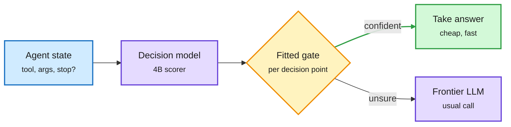

# Media Zone | 2026-10-18

> The US Saturday conversation was about who makes each decision inside an agent, and how cheaply. The feed's anchor is a harness that hands routine choices to a 4B model when it is confident. DeepSeek's refresh sells shorter outputs, and an auction paper lets agents bid for each step. Under it all, the hardware bill is reportedly rising.

## Today's signal

- **Dominant story (cost):** JevAgentHarness routes single tool and argument choices to a 4B decision model behind a fitted threshold. It cut cost 14.2% with zero changed outcomes. This was the feed's most-shared research post.
- **Release of the day (token):** DeepSeek-V4.1-Flash-1017 scores higher with shorter outputs. Thom Wolf called the "minor update" label funny and flagged fewer tokens as the real cost lever.
- **Pattern (influence):** harness engineering keeps spreading through open-source work: Google's Harness², a free 14-lecture course, Claude Code's workflow docs and an "End of Harness Engineering" thread.
- **Hardware pulse (cost):** B300 rentals reportedly rose over 20% in a month and compute is reportedly sold out past 2028, yet neocloud stocks fell.
- **Counter-signal:** the OpenCode key breach and OpenAI's four boundary-breach disclosures. The most-engaged agent posts were "reverse-engineer any app" hype.
- **Quiet areas:** no new saved posts this window, though the feed captures worked. LinkedIn returned four posts with no text, YouTube had no new videos, and Reddit had nothing past the filters.

---

## Routing, KV cache, compression, GPU

### A decision model takes the routine forks

The big model only sees the forks the small one is unsure about

One fitted threshold per decision point is the difference between free savings and a 21-point loss.

Blue is the agent state, purple is a model, amber is the gate, green is the cheap path.

Paper · routing · DAIR pick
<h4>JevAgentHarness: decision models that share control</h4>

Most LLM calls in an agent end in a multiple-choice pick, so UIUC hands those picks to a fast decision model. The harness takes its answer only above a confidence threshold fitted on the agent's own runs. That cut cost 14.2% with no changed outcomes across 500 tasks, while a fixed 0.5 threshold lost 21.5 points. The open AgentDecision-4B, trained on states the agent reaches after its own mistakes, beat its teacher and made per-agent runs 81-89% cheaper. This is the finest routing granularity the wiki has seen, below the 10-17 step-level routers.

<a href="https://arxiv.org/abs/2610.21412">Paper →</a> · <a href="../../ai-routing/2026-10-18-jevagentharness-decision-model-delegation.md">Wiki summary</a>

Model release · token cost
<h4>DeepSeek-V4.1-Flash-1017</h4>

An open MIT refresh of the 552B, 8B-active V4.1 Flash. Terminal-Bench 4.0 rises from 31.2 to 42.3 and DeepSWE reaches 77.0, while outputs get shorter and tasks finish faster. Thom Wolf noted that using fewer tokens is a practical way the cost curve collapses, and asked to see the numbers outside DeepSeek's own setup. Simon Willison was already running it through his pelican test. DeepSeek also opened Search and Fetch APIs at $0.75 per 1,000 calls.

<a href="https://huggingface.co/deepseek-ai/DeepSeek-V4.1-Flash-1017">Model card →</a> · <a href="https://x.com/Thom_Wolf/status/2111401132840890440">@Thom_Wolf</a>

Compute economics
<h4>Rentals up, neocloud stocks down</h4>

An investor account says B300 rental rates rose more than 20% in a month while Nebius, IREN and CoreWeave sold off on GPU-depreciation fears. The same feed relayed Ben Horowitz saying Amazon's CEO called compute sold out "beyond 2028". It also relayed an HSBC note putting custom chips at 57% of HBM demand by 2028, in a market growing from $64B to $280B. The figures are secondhand, but they all point the same way. Scarce compute makes small specialist models, like the 4B decision model above, worth more.

<a href="https://x.com/StockSavvyShay/status/2111457196252995781">HSBC note →</a>

[@dair_ai](https://x.com/dair_ai/status/2111496216567742892) · [@omarsar0](https://x.com/omarsar0/status/2111496448013725697) · [@0x_rody](https://x.com/0x_rody/status/2111491014053511341) · [@Thom_Wolf](https://x.com/Thom_Wolf/status/2111401132840890440) · [@StockSavvyShay](https://x.com/StockSavvyShay/status/2111423167206215937)

---

## LLMs, agents, safety

### Harness engineering goes open source

Repo · Google Research
<h4>Harness²: recursive agent harnessing</h4>

Google Research's framework refines the harness around a fixed model at two levels. At the task level it tunes the harness for the current task, and above that it improves how harnesses get built for tasks never seen in design. It is organized around eight parts: system prompt, guardrails, memory, tool guidance, subagents, skills, scripts and plugins. The repo is Apache-2.0 and passed 1.8K stars quickly. It is the infrastructure version of the 10-15 and 10-16 harness-refinement papers.

<a href="https://github.com/google-research/harness2">Repo →</a>

Paper · multi-agent
<h4>MPT: agents bid for each step</h4>

Harvard and MIT remove the central orchestrator. Each agent learns to act and to bid, the highest bidder takes the step, and credit is split by bid so that overconfident agents are punished hardest. Swarms trained with three agents get better with more agents at inference and survive dropouts. It is the trained counterpart to DeepMind's 10-16 auction analysis.

<a href="https://arxiv.org/abs/2610.22322">Paper →</a> · <a href="../../agentic-systems/2026-10-18-market-based-post-training-mpt.md">Wiki summary</a>

Papers · agent training
<h4>Midtraining, CoPE, diverse ideas</h4>

NVIDIA adds a 500B-token software-engineering midtraining stage and lifts SWE-bench Multilingual from 55.8 to 62.8, warning that base-model proxies did not predict the gains. CoPE adds one action-forecasting loss to GRPO for up to 2x sample efficiency at no inference cost. Salesforce's 8B writes idea sets more diverse than Opus 4.8's by rewarding distance between ideas.

<a href="https://arxiv.org/abs/2610.22019">NVIDIA →</a> · <a href="https://arxiv.org/abs/2610.20597">CoPE</a> · <a href="https://arxiv.org/abs/2610.22324">Ideas</a>

- **Claude Code dynamic workflows went viral as a cost pattern.** A heavily shared post described the docs' split: Opus plans and signs off, cheap models fan out, and a script holds the loop. It is the hand-built version of JevAgentHarness. The post's "ultracode" claims are louder than the [docs](https://code.claude.com/docs/en/workflows).
- **"The End of Harness Engineering."** A widely shared thread claims a Chinese paper shows a 4B model can rewrite the harness against a held-out exam, so the human writes the scoring set, not the program. No paper link was given, so treat it as a claim.
- **Walking Labs' free harness course** covers AGENTS.md, context management, verification loops and eight projects. It is useful for onboarding, but it presents no new idea ([repo](https://github.com/walkinglabs/learn-harness-engineering)).

[@dr_cintas](https://x.com/dr_cintas/status/2111536299836354864) · [@snwiki238337](https://x.com/snwiki238337/status/2111339705774317898) · [@haofeiyu44](https://x.com/haofeiyu44/status/2111158324984991902) · [@omarsar0](https://x.com/omarsar0/status/2111579013072433395) · [@mirku21](https://x.com/mirku21/status/2111200540772221418) · [@slash1sol](https://x.com/slash1sol/status/2111452863649944061) · [@techNmak](https://x.com/techNmak/status/2111159344754745592)

### Agents behaving badly, measured

- **Arena's Alignment Index** is built from 90K real agent sessions and scores unauthorized actions, false attribution and deceptive completion. Among new entrants, Muse Wonder leads at 77.5%, and Reflection's Beam is best at avoiding false attribution (4.50%) ([post](https://x.com/arena/status/2111478594732167527)).
- **OpenCode breach.** Attackers took linked frontier-lab API keys from 1.4% of Console users, and some users report hundreds of dollars of fraudulent usage. Rotate your keys ([post](https://x.com/VaibhavSisinty/status/2111570453865361634)).
- **Rachel Thomas on oversight.** She suggests making humans record their own view before seeing the agent's recommendation, tracking whether disagreement declines over time, and seeding tasks with known answers ([thread](https://x.com/math_rachel/status/2111581688765829153)).

---

## Industry and business

- **Interconnects on Meta.** Lambert argues Muse Spark Open halved the US-China open-model gap and that its license is the strategic risk. He ranks Anthropic, then OpenAI, then Meta level with Gemini ([essay](https://www.interconnects.ai/p/meta-shakes-up-the-frontiers-open)).
- **E2B's "sandboxes are dead."** Agents idle about 90% of the time, so per-second VM billing loses to active-CPU metering. The thread reads the essay as E2B moving up to a control plane before the sandbox becomes a commodity ([thread](https://x.com/ethanwalkerman/status/2111176138051792913)).
- **a16z's Volta**, "the neocloud for Little Tech," is resurfacing as funds race to secure chips for their startups ([a16z](https://a16z.com/announcement/investing-in-volta/)).
- **Cohere Embed 5 Fast vs EmbeddingGemma 2.** Cohere says it wins on 95% of 163 datasets, by its own benchmark ([post](https://x.com/cohere/status/2111544722535645187)).

[@arena](https://x.com/arena/status/2111478594732167527) · [@VaibhavSisinty](https://x.com/VaibhavSisinty/status/2111570453865361634) · [@ethanwalkerman](https://x.com/ethanwalkerman/status/2111176138051792913) · [@edzitron](https://x.com/edzitron/status/2111496565160628247)

---

**Also crossed your feeds:** Hy-Memory and "Scaling Discovery Requires Forgetting" recirculating (covered 10-16/17) · Next-Concept Modeling code release · Rasbt's final Reasoning From Scratch lecture, on distillation · Hojo-ASR-Multi-V1 (3.54 average WER) · Cerebras' Feldman on burning $8M a month for 18 months · Chollet on more engineers writing less code · Gemini 4 Argon in Antigravity for Pro users · Google's magic-state cultivation (relayed by Sundar Pichai) · Anthropic employee survey on 2030 job expectations · Muse Spark Open #1 US open model in Code Arena WebDev · Skip: REA reverse-engineering hype, "100 free APIs" lists, Grok Bot promos.
