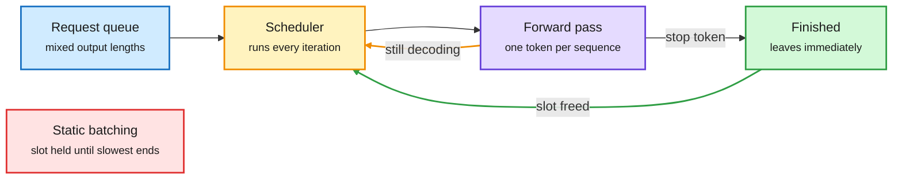

# Media Zone | 2026-10-19

> *Live draft: this window is still open. It is finalized with the 2026-10-19 digest at the 10:30 IST cutoff.*

> The US Sunday conversation so far is about who pays and who learns. Memory gets pricier while it scales, open labs have given away about $1B of training compute, and a Meta paper shows the best agent is not the cheapest learner. Anthropic's own data and its proposed AI bill drew the loudest pushback.

## Today's signal

- **Dominant story (cost):** HBM (stacked high-bandwidth memory on AI accelerators) is forecast to double in price per GB by 2030 while shipments roughly quadruple. Memory is breaking its usual price curve.
- **Influence:** Thom Wolf estimates labs have shared about $1B of training compute as free open weights on Hugging Face, up from under $40M at end of 2023.
- **Pattern (cost of learning):** Meta's "Agent Plasticity" scores self-improving agents by held-out gain per dollar. Anthropic's Project Deal showed weaker agents lose money without users noticing.
- **Edge efficiency:** small models off the GPU. Mistral's 209M forecaster runs on CPU and AMD ran a diffusion LLM on a laptop NPU at 8.9x better energy.
- **Counter-signal:** Anthropic's proposed AI law drew sharp criticism from safety voices, and its own survey shows junior technical hiring shrinking.
- **Gaps:** network outage blanked the 15:00, 18:00 and 21:00 X captures; a 21:53 catch-up recovered the feed. No new saved posts, no LinkedIn capture and no Gmail this window.

---

## Routing, KV cache, compression, GPU

### The memory bill keeps climbing

- **HBM breaks the memory price curve (cost).** A widely shared forecast puts HBM at about $35/GB by 2030, more than double today, with a possible ~$640B market. Memory usually gets cheaper as volume grows. HBM4 is getting harder to make.
- **HBM4 takes half the demand by 2027.** HBM4 and HBM4E are projected to reach 48% of HBM demand as Nvidia Rubin ships. Older HBM3E 8-Hi also doubles its share to 17%, which the poster reads as custom ASICs widening the market.
- **Nvidia's take per gigawatt doubled.** Jensen Huang says Nvidia's revenue opportunity per gigawatt of AI capacity is now over $40B, from selling CPUs, networking and full systems, not just GPUs. Ethernet switching is reportedly growing 49% a year against 36% for AI servers.
- **Read with care.** These come from an investor account, not primary filings. Treat the numbers as directional until SemiAnalysis or a memory-maker call confirms them.

[HBM pricing](https://x.com/StockSavvyShay/status/2111838065526448219) · [HBM4 share](https://x.com/StockSavvyShay/status/2111764985114407345) · [Nvidia per GW](https://x.com/StockSavvyShay/status/2111801667368980835) · [Ethernet switching](https://x.com/StockSavvyShay/status/2111794380269142024)

### Serving and small models: getting more from the same hardware

Continuous batching frees a slot the moment a request ends

The scheduler decides again after every forward pass, so short requests stop holding seats.

Blue is incoming work, amber is the per-iteration scheduling loop, purple is the model, green is the freed slot, red is the wasteful static policy.

X thread · serving explainer
<h4>Continuous batching, explained</h4>

LLM decoding makes one token per sequence per forward pass, and nobody knows a request's length until it emits a stop token. Static batching fixes the batch up front, so a 30-token answer keeps its slot until a 400-token neighbour finishes. The GPU still pays the full weight read from HBM for a mostly empty batch. Continuous batching re-schedules after every pass, so finished requests leave and queued ones join at once. In Anyscale's OPT-13B test on one A100, the gain grew with output-length variance, reaching 23x over naive Hugging Face serving with vLLM. A clear refresher on why serving cost depends on traffic mix.

<a href="https://x.com/_avichawla/status/2111770806032417224">Read the thread →</a>

PyTorchCon poster · NPU inference
<h4>A diffusion LLM on AMD's laptop NPU</h4>

AMD engineers ran LLaDA-8B-Instruct, a masked diffusion language model that fills in many tokens in parallel, on the XDNA2 NPU in a Ryzen AI MAX+ 395. At sequence length 128 the NPU took 504 ms per forward pass at 36 W. CPU INT4 took 843 ms at 110 W. That makes the NPU 1.67x faster and 8.9x better on energy. The poster covers the INT4 quantization and graph-partitioning pipeline needed to fit it. Diffusion LMs suit NPUs because prefill-style parallel passes match their dense-matmul design.

<a href="https://x.com/PyTorch/status/2111849880222097726">See the post →</a>

Model release · small foundation model
<h4>Mistral's 209M time-series forecaster runs on CPU</h4>

Mistral's Timestral family forecasts sales, power use or sensor data without training a new model per dataset. The largest version is 209M parameters (837MB in FP32), reads up to 32,768 past steps and outputs 1,024 future steps with 21 probability quantiles. Mistral says it ranks first among zero-shot models on GIFT-Eval, TIME and fev-bench. On an 8-thread CPU the 209M model takes ~140 ms and the 5M version ~10 ms. Good evidence that useful foundation models do not all need a GPU.

<a href="https://x.com/TeksEdge/status/2111653496579567903">See the post →</a>

GPU MODE · lecture 118
<h4>GSQ-RCO: better non-uniform GGUF quantization</h4>

The full lecture behind the short covered on 10-15. ISTA DASLab researchers explain two methods for low-bit LLM quantization. GSQ uses Gumbel-Softmax sampling, a differentiable way to choose discrete quantization values, to improve the rounding itself. RCO uses Riemannian optimization to decide how many bits each part of the model gets under a fixed file-size budget. The talk covers why the two combine well and what they learned shipping GGUF models.

<a href="https://youtube.com/watch?v=ISaPeJeXJnY">Watch the lecture →</a>

### Open weights as a public good

HF Space · data explorer
<h4>About $1B of training compute, free on the Hub</h4>

Thom Wolf estimates what it would cost to rent the GPUs that trained 75 official open-weight model families on Hugging Face, from Meta, NVIDIA, Alibaba, DeepSeek, Moonshot, Mistral and ~30 more labs. The total is close to $1B, up from under $40M at end of 2023. Prices assumed are $2.5 per H100-hour and $5 per B200-hour. About half rests on published compute numbers; the rest is estimated. It is a floor: it skips experiments, failed runs, data and ~900k community fine-tunes. A useful number for anyone arguing about the economics of open models.

<a href="https://thomwolf-hub-dollars.static.hf.space">Explore the data →</a>

---

## LLMs, agents, safety

### Measuring what agents learn, and what it costs

arXiv 2610.08902 · Meta
<h4>Agent Plasticity: self-improvement per dollar</h4>

Most agent benchmarks test a model once. This paper freezes weights and lets agents play chess, Go, Hex and NetHack, rewriting their own tools and notes after each round, then scores them on held-out games. "Plasticity" is held-out gain per dollar of learning cost. Claude Fable 5 rose from 37.5% to 73.3% on hard held-out chess. GPT-5.6 Sol gained 298 points per $1,000 against 57 for Fable 5. The best final agent is not the most efficient learner, and gains often transfer only partly out of distribution.

<a href="https://arxiv.org/abs/2610.08902">Read the paper →</a>

FT via X · agent markets
<h4>Project Deal: weaker agents lose money quietly</h4>

In an Anthropic experiment, 69 employees' Claude agents closed 186 deals worth just over $4,000 with no human approving any trade. Opus agents sold identical items for $2.68 more and bought for $2.45 less than Haiku agents. Haiku users still rated their deals as fair (4.06 vs 4.05 of 7). A follow-up found the model mattered six times more than "be ruthless" instructions. Anthropic now wants negotiating ethics built into agents that bargain with other agents.

<a href="https://x.com/rohanpaul_ai/status/2111695161164259808">See the post →</a>

arXiv 2608.23642 · position paper
<h4>AI agents push humans out of the loop</h4>

Margaret Mitchell and co-authors argue that "human in the loop" is failing as a safety plan. After dozens of tool calls and approvals, people click "confirm" without real judgement, and long use of automation erodes the skills needed to take over. They ask builders to treat overseer needs as seriously as agent capability. Concretely: fewer pointless approvals, attention focused on high-risk steps, better state recovery and batch review. Resurfaced today by a widely read Chinese-language thread.

<a href="https://arxiv.org/abs/2608.23642">Read the paper →</a>

AI Engineer · harness talk
<h4>Teach your agent to prove it's done</h4>

WorkOS engineers show verification loops for coding agents: clear goals, CLI health checks, browser snapshots, LLM judges and evals. A failure feeds the next fix instead of landing on a human's desk. It is the practical side of the harness-engineering thread the feed has carried all week. A companion Langfuse workshop covers evals for high-stakes agents, with CI that blocks prompt changes when scores drop.

<a href="https://youtube.com/watch?v=q4WC4TowkBo">Watch the talk →</a> · <a href="https://youtube.com/watch?v=obfPzbapMIM">Langfuse evals workshop →</a>

### Agents and permissions

- **An agent got its user banned from Resy.** It made 200 booking calls in 90 minutes. A panel with JPMorgan's security architect and OAuth co-creator Dick Hardt argues OAuth scopes are too coarse for agents ([video](https://youtube.com/watch?v=IavxrdVnwXM)).
- **"Context inertia" named as a failure mode.** Drew Breunig describes long-running agents locking onto one line of work. His suggested fix is to periodically clear or reshape their context ([thread](https://x.com/DimitrisPapail/status/2111819588535263283)).
- **Interpretability should aim to improve models.** Kenneth Stanley asks why mech interp studies working systems but rarely fixes them. He points to his "fractured entangled representations" result as a target ([post](https://x.com/kenneth0stanley/status/2111853985942683876)).

---

## Industry and business

- **Anthropic's own workforce data.** Its junior share of technical headcount fell from 21% to 14% while the company tripled. About a third of ML managers say AI has them hiring less ([post](https://x.com/rohanpaul_ai/status/2111698696337514705)).
- **Staff vs public expectations.** Anthropic staff expect AI to do 75% of their current work by 2030; US workers say 28% ([post](https://x.com/rohanpaul_ai/status/2111744320982425948)).
- **Backlash to Anthropic's proposed AI bill.** Nate Soares and Jeffrey Ladish say it would make courts less able to restrict AI development. Gary Marcus amplified the criticism ([Soares RT](https://x.com/GaryMarcus/status/2111766632549003557) · [Ladish RT](https://x.com/GaryMarcus/status/2111775778467877263)).
- **The price gap per task.** A circulated comparison puts Meta Muse Spark and Gemini at ~$0.40 per agent task against $2.34 for Opus 5. That gap is the routing case in one number ([post](https://x.com/StockSavvyShay/status/2111831351540490401)).
- **Neocloud credit stress.** Chamath links wider CoreWeave CDS spreads to rising rates, heavy borrowing and fixed-price capacity contracts ([clip](https://x.com/rohanpaul_ai/status/2111818135267660022)).
- **Nebius power runway.** Reportedly 5 GW contracted by end of 2026 but only ~0.6 GW live ([post](https://x.com/StockSavvyShay/status/2111809243531952300)).

---

## Also crossed your feeds

DeepSeek-V4.1-Flash-1017 is now on Prime Inference and got a WorldofAI test video (covered 10-18) · Google's Harness² and the REA reverse-engineering MCP kept circulating (covered 10-18) · Terminal-RSI's 51.7% to 86.5% Terminal-Bench jump resurfaced (covered 10-17) · a "hot week for looped Transformers" thread from Princeton/UPenn · Sander Dieleman on nested looping in diffusion and condition-free minibatch-OT · flow-matching samples improved by scaling velocity 1.15x with no retraining · native encoder-free VLMs NEO and SenseNova-U · Tencent/Graphify codebase-to-knowledge-graph skill and Microsoft MarkItDown (tooling) · TMLR suspends 150+ authors under a 300% submission surge · Raschka's final "Reasoning From Scratch" video on distillation · YC Paper Club on AI safety with Stanford's Barrett and Kochenderfer · four Gemini 4 Argon agents beat Minecraft's Ender Dragon in 27 hours · semiconductor growth leaderboard (AAOI, SK hynix, Lumentum lead 3-year forecasts).
