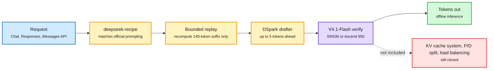
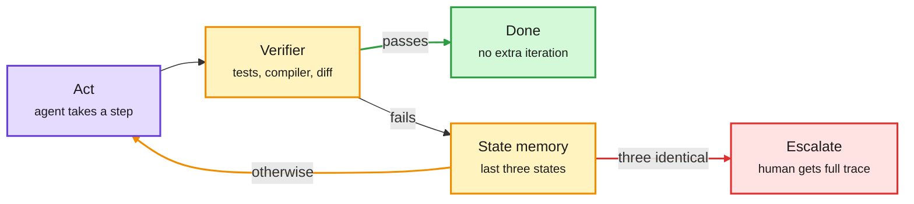

# Media Zone | 2026-10-21

> *Live draft: this window is still open. It is finalized with the 2026-10-21 digest at the 10:30 IST cutoff.*

> The US Tuesday conversation was about serving stacks, not models. DeepSeek gave away the engine behind its own API, llm-d hit 1.0 on the PyTorchCon stage, and a hobbyist got a 27B model to 381 tokens a second on a four-year-old GPU. The loudest thread was the old one: is the harness dead, again.

## Today's signal

- **Dominant story (cost):** DeepSeek open-sourced DeepInfer, the production inference engine behind V4.1-Flash, under Apache 2.0. The day's most-shared post by a wide margin, and confirmed by AI Weekly's lead item.
- **Pattern (cost):** the week's savings are coming from the serving layer. llm-d 1.0, Reflection shipping a 501B model as FP8 through LLM Compressor, and context-lookup drafting on a consumer GPU all squeeze the same hardware harder.
- **Contested (influence):** "The End of Loop Engineering" went viral and Elvis Saravia pushed back hard. High replies, few likes on both sides. The Coinbase talk on YouTube lands on the same question from the practitioner side.
- **Research:** the agentic RL data scaling-law paper (environments beat tasks beat trajectories) is the day's most useful paper for anyone synthesizing training data.
- **Hype to skip:** the Claude Code "tripartite loop" threads repackage the documented model config page. The "ChatGPT writes a psychological profile of you" and "Stanford 31x faster" threads name no paper.
- **Gaps:** no new saved posts, LinkedIn returned zero posts, and Reddit is not in this window. YouTube subscriptions carried real AI content for once (Hugging Face, Stanford, AI Engineer).

---

## Routing, KV cache, compression, GPU

### DeepSeek gave away the speed layer, not the serving layer

What DeepInfer ships, and what it leaves out

The open release is the per-GPU fast path. The parts that turn it into a service are still DeepSeek's.

Blue is the request, amber are the speed tricks, purple is model compute, green is output, red is what did not ship.

GitHub · Apache 2.0 · the day's most-shared
<h4>DeepInfer: the engine behind DeepSeek's API</h4>

DeepSeek released the inference framework that runs its production service, with the stated goal of lowering compute and energy cost for everyone. It runs only DeepSeek-V4.1-Flash, on NVIDIA SM100 GPUs or Huawei Ascend 950, the same Huawei silicon DeepSeek said last week it plans to pre-train on. The useful parts are DSpark, a drafter that proposes up to five tokens and schedules their verification by confidence, and bounded replay, which trims prefill by recomputing only a 140-token suffix sized to the sliding attention window. Rohan Paul's caveat matters: this is offline inference. The KV cache system, prefill and decode disaggregation, and replica load balancing are not in the repo. A companion library, deepseek-recipe, maps Chat Completions, Responses and Messages requests onto the prompts the official API uses, so community deployments behave like the hosted one.

<a href="https://github.com/deepseek-ai/DeepInfer">Open the repo →</a>

- **The streak (influence).** Thomas Wolf's tally: FlashMLA, DeepEP, DeepGEMM, 3FS, and now the full inference engine. DeepSeek is publishing the systems layer that Western labs keep closed.
- **Why now (cost).** The release lands the same week DeepSeek said it will pre-train on Ascend. Shipping Ascend support in the engine is the clearest signal yet that the Huawei path is real, not a hedge.
- **Dark side.** Bloomberg reports an open-source pentest agent became the shared engine of breach campaigns in Japan and South Korea, run mainly on V4.1-Flash. Cheap open inference cuts both ways.

[@deepseek_ai](https://x.com/deepseek_ai/status/2112476496283775135) · [Rohan Paul's caveats](https://x.com/rohanpaul_ai/status/2112517682646155349) · [Thom Wolf's tally](https://x.com/Thom_Wolf/status/2112513796866813956) · [Bloomberg via Rohan Paul](https://x.com/rohanpaul_ai/status/2112504002806206876)

### PyTorchCon day one: the serving stack grows up

IBM Research · PyTorch Conference
<h4>llm-d 1.0: a stable API for day-two inference</h4>

llm-d is the Kubernetes-native layer that turns vLLM or SGLang servers into a production service. Version 1.0 does not add new tricks. It makes the existing five work together under real traffic: prefix-cache-aware routing, KV cache offload across GPU, CPU and storage, batch optimization, prefill and decode disaggregation, and wide expert parallelism. The new pieces are flow control and fairness, so an agent's burst of requests cannot starve a human's chat, and multi-turn pinning that keeps a request on the replica holding its cache. Two numbers to keep: the prefix-aware router captured 97% of available cache reuse on an agentic coding workload, and IBM and Red Hat ran 3,000 concurrent software agents self-hosted for 5 to 10 times less than the API price of the same open model.

<a href="https://research.ibm.com/blog/llmd-1-0-is-ready-for-production-inference-serving">Read the post →</a>

Hugging Face · quantization
<h4>Reflection ships Beam 1.0 (501B MoE) as FP8 via LLM Compressor</h4>

Reflection used vLLM's open LLM Compressor to produce the production FP8 checkpoint of Beam 1.0, a 501B-parameter mixture-of-experts model with 23B active parameters. Red Hat flagged it as a sign that major open models now reach for the open quantization toolchain to ship weights, not just for research. FP8 halves memory against BF16 and is the format Hopper and Blackwell tensor cores run natively, so this is the shape most large open models will ship in from here.

<a href="https://huggingface.co/reflection/Beam-1.0-501B-A23B-FP8">See the checkpoint →</a>

- **Three walls past a trillion parameters (cost).** Baseten's Philip Kiely frames the inference problem as width (routing across hundreds of sparse experts), depth (mixing global and local linear attention) and length (1M-token sequences). A widely shared diagram, no paper behind it.
- **Cluster scale is the real test.** Red Hat's CTO argues single-server performance was step one. Managing serving across a cluster, with tenants competing, is what llm-d 1.0 is for.
- **PyTorchCon runs all week** in San Jose with vLLM, DeepSpeed, Ray, Helion and Safetensors on the program. Expect kernel and compiler posts to keep landing through Thursday.

[Reflection FP8](https://x.com/RedHat_AI/status/2112558013735125201) · [Kiely's three walls](https://x.com/philipkiely/status/2112272656217297224) · [Red Hat CTO](https://x.com/RedHat_AI/status/2112552960073040141) · [PyTorchCon](https://x.com/PyTorch/status/2112544495082319919)

### Consumer-GPU inference: the stack, not the card, sets the ceiling

X thread · quietly high-signal off a small account
<h4>Qwen3.8-27B at 381 tokens/sec on one RTX 3090</h4>

A developer took a 27B model from 82 to 381 tokens a second on a 24 GB RTX 3090 without touching the hardware. The steps: multi-token prediction drafting (114 tok/s), DFlash2 speculative decoding plus context lookup (138 tok/s), then optimized lookup verification (381 tok/s). Context lookup is the key idea. When the expected output already exists in the prompt, as in extraction, document transformation or code edits, the engine proposes matching spans from the context as draft tokens and the model only verifies them. Verification blocks grew from the usual 7 tokens to 16, with about 15 of 16 accepted. The honest qualifier: ordinary chat runs closer to 133 tok/s. Prefix caching separately cut time to first token on a repeated 25K-token document from 22.4 seconds to 0.56.

<a href="https://x.com/Oluwaphilemon1/status/2112382397656261049">Read the thread →</a>

YouTube · Hugging Face livestream
<h4>Local AI 202: speculative decoding with EAGLE, DFlash and MTP</h4>

A three-part livestream on the same technique the thread above exploits. Merve Noyan introduces speculative decoding, Eldar Kurtić from Red Hat walks through the Speculators library for training drafters, and Maarten Grootendorst from Google DeepMind shows MTP drafters speeding up Gemma 4. It covers llama.cpp and transformers, so it is the practical companion to the FlashMap and Speculators v0.9 items from yesterday's page.

<a href="https://youtube.com/watch?v=H4azmWcqO5g">Watch →</a>

- **An MLA conversion that shrinks per-token memory 3.5x (cost).** A new RL post-train of Qwen3.8-27B ships a variant with its 16 full-attention layers converted to multi-head latent attention, taking each token's KV footprint from 64 KiB to 18 KiB. Hallucination on AA-Omniscience halves (30.4% to 15.1%) and it solves Terminal-Bench tasks in a median 23.8K output tokens against 54.9K for base Qwen. Fewer tokens per task is the cost number.
- **Muse Glimmer, the curator's take.** DAIR's writeup adds detail to yesterday's Meta release: the architecture was picked by training ladders of candidates under a fixed 32 GB VRAM ceiling, and the shipped model uses a Dflash speculative head at about 4-bit for a single RTX 5090. It leads on MCPAtlas and SWE-Bench Pro, trails Qwen3.6-27B on OSWorld and TerminalBench.

[Qwen3.8-27B post-train](https://x.com/rohanpaul_ai/status/2112546482478023075) · [Muse Glimmer via DAIR](https://x.com/dair_ai/status/2112526756372684997) · [arXiv 2610.24628](https://arxiv.org/abs/2610.24628)

### Hardware: China orders, Amazon's glut, and an open edge NPU

- **$35B of RTX PRO 5500 orders from China (cost).** ByteDance, Alibaba and Tencent are reportedly lining up GPUs built on GDDR7 instead of HBM, so NVIDIA can serve China's inference market without pulling HBM or packaging capacity from Rubin. Chinese demand is said to exceed 6M GPUs against 3M planned for 2027. Still subject to export approval.
- **Amazon's $8B chip SPV looks stranger (cost).** Ed Zitron connects the Reuters report that Amazon wants investors to take $8B of NVIDIA chips off its books with the "shadow glut" of silicon waiting for electricity. Contested: others read it as plain financing.
- **The neocloud selloff.** A South Korean neocloud, Elice, fell 30% on its IPO debut and dragged IREN, Cipher, CoreWeave and Nebius down 5 to 7%. Watch whether rented-GPU economics get repriced this week.
- **Coral NPU's open standard (influence).** Google Research argues the edge is split across hundreds of proprietary chips and toolchains, and proposes its RISC-V, ML-first NPU plus open compiler as the way to optimize a model once and run it across vendors. A model-cascade story: tiny always-on models that hand off to bigger ones.
- **Also:** MIT Technology Review's visit to Samsung's new fab complex for the AI memory boom, and Micron investing in critical-mineral processing in New York with over 75% of 2027 output already committed. NVIDIA's GTC Berlin keynote is tomorrow.

[RTX PRO 5500 orders](https://x.com/StockSavvyShay/status/2112524772630495607) · [Amazon SPV](https://x.com/edzitron/status/2112537920242663481) · [Neocloud selloff](https://x.com/StockSavvyShay/status/2112542673336987794) · [Coral NPU](https://developers.googleblog.com/unifying-edge-ai-how-coral-npus-open-standard-brings-portable-energy-viable-intelligence-from-model-to-silicon/) · [Samsung fabs](https://x.com/techreview/status/2112473685810405858) · [Micron minerals](https://x.com/StockSavvyShay/status/2112531793769632112) · [GTC Berlin](https://x.com/NVIDIAAI/status/2112525188273250336)

---

## LLMs, agents, safety

### Is the harness dead? The same fight, with better evidence on both sides

This is the reader's most-saved theme, and it flared again on the US day. The viral claim is that a paper titled "The End of Loop Engineering" shows pre-authored caps, budgets and exit conditions are all the same mistake. The rebuttal is that the claim rests on code benchmarks that models have already saturated.

The "observed exit" loop the viral thread describes

Nothing is pre-authored except the check. The run decides when it is done.

Purple is model action, amber are the checks, green is the exit, red is the escalation path.

- **The claim (contested).** Across 2,400 runs, the verifier-plus-three-state rule reportedly ended at the wrong moment 4% as often as a fixed cap, with 2,391 self-stops and 9 escalations. The thread links no paper and sells the author's own playbook. Treat the numbers as unverified until the arXiv id surfaces.
- **The rebuttal (influence).** Elvis Saravia: like "prompt engineering is dead" and "RAG is dead," this comes from a few papers with weak setups on benchmaxxed SWE tasks. Outside coding, harnesses are getting more specialized, not less: security, authorization, memory, cost, and the new wave of proactive personal agents (Muse, Grok Bot, dots, Instinct). DAIR is polling the question.
- **The practitioner answer (cross-source, YouTube).** Coinbase's Evan Kormos says the same thing from inside a regulated workflow: model processes as DAGs and loops, and a loop is only as trustworthy as its check. Agents graduate from fully supervised, to sampled, to humans handling only exceptions. That is the viral thread's verifier, with a compliance department attached.
- **The tooling answer.** Pi Durable (Hugging Face video) checkpoints every task and tool call to SQLite so an agent resumes after a crash, even running Qwen3.5-0.8B locally. Google's open Ambient quality agent reads live traces and points to the failing line. Hugging Face's Agent Manager orchestrates dozens of agents across Claude Code, Codex and OpenCode. All three are harness, not model.

[The viral thread](https://x.com/slash1sol/status/2112164626456543246) · [Saravia's rebuttal](https://x.com/omarsar0/status/2112557582128652785) · [DAIR poll](https://x.com/dair_ai/status/2112557998325354941) · [Ambient quality agent](https://x.com/Saboo_Shubham_/status/2112428713979900248) · [Agent Manager](https://x.com/huggingface/status/2112561362991788302) · [Google's next step after agentic engineering](https://x.com/_avichawla/status/2112472676497604632)

### What to scale: agentic RL data, and agents from many developers

arXiv 2610.23946 · NeurIPS 2026 · via DAIR
<h4>Scaling laws for agentic RL data: environments beat tasks beat trajectories</h4>

Pretraining treats data as one number, a token count. Agentic RL does not get that luxury, because synthesis pipelines generate tasks, environments and trajectories separately and at very different costs. This paper fits per-axis scaling laws across model sizes, families, four domains (math and code, SWE, web, UI and tools) and both PPO and GRPO, and the exponents order the same way every time: environment above task above trajectory. The environment advantage comes mainly from world diversity, meaning genuinely different settings. Varying the structure of one world helps about as much as adding tasks. The laws also price each synthesis method with a discount factor and a synthetic-to-real ratio at which training collapses, and those ratios differ by an order of magnitude across axes. A Chinchilla-style budget recipe gives up to 1.7x compute efficiency over the default of generating more trajectories.

<a href="https://arxiv.org/abs/2610.23946">Read the paper →</a>

arXiv 2610.20518 · Princeton
<h4>The Wealth of Agents: specialists from many developers beat one general agent</h4>

Most agentic systems are built by one developer who controls every agent, so every team rebuilds the same skills. This paper simulates populations of developers, each building agents under a fixed budget, and compares lone systems with a multi-developer system that splits each task and routes the parts to different developers' agents. On GAIA, specialists scoring at most 35% alone reached 70% together, 12 points above the median general agent, at the same total development budget. On the search-only SealQA benchmark the combined system did worse and cost more. The practical lesson is to build agents that fill gaps in shared systems: one scoring 19% alone lifted the combined system from 40% to 53%.

<a href="https://arxiv.org/abs/2610.20518">Read the paper →</a>

- **QD-Rec (Sakana AI).** Quality-diversity evolutionary search applied to recommendation: the unit is a candidate plus a hypothesis for why to pick it, and an LLM keeps writing new hypotheses from the best old ones. Tested on M&A targets, customer targeting and paper recommendation. Code and paper are out.
- **An 825-page transformer monograph.** Giansalvo Cirrincione's "Mathematical Theory of the Transformer, Volume I" on Zenodo, headed for MIT Press: full proofs for positional encoding, layer norm rank dynamics, attention geometry and an incremental transformer. The kind of reference the feed rarely surfaces.
- **Looped transformers reading list.** The Turing Post's ten-paper roundup on recurrent-depth models keeps circulating. Relevant to the compute-per-token question, since looping trades parameters for iterations.
- **Stanford CME295 lecture 4** walks RL for LLMs from REINFORCE to PPO, the DPO connection and GRPO in 70 minutes. Good reference for the agentic RL paper above.

[Agentic RL scaling laws thread](https://x.com/omarsar0/status/2112527762212933819) · [Wealth of Agents thread](https://x.com/rohanpaul_ai/status/2112452020334665902) · [QD-Rec](https://x.com/SakanaAILabs/status/2112507110290502109) · [Transformer monograph](https://x.com/antoniolupetti/status/2112473962978410680) · [Looped transformers](https://x.com/TheTuringPost/status/2112506672975585394)

### Security and safety: agents on prod, AI-written proofs, and a consciousness paper

- **Agents attacking at scale.** Bloomberg's report (above) is the day's hardest safety item: an authorized-pentest agent reused as a breach engine against about 20 Japanese companies and South Korean financial firms, run on cheap open inference.
- **Keep agents off the production database.** Google Cloud's Martin Omander argues for sandboxing coding agents with synthetic data, citing hallucinated table wipes and GDPR and EU AI Act exposure. Cisco's Al Chen, in the AI Engineer talk on shipping into five banks, adds a sharper failure: PII leaking through LLM judges.
- **Red teaming for beginners.** Red Hat's walkthrough runs a probe, reads the failure rate, applies targeted guardrails and rescans, on Granite 3.1B in a free sandbox.
- **Detecting AI-written math.** A Duke detector trained on an academic budget catches 2.4x more AI-generated proofs than Pangram by using the visual layout of math-heavy PDFs, not just extracted text. Paper and demo are live.
- **"Three reasons why AI is not conscious."** Anil Seth's Nature piece got a read-only link: intelligence is not consciousness, biology may be essential, and physical organization may matter more than computation. Widely shared, not a technical result.
- **Skip:** the "ChatGPT secretly profiles every user" thread cites a paper it never names. Memory features are documented; the 96% figure is unsourced.

[Red Hat red teaming](https://x.com/RedHat_AI/status/2112554127180058693) · [AI-proof detector](https://x.com/danish037/status/2112257016463049133) · [arXiv 2610.21062](https://arxiv.org/abs/2610.21062) · [Nature piece](https://x.com/anilkseth/status/2112545027524358597) · [Profile thread (skip)](https://x.com/thesupermannx/status/2112504664960754145)

---

## Industry and business

- **OpenAI racing to raise about $30B above a $1.4T valuation** before Anthropic's public filings invite side-by-side comparison, per Reuters. The two book revenue differently (net of partner share vs gross through clouds), which is why OpenAI wants the number locked first.
- **Anthropic has an unreleased model** that infers what users want from sparse instructions, per The Information. Relevant to the harness fight above: inferred intent is harness work moving into the model.
- **Salesforce acquires Braze for about $5.7B in cash.** A real-time customer engagement platform, and a usage-based revenue model as agents erode per-seat pricing.
- **Agents with bank accounts (YouTube).** Coinbase's Lincoln Murr traces AgentKit to x402, the open standard built on HTTP 402 that now handles hundreds of millions of agent transactions a month. Microtransactions as a replacement for the ad economy is the bigger claim.
- **A one-person agency run by 35 agents.** Ravenopus bills $20K to $30K a month per client on an AI bill under $1,000, with directives, an orchestration layer and department agents. Nothing ships without the founder's approval. A clean data point for the cost side of agent businesses.
- **US sanctions five Chinese entities** tied to ex-Google engineer Linwei Ding, whose stolen material covered how Google turns thousands of TPUs and GPUs into supercomputers. Efficient use of scarce chips is exactly what export controls make valuable.
- **Launches:** ObsessionDB, a realtime data warehouse for agents (YC); Beacon, open-source portable session data so agents keep learning across providers; Codex cloud environments, voice input and worktree forking in OpenAI's first "Cooking with Codex" episode.
- **SKY-001**, a world model built only for engineering design, reportedly matched GPT-6 Astra on CAD tasks at 3.9 seconds and half a cent versus 199 seconds and 75 cents. Vendor numbers, one source.

[OpenAI raise](https://x.com/rohanpaul_ai/status/2112455383356989598) · [Anthropic model](https://x.com/rohanpaul_ai/status/2112503306757251213) · [Braze](https://x.com/StockSavvyShay/status/2112516260219228351) · [Ravenopus](https://x.com/undefinedKi/status/2112541700220481931) · [Ding sanctions](https://x.com/rohanpaul_ai/status/2112505487581417721) · [ObsessionDB](https://x.com/ycombinator/status/2112545934110580846) · [Beacon](https://x.com/AiBreakfast/status/2112553516950864250) · [SKY-001](https://x.com/VaibhavSisinty/status/2112495690576466414)

---

## Also crossed your feeds

NeurIPS 2026 explorer (who publishes what, by institution and topic) · Open-Science, an Apache-2.0 desktop research workbench that keeps the provenance of every figure · QwenPaw-Data, an agentic enterprise data-analysis system · a deep research agent using Jev as the stop-or-continue reviewer · REA, an MCP that reverse-engineers Android apps with Opus 5.5 · the "noOS" conjecture (one mega-app, the OS just hands the agent FLOPs) · Nikhil Kamath's "WTF is AI" trailer with Azalia Mirhoseini and Anna Goldie · Trelis launches Dialt for controllable voice agents · Moshi's "the investor's edge lives in their head" talk · P99 CONF runs Oct 21 to 22 · Claude Code "tripartite loop" threads (documented model config, skip) · "Next-Concept Modeling, 31x faster" thread (no paper linked, skip) · "15 concepts in every AI engineer interview" (skip).
