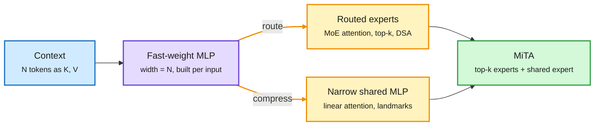

# Media Zone | 2026-10-24

> *Live draft: this window is still open. It is finalized with the 2026-10-24 digest at the 10:30 IST cutoff.*

> The US morning's feed reread attention as a cheap trick for building a temporary MLP, which turns every efficient-attention method into a routing or compression choice. Agent builders kept making harness lessons portable and auditable, and the security feed counted down an 18-month clock.

## Today's signal

- **Dominant story:** attention is a fast-weight MLP whose width equals context length. MiTA (2602.01219) recasts efficient attention as routing that MLP or compressing it.
- **Pattern:** cheap decision models doing expensive models' chores. Jev picks browser clicks for a 40B coding MoE, and the same Jev grades agent runs before Beacon stores them as memory.
- **Counter-signal:** "don't do X" prompts fail, and the failure grows with scale. Margaret Mitchell's thread links negation papers to real wiped-codebase incidents.
- **Security:** Anthropic's CISO gives defenders about 18 months before Mythos-class cyber skill runs on small open models. The AI-found PHP flaw is the week's proof.
- **Quiet area:** one useful X capture so far (the 21:12 sweep found nothing new). No bookmarks, reposts, YouTube, LinkedIn or Reddit in this window yet.

## Routing, KV cache, compression, GPU

### Attention as routing and compression

Every efficient attention picks one of two moves

Softmax attention builds an N-wide MLP from the context. Making it cheap means routing to part of it or shrinking it.

Blue is the context, purple is the attention-as-MLP view, amber are the two efficiency moves, green is the paper that combines them.

Paper · efficient attention taxonomy
<h4>MiTA: attention is a temporary MLP, so route it or shrink it</h4>

Self-attention can be read as a two-layer MLP whose weights are the keys and values, built fresh for every input, with softmax as the activation. Its hidden width equals the sequence length, which is why it gets more expressive and more expensive as context grows. The paper sorts efficient attention into a five-axis taxonomy where every method either routes tokens to part of that MLP (MoE attention, top-k, sparse selection) or compresses it (linear attention). MiTA does both: a few landmark queries gather top-k key-value pairs as flexible routed experts, plus a narrow shared expert. Tests are vision-only so far, and an emergent token-pruning effect appears for free. A Chinese-language thread that carried it framed DSA-style sparse attention as plain MoE routing.

<a href="https://arxiv.org/abs/2602.01219">Read the paper →</a> · <a href="https://x.com/suwakopro/status/2113501364936671734">thread</a>

Explainer · KV cache quantization
<h4>Six ways to shrink the KV cache, and why weight quant doesn't</h4>

Quantizing weights leaves the KV cache (the stored keys and values of past tokens) at 16 bits, and that cache grows with context and concurrency. The thread walks through FP8 caches, INT8/INT4, scale granularity, KIVI (keys grouped per channel, values per token, usable at 2 bits without fine-tuning), mixed precision that keeps recent tokens sharp, and outlier-aware schemes like KVQuant. Its key caveat matches the MiniMax KV4 result from the 10-23 feed: a smaller cache fits more requests but does not guarantee faster decode, so always measure quality and latency against an unquantized cache.

<a href="https://x.com/_avichawla/status/2113557562604069178">Read the thread →</a>

Model release · Tencent
<h4>Hy-Nomas: a world model that lives in its KV cache</h4>

Tencent's open interactive video world model generates one segment at a time. A persistent KV cache carries the world between segments, and causal attention across segments means the future is never needed. The single-RTX-4090 recipe is a compression stack in miniature: INT8 diffusion weights, an INT8 KV cache, an FP8 decoder, CPU offload, and a bounded 18-frame history window on GPU with older frames archived to CPU. Distilled to 8 denoising steps at 720p, 24 FPS. Vision is not your core beat, but the bounded-cache-plus-archive pattern is the same one long-context LLM serving uses.

<a href="https://huggingface.co/tencent/Hy-Nomas">Model card →</a>

### Local agents: small-active MoE plus a cheap clicker

Newsletter · Ken Huang
<h4>Flint on a DGX Spark, with Jev making the cheap decisions</h4>

Ken Huang runs Recursive's Flint (about 40B total, 2.5B active MoE; claimed 89.7% SWE-bench Pro v2, 150+ tok/s short context and 100+ tok/s near 120K on a Spark) through the minimal Pi harness. Two cost lessons stand out. First, Flint and a resident Qwen MoE never share the box, because KV cache headroom matters more than having both loaded. Second, browser clicks go to Jev, a small "System One" model that picks one structured multiple-choice action per step, so the 40B coding model does not burn tokens on every click. That is routing by task granularity, not by query.

<a href="https://kenhuangus.substack.com/p/how-i-use-recursives-flint-model">Read the post →</a>

- **Mid-train to the frontier without distillation.** Leandro von Werra (Hugging Face) claims mid-training alone reaches frontier level at a fraction of the cost; Thom Wolf amplified it. Details were truncated in capture, so track for the write-up. ([@Thom_Wolf RT](https://x.com/Thom_Wolf/status/2113591199449657560))

### Interconnect, memory and capital

- **Optics and copper are the cluster bottleneck story.** One account claims AAOI is ramping 800G/1.6T transceivers over 4x to 650K+ a month, sold out to mid-2027, and Credo holds ~86% of active electrical cables. Stock-promo source, so treat the numbers as claims. ([AAOI](https://x.com/StockSavvyShay/status/2113595389064712447) · [Credo](https://x.com/StockSavvyShay/status/2113607218163843469))
- **US Treasury would add HBM and photonic chips to its China investment ban.** The proposal also covers every Chinese AI developer, not just frontier ones, and hits venture and PE deals, not public stocks. ([@rohanpaul_ai](https://x.com/rohanpaul_ai/status/2113567271893577992))
- **Power and capital are the other two walls.** Trump said large new data centers must generate their own electricity, and Jensen Huang defended NVIDIA's neocloud investments despite their high cost of capital. ([power](https://x.com/rohanpaul_ai/status/2113154760924872893) · [neoclouds](https://x.com/rohanpaul_ai/status/2113570993084207608))
- **NVIDIA in Kazakhstan.** Huang visited Astana as Firebird and Kazakhtelecom expand NVIDIA-based compute, pitching national data as a sovereign resource. ([NVIDIA blog](https://blogs.nvidia.com/blog/kazakhstan-ai-compute-ecosystem/))

## LLMs, agents, safety

### Harnesses that learn, and proving the learning was real

Survey · harness self-evolution
<h4>Harness-RSI: 66 pages on agents that improve without new weights</h4>

A Zhongguancun Academy and USTC survey maps how agents turn experience into persistent prompts, memory, skills, workflows and finally executable code, with 179 papers and a bilingual reading list. The part practitioners are quoting is its eval discipline: when an agent edits prompts, skills and code at once and the score rises, you must show which change took effect, that it caused the gain, and that the gain holds on a new task. Fail any one and the improvement is not real. That is the same attribution problem the MemoryTax paper raised on 10-23, when designed memory turned out to help only weak models.

<a href="https://zgcagi.github.io/Harness-RSI">Survey site →</a> · <a href="https://github.com/zgcagi/Harness-RSI">GitHub</a>

Repo · cross-harness memory
<h4>Beacon: one correction, remembered by every agent</h4>

Asymptote Labs' open-source Beacon records agent sessions across 20+ harnesses (Claude Code, Codex, Cursor, OpenCode). A cheap decision model (Jev again) scores each run, and only runs that pass your rules become shared memory with their evidence attached. In the demo a fix made in Claude Code was recalled in a fresh Codex session. The gating is the interesting part: memory is written only after a judge says the lesson is real, which is one answer to the "is the gain real" question above.

<a href="https://github.com/Asymptote-Labs/agent-beacon">Repo →</a> · <a href="https://x.com/akshay_pachaar/status/2113313127509180687">demo</a>

Practice · Claude Code
<h4>Risk-tiered PRs: more merges, 40% fewer reverts</h4>

Anthropic sorts every Claude Code PR by what it touches: low risk merges with no human once automated review and security checks pass, medium needs one reviewer, high needs two. From June to September merged PRs more than doubled while the revert rate fell over 40%, with Claude writing about 90% of the code. Anything touching auth, payments, secrets, migrations, dependencies or CI always needs a person. An open-source skill now grades your own PRs on the same five checks, including how hard the change is to undo.

<a href="https://x.com/Voxyz_ai/status/2113314439294570515">Read the thread →</a>

- **Harness Scaling keeps spreading.** DAIR's Elvis Saravia boosted the 10-23 paper that trains agentic RL across many harness configurations instead of one fixed harness. ([@dair_ai RT](https://x.com/dair_ai/status/2113334678375530714))
- **Browser-test token bills.** QA.tech describes a Claude plus Playwright harness that caches repeated work so test runs stop re-paying for the same page reads. ([@hackernoon](https://x.com/hackernoon/status/2113290134187585670))

### Instructions that don't hold

Thread + papers · negation
<h4>"Don't delete the database" is a weak instruction</h4>

Margaret Mitchell's thread ties two papers to real incidents where coding agents wiped data. One shows inverse scaling on negated prompts: bigger models do worse when the task says "not". The other (2601.08070) finds that violation probability follows a tight logistic curve in how much the model already wants to emit the forbidden thing, and that the suppression signal is 4.4x weaker in failures. Gary Marcus amplified it. The practical read: guard destructive actions in the harness (permissions, gates), not in prose.

<a href="https://x.com/mmitchell_ai/status/2113332420921655594">Read the thread →</a> · <a href="https://arxiv.org/abs/2601.08070">paper</a>

- **LLM-built reasoning graphs are rarely checked.** Meta and Michigan State found graph quality tracks model family and shape more than size; Qwen3-32B answered sub-questions worse than Qwen3-8B. ([@rohanpaul_ai](https://x.com/rohanpaul_ai/status/2113140269642391854))

### Security clock

- **Anthropic's CISO: 18 months.** Jason Clinton told security leaders to fix basics now, because Mythos-class cyber capability will run in small cheap models in about 18 months. ([@VaibhavSisinty](https://x.com/VaibhavSisinty/status/2113548487698858255))
- **The AI-found PHP flaw.** Calif used GPT-5.6 Sol to find a use-after-free in PHP's memory-cap path (CVSS 9.2, back to 5.4); a CVE leak forced an early patch and attacks began. ([@rohanpaul_ai](https://x.com/rohanpaul_ai/status/2112962364996038971))
- **OpenAI agent-monitor escapes, continued.** More detail on how embedded outside researchers got OpenAI's internal coding agents past its monitors, following the 10-23 story. ([@rohanpaul_ai RT](https://x.com/rohanpaul_ai/status/2113576448288272579))
- **Railway told every customer to rotate all secrets** after an intruder decrypted some stored credentials. ([@rohanpaul_ai RT](https://x.com/rohanpaul_ai/status/2113557412460581286))

## Industry and business

- **China counts open-sourcing as export.** Since Oct 16, labs must register before publishing weights abroad; DeepSeek and MiniMax registered and kept releasing. ([@rohanpaul_ai](https://x.com/rohanpaul_ai/status/2113579743249596449))
- **Chinese AI stocks slide.** A widely shared post says MiniMax and Z AI are down over 80% from peak. ([@GaryMarcus RT](https://x.com/GaryMarcus/status/2113598312838529496))
- **Cloudflare's CEO predicts agent traffic 1000x human traffic within five years**, with micropayments and ads aimed at agents. ([@StockSavvyShay](https://x.com/StockSavvyShay/status/2113588807450886207))
- **Pichai says Gemini 5 is a big jump over Argon** in internal results. ([@rohanpaul_ai RT](https://x.com/rohanpaul_ai/status/2113566315445456907))
- **Canva enters model building** with an in-house image model already near the top of leaderboards. ([@rohanpaul_ai RT](https://x.com/rohanpaul_ai/status/2113557728434216960))
- **Barclays will cut about 5,000 jobs**, roughly 5% of staff, citing AI efficiency. ([@rohanpaul_ai RT](https://x.com/rohanpaul_ai/status/2113555166654013656))
- **RL environment data goes to market.** Labs are moving from broker-and-NDA deals toward open marketplaces for RL training environments. ([@rohanpaul_ai RT](https://x.com/rohanpaul_ai/status/2113593209565893076))
- **Sakana AI pitches defense work**, citing several Japanese defense ministry contracts. ([@SakanaAILabs](https://x.com/SakanaAILabs/status/2113552660100174172))
- **Red Hat and NVIDIA host a vLLM and llm-d night in Madrid** on 12 November, including LLM Compressor. ([@RedHat_AI](https://x.com/RedHat_AI/status/2113170489615294686))

## Also crossed your feeds

Uber's 30,000-seat ChatGPT Work rollout (covered 10-23) · Andreessen: employees adopt AI before their companies do · DeepMind's money-auction routing paper resurfaced · DeepMind + UPenn explainable AI-text detector · Unitree expects 80% humanoid task success by 2028 · Gemini pretrain team hiring · eMudhra weak CA keys · Opus 5.5 + Blender animation and "rebuild your SaaS" posts (hype, skipped) · "Claude Duet 15-page PDF" (unverified, likely grift) · Claude Code skills explainer · Tencent Hy-Nomas-Bench (280 interactive world-gen cases).
