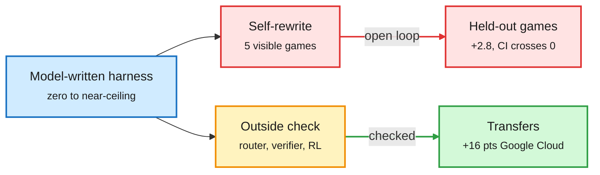

# Media Zone | 2026-10-25

> The US Saturday split in two. YouTube carried the serving-cost argument (YC's Paper Club: most compute goes to serving, not training). X carried the harness argument: frontier models cannot yet improve their own harness, and the useful structure is an outside check. The cost throughline: inference margin is a stack-quality business, and the cheapest token is the one a router never sends to the big model.

## Today's signal

- **Dominant story:** harness design. A DAIR-picked ARC-AGI-3 study finds two self-rewrites add 2.8 held-out points with an interval crossing zero.
- **Cost throughline:** Deedy Das puts reseller earnings at $10-38 per GPU-hour on $8 rented B300s; YC's Paper Club says serving burns about six FLOPs a year per training FLOP.
- **Pattern:** routing moves inside the agent. A Kurate + DAIR paper routes step size; a practitioner thread routes by context length to dodge a claimed price cliff.
- **Counter-signal:** Axim's credit test found that two frontier models agreeing does not make them right, and the self-harness study found the model's own cost cuts lower the score.
- **Quiet area:** no new saved posts (the feed capture worked, so this is no new saves, not an auth failure), no LinkedIn posts, and nothing passed the Reddit filters.

## Routing, KV cache, compression, GPU

### Where the inference dollar goes

```mermaid
flowchart LR
  Q["Request<br/><small>user tokens arrive</small>"] --> R["Routing<br/><small>pick model and replica</small>"]
  R --> C["Caching<br/><small>reuse prefix KV</small>"]
  C --> S["Scheduling<br/><small>batch, prefill vs decode</small>"]
  S --> K["Kernels<br/><small>attention, GEMM, scan</small>"]
  K --> H["Memory + hardware<br/><small>HBM bandwidth bound</small>"]
  H --> O["Token out<br/><small>speed, cost, quality</small>"]
  classDef input fill:#d0ebff,stroke:#1971c2,color:#1b1b1b,stroke-width:2px
  classDef loop fill:#fff3bf,stroke:#f08c00,color:#1b1b1b,stroke-width:2px
  classDef core fill:#e5dbff,stroke:#6741d9,color:#1b1b1b,stroke-width:2px
  classDef err fill:#ffe3e3,stroke:#e03131,color:#1b1b1b,stroke-width:2px
  classDef exit fill:#d3f9d8,stroke:#2f9e44,color:#1b1b1b,stroke-width:2px
  class Q input
  class R,C,S loop
  class K core
  class H err
  class O exit
```

Each token pays five layers of tax before it ships

YC's Paper Club argues the cost of serving lives in the stack around model.forward, not in the forward pass itself.

Blue is the request, amber are the serving decisions, purple is the compute, red is the binding cost, green is the output.

YouTube · inference economics
<h4>YC Paper Club: why inference matters more than training</h4>

YC's Paper Club brings together researchers and builders from Together AI and others to talk about serving. The headline claim: for every FLOP spent training a model, roughly six go to serving it each year, and getting serving right has created over $220B in market cap in a decade. The talk treats inference as a full stack: routing, caching, scheduling, kernels, memory and hardware, all traded against speed, cost and quality. It is the clearest single overview of your core topics this window. Watch it as a map of where routing and KV-cache reuse save the most money.

<a href="https://youtube.com/watch?v=mHNKuH-9OxU">Watch →</a>

GPU MODE · kernels
<h4>Scan at the speed of light (Lecture 119)</h4>

Bernhard Gruber's GPU MODE lecture covers parallel prefix scan, also called a running sum, and how to run it at memory-bandwidth speed. Scan sounds like a niche primitive, but it underpins top-p sampling, MoE token-to-expert offsets, stream compaction and the recurrences in linear attention and SSM (state-space model) layers. A scan that reaches bandwidth limits is a direct serving-cost win for those architectures. A clipped version was also posted the next day.

<a href="https://youtube.com/watch?v=6qQQS1zjGoU">Watch the lecture →</a> · <a href="https://youtube.com/watch?v=FChg7caTvI8">short cut</a>

DARPAtv · training cost
<h4>DARPA AIQ: predict big-model hyperparameters from small models</h4>

This is a four-part set from DARPA's AIQ program. Boris Hanin (Princeton) and Cengiz Pehlevan (Harvard) describe parameterizations, worked out with Cerebras, that let tuning done on small models carry over to large ones. That removes the trial-and-error sweeps at full scale. They report a 2.4x cut in the cost of training a 3.8B-parameter model (<a href="https://arxiv.org/abs/2505.01618">arXiv 2505.01618</a>). The open-questions talk asks how architecture and training choices drive anomalous and unsafe behavior. The research is from May 2026 but was only posted now.

<a href="https://youtube.com/watch?v=O62WZhBk6DI">Impact talk →</a> · <a href="https://youtube.com/watch?v=GDTboKGBSNQ">Pehlevan deep dive</a> · <a href="https://youtube.com/watch?v=fxi6SZgiJZA">scaling principles</a> · <a href="https://youtube.com/watch?v=UPqWfLLs3LE">open questions</a>

GPU MODE · numerics
<h4>Finding floating-point errors on GPUs (NixNan)</h4>

Mark Baranowski presents NixNan, a tool that detects and diagnoses floating-point exceptions (NaNs, infinities, subnormals) in GPU kernels across mixed hardware and software stacks. It is useful to anyone pushing to bf16 or FP8, where silent overflow is the usual way a quantized kernel goes wrong. It pairs with yesterday's softmax rounding-bug paper from DeepMind as a reminder that low precision needs its own tests.

<a href="https://github.com/parfloat/nixnan">Repo →</a> · <a href="https://youtube.com/watch?v=Sq7URODP80U">talk</a>

### Inference is a margin business now

- **Token arbitrage (cost):** Deedy Das says on-demand B300s at about $8/GPU-hour earn $10-20 serving open models like GLM 5.3, Kimi K3 or DeepSeek 4.1, and DeepInfer reports $38 off-peak. Stack quality and utilization set the margin; Chinese labs now ask big resellers for revenue share ([thread](https://x.com/deedydas/status/2114195317860266432)).
- **Context-price cliff (cost, unverified):** a viral thread claims a cheap Claude model's per-token price jumps 5x past a context threshold, so an Opus lead should fork Haiku workers before they cross it. Claimed bill: $6.15 for one agent, $0.85 for nine. The linked docs page does not show the tier.
- **Kimi K3.1 Pro in Agent Arena:** #11 overall and the top open model, at a $1.03 median cost per task, 13% cheaper than K3 and just off the Pareto frontier ([Arena](https://x.com/arena/status/2114008313054527901)).
- **Diffusion drafters (cost):** Sander Dieleman argues flow-map language models, which capture token dependencies in one or two passes, make natural speculative drafters, and flags another 8B blockwise continuous diffusion LM with self-speculative decoding ([post](https://x.com/sedielem/status/2114118321960542334), [background](https://sander.ai/2026/08/24/continuous-dlms.html)). Inception's Mercury 2.5 dLLM is now on OpenRouter.

[@deedydas](https://x.com/deedydas/status/2114195317860266432) · [@Sprytixl](https://x.com/Sprytixl/status/2114094189977723325) · [@arena](https://x.com/arena/status/2114008313054527901) · [@sedielem](https://x.com/sedielem/status/2114146901042016580)

## LLMs, agents, safety

### Can a model improve its own harness?

Self-revision tunes to what the model can see

The methods that transfer all add an outside check.

Blue is the first harness, red is the open-loop path, amber is the outside check, green is what transfers.

Paper · DAIR pick
<h4>Can LLMs improve their own harness? (ARC-AGI-3)</h4>

Each frontier model writes a complete harness from a fixed bootstrap, plays five development games, and rewrites its whole codebase twice. Every version is scored on 20 held-out games that never feed back. First harnesses range from useless to near-perfect across 27 lineages, but two rewrites add only 2.80 points of RHAE (levels completed, weighted by action efficiency against humans), with a 95% interval of -1.44 to 7.35. Gains on visible games overstate held-out gains, and revisions that cut dollar cost tend to lower the score. It is the second clean result, after the 10-22 HDA audit, that self-revision mostly overfits.

<a href="https://arxiv.org/abs/2610.30499">Read the paper →</a> · <a href="../../agentic-systems/2026-10-25-llms-improve-own-harness-arc-agi-3.md">wiki</a>

Paper · Kurate + DAIR
<h4>Adaptive Skill Granularity for coding agents</h4>

A coding agent can take many small tool calls or run one packaged macro skill. This paper makes that a per-task routing decision: a controller reads task structure, execution state and earlier macro failures, and a finite-state executor falls back from macro to primitive steps as an explicit transition. A learned router reaches 100% on a 12-task study where a hand-written heuristic fails. It pairs with Anthropic's advice to fold subagents into one loop with skills: skills become recoverable policies, not just retrievable files.

<a href="https://arxiv.org/abs/2610.31461">Read the paper →</a> · <a href="../../ai-routing/2026-10-25-adaptive-skill-granularity-and-context-cliffs.md">wiki</a>

- **Fold subagents, but run evals first:** Elvis Saravia and IntuitMachine back Anthropic's guidance that most subagent setups are "Conway's Law for AI" (one subagent per team, lossy handoffs). Keep subagents for parallel research, and decide with cost and quality evals ([@omarsar0](https://x.com/omarsar0/status/2114057736363352127), [@IntuitMachine](https://x.com/IntuitMachine/status/2114140884296175790)).
- **Claude Duet harness checklist:** brief, context, tools, observations, verification, repair, delivery. Keep checkpoints so work can resume, and mark missing evidence UNVERIFIED ([@beamnxw](https://x.com/beamnxw/status/2114058366347554833)).
- **AI-assisted hacking keeps escalating:** Codex helped jailbreak the Switch 2 with a human driving, and a Cornell paper traces an agent that turned a 404 into brute-forced URLs, scraped repos and a campus-security incident ([@VaibhavSisinty](https://x.com/VaibhavSisinty/status/2114122299872055738), [@kyronis_talks](https://x.com/kyronis_talks/status/2113895163193880724)).
- **Anthropic's Mythos handling, contested:** Miles Brundage says the July defense looked rushed and welcomes the Anthropic and AISI follow-up; Nate Soares mocks "rationalized" alignment. Commentary, no new data ([@Miles_Brundage](https://x.com/Miles_Brundage/status/2114026870098518060), [@So8res](https://x.com/So8res/status/2114190924540526927)).

### Evals are the agent's regression suite

- **Arize:** a one-line prompt change made a support agent 17 points safer and 17 points worse at finishing tasks. The fix is a loop: build datasets from production traces, score them, compare against a baseline, and block merges in CI.
- **Axim:** two frontier models disagreed sharply on whether iHeartMedia goes bankrupt or restructures. Splitting the analysis into checked layers (extraction, derivation, judgment, prediction) made them agree. That leaves open whether agreement means they are right.
- **Contour ($6B fund):** live A/B tests of analysts with and without AI tools, tracked as "cost per useful insight." That is a token-spend metric worth borrowing for routing evals.

AI Engineer · agent evals
<h4>Your agent fix just broke something else</h4>

Sofia Jakovcevic of Arize argues that agents fail at runtime, not in code, so code review misses most regressions. Her five-step loop: curate datasets from traces, score with evaluators, run baselines, compare changes, and gate merges in CI. She then closes the loop with coding agents that read traces and propose fixes. It fits the harness-engineering thread you have been saving: the eval loop is part of the harness.

<a href="https://youtube.com/watch?v=v5tm5EAzsAs">Watch →</a>

AI Engineer · reasoning reliability
<h4>Can AI understand a distressed credit?</h4>

Harneet Kaur, a former distressed-credit investor, gave two top models the same iHeartMedia context. They disagreed on the odds of bankruptcy versus restructuring. Splitting the task into verified stages brought them to the same answer. It is a practical case for decomposed pipelines over one-shot prompts, and an honest note that agreement between models is not ground truth.

<a href="https://youtube.com/watch?v=WOszaC1WWbQ">Watch →</a>

## Industry and business

- **Weekend market signal:** Jassy's demand "barbell" and the 2027 chip, memory and power crunch ([@VaibhavSisinty](https://x.com/VaibhavSisinty/status/2114038898477408373)). Gary Marcus quotes Apollo's Torsten Slok: no AI payoff outside tech ([@GaryMarcus](https://x.com/GaryMarcus/status/2114041475604332851)).
- **Block's Dessa:** a speech-native voice model trained only on human audio. The demo interrupts and laughs mid-sentence; it is not released ([@VaibhavSisinty](https://x.com/VaibhavSisinty/status/2114002148799418392)).
- **SambaNova:** pitches on-prem, behind-the-firewall inference as hybrid demand grows ([@SambaNovaAI](https://x.com/SambaNovaAI/status/2114097602119479634)).

- **Bridgewater's "Vault":** over 100M documents from 135 sources plus internal memos, all permissioned and tagged to the firm's ontology. Lesson: humans and agents need different search, and the payoff is agents that bring things to investors before they ask ([talk](https://youtube.com/watch?v=CLve4Nx_RwI)).
- **Contour Asset Management** measures AI's return on investment with live analyst A/B tests and uses agents to resurface old ideas when markets move ([talk](https://youtube.com/watch?v=ZMZlAn6Pyfg)).
- **Nikhil Kamath's "WTF is AI?"** founder panel follows Friday's "Is AI a bubble?" episode. It is broad commentary aimed at Indian founders ([panel](https://youtube.com/watch?v=94pqPlHoko0)).

## Also crossed your feeds

Secondhand weekly roundup (Madry back at OpenAI, "Aurora" model references, Harvard AI-review study) · Warp's agent-native payroll (YC Root Access) · Red Hat's garak red-teaming walkthrough · Ben Goertzel on publicly funded formal verification · Varun Mayya on AI making the internet less safe · WorldofAI's Kimi K3.1 Pro test video · Trelis/Dialt voice agents that interrupt, persona control and background-speaker suppression (product demos) · Stanford EE292R "From World Models to World Agents" · Stanford CS547 "Designing AI for Societal Good" · YC on launch videos · hype skipped: "ResonanceDB" quantum vector DB, "Brainobot," LLM "emotion circuits," Grok Bot templates · politics, finance and off-topic channels skipped.
