# Media Zone | 2026-10-25

> *Live draft: this window is still open. It is finalized with the 2026-10-25 digest at the 10:30 IST cutoff.*

> So far the US Saturday is a video day. X has not come through yet. On YouTube, inference serving gets the cost argument (YC's Paper Club: most compute goes to serving, not training) and the agent talks all land on one point: you can't trust a change until it has been tested on traces.

## Today's signal

- **Dominant story:** inference economics. YC's Paper Club claims serving burns roughly six FLOPs a year for every training FLOP, and maps the stack that decides the price.
- **Pattern:** evals as the agent's regression suite. Arize, Axim and Contour each argue that production traces and checked layers matter more than the prompt.
- **Cost throughline:** cheaper tuning and faster primitives. DARPA's AIQ talks describe a 2.4x cut in training cost from predicting big-model hyperparameters on small models, and GPU MODE takes on scan, a core GPU building block.
- **Counter-signal:** Axim's credit test found that two frontier models agreeing does not make them right.
- **Gaps so far:** both X feed captures since the window opened (21:12 and 23:32 IST) returned nothing because of network timeouts. Gmail has not been captured since 2026-10-23. No LinkedIn or Reddit files are in this window yet. The US-day X conversation should arrive with the morning catch-up scan.

## Routing, KV cache, compression, GPU

### Where the inference dollar goes

```mermaid
flowchart LR
  Q["Request<br/><small>user tokens arrive</small>"] --> R["Routing<br/><small>pick model and replica</small>"]
  R --> C["Caching<br/><small>reuse prefix KV</small>"]
  C --> S["Scheduling<br/><small>batch, prefill vs decode</small>"]
  S --> K["Kernels<br/><small>attention, GEMM, scan</small>"]
  K --> H["Memory + hardware<br/><small>HBM bandwidth bound</small>"]
  H --> O["Token out<br/><small>speed, cost, quality</small>"]
  classDef input fill:#d0ebff,stroke:#1971c2,color:#1b1b1b,stroke-width:2px
  classDef loop fill:#fff3bf,stroke:#f08c00,color:#1b1b1b,stroke-width:2px
  classDef core fill:#e5dbff,stroke:#6741d9,color:#1b1b1b,stroke-width:2px
  classDef err fill:#ffe3e3,stroke:#e03131,color:#1b1b1b,stroke-width:2px
  classDef exit fill:#d3f9d8,stroke:#2f9e44,color:#1b1b1b,stroke-width:2px
  class Q input
  class R,C,S loop
  class K core
  class H err
  class O exit
```

Each token pays five layers of tax before it ships

YC's Paper Club argues the cost of serving lives in the stack around model.forward, not in the forward pass itself.

Blue is the request, amber are the serving decisions, purple is the compute, red is the binding cost, green is the output.

YouTube · inference economics
<h4>YC Paper Club: why inference matters more than training</h4>

YC's Paper Club brings together researchers and builders from Together AI and others to talk about serving. The headline claim: for every FLOP spent training a model, roughly six go to serving it each year, and getting serving right has created over $220B in market cap in a decade. The talk treats inference as a full stack: routing, caching, scheduling, kernels, memory and hardware, all traded against speed, cost and quality. It is the clearest single overview of your core topics this window. Watch it as a map of where routing and KV-cache reuse save the most money.

<a href="https://youtube.com/watch?v=mHNKuH-9OxU">Watch →</a>

GPU MODE · kernels
<h4>Scan at the speed of light (Lecture 119)</h4>

Bernhard Gruber's GPU MODE lecture covers parallel prefix scan, also called a running sum, and how to run it at memory-bandwidth speed. Scan sounds like a niche primitive, but it underpins top-p sampling, MoE token-to-expert offsets, stream compaction and the recurrences in linear attention and SSM (state-space model) layers. A scan that reaches bandwidth limits is a direct serving-cost win for those architectures. A clipped version was also posted the next day.

<a href="https://youtube.com/watch?v=6qQQS1zjGoU">Watch the lecture →</a> · <a href="https://youtube.com/watch?v=FChg7caTvI8">short cut</a>

DARPAtv · training cost
<h4>DARPA AIQ: predict big-model hyperparameters from small models</h4>

This is a four-part set from DARPA's AIQ program. Boris Hanin (Princeton) and Cengiz Pehlevan (Harvard) describe parameterizations, worked out with Cerebras, that let tuning done on small models carry over to large ones. That removes the trial-and-error sweeps at full scale. They report a 2.4x cut in the cost of training a 3.8B-parameter model (<a href="https://arxiv.org/abs/2505.01618">arXiv 2505.01618</a>). The open-questions talk asks how architecture and training choices drive anomalous and unsafe behavior. The research is from May 2026 but was only posted now.

<a href="https://youtube.com/watch?v=O62WZhBk6DI">Impact talk →</a> · <a href="https://youtube.com/watch?v=GDTboKGBSNQ">Pehlevan deep dive</a> · <a href="https://youtube.com/watch?v=fxi6SZgiJZA">scaling principles</a> · <a href="https://youtube.com/watch?v=UPqWfLLs3LE">open questions</a>

GPU MODE · numerics
<h4>Finding floating-point errors on GPUs (NixNan)</h4>

Mark Baranowski presents NixNan, a tool that detects and diagnoses floating-point exceptions (NaNs, infinities, subnormals) in GPU kernels across mixed hardware and software stacks. It is useful to anyone pushing to bf16 or FP8, where silent overflow is the usual way a quantized kernel goes wrong. It pairs with yesterday's softmax rounding-bug paper from DeepMind as a reminder that low precision needs its own tests.

<a href="https://github.com/parfloat/nixnan">Repo →</a> · <a href="https://youtube.com/watch?v=Sq7URODP80U">talk</a>

## LLMs, agents, safety

### Evals are the agent's regression suite

- **Arize:** a one-line prompt change made a support agent 17 points safer and 17 points worse at finishing tasks. The fix is a loop: build datasets from production traces, score them, compare against a baseline, and block merges in CI.
- **Axim:** two frontier models disagreed sharply on whether iHeartMedia goes bankrupt or restructures. Splitting the analysis into checked layers (extraction, derivation, judgment, prediction) made them agree. That leaves open whether agreement means they are right.
- **Contour ($6B fund):** live A/B tests of analysts with and without AI tools, tracked as "cost per useful insight." That is a token-spend metric worth borrowing for routing evals.

AI Engineer · agent evals
<h4>Your agent fix just broke something else</h4>

Sofia Jakovcevic of Arize argues that agents fail at runtime, not in code, so code review misses most regressions. Her five-step loop: curate datasets from traces, score with evaluators, run baselines, compare changes, and gate merges in CI. She then closes the loop with coding agents that read traces and propose fixes. It fits the harness-engineering thread you have been saving: the eval loop is part of the harness.

<a href="https://youtube.com/watch?v=v5tm5EAzsAs">Watch →</a>

AI Engineer · reasoning reliability
<h4>Can AI understand a distressed credit?</h4>

Harneet Kaur, a former distressed-credit investor, gave two top models the same iHeartMedia context. They disagreed on the odds of bankruptcy versus restructuring. Splitting the task into verified stages brought them to the same answer. It is a practical case for decomposed pipelines over one-shot prompts, and an honest note that agreement between models is not ground truth.

<a href="https://youtube.com/watch?v=WOszaC1WWbQ">Watch →</a>

## Industry and business

- **Bridgewater's "Vault":** over 100M documents from 135 sources plus internal memos, all permissioned and tagged to the firm's ontology. Lesson: humans and agents need different search, and the payoff is agents that bring things to investors before they ask ([talk](https://youtube.com/watch?v=CLve4Nx_RwI)).
- **Contour Asset Management** measures AI's return on investment with live analyst A/B tests and uses agents to resurface old ideas when markets move ([talk](https://youtube.com/watch?v=ZMZlAn6Pyfg)).
- **Nikhil Kamath's "WTF is AI?"** founder panel follows Friday's "Is AI a bubble?" episode. It is broad commentary aimed at Indian founders ([panel](https://youtube.com/watch?v=94pqPlHoko0)).

## Also crossed your feeds

Trelis/Dialt voice agents that interrupt, persona control and background-speaker suppression (product demos) · Stanford EE292R "From World Models to World Agents" (long-context video world models, autoregressive drift) · Stanford CS547 "Designing AI for Societal Good" · Stanford robot autonomy ROS lecture (2019 archive) · YC on launch videos and standing out among AI-made designs · Curt Jaimungal physics episodes, finance, health and politics channels (off-topic, skipped).
