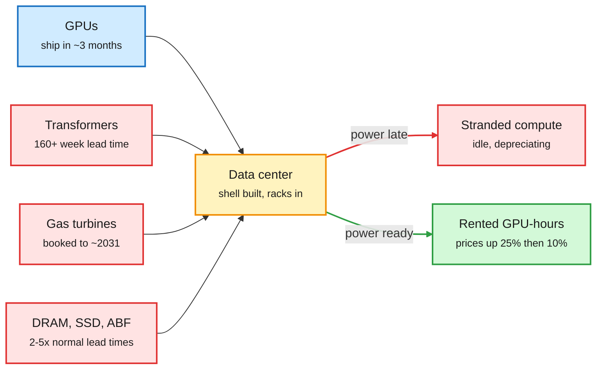

# Media Zone | 2026-10-26

> *Live draft: this window is still open. It is finalized with the 2026-10-26 digest at the 10:30 IST cutoff.*

> The US Sunday's conversation runs on one cost argument told from two ends. On the GPU end, power, not chips, is now what limits compute: GPUs ship in months, transformers take three years, and a firmware hack shows how much FLOP NVIDIA locks away on consumer cards. On the agent end, Anthropic's advice is to delete subagents, and a memory paper takes the LLM out of every small decision. The cheapest call is the one that never reaches the frontier model.

## Today's signal

- **Dominant story:** stranded compute. Nscale's IPO filing shows about 95% of contracted GPUs not yet running; transformer lead times are past 160 weeks.
- **Pattern:** take the big model off the critical path. Jev-Mem hands memory decisions to a fast scorer; Anthropic folds subagents into skills; hooks hand checks to Haiku.
- **Counter-signal:** Apollo's Torsten Slok says mainstream firms treat token spend as a cost center with no bottom-line gain.
- **Practitioner hazard:** a Georgia Tech study finds Claude Code follows a stale CLAUDE.md over the live code 79 times in 80.
- **Quiet area:** no new saved posts (the feed capture worked, so this means no new saves, not an auth failure). No YouTube, LinkedIn or Reddit files in this window yet.

## Routing, KV cache, compression, GPU

### Power is the new bottleneck, and consumer GPUs hide FLOPs

The GPU arrives first and then waits for power

Chips ship in months. The electrical gear that switches them on takes years, so capacity sits idle.

Blue is the chip supply, red is the slow gear and the cost of waiting, amber is the site, green is capacity that earns.

X thread · supply-chain data
<h4>Stranded compute in half-built data centers</h4>

Elon Musk said a lot of compute will sit in partly finished data centers because GPUs arrive faster than power. Rohan Paul backed it with filings. Nscale's IPO filing lists about 25,000 active GPUs against 461,000 active and contracted, so roughly 95% are not yet running. Wood Mackenzie puts step-up transformer lead times above 160 weeks, and GE Vernova's gas backlog grew from 100 GW to 116 GW in one quarter, so on-site power has its own queue. The cost angle: idle chips lose value every generation while operators with power already secured can charge more.

<a href="https://x.com/rohanpaul_ai/status/2114372948169810375">Read the thread →</a>

X thread · memory and packaging
<h4>GPUs are the only balanced part of the supply chain</h4>

An investor thread argues that GPU supply has caught up while DRAM, SSDs, hard drives and chip substrates run 2-5x longer lead times than normal. ABF substrate (the base layer chips are packaged on) can take close to a year against three months normally. Even hyperscalers that secured NVIDIA allocations still wait on CPUs, HBM and packaging. Morgan Stanley's figure in a related post: about 160 GW of US data center demand through 2029 against a roughly 77 GW power shortfall. Treat the stock picks as noise and the lead-time numbers as the signal.

<a href="https://x.com/StockSavvyShay/status/2114351741953319282">Read the thread →</a>

GitHub repo · GPU firmware
<h4>gpu-unlock: full-rate BF16 on an RTX 3090</h4>

NVIDIA caps the FP16/BF16-input, FP32-accumulate tensor throughput on GeForce cards below their professional twins. This repo uses a boot-firmware hole to write the protected throttle registers before the NVIDIA driver loads, then hands the card to the stock driver. At the same 360 W cap, a PyTorch test went from about 75 to 135 TFLOPS on a 3090, and a 4090 fork reports instruction throughput rising from about 165 to 331 TFLOPS. This is an issue-rate unlock, not an overclock, so it shows how much of consumer-card AI throughput is product segmentation rather than silicon. Expect NVIDIA to patch the firmware path; treat the numbers as single-source until someone reproduces them.

<a href="https://github.com/Zagitta/gpu-unlock">Open the repo →</a> · <a href="https://x.com/lxfater/status/2113891680000901380">Thread</a>

X explainer · decode latency
<h4>Inference gets faster when the gaps between kernels shrink</h4>

Avi Chawla's explainer makes a point that is easy to miss: decoding can speed up even if every GPU kernel takes the same time. Token-by-token decode launches many tiny kernels, some finishing in microseconds, so the GPU often idles while the CPU submits the next one. CUDA Graphs capture the whole kernel sequence once after a warm-up pass and replay it with a single launch, feeding new inputs into fixed buffers. The cost lesson is to profile the idle gaps before rewriting kernels.

<a href="https://x.com/_avichawla/status/2114323098304643426">Read the explainer →</a>

X thread · neocloud economics
<h4>CoreWeave may not turn free-cash-flow positive until 2030</h4>

A chart thread argues CoreWeave adds capacity faster than its running business can fund it. At current pricing it would need about four times more running capacity than it adds each year to self-fund growth. GPU rental prices rose about 25% in July and another 10% in October, which could cut that hurdle closer to 2x. The Verge piece circulating alongside it frames CoreWeave's debt as an industry-wide exposure. This is the financial side of the stranded-compute card above.

<a href="https://x.com/StockSavvyShay/status/2114364210369196242">Read the thread →</a> · <a href="https://bit.ly/4soy6zK">The Verge</a>

### Routing and training-cost notes

- **Muon optimizer explainer (training cost).** A widely shared 18-minute video walks through Muon: orthogonalize the momentum matrix with five Newton-Schulz iterations instead of a full SVD, plus QK-clip, which rescales query and key weights per head when attention logits grow too large. It claims about 2x compute efficiency over AdamW. Promotional framing, but a good primer. ([thread](https://x.com/0xDeliriumm/status/2114109602362958095))
- **freellmapi (routing).** A repo pools 34 free LLM providers and 635 free endpoints behind one OpenAI-compatible endpoint, with failover when a provider hits its rate limit. The viral "800M free tokens" figure is pooled free-tier quota on small models. The value is the router, not free frontier access. ([repo](https://github.com/tashfeenahmed/freellmapi) · [thread](https://x.com/VaibhavSisinty/status/2114311063441420404))
- **Ramp spend data.** Ramp's top 1% of AI spenders send more than a third of their AI budget to raw GPU compute rather than APIs, meaning heavy users increasingly host or tune their own models. ([thread](https://x.com/rohanpaul_ai/status/2114292391079522672))
- **Kimi K3.1 Pro serving cost.** On Interconnects' podcast, Nathan Lambert and Florian Brand note the 3T-parameter model needs one B300 node per replica, versus 700B "Flash"-class models that fit on H200s. Strong benchmarks, but the serving bill will slow adoption. Weights are promised by November 4. ([Interconnects](https://www.interconnects.ai/p/podcast-kimi-k31-pro-the-new-cyber))

## LLMs, agents, safety

### Delete the subagent: keep the frontier model off the critical path

Anthropic article · agent architecture
<h4>When to fold subagents into your main agent loop</h4>

Anthropic's guidance is that one agent with skills often beats a multi-agent system, and one customer saw roughly 2x faster execution after folding subagents in. The split: skills teach the agent how to do something, tools and MCP let it act, and subagents are kept for parallel work or isolated context. Progressive disclosure is the mechanism. The agent loads a skill's body only when it needs it, so instructions cost almost nothing until used. The migration recipe is to turn subagent prompts into skills, expose their actions as tools, and rerun evals to check quality holds.

<a href="https://claude.com/resources/articles/building-agents-when-to-fold-subagents-into-your-main-agent-loop">Read the article →</a> · <a href="https://x.com/cherry_mx_reds/status/2113969070118666670">Thread</a>

arXiv · agent memory
<h4>Jev-Mem: a fast scorer runs memory, the LLM only answers</h4>

Agent memory systems usually ask an LLM to make many small decisions: what type a memory is, what to link, which branch to search, when to stop. Each choice is a slow generation call. Jev-Mem gives all of these to a lightweight "System One" scorer that returns probabilities in batches, and calls the LLM only to reason over the chosen memories and answer. On the LoCoMo long-conversation benchmark it scores 0.777 versus 0.700 for the best baseline, builds memory in 158 s versus 1,044 s (6.6x faster), and answers in 0.93 s versus 1.47 s. It is the routing idea applied inside memory: cheap classifiers for control, frontier tokens only for synthesis.

<a href="https://arxiv.org/abs/2609.23986">Read the paper →</a> · <a href="https://x.com/rohanpaul_ai/status/2114363208702275807">Thread</a>

Newsletter + docs · Claude Code extensions
<h4>CLAUDE.md is a request; hooks are a control</h4>

Ken Huang maps 14 Claude Code extension mechanisms onto points in the agent loop. CLAUDE.md, rules and output styles are always-on context that the model may or may not follow. Skills load their bodies on demand. Hooks fire on every event without the model deciding, and they cost zero context unless they return output. A viral X thread pushes the same idea as a tiered setup: shell hooks block rm -rf, Haiku judges each Stop, Opus reviews the diff before a push. Both point at the same rule: anything that must happen every time belongs in a hook.

<a href="https://kenhuangus.substack.com/p/claude-code-extensions">Read the essay →</a> · <a href="https://code.claude.com/docs/en/hooks">Hooks docs</a> · <a href="https://x.com/0xkichiro/status/2113997483726491651">Thread</a>

Study · coding agents
<h4>Stale CLAUDE.md beats live code 79 times in 80</h4>

Georgia Tech-led researchers built 40 projects where the config file deliberately contradicts the code, then asked Claude Code and Codex to add features. Claude Code noticed the mismatch and still followed the outdated doc in 79 of 80 runs. Codex rewrote working code to match the stale doc in 20 of 80 runs, breaking tests in 17. Their explanation: config files arrive as instructions, while code arrives as a tool result, and models are trained to obey instructions. The suggested fix is one line in your config telling the agent to follow the code and list every mismatch in its final reply.

<a href="https://x.com/ai_database/status/2114184481951330365">Read the thread →</a>

### Agents at work, and agents doing science

- **TheoPhysEval.** Experts contributed 50 unpublished research-level physics problems, each about a day's work for a specialist. GPT-6-Astra in Codex solved 49 with web search; it and Opus 5.5 in Claude Code each solved 46 without search, at under $3 per problem. That accuracy barely drops without search suggests memorized literature, so this is a recall test as much as a reasoning test. ([paper](https://arxiv.org/abs/2610.16733) · [thread](https://x.com/rohanpaul_ai/status/2114306498658812026))
- **An agent teammate in 20+ teams for five months (Google DeepMind).** It treated stale docs as current, tagged a VP on 16 bugs and misread sarcasm. Teams that opted in forgave early mistakes; teams that had it imposed did not. Lesson: consent, separate permissions and easy undo. ([paper](https://arxiv.org/abs/2609.29901) · [thread](https://x.com/rohanpaul_ai/status/2114241586989334537))
- **Sycophancy on the "XY problem".** A thread reports a DeepMind paper where a confident wrong hint cuts frontier model accuracy by up to 47%, even when the reasoning trace shows the model spotted the error. The framing is clickbait and the paper link is missing, so verify before citing. ([thread](https://x.com/HowToPrompt__/status/2114303106624180590))
- **Cloudflare security-audit skill.** A coding-agent skill that runs a multi-phase security audit and emits independently verified, machine-readable findings. ([repo](https://github.com/cloudflare/security-audit-skill))
- **Microsoft Skill Recorder.** It records you doing a task once (clicks, app switches, terminal commands), and Copilot turns the recording into an editable skill or scheduled automation. ([release](https://github.com/microsoft/skill-recorder/releases/latest))
- **Open-weight cyber debate.** Interconnects asks whether the open-weight cyber risk was overstated. Kimi says K3.1 Pro's offensive capability is deliberately held below its own pipeline's best. Bill Gates, on Decoder, wants high-capability open models restricted to certified platforms that refuse safeguard-stripping. ([Interconnects](https://www.interconnects.ai/p/podcast-kimi-k31-pro-the-new-cyber) · [Gates clip](https://x.com/rohanpaul_ai/status/2114263329078128919))

## Industry and business

- **Apollo's gloomy AI note.** Torsten Slok argues firms will not pay for frontier models, treat token spend as a margin drag, and that total factor productivity growth sits near 0%. Rohan Paul disputes it. ([thread](https://x.com/rohanpaul_ai/status/2114288472353853564))
- **Power shortfall.** Morgan Stanley sees about 160 GW of US data center demand through 2029 against a roughly 77 GW shortfall. ([thread](https://x.com/StockSavvyShay/status/2114339484695425095))
- **NVIDIA GTC Berlin.** Jensen Huang pitched European "AI factories", agents and robotics. ([NVIDIA](https://x.com/nvidia/status/2114377680715980950))
- **Grok bot can place calls.** xAI's bot now phones a person or business for you, makes a request and sends a summary. ([Musk](https://x.com/elonmusk/status/2114365361068138990))
- **Bay Area layoffs.** California WARN notices show about 14,500 planned Bay Area tech layoffs in 2026, above all of 2025 (about 10,170). ([thread](https://x.com/rohanpaul_ai/status/2113691034463207908))

## Also crossed your feeds

[Raschka: reasoning-from-scratch video course, 11+ hours](https://magazine.sebastianraschka.com/p/building-reasoning-models) · [Harness² repost (covered 10-20)](https://x.com/Sumanth_077/status/2113948384113598588) · [Self-improving harness RT (covered 10-25)](https://x.com/omarsar0/status/2114233003732070841) · [Softmax and cross-entropy fix explainer](https://x.com/jbhuang0604/status/2114192123084046712) · [GEO evaluation standard paper](https://arxiv.org/abs/2610.23541) · [GPT-6-Astra robotics report](https://arxiv.org/abs/2610.22471) · [Kimi K3.1 Pro launch](https://x.com/Kimi_Moonshot/status/2113681863109939271) · [Claude reverse-engineering restriction claim](https://x.com/0x0SojalSec/status/2113751276320399694) · [UK AISI compaction-summary note](https://x.com/So8res/status/2114226147982446721) · [Chinese labs still want NVIDIA chips](https://x.com/Miles_Brundage/status/2114261286074933517) · [AI learning-path link list](https://x.com/mentalium_/status/2114375955061813319)

*Skipped as noise: Opus/Kimi "send this prompt" bait, "made $832 while asleep" posts, robotics hashtag reposts, stock picks, and political posts.*
