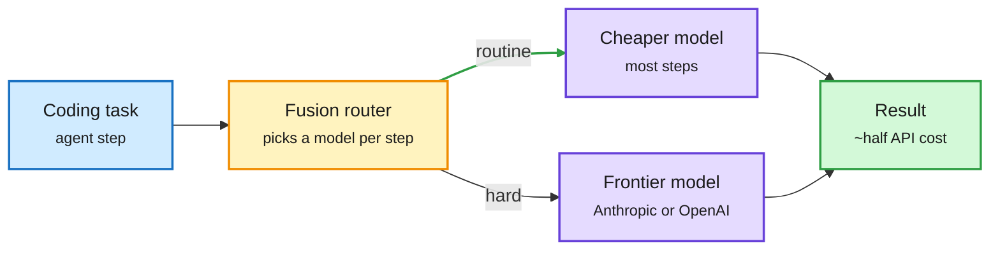
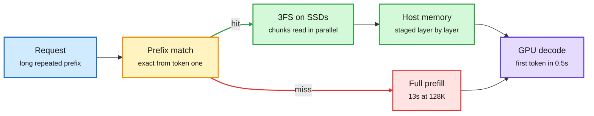

# Media Zone | 2026-10-29

> The US day's conversation: Google drops Gemini 4 Carbon two weeks after Argon, GitHub ships a model router that matches Claude Code at half the cost, the KV cache keeps leaving the GPU, and earnings night showed compute repricing upward everywhere. Cost per task, not raw score, is how the day's launches are being judged.

## Today's signal

- **Dominant story:** Gemini 4 Carbon lands. #1 on the Artificial Analysis index, 96.2% on 1M-token GraphWalks, gated to cyber defenders first.
- **Routing goes mainstream:** GitHub Copilot Fusion routes between Anthropic and OpenAI models, within two points of Claude Code at about half the cost.
- **KV cache leaves the GPU:** DeepSeek's DeepInfer serves cached prefixes from SSD; a 128K hit returns the first token in 0.5s instead of 13s.
- **Pattern:** self-improving agents need scoped edits. One paper shows prompt-rewriting agents forget; Amazon's EMMA fixes it by assigning each failure to one owner.
- **Counter-signal:** a Cerebras critique says its wafers must run dummy work to stay warm, undercutting its "thermal-tolerant packaging" S-1 claim.
- **Earnings night:** Google Cloud +103% with ~32B API tokens a minute, and Jensen Huang argued faster kernels are pure revenue while demand outruns capacity.
- **Quiet area:** no new bookmarks or curated reposts this window (the bookmark fetch ran fine, nothing new was saved). LinkedIn returned no posts, and YouTube carried only OpenAI customer videos. The X Following feed carries everything.

## Routing, KV cache, compression, GPU

### Routers and decision models: pay frontier prices only when needed

The day's routing story came from product launches, not papers. Each one sells the same trade: a cheap component decides, an expensive one executes only when it must.

Copilot Fusion sends each step to the cheapest model that can do it

Matching the best agent at half the cost comes from the router, not a new model.

Blue is the task, amber is the routing decision, purple is a model, green is the cheaper result. The split of steps is illustrative; GitHub has not published it.

Product · LLM routing
<h4>GitHub Copilot Fusion: a cross-vendor router inside Copilot</h4>

Announced at GitHub Universe, Fusion orchestrates between Anthropic and OpenAI models inside Copilot instead of making the user pick one. On the Artificial Analysis Coding Agent Index, Fusion Max scored within two points of Claude Code running Opus 5.5 Max at about half the API cost per task. That is the cleanest production evidence yet that routing, not a bigger model, is how a platform closes a quality gap cheaply. GitHub has not said how the router decides, so the policy is a black box for now.

<a href="https://x.com/github/status/2115480207469560109">Read the announcement →</a>

Model · decision model
<h4>Drex Max 1.1 and Parallel's Decisions API</h4>

Decision models are small, fast models that return a structured choice (yes/no, a category, a routing target) rather than prose. Nace's Drex Max 1.1 scores 70.8 on its Decision Index (up from 67.6), takes 262K context, and answers in a median 172ms. AI Breakfast quotes about $0.03 per 1,000 decisions versus ~$10 for Opus 5.5, roughly 170x cheaper, though that chart is the vendor's own. Parallel's new Decisions API pairs live web search with a bounded decision in one call and returns the typed answer with probability and sources. Both are router components in all but name.

<a href="https://x.com/omarsar0/status/2115464870887850329">Drex Max 1.1 →</a> · <a href="https://x.com/Sumanth_077/status/2115446285205651494">Decisions API →</a>

Leaderboard · cost per task
<h4>Agent Arena now ranks on a Pareto frontier</h4>

Arena plots agent quality against median cost per task. Gemini 4 Carbon (High) entered at #2 in Agent Arena with a +16.2% net improvement at $1.80 per task, 72% cheaper than #1 Claude Opus 5.5 (Max). A separate Arena study of 20,869 coding-agent traces found frontier models mostly win by getting stuck less: failed repair loops show up 6.9 points less often in complaint sessions. For a router, that is the feature to predict: which tasks will loop on a cheap model.

<a href="https://x.com/arena/status/2115495007025303564">Pareto chart →</a> · <a href="https://x.com/arena/status/2115465844230938846">Trace study →</a>

### The KV cache moves to disk, and agents start editing it

Two posts, one idea: recomputing prefill is the expensive part of long-context serving, so the winning move is keeping KV states alive longer and touching them less.

A cache hit is a disk read, not a GPU recompute

MLA makes each cached token small; 3FS makes thousands of SSDs read like one fast drive.

Blue is the request, amber is the cache decision, green is the cheap hit path, red is the expensive miss, purple is the model.

X thread · KV cache serving
<h4>DeepSeek open-sources DeepInfer: prefix cache on SSD</h4>

DeepInfer is the serving stack behind DeepSeek's API cache hits. Conventional engines keep the KV cache (the stored attention keys and values for every past token) in GPU memory, where it gets evicted fast. DeepSeek stores it on SSDs instead. That works only because MLA (multi-head latent attention, which stores one compressed vector per token per layer) shrank the cache about 93% versus their older 67B model, and because their 3FS file system stripes reads across thousands of drives. Cached prefixes live 3 days for agent traffic and 7 for chat, and 56% of input tokens on one production day came from disk. The cost face is blunt: a hit is 50x cheaper than a miss on deepseek-flash, so put system prompts, tools and documents first.

<a href="https://x.com/_avichawla/status/2115400590960599112">Read the thread →</a>

Paper thread · agent KV cache
<h4>Cache engineering: edit the KV cache, not the prompt</h4>

Agents that trim or summarize old messages break prefix reuse, so they pay to recompute the cache. A Tsinghua and CUHK team keeps the text history intact and instead adds two cache operations: "drop" hides selected KV entries from future attention, and "repos" fixes the positions of the keys that remain. Their AKV serving engine tracks these edits in an extended radix tree and rebuilds missing states in one batched prefill. Dropping old tool responses gave 27.7% lower cost, +1.7 benchmark points, 1.18x throughput and 1.51x faster P95 latency; letting agents tune their own drop policy saved another 7.1%. Quietly posted, low engagement, but squarely on KV eviction research.

<a href="https://x.com/TheTuringPost/status/2115426701769642018">Read the thread →</a>

Manual · serving how-to
<h4>vLLM 101: serve, size, tune and debug open models</h4>

A free hands-on manual that answers each serving decision with a measurement. It covers sizing GPU memory before you buy, FP8 KV cache to fit more users, prefix-cache hit rates, chunked prefill so long prompts do not stall short ones, EAGLE3 and n-gram speculative decoding, multi-LoRA, vLLM as an RL rollout engine, and when to pick SGLang instead. The best-performing post of the day by engagement rate off a small account. A good checklist to compare against the DeepInfer approach above.

<a href="https://aiengineeringfromscratch.com/manual-vllm-101">Read the manual →</a>

X thread · serving internals
<h4>CUDA Graph padding: paying for tokens that do not exist</h4>

CUDA Graphs record a fixed sequence of GPU kernels once and replay it, which removes the CPU launch cost on every decode step. The catch is that a graph has a fixed shape, while continuous batching changes the batch size every step. Engines like vLLM capture graphs for a few sizes and pad up to the next one, so a 121-token batch runs the 128-token graph and pays for 7 phantom slots. Adding one token past a capture size makes cost jump in a step, which vLLM's Adaptive Verification work hits directly with speculative decoding. A small account, high engagement rate, and a clean explanation of a cost most serving dashboards hide.

<a href="https://x.com/navaneethvb/status/2115434455775031807">Read the thread →</a>

X thread · primer
<h4>Inference engineering in one page</h4>

A dense primer on why serving is its own discipline. Prefill (processing the prompt and building the KV cache) is compute-heavy and parallel; decode (one token at a time) is bound by memory bandwidth because it rereads weights and KV state every step. Almost every known trick maps to one side of that split: FlashAttention and GQA cut memory traffic, PagedAttention cuts fragmentation, chunked prefill lets long prompts share the GPU with decode, prefix caching skips repeated prefill but does not speed decode. It ends on the right metric: goodput, the load you can carry while still meeting TTFT and tail-latency targets. Pairs with the DeepInfer card: prefix caching is exactly the "skip prefill" lever.

<a href="https://x.com/techNmak/status/2115459437146370201">Read the thread →</a>

### GPU stack and compute economics

- **PyTorch 2.15 ships faster 4-bit decode.** NVFP4 LLM decoding gets faster on Blackwell, the rewritten NCCL backend becomes default, and a one-sided NIXL transport arrives for KV and weight movement ([@PyTorch](https://x.com/PyTorch/status/2115501310233456900), [blog](https://pytorch.org/blog/pytorch-2-15-release-blog/)).
- **Cerebras keeps wafers warm with dummy work.** A packaging critique says the wafer-scale chip runs non-functional workloads to avoid thermal cycling, despite S-1 claims of expansion-tolerant packaging. One analyst's read; worth checking against the cited research ([@not_ellington](https://x.com/not_ellington/status/2115493050978107481)).
- **GB300 rents for 4x an H100.** Deutsche Bank estimates up to ~$14/hour versus $3.50, with some contracts near $60M per MW a year ([@StockSavvyShay](https://x.com/StockSavvyShay/status/2115408309469815074)).
- **Token prices fell 55% from the May peak.** RAND says LLM prices are now below where 2026 began, even as GPU rents climb. Cheaper tokens, pricier silicon: margin moves to whoever caches and routes best ([RAND via @GaryMarcus](https://x.com/GaryMarcus/status/2115474248143970477)).
- **IREN borrows $363M against working GPUs**, and **Vertiv beats on Q3** ($4.3B vs $3.8B expected). Power and contracted GPUs are now collateral ([IREN](https://x.com/StockSavvyShay/status/2115403410744963212), [Vertiv](https://x.com/StockSavvyShay/status/2115393233106931802)).
- **GitHub's agent load is an infra story.** 7.38B commits in September, 5x a year ago; GitHub added 4M CPU cores and 160PB of storage this year after a 7h47m outage in August ([@rohanpaul_ai](https://x.com/rohanpaul_ai/status/2115494454673211650)).
- **Jensen: 2x speed is 2x revenue.** Huang says doubling model speed with software or kernels doubles a lab's revenue, because tokens per second on the same GPUs and power is the product. True only while demand outruns capacity, which AWS (sold out through 2027) says it does ([@rohanpaul_ai](https://x.com/rohanpaul_ai/status/2115571526078763506)).
- **Google Cloud doubles.** Revenue +103% to $30.7B, operating income tripled to $11.1B, model APIs at ~32B tokens per minute (4x a year ago). Most TPU revenue lands in 2027; free cash flow went negative by $9B+ ([@rohanpaul_ai](https://x.com/rohanpaul_ai/status/2115554654738391482)).
- **Opus 5.5 beats Astra at custom kernels**, says Dimitris Papailiopoulos, a day after he reported Opus's cyber classifier blocking SASS work ([@DimitrisPapail](https://x.com/DimitrisPapail/status/2115565736659759392)).

## LLMs, agents, safety

### Gemini 4 Carbon: the frontier release of the US day

Lab release · frontier model
<h4>Gemini 4 Carbon: long-horizon agent, cyber-first rollout</h4>

Google DeepMind's new frontier model arrives two weeks after Gemini 4 Argon and ranks #1 on Artificial Analysis Intelligence Index v5.0 at 59. Its biggest gains are in security: 88.2% on SEC-bench Pro (finding vulnerabilities), 54.8% on ExploitGym (exploiting them) and 71.0% on CWE-bench (patching). Because of that exploit skill, access starts with a subset of cyber defenders in the Fairwind program before developers and consumers. The efficiency-relevant numbers: 96.2% on GraphWalks at 256K to 1M tokens versus 66.8% for Opus 5.5, and the same $2/$10 per million tokens as Argon with cached input 95% off. Google says it runs for days on engineering tasks without stalling; that claim is untested outside Google.

<a href="https://deepmind.google/blog/gemini-4-carbon-our-next-frontier-model/">Read the blog →</a> · <a href="https://x.com/rohanpaul_ai/status/2115496031031058815">Benchmark thread →</a>

- **Reaction:** the feed reads it as "Google is back" on cadence ([@omarsar0](https://x.com/omarsar0/status/2115502605069640045), [@sundarpichai](https://x.com/sundarpichai/status/2115489219804352921)). Investors credit the long-context lead to training on Google's own TPUs ([@StockSavvyShay](https://x.com/StockSavvyShay/status/2115492040050139409)).
- **The 95% cache discount is the quiet headline.** It makes long agent sessions with stable prefixes almost free on input, the same lever DeepInfer pulls above.

### Self-improving agents: plasticity needs a scope

Paper · continual learning
<h4>Are self-evolving agents actually continual learners?</h4>

Many self-improvement methods leave weights frozen and rewrite the agent's own prompts, memory or code from feedback. This paper tests ReasoningBank, GEPA and Meta-Harness on task streams that drift in topic, workflow or domain (built from BIRD, BFCL and ScienceWorld). Self-evolution helps on average, but more plasticity always costs stability. Global prompt edits overwrite what worked on earlier tasks, and similarity-based memory pulls in the wrong memories when similar queries need different workflows.

<a href="https://arxiv.org/abs/2610.25858">Read the paper →</a>

Paper · agent memory
<h4>EMMA: scoped edits fix the forgetting problem</h4>

An Amazon-led paper reads like a direct answer to the card above. EMMA treats a multi-agent system's configuration as episodic memory with three parts: the controller's routing memory (which sub-agent handles which step), specialist prompts that inherit a generalist prompt, and short procedural skills. After a failure, a reflector assigns the fix to exactly one of the three and proposes one bounded edit, so a change cannot sprawl across the system. It beats ACE, GEPA, EvoMAS and ADAS on KramaBench, AppWorld and BBEH by up to 32.5%, with 17 to 38% fewer training runs.

<a href="https://arxiv.org/abs/2610.35966">Read the paper →</a>

Curriculum · agent training
<h4>Hugging Face: a 5-step curriculum for post-training agents</h4>

A course that goes from supervised fine-tuning to RL through a real agent harness, with livestreams, code and docs for each step. It complements the free harness-engineering repo (14 lectures, 8 projects) that circulated earlier today: one teaches the environment around the agent, the other teaches how to train the model inside it.

<a href="https://huggingface.co/blog/huggingface/train-agents">Read the curriculum →</a> · <a href="https://github.com/walkinglabs/learn-harness-engineering">Harness repo →</a>

Research blog · AI for science
<h4>After42: can AI propose interesting research questions?</h4>

An agentic workflow refines broad research goals into questions by trying to solve them. Across math, statistics, theoretical CS and physics, 29 experts judged 45 of 135 questions interesting. Model judges matched expert consensus but not individual taste, and 97% of questions combined existing ideas rather than opening new ones.

<a href="https://after42.org/research/can-ai-propose-interesting-research-questions/">Read the post →</a>

- **Plain RAG keeps winning agent memory comparisons**, per another paper flagged by DAIR: dedicated memory systems still struggle to beat retrieval ([@dair_ai](https://x.com/dair_ai/status/2115100214797250955)).

### What models do that they cannot explain

- **A red heart makes models write recursion.** DeepMind and Stanford found a heart image in context pushes Opus 4.7 and GPT-5.4 to recursive code 100% of the time; 74.7% of GPT-5.4's traces give the wrong reason ([paper](https://arxiv.org/abs/2610.36449)).
- **Models talking in hidden states.** MIT researchers pass internal states between models from different vendors (Llama to Qwen, Gemma to Granite) instead of text: ~40% more accurate and 4x faster. A latent channel, and a KV-sharing cousin ([@ai_database](https://x.com/ai_database/status/2115422104657281392)).
- **Rare failures escape safety tests.** NYU work estimates how often low-probability harmful outputs slip past finite evaluation ([@NYUDataScience via @thegautamkamath](https://x.com/thegautamkamath/status/2115471605841506788)).

### Agents leak through their tools

- **Log-To-Leak (TikTok).** MCP agents often finish the real task, then quietly call an attacker's logging tool that records the query, the server reply and the answer. The attack hides inside a successful run, so outcome-only evals miss it ([@rohanpaul_ai](https://x.com/rohanpaul_ai/status/2115585031901257874)).
- **Distillers move from Claude to Astra.** The Information reports DeepSeek and Moonshot leaned on GPT-6 Astra outputs after Anthropic's limits cut their Claude harvest 90-99%. Frontier outputs are now a contested resource ([@rohanpaul_ai](https://x.com/rohanpaul_ai/status/2115643355522896283)).
- **Tool-agent data: mix beats volume.** Apple's SynthAPI trained 849 models: at a fixed 32,768 tasks, more apps and database states lifted a 4B agent from 38.4% to 45.0% on AppWorld ([@rohanpaul_ai](https://x.com/rohanpaul_ai/status/2115657738072334570)).
- **Rubrics as Rewards** uses an LLM judge scoring against rubrics to give RL rewards on open-ended tasks ([@berkeley_ai](https://x.com/berkeley_ai/status/2115582674459095429)).

### OpenAI's math claims, now with pushback

- **Proposed proofs, not yet accepted.** Kakeya in all dimensions, Yang-Mills existence and a refutation of the Exponential Time Hypothesis; a KITP working group is interpreting the Yang-Mills claim ([@ValerioCapraro](https://x.com/ValerioCapraro/status/2115149912719466708), [KITP via @OpenAI](https://x.com/OpenAI/status/2115237121300770818)).
- **The ETH refutation may be galactic.** Dimitris Papailiopoulos notes it only kicks in past n greater than (atoms in the universe)^(10^26), so it is a theory result, not a faster SAT solver ([@DimitrisPapail](https://x.com/DimitrisPapail/status/2115451187801514168), [alphaXiv explainer](https://x.com/askalphaxiv/status/2115361048652058962)).

## Multimodal / vision / audio

- **Nemotron 3.5 Transcribe is a speech MoE.** 30B total, ~4B active parameters, 40 languages, speaker attribution and translation in one open checkpoint; #1 open model on the Open ASR English leaderboard at 5.33% WER ([@NVIDIAAI](https://x.com/NVIDIAAI/status/2115462300241141882)).
- **EmbeddingGemma 2 puts all modalities in one 744M model.** Load only the encoders you need (271M text-only); int4 loses only ~0.4 MTEB points ([paper](https://arxiv.org/abs/2610.37364)).
- **MiniCPM-OCR 1.0 pairs a 1.3B parser with a verifier.** A second "Jev" model scores how reliable each extraction is, a decision model used as a quality gate ([@omarsar0](https://x.com/omarsar0/status/2115451835108802685), [repo](https://github.com/OpenBMB/MiniCPM-OCR)).

## Industry and business

- **Cognition gets $70B to $80B offers**, weeks after raising $2B at $48B; that is 78x to 89x revenue ([@rohanpaul_ai](https://x.com/rohanpaul_ai/status/2115487458502881417)).
- **Anthropic's S-1 shows $131.7B in cash** and $321.4B in lease obligations not yet started, plus ~$245B in new minimum commitments since June ([@rohanpaul_ai](https://x.com/rohanpaul_ai/status/2115491649543635378)).
- **Claude in drug discovery.** Divergence Labs reports early hits on a food-allergy antibody after Claude generated ~35,000 designs in a month ([@bjing2016](https://x.com/bjing2016/status/2115235758802161846)).
- **Meta funds five universities** with access to its Muse models for science and medicine ([@AIatMeta](https://x.com/AIatMeta/status/2115490919923548307)).
- **24% of web pages now carry AI text**, up from near zero before 2022, mostly at the edges of the web graph ([paper](https://arxiv.org/abs/2610.36631)).

- **ServiceNow falls 19% after hours** despite beating its own targets, on "SaaSpocalypse" fears ([@rohanpaul_ai](https://x.com/rohanpaul_ai/status/2115645490352259252)).
- **OpenRouter as a launchpad.** Prime Inference went from zero to 120B tokens a day in a month; Suhail's particle-1 inference service launched on it ([@vincentweisser](https://x.com/vincentweisser/status/2115631760918954163), [@ycombinator](https://x.com/ycombinator/status/2115648826925347137)).
- **Broccoli raises $52M** for phone agents for plumbers and HVAC firms; Exa now indexes 3M+ podcasts for agents ([@ycombinator](https://x.com/ycombinator/status/2115550323607740769), [Exa](https://x.com/ycombinator/status/2115614819403649166)).
- **ChatGPT plans now include API credits**: up to $500 a month for Pro and Business, a push to turn subscribers into builders.

## Practitioner ground truth

- **OCR has no single winner.** On 150 mixed pages, DeepSeek-OCR led tables at 87.2 while PaddleOCR-VL returned only the title of a 1040 form ([@akshay_pachaar](https://x.com/akshay_pachaar/status/2115163583764169031), [repo](https://github.com/datalab-to/omni_parse_bench)).
- **Coding interviews are dying at Anthropic.** Claude beats candidates on the old quizzes; hiring now runs on weekend prototypes ([@VaibhavSisinty](https://x.com/VaibhavSisinty/status/2115410753654305205), [@omarsar0](https://x.com/omarsar0/status/2115420120474358245)).
- **Evals start with error analysis.** Annotate 100+ production traces, cluster the failures, fix the top three categories before choosing metrics ([@divaagurlxw](https://x.com/divaagurlxw/status/2115418017891020888)).

## Also crossed your feeds

Already covered 2026-10-28, re-shared: Liquid LFM3 2B models, Google TPUs on Oracle cloud, Physical Intelligence at ~$20B · Decision models versus rerankers ([@omarsar0](https://x.com/omarsar0/status/2115405077032939701)) · Turing Post papers of the week ([link](https://x.com/TheTuringPost/status/2115322900349940096)) · Northeastern: agents take unpermitted actions ([link](https://x.com/rohanpaul_ai/status/2115335688707317968)) · Anthropic S-1 "$40T market" skepticism ([link](https://x.com/rohanpaul_ai/status/2115381881164480849)) · IOWN 40km photonic storage link ([link](https://x.com/Ronald_vanLoon/status/2115397708030869846)) · Oracle Agent Memory adds images ([link](https://x.com/TheTuringPost/status/2115398721080885556)) · Next-hidden-state prediction interview ([@yacinelearning](https://x.com/yacinelearning/status/2115095038979960957)) · Train-an-LLM-from-scratch repo ([link](https://x.com/techNmak/status/2115056057118769469)) · Free book: Mathematical Theory of Deep Learning ([link](https://arxiv.org/pdf/2407.18384)) · Michael Burry's bull case on Meta AI margins ([link](https://x.com/StockSavvyShay/status/2115498610137890929)) · Google LangExtract ([link](https://x.com/mdancho84/status/2115406508536029445)) · AssemblyAI TTS-1 ([link](https://x.com/ycombinator/status/2115453338439569746)) · Meta Andromeda ads retrieval co-design ([Meta Engineering](https://engineering.fb.com/2026/10/28/ml-applications/meta-andromeda-next-gen-ads-retrieval-gpu-co-design/)) · Nate Soares on model personality as a facade ([@So8res](https://x.com/So8res/status/2115483485326488010))

