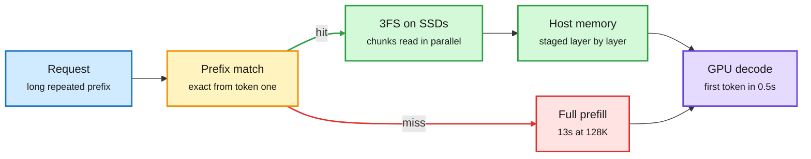

# Media Zone | 2026-10-29

> *Live draft: this window is still open. It is finalized with the 2026-10-29 digest at the 10:30 IST cutoff.*

> The US day's conversation so far: the KV cache is leaving the GPU. DeepSeek serves cached prefixes from SSD, a Tsinghua/CUHK team edits the cache instead of the prompt, and GB300 rental math shows why every saved prefill is worth money.

## Today's signal

- **Dominant story:** DeepSeek open-sources DeepInfer, its disk-backed prefix cache. A 128K-token cache hit returns the first token in 0.5s instead of 13s.
- **Pattern:** "cache engineering" replaces context engineering. Dropping KV entries instead of summarizing text cut agent cost 27.7% with a slight accuracy gain.
- **Pattern:** self-improving agents hit a wall. A new paper finds prompt-rewriting agents forget old tasks when the task stream drifts.
- **Off-axis shock:** OpenAI posted proposed proofs for Kakeya in all dimensions and Yang-Mills existence, plus an ETH refutation. Unverified, heavily discussed.
- **Compute economics:** Deutsche Bank prices GB300 rentals near $14/hour versus $3.50 for H100. Power is now the asset everyone is borrowing against.
- **Quiet area:** no new bookmarks, curated reposts, YouTube or LinkedIn captures in this window yet. The X Following feed carries everything; the 21:12 capture added nothing new.

## Routing, KV cache, compression, GPU

### The KV cache moves to disk, and agents start editing it

Two posts, one idea: recomputing prefill is the expensive part of long-context serving, so the winning move is keeping KV states alive longer and touching them less.

A cache hit is a disk read, not a GPU recompute

MLA makes each cached token small; 3FS makes thousands of SSDs read like one fast drive.

Blue is the request, amber is the cache decision, green is the cheap hit path, red is the expensive miss, purple is the model.

X thread · KV cache serving
<h4>DeepSeek open-sources DeepInfer: prefix cache on SSD</h4>

DeepInfer is the serving stack behind DeepSeek's API cache hits. Conventional engines keep the KV cache (the stored attention keys and values for every past token) in GPU memory, where it gets evicted fast. DeepSeek stores it on SSDs instead. That works only because MLA (multi-head latent attention, which stores one compressed vector per token per layer) shrank the cache about 93% versus their older 67B model, and because their 3FS file system stripes reads across thousands of drives. Cached prefixes live 3 days for agent traffic and 7 for chat, and 56% of input tokens on one production day came from disk. The cost face is blunt: a hit is 50x cheaper than a miss on deepseek-flash, so put system prompts, tools and documents first.

<a href="https://x.com/_avichawla/status/2115400590960599112">Read the thread →</a>

Paper thread · agent KV cache
<h4>Cache engineering: edit the KV cache, not the prompt</h4>

Agents that trim or summarize old messages break prefix reuse, so they pay to recompute the cache. A Tsinghua and CUHK team keeps the text history intact and instead adds two cache operations: "drop" hides selected KV entries from future attention, and "repos" fixes the positions of the keys that remain. Their AKV serving engine tracks these edits in an extended radix tree and rebuilds missing states in one batched prefill. Dropping old tool responses gave 27.7% lower cost, +1.7 benchmark points, 1.18x throughput and 1.51x faster P95 latency; letting agents tune their own drop policy saved another 7.1%. Quietly posted, low engagement, but squarely on KV eviction research.

<a href="https://x.com/TheTuringPost/status/2115426701769642018">Read the thread →</a>

Manual · serving how-to
<h4>vLLM 101: serve, size, tune and debug open models</h4>

A free hands-on manual that answers each serving decision with a measurement. It covers sizing GPU memory before you buy, FP8 KV cache to fit more users, prefix-cache hit rates, chunked prefill so long prompts do not stall short ones, EAGLE3 and n-gram speculative decoding, multi-LoRA, vLLM as an RL rollout engine, and when to pick SGLang instead. The best-performing post of the day by engagement rate off a small account. A good checklist to compare against the DeepInfer approach above.

<a href="https://aiengineeringfromscratch.com/manual-vllm-101">Read the manual →</a>

### GPU economics: power is the collateral

- **GB300 rents for 4x an H100.** Deutsche Bank estimates up to ~$14/hour versus $3.50, with some contracts near $60M per MW a year, so 1 GW is worth ~$48B in annual revenue ([@StockSavvyShay](https://x.com/StockSavvyShay/status/2115408309469815074)).
- **IREN borrows $363M against working GPUs.** The loan is backed by GPUs already earning under multi-year contracts, a template for funding buildouts without new shares ([@StockSavvyShay](https://x.com/StockSavvyShay/status/2115403410744963212)).
- **Vertiv beats on Q3.** Revenue $4.3B versus $3.8B expected; the power and cooling vendor calls the buildout "accelerating." Data-center plumbing is where the capex shows up first ([@StockSavvyShay](https://x.com/StockSavvyShay/status/2115393233106931802)).
- **Compute 40km from its data.** The IOWN Global Forum claims an all-photonic link separating storage from GPUs by ~40km at a ~1.9% penalty, letting sites chase cheap power and land. Vendor-sponsored, so treat as a claim ([@Ronald_vanLoon](https://x.com/Ronald_vanLoon/status/2115397708030869846)).

## LLMs, agents, safety

### Self-improving agents and the harness curriculum

Paper · continual learning
<h4>Are self-evolving agents actually continual learners?</h4>

Many recent self-improvement methods leave weights frozen and rewrite the agent's own prompts, memory or code from feedback. This paper tests three of them (ReasoningBank, GEPA, Meta-Harness) on task streams that drift in topic, workflow or domain, built from BIRD, BFCL and ScienceWorld. Self-evolution helps on average, but more plasticity always costs stability. Global prompt edits overwrite what worked on earlier tasks, while similarity-based memory pulls in the wrong memories when similar queries need different workflows. A useful brake on the recursive-self-improvement hype.

<a href="https://arxiv.org/abs/2610.25858">Read the paper →</a>

Repo · harness engineering
<h4>learn-harness-engineering: a free course on building coding agents</h4>

A 21K-star open curriculum with 14 lectures and 8 projects that builds the environment around a coding agent step by step on one real app. It covers repo instructions, context and persistent memory, multi-session handoffs, planning and scope control, verification and observability, maker-checker loops, and graph orchestration with rollback. It also breaks down how Claude Code, Codex, Pi and DeepSeek structure their harnesses. Fits the reader's running harness-engineering theme.

<a href="https://github.com/walkinglabs/learn-harness-engineering">Open the repo →</a>

Research blog · AI for science
<h4>After42: can AI propose interesting research questions?</h4>

An agentic workflow starts from a broad research goal and refines questions by trying to solve them. Across math, statistics, theoretical CS and physics, 29 experts judged 45 of 135 final questions interesting, with big variation by subfield. Model judges matched expert consensus but not individual taste. One reader's takeaway: 97% of the questions were compositional, combining existing ideas, so genuinely new questions remain rare.

<a href="https://after42.org/research/can-ai-propose-interesting-research-questions/">Read the post →</a>

### OpenAI's math claims dominate the science feed

- **Proposed proofs, not yet accepted.** OpenAI released a proposed proof of the Kakeya conjecture in all dimensions, a proposed Yang-Mills existence proof and a proposed refutation of the Exponential Time Hypothesis ([@ValerioCapraro](https://x.com/ValerioCapraro/status/2115149912719466708)).
- **Verification is organized.** A KITP Yang-Mills working group issued a statement interpreting the result, and OpenAI amplified it. Nature reported it as a claimed Millennium Problem breakthrough ([KITP via @OpenAI](https://x.com/OpenAI/status/2115237121300770818)).
- **Take:** this pairs with After42 above. Solving is being automated faster than question-setting, which is where commentators now locate the human role.

## Practitioner ground truth

- **OCR has no single winner.** On 150 mixed pages, DeepSeek-OCR led tables at 87.2, one parser passed 5/6 handwriting tests while two passed 0, and PaddleOCR-VL returned only the title of a 1040 form. OmniParse Bench runs 16,288 rule-based tests with no LLM judge ([@akshay_pachaar](https://x.com/akshay_pachaar/status/2115163583764169031), [repo](https://github.com/datalab-to/omni_parse_bench)).
- **Coding interviews are dying at Anthropic.** Felix Rieseberg says Claude beats candidates on the old React and assembly quizzes; he now hires on weekend prototypes tied to business impact ([@VaibhavSisinty](https://x.com/VaibhavSisinty/status/2115410753654305205), echoed by [@omarsar0](https://x.com/omarsar0)).

## Also crossed your feeds

Already covered 2026-10-28, re-shared today: Liquid LFM3, Google TPUs on Oracle cloud, Meta's $5B chip-vendor share interest, Physical Intelligence at ~$20B, Genie 4 · Decision models versus rerankers ([@omarsar0](https://x.com/dair_ai/status/2115177896092291501)) · Turing Post papers of the week: Fleet Experience, Agent World Model, VerifierBench ([link](https://x.com/TheTuringPost/status/2115322900349940096)) · Northeastern: agents take unpermitted actions ([link](https://x.com/rohanpaul_ai/status/2115335688707317968)) · Anthropic's Claude in 6 drug programs ([link](https://x.com/rohanpaul_ai/status/2115407919571423525)) · Anthropic S-1 "$40T market" skepticism ([link](https://x.com/rohanpaul_ai/status/2115381881164480849)) · Gary Marcus disputes S-1 framing of his views ([@GaryMarcus](https://x.com/GaryMarcus)) · SoMark OXR-1.0, 1.3B document parser ([link](https://x.com/rohanpaul_ai/status/2115372675963199582)) · Oracle Agent Memory adds image context ([link](https://x.com/TheTuringPost/status/2115398721080885556)) · Tool selection as the key agent decision ([link](https://x.com/rohanpaul_ai/status/2115414192148918298)) · AMD R9700 versus RTX A5000 on local LLMs ([@Hostkey](https://x.com/Hostkey/status/2108975167598899656)) · Researchers on how teams use coding agents ([link](https://x.com/thegautamkamath/status/2115419796187529702)) · Miles Brundage: tokens were always cheap versus human labor ([link](https://x.com/Miles_Brundage))

