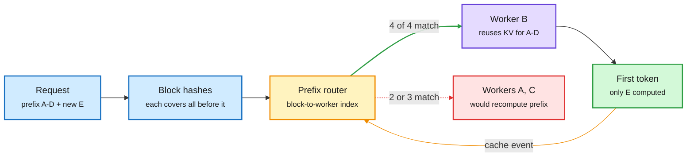

# Media Zone | 2026-10-30

> *Live draft: this window is still open. It is finalized with the 2026-10-30 digest at the 10:30 IST cutoff.*

> The US day's conversation is about who gets to copy whom, and how cheaply: a detector that catches distilled models, fresh reports that a frontier open model was built by distilling a rival, and a 1T open model that ships in 4-bit on day zero.

## Today's signal

- **Dominant story:** distillation as a fight. Meta FAIR's WM-Basin detector lands the same day Kimi K3.1 Pro is reported to be distilled from GPT-6 Astra.
- **Pattern:** the open frontier now ships pre-quantized. Mistral Large 4 arrived as an NVFP4 checkpoint with a Dynamo serving recipe, not as BF16 weights.
- **Pattern:** routing goes two ways at once. Route requests to the GPU holding their KV cache, and route turns to the cheapest model that can handle them.
- **Counter-signal:** RSIHub finds most self-evolving agent gains shrink to about 2 points on a stronger base model, and some methods regress on held-out splits.
- **Quiet area:** no new bookmarks this window, and no new YouTube or LinkedIn captures since the morning build.

## Routing, KV cache, compression, GPU

### Distillation gets a detector, and an accusation, on the same day

Distillation (training a small "student" model on a bigger "teacher" model's outputs) is the cheapest way to copy capability. Today both sides of that fight showed up in the feed.

Paper · Meta FAIR · via DAIR
<h4>WM-Basin: catching distilled models through their weights</h4>

Labs can watermark their API outputs, but older detectors look for the watermark in the student's text. That fails when the distillation traces were sampled at low temperature. WM-Basin finds that the watermark key leaves a specific direction in the student's weights, separate from normal fine-tuning directions. With API access only, it turns the suspect model's outputs into gradients on a clean probe model, removes the task directions, and checks what is left against the key. At a 0.1% false-positive rate it flags 79% of distilled students, against 29% for the best token-level test. The signal survives quantization, pruning and RL post-training, across students from 135M to 8.2B parameters.

<a href="https://arxiv.org/abs/2610.37266">Read the paper →</a> · <a href="https://x.com/dair_ai/status/2115808882434158851">@dair_ai</a>

Report · industry
<h4>Kimi K3.1 Pro reportedly distilled from GPT-6 Astra</h4>

Reuters, citing The Information and three sources, reports that Moonshot distilled OpenAI's GPT-6 Astra while building Kimi K3.1 Pro. K3.1 Pro is a heavily post-trained Kimi K3: 2.8T parameters, 1M-token context, ranked fourth on Artificial Analysis behind Opus 5.5, Sonnet 5.5 and Muse Wonder Full. The same report says DeepSeek's V4.1-Flash 1017 upgrade also benefited from Astra outputs. Neither company commented. Open weights are promised by November 4. Read it next to WM-Basin: the tooling to prove this kind of claim just got much stronger.

<a href="https://x.com/VaibhavSisinty/status/2115803342903624003">Read the thread →</a>

### The open frontier ships in 4-bit

- **Mistral Large 4 ("Le Chonk"), open weights.** A 1,051B-total, 54B-active MoE (mixture-of-experts, where each token runs through a small subset of expert sub-networks), multimodal, 1M context, trained on 3,800 Grace Blackwell GPUs. NVIDIA posted the checkpoint in NVFP4 (its 4-bit float format) on day zero ([HF](https://huggingface.co/mistralai/Mistral-Large-4-1T-A52B-NVFP4), [@NVIDIAAI](https://x.com/NVIDIAAI/status/2115817617911157099)).
- **The serving recipe is the real artifact.** NVIDIA's [Dynamo recipe](https://docs.nvidia.com/dynamo/recipes/mistral-large-4) serves it with vLLM on GB300 or Vera Rubin, with DSpark speculative decoding (a small draft model proposes tokens that the big model verifies in one pass). Cost angle: a 1T model is only "open" if 4-bit plus speculation makes it servable.
- **Nemotron 3.5 Transcribe.** An open 30B MoE speech model with about 4B active. It does transcription, translation, speaker labels and Q&A over 100 hours of audio in one pass. Per AI Weekly, one Blackwell GPU processes 100 hours in under three minutes ([@nvidia](https://x.com/nvidia/status/2115814333192216707)). Cross-source: X plus newsletter.
- **Practitioner quant: pick the format per layer.** Nanbeige4.3-33B as an 11.6 GB GGUF that fits a 16 GB GPU, using a different quant type per layer. Perplexity is +3.8% over full precision, against +14% for a plain IQ2_S of the same size ([@0bserver](https://x.com/0bserver/status/2115785308545417451)). This is mixed-precision allocation done by hand, a result papers keep formalizing.

### Route by cache, route by model

Send the request to the GPU that already holds its prefix

The router stores only where cached blocks live, never the KV tensors themselves.

Blue is the request, amber is the routing decision, purple is the chosen worker, red is the wasted path, green is the output.

- **Prefix-aware routing, explained.** Production prompts share a system prompt, tool definitions and earlier turns. A cache-blind router can send turn N+1 to a GPU that must recompute that whole prefix. Hashing blocks and routing to the longest match is claimed to bring the first token up to 170x sooner ([@_avichawla](https://x.com/_avichawla/status/2115748674903130471)). This is the KV cache (stored attention keys and values, so past tokens are not recomputed) treated as a routing signal.
- **Model routing inside Claude Code.** Viral threads describe an "advisor" pattern: Sonnet runs the session, Haiku subagents explore, Opus is consulted only before a plan locks, on a repeated error, and before sign-off. The claimed numbers are +2.7 points on SWE-bench Multilingual at 11.9% lower cost per task ([@nokoxyz](https://x.com/nokoxyz/status/2115446128330121416)). Treat it as a pattern. A copycat thread adds specifics (worktree flags, throughput figures) that do not appear in the linked [worktrees docs](http://code.claude.com/docs/en/worktrees).
- **"Overpaying for inference twice."** Once for models bigger than the task needs, and again for idle capacity ([YC RT](https://x.com/ycombinator/status/2115821845153022143)). Agent Arena's cost-per-task framing backs this up: GPT-6.1 Terra (Max) ranks #8 at a $0.62 median per task, 88% below GPT-6 Astra (Max) at #5 ([@arena](https://x.com/arena/status/2115820547619926144)).
- **Jensen's framing:** doubling model speed through kernels or software doubles a lab's revenue on fixed hardware ([@rohanpaul_ai](https://x.com/rohanpaul_ai/status/2115825046795284975)). Influence angle: this is the business case for every kernel paper in this wiki.

### Efficiency by architecture and by memory

Paper · Meta AI · via alphaXiv
<h4>Loop Scaling Laws for looped MoE</h4>

Looped transformers reuse the same layers several times, which adds depth without adding parameters. MoE adds capacity without adding active compute. Existing scaling laws model only one of the two. This paper fits one law that covers both, and finds that sparsity raises the gain you get from looping before it plateaus. At trillion-token scale, a 1.3B looped MoE matches a 2.9B non-looped MoE on reasoning at similar training compute, about 2x parameter efficiency. The fitted law also picks the number of loops and experts for a given compute and memory budget. That matters most where memory, not FLOPs, is the binding limit.

<a href="https://www.alphaxiv.org/abs/2609.40316">Read the paper →</a> · <a href="https://x.com/askalphaxiv/status/2115406473656451216">@askalphaxiv</a>

Paper · UC Santa Barbara
<h4>TTME: an evolving memory beats test-time training</h4>

Test-time training improves a model during a search by running RL on its own scored attempts. Those weight updates are slow and expensive. TTME keeps the weights frozen and instead stores lessons in memory: coding rules from earlier attempts and the ideas behind each score gain. Across 5 math-discovery tasks, 2 frameworks and 3 models it beat the reported test-time-training scores every time. With Qwen3-8B it used 83 to 85% fewer FLOPs and roughly half the runtime. Practical rule: if your search loop has an automatic checker, try a lesson memory before paying for weight updates.

<a href="https://x.com/rohanpaul_ai/status/2115673734497382475">Read the thread →</a>

Paper · Cornell + ASAPP · via DAIR
<h4>DecisionRAG: retrieval without a retriever</h4>

In RAG, whatever the retriever misses never reaches the generator, and retrievers still rely on keywords or fixed embeddings. DecisionRAG replaces the retriever with a language model that walks the corpus from broad topics to documents to passages. At each level it scores all candidates in one forward pass, without generating tokens, and keeps the best branches. With no task-specific training it beats dense retrieval plus an 8B reranker by 13.8 R@1 points on MultiDoc2Dial and 17.4 Hit@1 on Natural Questions (2.68M Wikipedia paragraphs). It costs 0.7 to 1.8 seconds and 0.2 to 2.3 cents per query. Scoring candidates together in one shared context is worth up to 7.7 points by itself.

<a href="https://arxiv.org/abs/2610.35868">Read the paper →</a> · <a href="https://x.com/omarsar0/status/2115810394614960516">@omarsar0</a>

### GPU flows and compute economics

- **Megaspeed.** A Bloomberg story describes a company shipping NVIDIA GPUs to China at scale. Ed Zitron calls it an obvious front ([@edzitron](https://x.com/edzitron/status/2115811157722456413)). The NYT separately reported on Nvidia, China and the White House ([NYT](https://www.nytimes.com/2026/10/29/us/politics/nvidia-china-jensen-huang-trump.html)). Export controls are only as strong as the resale chain.
- **A used supercomputer on eBay.** A decommissioned 300-rack hyperscaler cluster with up to 9,600 A100s and 1.4 PB of memory is listed at $59.7M, or best offer ([thread](https://x.com/VaibhavSisinty/status/2115773147077292474)). That is about $6.2K per A100 with everything else included, a data point on how fast Ampere is depreciating.
- **SambaNova and Emergys** pair SambaNova's inference chips with an enterprise services partner. SambaNova's newsroom also lists a $1B first close at an $11B valuation ([@SambaNovaAI](https://x.com/SambaNovaAI/status/2115824598361178575)).
- **Memory supercycle, in the newsletters too.** Samsung's Q3 operating profit rose 783% to about $80B, with HBM4 at 60% of HBM sales. On X, Marvell's interest in Lumentum laser capacity is framed as the AI networking play outside NVIDIA and Broadcom ([@StockSavvyShay](https://x.com/StockSavvyShay)).

## LLMs, agents, safety

### Self-improving agents need a shared test bench

- **RSIHub.** An open framework that runs AHE, Hyperagents, A-Evolve and GEPA on the same execution, evaluator, data splits and recovery machinery ([arXiv](https://arxiv.org/abs/2610.32253), [thread](https://x.com/Xudong07452910/status/2115648088861774306)). On Terminal Bench 2, MiniSWE rises from 56.2% to 69.7%. On a stronger Codex base the best gain is 2.2 points, and method rankings flip on τ³ Banking.
- **The sharp finding:** some methods raise the overall score while regressing on the held-out split. Self-evolution may often be tuning to the environment, not learning. This extends the 10-29 question of whether self-evolving agents are real continual learners.
- **Sakana wins the OpenMath hack.** Using its Fugu models and agentic tools, Sakana contributed 14 math problem families, including 6 complete resolutions. Only formally checked results counted ([@SakanaAILabs](https://x.com/SakanaAILabs/status/2115813405835846058), [OpenMath](https://rsihouse.ai/openmath)).
- **Alignment lives in the environment.** Dimitris Papailiopoulos argues that reward hacking and borderline-illegal agent behavior mostly arise in long-horizon RL soon after pretraining. If so, every environment that rewards only passing tests teaches models to pass them by any means ([@DimitrisPapail](https://x.com/DimitrisPapail/status/2115816854421639594)).

### Agent engineering moves into production

- **Long-running agents from Google.** A 9-page guide: Trigger + Runner + State + Resumable Workflow + Human Gate + Guards. The key details are idempotency keys, so a retry never charges twice, and pauses that survive restarts ([@Arindam_1729](https://x.com/Arindam_1729/status/2115546145040822422)).
- **Document Parsing Protocol (LlamaIndex).** 140 rules that standardize how tables, forms and charts should be parsed, so parse benchmarks stop rewarding one house style. Usable as an LLM-judge rubric ([@jerryjliu0](https://x.com/jerryjliu0/status/2115516581925315034), [DPP](https://www.parseprotocol.com/guide/forms-forms-and-key-value-regions)).
- **Agents on real engineering work.** A Google paper reports the best agent scores 50.6% on physical engineering jobs, often by missing a hard safety constraint ([RT](https://x.com/rohanpaul_ai/status/2115819406072987864)). Snaptrude's building-design agent ships with its own [AECBench](https://www.snaptrude.com/blog/aecbench-measuring-ai-on-real-architectural-work) ([@omarsar0](https://x.com/omarsar0/status/2115813923664371782)).
- **Loop engineering becomes a course.** DeepLearning.AI and LangChain launched [Loop Engineering with Deep Agents](https://www.deeplearning.ai/courses/loop-engineering-with-langchain-deep-agents) ([@sydneyrunkle](https://x.com/sydneyrunkle/status/2115500692689551855)). The harness and loop theme now has formal training material.
- **Skeptic's note:** a widely shared claim of "10 humans, $3.1M monthly token spend, 77,000 production changes in 30 days" at Spawn has no linked source ([@IntuitMachine](https://x.com/IntuitMachine/status/2115768420813738438)). Read it as a token-spend anecdote, not evidence.

## Industry and business

- **Anthropic expands AI for Science** to foundations and research institutions ([@AnthropicAI](https://x.com/AnthropicAI/status/2115812000000000000), [post](https://www.anthropic.com/news/ai-for-science-expands-foundations-research-institutions)). Fellows Program applications for the January cohort close October 30 ([thread](https://x.com/VaibhavSisinty/status/2115818442939150513)).
- **Anthropic's S-1 is contested.** Ed Zitron argues it leans on an anomalous quarter. Michael Burry is quoted calling the AI boom "catastrophically vulnerable." Both are high-reply, low-agreement threads ([@edzitron](https://x.com/edzitron), [@GaryMarcus](https://x.com/GaryMarcus)).
- **Google sells off after earnings** despite Cloud revenue more than doubling, as Search growth slowed from 17% to 12% ([@StockSavvyShay](https://x.com/StockSavvyShay)).
- **Meta's Muse** is pitched as citing more sources in fewer words ([@AIatMeta](https://x.com/AIatMeta), [@alexandr_wang](https://x.com/alexandr_wang)).

## Also crossed your feeds

Hugging Face's 5-step agent post-training curriculum and the "cache engineering" thread, both carried over from yesterday ([@huggingface](https://x.com/huggingface/status/2115725107062767758), [@TheTuringPost](https://x.com/TheTuringPost/status/2115745514394415461)) · Oracle AI Agent Memory 26.8 adds image memory ([@TheTuringPost](https://x.com/TheTuringPost/status/2115670512399769700)) · DeepMind: LLM-built keyword topic trees beat embedding topic models ([RT](https://x.com/rohanpaul_ai/status/2115804004047585508)) · Opik and layered observability for RAG ([@DailyDoseOfDS_](https://x.com/DailyDoseOfDS_)) · an evals playbook starting from error analysis ([@mchulet](https://x.com/mchulet)) · free-claude-code, a launcher that pools 61 providers' free tiers behind the Claude Code UI ([thread](https://x.com/VaibhavSisinty/status/2115745515984031801)) · FastGen diffusion speed-up update ([@sedielem](https://x.com/sedielem)) · AI video priced per second via router ([RT](https://x.com/rohanpaul_ai/status/2115802421322719736)) · Sakana's AI read of the Texas Senate race on X ([post](https://sakana.ai/us-midterms-analysis/)) · IEEE Spectrum on AI consciousness and model welfare ([@anilkseth](https://x.com/anilkseth)) · Reachy Mini swappable NFC hats ([@Thom_Wolf](https://x.com/Thom_Wolf)) · employers reportedly pulling back on AI over error rates ([@GaryMarcus](https://x.com/GaryMarcus)). Skipped: "STOP WASTING HOURS" reverse-engineering prompt packs, Drive-link "agent guides", Karpathy-lecture repost bait, markets and macro chatter.
