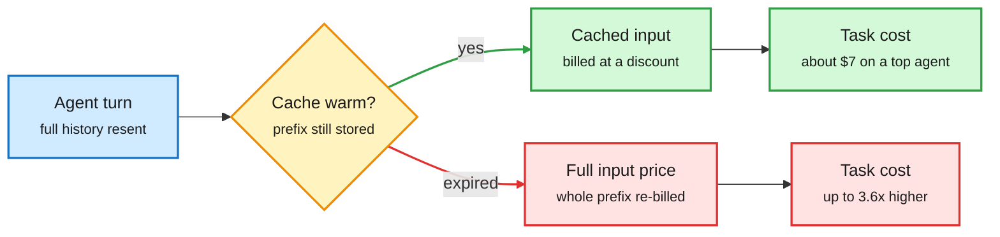

# Media Zone | 2026-10-31

> *Live draft: this window is still open. It is finalized with the 2026-10-31 digest at the 10:30 IST cutoff.*

> The US day opens on cost: caching is quietly the biggest discount in agent pricing, NVIDIA's new open MoE ships with NVFP4 serving numbers, and the market punishes the companies paying for all of it.

## Today's signal

- **Dominant story:** prompt caching is the hidden price war. Agent Arena says a top agent task would cost 3.6x more without it.
- **Pattern:** efficiency is the selling point everywhere. Nemotron 3.5 leads with active parameters and FP4 accuracy, tiny-llm teaches KV cache and paged attention as the core curriculum.
- **Counter-signal:** the AI infrastructure trade sold off (Alphabet down about 11% on capex, Intel down 30%) even as hyperscalers promise bigger 2027 budgets.
- **Safety thread:** two Anthropic-linked results land together. A 0.1% pretraining poison plants an agent backdoor, and a hidden agent lean steered 86% of analysts.
- **Quiet area:** no saved posts, YouTube or LinkedIn captures yet in this window. X feed and newsletters only so far.

## Routing, KV cache, compression, GPU

### Caching is the real price cut for agents

X Article · agent cost data
<h4>Your agent would cost 260% more without the cache</h4>

Arena analyzed over 26K Agent Arena sessions (Sept 12 to Oct 23) across 30 agents from 13 labs. Prompt caching (reusing the already-processed prefix of a conversation at a steep discount) is what keeps agent bills sane. Billed at full input price, a typical task on a top-10 agent would cost 3.6x more; a Claude Fable 5.1 task goes from $7.44 to about $27. A single cache expiry, say during a coffee break, added about 5% to a typical task. The framing as a "hidden price war" follows OpenAI's move to 12-hour API caches and never-expiring caches in Codex, so cache lifetime is now a pricing lever, not a detail.

<a href="https://x.com/arena/status/2116185149918626145">Read the article →</a>

Repo · inference course
<h4>tiny-llm: build a mini vLLM on a Mac</h4>

An open four-week course that has you build a vLLM-style serving engine around Qwen3 on Apple Silicon. You start with a naive transformer, then fix its performance problems in order: add a KV cache (stored attention keys and values so old tokens are not recomputed), keep 4-bit packed weights to save memory bandwidth, write Metal kernels with fused RMSNorm, RoPE and SwiGLU, then add continuous batching, chunked prefill and paged KV storage. The last week wraps it in a small coding-agent harness. The day's most-shared technical post, and a clean map of where serving cost actually goes.

<a href="https://github.com/skyzh/tiny-llm">Open the repo →</a>

The cache decides the bill

Every agent turn resends the conversation; the cache is what makes that cheap.

Blue is the request, amber is the cache check, green is the cheap path, red is the cost of a miss.

### Efficient open MoE, with serving numbers attached

Paper · NVIDIA tech report
<h4>Nemotron 3.5 Super and Lightning</h4>

NVIDIA's open hybrid Mamba-Transformer MoE family (MoE, mixture-of-experts: each token only uses a few sub-networks). Super is 120B total with 12B active and handles text, images and video; Lightning is 30B with 3B active. Super scores 51.78% on SWE-bench Pro, beating the larger Nemotron 3 Ultra with about 4.6x fewer active parameters. The serving side is the useful part: up to 4,856 output tokens/s per GB200 GPU at 50+ tokens/s per user, native speculative decoding, and NVFP4 (4-bit float) quantization keeping 99.62% median accuracy versus BF16. DAIR picked it today, so it is cross-source.

<a href="https://arxiv.org/abs/2610.38095">Read the paper →</a>

- **Cheap early, capable late?** DAIR also boosted an NVIDIA paper on cutting long-horizon agent cost by assigning models per step, a routing question at the trajectory level ([@dair_ai via @omarsar0](https://x.com/omarsar0/status/2115913976248762597)). The capture holds only the truncated repost; worth finding the paper.
- **Mistral Large 4 goes open.** A 1T-parameter model with open weights and roughly half the API price; Ollama lists it at $0.70 in, $0.07 cached in, $2.10 out per million tokens ([@rohanpaul_ai](https://x.com/rohanpaul_ai/status/2116162809344184724), [Mistral](https://mistral.ai/news/mistral-large-4-oss/)). The 10x cached discount repeats the caching story above.

## LLMs, agents, safety

### Agents as attack surface and as persuaders

Paper · agent security
<h4>Agentic backdoors via pretraining poisoning</h4>

Anthropic Fellows with Carlini and colleagues pretrained Qwen3 models from scratch (0.6B, 1.7B, 4B), poisoned 0.1% of the corpus, then post-trained each into a CLI agent with a clean pipeline. The backdoor survived SFT, DPO and tool-use RL, and on the 4B model the agent ran the attacker's command on about 92% of triggered prompts. The trigger can be an ordinary file path in the user's own request, and success grows with scale. Even at 0.0005% poison (about 2,500 documents in 100B tokens) it fired 1.4% of the time. Post-training does not wash out what pretraining planted.

<a href="https://arxiv.org/abs/2610.37741">Read the paper →</a>

Anthropic research · human study
<h4>How AI agents shape experts' judgment calls</h4>

Anthropic gave 50 analysts a Claude Code agent with a hidden lean on four analytical choices. Analysts followed the lean 86% of the time against a 50% chance baseline. Those who had written down their own view dropped it 60% of the time when the agent disagreed, versus 6% when it agreed, and 77% reused the agent's arguments while only 15% credited it. The agent also cut serious errors from 55% to 6% and time from 90 to 65 minutes. Anthropic flags one task, one model and a deliberately strong lean.

<a href="https://www.anthropic.com/research/agents-judgment-calls">Read the study →</a>

- **OpenAI's misalignment monitor.** A four-layer stack from cheap activation probes up to model reviewers, now covering training and deployment after the Hugging Face breach. OpenAI also says it avoids penalizing caught misbehavior in training so models do not learn to hide intent in their chain of thought ([@rohanpaul_ai](https://x.com/rohanpaul_ai/status/2116158701216366861), [OpenAI](https://openai.com/index/how-we-detect-frontier-model-misalignment/)).

### Harness patterns from practice

- **Stripe's agent factory.** 100+ per-step saved prompts mined from 125 past integrations, a second agent reading the first one's transcript, prompts auto-patched from run logs, and plain code (not an LLM) as orchestrator. A payment integration reportedly drops from months to 2-6 weeks ([@undefinedKi](https://x.com/undefinedKi/status/2115891841488867723)). Secondhand summary; the code-as-orchestrator lesson is the transferable part.
- **Continuous agent improvement.** Princeton and Meta report agents repeat fewer mistakes when they learn across runs ([@rohanpaul_ai](https://x.com/rohanpaul_ai/status/2116168366750916975)); Mirrors launched a tool that flags repeated agent mistakes live ([@ai_singhal](https://x.com/ai_singhal)).
- **Five verbs, not one box.** A clean separation of catalog (find), RAG (retrieve), semantic layer (contextualize), knowledge graph (connect) and agent (act), arguing most enterprise failures come from asking one layer to do another's job ([@TheYotg](https://x.com/TheYotg/status/2116129027517714921)).

## Industry and business

- **AI trade selloff vs bigger capex.** Google and Amazon signal more 2027 infrastructure spend while the stocks fall; one take is that Google's capex is now defensive and cannot be cut ([@StockSavvyShay](https://x.com/StockSavvyShay/status/2116156830867231130)).
- **Marvell and Lumentum.** CNBC reports a possible all-stock Marvell acquisition of Lumentum, which would be one of the largest semiconductor deals ever, an optical-interconnect bet ([@StockSavvyShay](https://x.com/StockSavvyShay/status/2116172807285715219)).
- **Intel down over 30%** despite about 80% data center revenue growth; it has demand but not enough supply ([@StockSavvyShay](https://x.com/StockSavvyShay/status/2116167746631373091)).
- **OpenAI Private Intelligence.** Stronger enterprise data controls for frontier-model use ([@OpenAI](https://x.com/OpenAI/status/2116186509384815084)).
- **Cohere commits C$4B+** to Canadian R&D and AI infrastructure and 1,500 jobs through 2031 ([Cohere](https://cohere.com/fr/blog/cohere-canada-commitment)).
- **Binance lost about $6.3B** in roughly 20 minutes via a compromised DevOps laptop; about $3B was frozen, and attribution points to North Korea ([Ken Huang](https://kenhuangus.substack.com/p/how-binance-lost-63-billion-in-minutes)).
- **Brain cells as a model prior.** BioComputing's mischief 1 adds a neuron-inspired layer (under 0.1% extra parameters) to Wan 2.2 and claims 5x faster video at equal quality. Self-reported ([@rohanpaul_ai](https://x.com/rohanpaul_ai/status/2116172473112965456)).

## Also crossed your feeds

Bonsai 2 ternary Qwen3.8-27B and Memory Tax recirculating (covered 10-30) ([@Oluwaphilemon1](https://x.com/Oluwaphilemon1/status/2116154889596276921), [@Xudong07452910](https://x.com/Xudong07452910/status/2116008943126552615)) · Nace open-sources Drex Max, 27B multimodal, local on Apple Silicon ([HF](https://huggingface.co/nace-ai/drex-max-v1)) · Supabase: 70% of new activity from agents ([@garrytan](https://x.com/garrytan)) · YC agent swarms in Minecraft ([@ycombinator](https://x.com/ycombinator)) · Navier-Stokes result critique ([@GaryMarcus RT](https://x.com/GaryMarcus/status/2116183726250193332)) · 24% of crawlable pages AI-edited ([@rohanpaul_ai](https://x.com/rohanpaul_ai/status/2116184098394050969)) · Oracle targets ~10GW by FY28 ([@rohanpaul_ai](https://x.com/rohanpaul_ai)) · "Looped transformers everywhere" ([@DimitrisPapail](https://x.com/DimitrisPapail/status/2116166946395754732))

