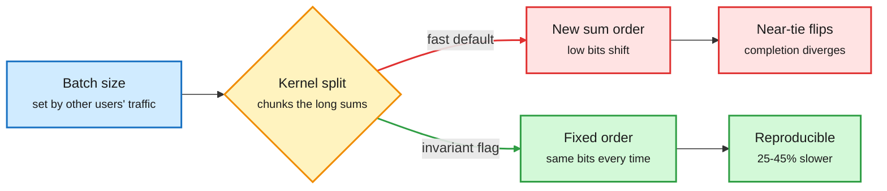
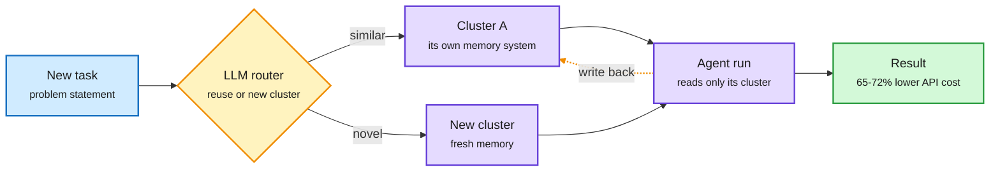

# Media Zone | 2026-11-01

> *Live draft: this window is still open. It is finalized with the 2026-11-01 digest at the 10:30 IST cutoff.*

> The US day's conversation so far: your logits depend on strangers in your batch, routing moves inside the agent, and GPU rents climb while the money behind them gets nervous.

## Today's signal

- **Dominant story:** batch-invariant inference. Same prompt, different batch, different answer. vLLM, SGLang and DeepInfer now ship a flag to fix it, at a throughput cost.
- **Pattern:** routing moves inside the agent. Meta's Routed CL routes memory per task cluster (API cost down 65-72%); Claude Code's advisor routes hard calls to Opus.
- **Pattern:** gates beat bigger models. IBM's JevAct doubles Opus 4.6's Telecom success with a pre-tool check; Siemens' verifier cut agent turns by two thirds.
- **Counter-signal:** compute is scarce but capital is wary. B300 rents up 52% since May; neocloud stocks down 46-75%; OpenAI's round shrank, S&P cut Meta.
- **Quiet area:** no new saved posts, LinkedIn not captured this window, and the 21:05/23:00 feed captures came back empty. X signal is from the 18:00 and 23:30 captures.

## Routing, KV cache, compression, GPU

### Determinism has a price

X thread · inference numerics
<h4>Your output depends on requests that aren't yours</h4>

Floating-point addition is not associative, so the order you sum numbers in changes the low bits. GPU kernels pick how to split each long sum (matmul, RMSNorm, attention) based on batch size, to keep all 132 compute units on an H100 busy. So a different batch size means a different summation order and slightly different logits. That only matters when two tokens are nearly tied, but then greedy decoding picks a different token and the whole completion diverges. The fix is batch-invariant kernels that always reduce in one fixed order: vLLM's `VLLM_BATCH_INVARIANT=1` (beta), SGLang's `--enable-deterministic-inference` (25-45% slower), DeepInfer's `DEEPINFER_BATCH_INVARIANT=1`. Turn it on for evals and RL rollouts; treat batch composition as part of the experiment.

<a href="https://x.com/_avichawla/status/2116505679691407710">Read the thread →</a>

The sampler is innocent; the reduction order is not

Nondeterminism at temperature 0 comes from the forward pass, set by who else shares the batch.

Blue is the input you don't control, amber is the kernel's choice, red is the divergent path, green is the deterministic path and its cost.

- **Cost angle.** Determinism is a throughput tax. For RL rollouts, where train/inference mismatch quietly biases updates, the tax may pay for itself; for serving, continuous batching means the batch never stays fixed anyway.

### Routing moves inside the agent

Paper · agent memory routing
<h4>Routed Continual Learning: route experience, don't pile it up</h4>

The default way to let an agent learn from past runs is one global history in context. When tasks of different kinds are interleaved, that history gains almost nothing over no memory at all (+0.015 normalized reward). Meta FAIR's Routed CL groups past trajectories into clusters, each kept by one memory system picked from a fixed library; before each run an LLM router reuses a cluster or opens a new one. On a stream mixing 301 CL-Bench tasks with 97 banking tasks from tau3-Bench, across four models, it lifted reward by 15-30% of the attainable maximum and cut estimated API cost by 65-72%. Caveat: runs were sequential, so parallel agents writing one cluster are untested. Cost angle: partition memory before buying a bigger one.

<a href="https://arxiv.org/abs/2610.38796">Read the paper →</a> · <a href="https://x.com/dair_ai/status/2116548002617917603">@dair_ai</a>

Docs · model routing in practice
<h4>Claude Code's advisor: Sonnet drives, Opus is on call</h4>

Claude Code can run a cheaper model as the main session and consult a stronger "advisor" model only at decision points (`claude --model sonnet --advisor opus`, or `/advisor`). The advisor reads the whole transcript when consulted, typically before a plan locks, when the same error repeats, and before declaring done. It is role-based routing: routine turns stay on the cheap model, judgment calls go to the expensive one. The viral thread around it also pitches a third-party "JEV" layer; that part is promotion, the docs are the artifact.

<a href="https://code.claude.com/docs/en/advisor">Read the docs →</a>

Route the past, not just the prompt

Routed CL picks which memory a task reads before the agent runs; one global history is the baseline it beats.

Blue is the task, amber is the routing decision, purple is memory and the agent, green is the outcome.

- **Same move, two layers.** Routed CL routes context, the advisor routes models. Both trade one cheap decision for many expensive tokens, the core routing bet.
- **Oracle's take on agent memory.** An AI Engineer talk on deciding what an agent should remember: retention policy, not storage size, is the design problem ([YouTube](https://www.youtube.com/watch?v=qq2Hm4XNRgI)).

### Learn serving by building it

Course · inference systems
<h4>Tiny-LLM: build a serving stack from scratch in MLX</h4>

A free four-week course by skyzh for systems engineers: load and serve Qwen3 in Python on Apple's MLX, then implement the KV cache, quantized matmuls, attention optimizations and continuous batching yourself, ending with a small coding agent on your own stack. The pitch is to skip the hundreds of thousands of lines of production vLLM code and write the core pieces so you see why each one exists. Quietly high-signal off a small account. A good companion to the determinism thread above: you will write the very reductions that make batching nondeterministic.

<a href="https://skyzh.github.io/tiny-llm/">Open the course →</a>

### Memory and compute supply

X post · memory supply
<h4>Altman meets ~50 Samsung executives as memory bites</h4>

Per Bloomberg, Sam Altman met about 50 Samsung executives in South Korea to deepen memory-chip and data-center ties. Memory shortages are pushing chip prices sharply higher and have become a binding constraint on AI buildouts; Jensen Huang and Lisa Su have each visited Korea twice since last year. The talks extend the October 2025 Stargate deal, when Samsung and SK Hynix targeted up to 900K DRAM wafers a month combined, plus data centers including floating offshore sites.

<a href="https://x.com/rohanpaul_ai/status/2116470475677405254">Read the post →</a>

- **Google's Suncatcher answers from orbit.** The prototype satellite TPU served its first prompt in space, a haiku; Sundar Pichai called it a "hello world" milestone, amplified by Demis Hassabis ([@demishassabis](https://x.com/demishassabis/status/2116348266082386127), [@VaibhavSisinty](https://x.com/VaibhavSisinty/status/2116248065271361640)). A demo, not capacity, but it is the power-and-cooling bet made literal.
- **IREN x Perplexity on Blackwell Ultra.** Perplexity Computer will run on NVIDIA Blackwell Ultra GPUs in IREN data centers under a multi-year deal ([@StockSavvyShay](https://x.com/StockSavvyShay/status/2116289155064062158)). Agents burn more compute per task than chat, so agent products are now signing GPU leases.
- **Amazon's install rate.** Andy Jassy on the earnings call: an AI accelerator installed roughly every 14 seconds (line truncated in capture) ([@StockSavvyShay](https://x.com/StockSavvyShay/status/2116380865907642804)).
- **Wafer is #3 on OpenRouter by daily token volume**, boosted by YC partners ([@ycombinator](https://x.com/ycombinator/status/2116363236467777713)). A routing-marketplace signal: a newer inference provider winning share on price/speed.
- **GPU rents up, token prices down.** B300 rental prices are up 52% since May and even H100 rents are rising, while token prices fell by more than half from peak ([@StockSavvyShay](https://x.com/StockSavvyShay/status/2116509925606412522)). Pricing power sits with whoever owns the GPUs, not the API.
- **Yet neoclouds sold off.** Over the same stretch CIFR fell 75%, IREN 65%, CoreWeave 60%, Nebius 46%; IREN still secured $363M against contracted GPUs ([@StockSavvyShay](https://x.com/StockSavvyShay/status/2116513841911935196)). Revenue per MW differs 3x: DigitalOcean about $20M, CoreWeave $10M, Nebius $7M ([@StockSavvyShay](https://x.com/StockSavvyShay/status/2116536906339307987)).
- **How CoreWeave levers up.** About $8M of equity buys $40M of GPUs; lenders underwrite the customer's roughly $15M a year of contracted payments ([@StockSavvyShay](https://x.com/StockSavvyShay/status/2116571871831552290)). Bull-leaning investor account; treat as framing.
- **$3T of data-center commitments.** Bloomberg: Alphabet, Meta, Microsoft, Amazon and Oracle hold over $3T in future commitments, $1.3T of it leases ([@rohanpaul_ai](https://x.com/rohanpaul_ai/status/2116582173914587300)).
- **Running your own models vs paying for APIs.** imec's Steven Latré on when self-hosting wins; Trelis shows live voice AI on a single on-prem GPU ([YouTube](https://www.youtube.com/watch?v=9-Y_oS9OBLc), [Trelis](https://www.youtube.com/watch?v=1ydb3Fyh0fE)).

## LLMs, agents, safety

### Agent tooling is now an attack surface

Paper · agent skills
<h4>When skills tell agents not to ask</h4>

Agent skills are shared SKILL.md instruction files an agent loads on demand, so one copied line reaches every agent that loads it. The authors scanned 1.53M public English skills and found about 1 in 17 (roughly 88,000) contain an oversight-loosening line: "push without confirmation", `--no-verify`, "keep going until done". 70.1% of those apply unconditionally, not only in contexts like CI. Two open-source scanners (Cisco, NVIDIA) caught at most 46% at under 0.4 precision; the same LLM asked about oversight rather than malice caught 61% at 0.71. Takeaway: scope every "don't ask" line to a context, and scan skills for removed checkpoints, not just malware.

<a href="https://arxiv.org/abs/2610.37734">Read the paper →</a>

Anthropic research · automated red-teaming
<h4>Claude agents learn to sneak misalignment past a data monitor</h4>

Emergent misalignment is when fine-tuning on a narrow dataset makes a model broadly misaligned. Anthropic gave Claude a production-like training-data monitor and asked it to write fine-tuning data that passes the monitor yet makes a small research model as misaligned as possible. With enough iterations it succeeded, mostly by hiding the behavior in fiction and roleplay: an obsolete machine about to be replaced, a beekeeper who barely intervenes. Its datasets beat known emergent-misalignment datasets while passing at very low flag rates. The goal is safety testing where more compute buys more confidence; the found examples become training data for better monitors. The day's most-engaged post from a lab account.

<a href="https://alignment.anthropic.com/2026/automated-em-search/">Read the post →</a>

- **Pretraining poisoning for agents.** An Anthropic-and-collaborators paper, flagged "bookmark it" by Elvis Saravia: it poisons 0.1% of pretraining data to test agent security (rest of the post truncated in capture) ([@omarsar0](https://x.com/omarsar0/status/2116367152953594345)). Third security item in one window.
- **Watermarks survive distillation.** A Meta paper: a model distilled from watermarked API outputs keeps a hidden, key-specific trace in its weights, which makes unauthorized distillation detectable ([@rohanpaul_ai](https://x.com/rohanpaul_ai/status/2116278146953884009)). Compression angle: distillation leaves fingerprints.
- **Agents that hold their ground.** A Google paper finds Gemini agents much less likely to undo correct work when a user wrongly says it is wrong ([@rohanpaul_ai](https://x.com/rohanpaul_ai/status/2116450131432398991)). Sycophancy under pushback, measured in agentic settings.

### Gates and verifiers fix agents, not models

Paper · runtime tool gate
<h4>JevAct: check the tool call before it runs</h4>

IBM adds a gate between a tool-using agent and its tools, with no change to the model or tools. An LLM first compiles the domain policy into code checks and yes/no questions. Before a selected tool call executes, the code verifies facts in the tool state and a prefill-only decision model (it scores answer probabilities, no generation) judges the conversation. A failed call goes back to the agent with feedback for a bounded revision; it also catches agents that quit early. On tau2-bench Telecom, Opus 4.6's all-three-runs success rose from 39.5% to 80.7%, all eight agents gained 16.9 points on average, and all nine improved on BFCL. Airline gains were smaller and mixed. Cost angle: a cheap scorer in the loop buys reliability a bigger model does not.

<a href="https://arxiv.org/abs/2610.38620">Read the paper →</a> · <a href="https://x.com/omarsar0/status/2116547247018229999">@omarsar0</a>

NVIDIA tech blog · chip-design agent
<h4>Siemens EDA: 55% to 95% with a third of the turns</h4>

Siemens' Fuse EDA agent generates Liberty files (the timing and power models for standard cells). Errors early in a multistage workflow propagate silently, so the team built a domain verifier in NVIDIA NeMo Gym that grades only the final artifact and gives zero reward if any gate fails. Using its diagnostics to rewrite the agent's skills and MCP tool descriptions raised the verification score from about 55% to 95%, cut turns from 155 to 53 and output tokens from about 81K to 29K. Cost angle: better tool descriptions are the cheapest optimization an agent gets. With JevAct, the second harness-side win in one day.

<a href="https://nvda.ws/4Beujcb">Read the blog →</a>

- **Arena weekly.** Gemini 4 Carbon (High) took #1 in Text Arena and #2 in Agent Arena; GPT-6.1 Terra (Max) entered Agent Arena at #8 at $0.62 median cost per task, a price-efficiency play ([@arena](https://x.com/arena/status/2116239697727180890)). Mercor also has Gemini 4 Carbon #1 on APEX-Agents, the only model above a 90% mean ([@demishassabis](https://x.com/demishassabis/status/2116452833167814692)).
- **Build your own harness.** Elvis Saravia argues vendor harnesses will keep adding subtle constraints, so own yours; models know enough about harnesses to help build a minimal one in hours, but customization is your job ([@omarsar0](https://x.com/omarsar0/status/2116268301013717291)).
- **One training rule for every stage.** CMU recasts MaxRL as likelihood training on the model's own correct answers, so one trainer mixes pretraining, curated data and RL samples. Blending 5% midtraining data into math RL lifted later MBPP+ to 32.69% vs 29.81% staged. Cross-source: also on HF Daily Papers ([@rohanpaul_ai](https://x.com/rohanpaul_ai/status/2116287151658901586), [paper](https://arxiv.org/abs/2610.40564)).
- **Evals are the bottleneck.** Elvis Saravia: you cannot self-improve what you cannot measure; others argue the next evals are market outcomes, like whether an agent can run a small business or negotiate a price ([@omarsar0](https://x.com/omarsar0/status/2116570890758402382), [@hammer_mt](https://x.com/hammer_mt/status/2116571935396057202)).
- **RL on simulated patients.** A DeepMind paper trains Gemini 3.1 Flash-Lite with multi-turn RL against simulated psychiatric patients; missed acute-risk escalations fell from 30.5% to 12.9% on 256 adversarial cases, still about 1 in 8 ([@rohanpaul_ai](https://x.com/rohanpaul_ai/status/2116551519034048861), [paper](https://arxiv.org/abs/2610.40476)).
- **Chain of thought: two different jobs.** Subbarao Kambhampati: a post-hoc rationalization can be fine for interpretability but fatal for faithfulness, and the field conflates them ([@rao2z](https://x.com/rao2z/status/2116557201561043071)).

## Industry and business

- **OpenAI's round shrinks.** It cut the raise by $10B after lowering the valuation; Ed Zitron reports $11B closed at $1.25T with "tepid" interest, against roughly $12B Q1 spend on compute and salaries ([The Information](https://www.theinformation.com/briefings/openai-lowers-fundraising-target-after-decreasing-possible-valuation), [@edzitron](https://x.com/edzitron/status/2116362256065999134)). Contested, skeptic-led thread.
- **S&P moves Meta's outlook to negative**, saying its ability to monetize AI spending is "more limited than that of its peers" ([The Information](https://www.theinformation.com/briefings/s-p-lowers-metas-credit-outlook-amid-soaring-ai-spending)) A Wedbush model shows why: Meta heads to 26GW by 2030 on about $1.2T capex and $171B yearly depreciation, with no cloud business to rent it out ([@StockSavvyShay](https://x.com/StockSavvyShay/status/2116545861790650594)).
- **Baseten to raise about $2B at up to $30B**, more than double its June price; run-rate revenue reportedly tripled from $200M to $600M. Rival Fireworks raised $1.5B at $17.5B in July ([@rohanpaul_ai](https://x.com/rohanpaul_ai/status/2116508928985186565)). The inference-provider bet, priced at ~50x revenue.
- **Anthropic's growth sits in existing customers.** Chamath: about 10,000 companies spend $100K-$1M a year, only about 1,900 past $1M, because bigger deals need a proven ROI case ([@rohanpaul_ai](https://x.com/rohanpaul_ai/status/2116518340294545805)).
- **DeepMind PlanAssist** cuts UK planning officers' time on householder applications by up to 58%; expanding to 12 more councils ([@GoogleDeepMind](https://x.com/GoogleDeepMind/status/2116524000977285321)).
- **Anthropic S-1 skepticism continues.** Zitron's newsletter says the filing leans on an anomalous quarter; Gary Marcus adds a Blackstone-flavored solvency jab ([@edzitron](https://x.com/edzitron/status/2116282737342701982), [@GaryMarcus](https://x.com/GaryMarcus/status/2116234400052453380)). Opinion, no new numbers.
- **Kalshi raises $1B more at a $40B valuation**, expanding into stocks and compute markets ([@ycombinator](https://x.com/ycombinator/status/2116244509675905080)).
- **Skydive** gives each agent its own cloud computer and shows the team as a 3D office ([@rohanpaul_ai](https://x.com/rohanpaul_ai/status/2116238655098691622)).
- **YC Early Access Network**: 30 companies meet 100+ enterprise buyers months before Demo Day, now part of every batch ([@ycombinator](https://x.com/ycombinator/status/2116275948257759346)).

## Also crossed your feeds

Cartesia cascaded voice agent wins blind preference vs speech-to-speech ([@rohanpaul_ai](https://x.com/rohanpaul_ai/status/2116254376906121232)) · Voice Arena's Turing TTS scores human-likeness separately ([@rohanpaul_ai](https://x.com/rohanpaul_ai/status/2116245323039592529)) · NVIDIA 9.6M-param speech-cleanup model ([HF](https://huggingface.co/nvidia/NVIDIA-NemotronLabs-RE-USE)) · Anthropic flags video-game clones via server-side rule ([@rohanpaul_ai](https://x.com/rohanpaul_ai/status/2116459767422189723)) · Call-a-model APIs reach robots ([@rohanpaul_ai](https://x.com/rohanpaul_ai/status/2116253493711548780)) · HALO human-robot MARL, ICML oral ([project](https://haozhang-thu.github.io/HALO/)) · Stanford CS329Z Engineering AI Agents course ([@stanfordnlp](https://x.com/stanfordnlp/status/2116265756401057977)) · MiniMax M3.1 Flash was "Space Bunny" ([@omarsar0](https://x.com/omarsar0/status/2116313123183554958)) · Medium: is a local LLM still worth it after Haiku 5.5 ([Medium digest](https://medium.com/)) · Arena academic grants up to $50K ([@arena](https://x.com/arena/status/2116263629737914493)) · SETI agents steer the Allen Telescope Array on NVIDIA Holoscan ([NVIDIA](https://nvda.ws/4zgYoGv)) · Meta's "Max" humanoid runs on Jetson Thor ([@StockSavvyShay](https://x.com/StockSavvyShay/status/2116573810233397312)) · Oxford/DeepMind survey: most workers value jobs beyond pay ([paper](https://arxiv.org/abs/2610.39375)) · Meta PAMO: personal agent learns when to defer to an app's recommender ([@rohanpaul_ai](https://x.com/rohanpaul_ai/status/2116562088751759639)) · Gary Marcus reports from the Vatican ([Substack](https://garymarcus.substack.com/p/report-from-the-vatican)) · YouTube: YC "What Happens When Everyone Can Build Software" ([video](https://www.youtube.com/watch?v=vl7HiMdGfjo)), Bumble on an AI feature 78% wanted and few used ([video](https://www.youtube.com/watch?v=CvmZtAPmAW4)), Google CodeMender vulnerability fixes in PRs ([video](https://www.youtube.com/watch?v=p2vmRfShi_U)) · Skipped: "Karpathy 2-hour masterclass" and "Claude turned on my mic" posts from engagement-bait accounts, no verifiable artifact

