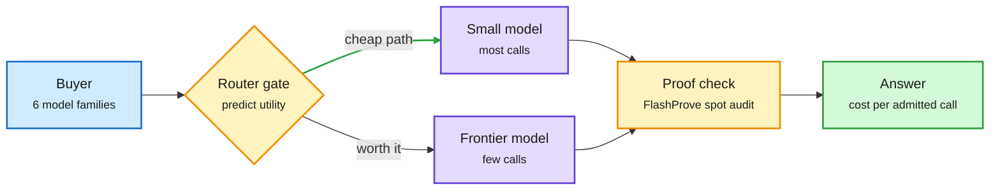

# Media Zone | 2026-11-03

> The US Monday's conversation was about who pays for cheaper intelligence: buyers spread across six model families, harnesses cut tokens 38-88%, and the labs selling the tokens posted a $23B quarterly loss while memory suppliers posted 80% margins.

## Today's signal

- **Dominant story:** Arvind Narayanan's "recursive self-extinction" thread, the day's most-shared substantive post. If RSI mostly makes capabilities cheaper, it erodes lab margins.
- **Pattern:** routing is now buyer behavior. OpenRouter's paying users run six model families on median; Arena shows a 10x cost spread for the same intelligence.
- **Pattern:** harness results are measured in tokens now. Context as Infrastructure cuts 38% of query tokens; DeepSeek's harness reportedly used 88% fewer.
- **Counter-signal:** "Astra rewrites weights" went viral; Neel Nanda's reply (clever interpretability, nothing spooky) is the right calibration.
- **Hardware:** GPU lead times hit 45 weeks and UBS puts agentic DRAM demand at 3x planned 2030 supply.
- **Quiet area:** no new saved posts were captured in either X run, LinkedIn returned no posts, and Reddit passed nothing through its filters. X signal comes from five Following-feed captures across the US day.

## Routing, KV cache, compression, GPU

### The economics of routing, from both ends

Essay · cost deflation
<h4>Recursive self-improvement may be recursive self-extinction (of the business model)</h4>

Arvind Narayanan's argument in four steps. Cost per equivalent capability has fallen at least 10x per year, and cost efficiency is a highly verifiable target, so AI-assisted research will keep pushing it. Unverifiable tasks (writing, governance) resist the same optimization because every proxy gets Goodharted. So RSI ends up narrow: an explosion in efficiency rather than broad job automation. With several labs at the frontier, nobody can hold margins while prices fall. It landed the same day Anthropic's $23.3B quarterly loss was reported.

<a href="https://x.com/random_walker/status/2117246718219612594">Read the thread →</a> · <a href="https://www.normaltech.ai/p/what-will-be-left-for-us-to-work">ICML keynote</a>

Market data · routing
<h4>Six model families is the new normal</h4>

OpenRouter says customers spending $100+ a month now use a median of six model families, double a year ago. Arena's Agent Arena now plots performance per output token and per minute waited: the same intelligence can cost 10x more, need 6x more output tokens and take twice as long, and output tokens barely predict the bill. Opus alone drives an OpenRouter dollar run rate above $5B. Together: spend concentrates on the top model while traffic fans out, which is exactly the shape a router exploits.

<a href="https://x.com/sarahookr/status/2117406011778842634">OpenRouter →</a> · <a href="https://x.com/arena/status/2117288179468513521">Arena</a> · <a href="https://x.com/deedydas/status/2117198564619366620">GMV chart</a>

Lab research · provable inference
<h4>FlashProve: catch a router that swapped your model</h4>

Anthropic and EPFL released an open-source zero-knowledge prover that shows a response came from committed, hidden weights. On a 400B MoE at 4-bit, one H100 proves about 110 tokens/s, roughly 72x the GPU time of serving, and the user checks a 19 MB proof on a CPU in about 20 seconds. Too costly to prove every token, but cheap enough to spot-check a reseller or aggregator. Full Deep Dive in today's digest.

<a href="https://www.anthropic.com/research/provable-inference">Read the post →</a>

Buyers fan out, a gate decides, a proof checks

Today's routing items each cover one box of the same loop.

Blue is the buyer, amber is a decision or check, purple is a model, green is the result.

### Memory and the hardware queue

- **TrendForce:** top-end GPU lead times rose 5 weeks to 45 as Rubin ramps; hyperscalers get Rubin first. DRAM lead times are 19 weeks, and 32/64GB RDIMMs stay severely tight. Cost angle: servers ship when the slowest part arrives ([thread](https://x.com/rohanpaul_ai/status/2117250376395329908)).
- **UBS:** DRAM capacity grows ~147% to ~89 EB by 2030, a third of the ~282 EB a full agentic buildout would need, because AI CPUs carry ~3x the memory ([thread](https://x.com/StockSavvyShay/status/2117243577734705540)).
- **Apple's margin:** down about a point sequentially, "primarily driven by higher memory costs," just as on-device AI wants more memory per phone ([thread](https://x.com/StockSavvyShay/status/2117388077329272837)).
- **Week 44 newsletter:** SK hynix at an 80% operating margin; an 8-die HBM stack at 95% die yield is all-good only ~66% of the time, so yield sets supply ([post](https://thesemiconductornewsletter.substack.com/p/week-44-2026)).
- **Marvell buys Lumentum:** an all-stock deal (about $80B per The Information; markets accounts cite ~$115B) for indium-phosphide lasers sold out into 2029. Interconnect is priced as a bottleneck ([The Information](https://www.theinformation.com/briefings/marvell-buy-lumentum-115-billion-all-stock-deal)).

### Depth without parameters, kernels by evolution

- **Looped transformers (Meta and MIT):** run the same layers several times per token for depth without weights. Per-loop adapters cost 1.1-4.3% extra parameters versus 51.4% for doubling depth; a fixed parallel decoder hides the extra passes. A memory-for-compute trade that matters more as DRAM tightens ([paper](https://arxiv.org/abs/2610.40325)).
- **Latent Sparse Attention:** an open release pitched as a step toward subquadratic attention; details not captured beyond the announcement ([repost](https://x.com/SchmidhuberAI/status/2117403167050829998)).
- **Evolved agent systems for GPU kernels (Berkeley, Ion Stoica):** evolve the agent system itself and report state-of-the-art kernel optimization results ([repost](https://x.com/berkeley_ai/status/2117367822603174047)).
- **qwenGPU:** a SIMT GPU with 4-lane warps compiled into Qwen3.5-2B's weights, using Gated DeltaNet state as registers and memory, running real PTX inside the forward pass. A curiosity, but a concrete trade of tool calls for in-weights compute ([thread](https://x.com/TheVixhal/status/2116938733815738516), [Qwenputer repo](https://github.com/divagr18/qwenputer)).

## LLMs, agents, safety

### Harnesses measured in tokens

arXiv · RAGFlow · agentic retrieval
<h4>Context as Infrastructure</h4>

A harness with only BM25 and grep on MiniMax M3 already answers 85% of BrowseComp-Plus and 91% of FRAMES. Summary trees, outlines, wikis and graphs added no accuracy, and one outline got worse at scale. Their value is token cost: a tree whose leaves are claim-evidence pairs cuts query tokens 91% when the leaf is enough and 38% on average. The price is extra round trips, which a decision gate cut from 140 s to 30 s.

<a href="https://arxiv.org/abs/2610.41172">Read the paper →</a> · <a href="https://x.com/dair_ai/status/2117274289154252866">DAIR thread</a>

arXiv · Stanford · robotics harness
<h4>RoboArchitect: fix the harness, not the policy</h4>

A coding model reads a frozen robot policy's rollouts, diagnoses failures and rewrites the control code around it: when to call the policy, when to use vision, when to retry. Success on unseen scenes rises from 9.7% to 43.3% with no weight change. It is the harness-over-model result from coding agents, now in robotics, and it pairs with REA (the day's top HF paper) routing between a slow brain and fast policies.

<a href="https://arxiv.org/abs/2610.42141">Read the paper →</a> · <a href="https://x.com/dair_ai/status/2117410434890535310">DAIR thread</a>

Debate · interpretability
<h4>"Astra edits Qwen's weights": impressive, not spooky</h4>

MIT gave GPT-6 Astra a small Qwen model's weights and 50 test runs. It found a signal written by two layers that made the model loop, subtracted it (0.016% of weights) and lifted MATH-500 from 7.9% to 48.1%. Creator threads called it weight-space programming and a path to self-improvement. Neel Nanda's reply is the useful one: this is classic direction-finding interpretability done well, exploiting structure in the data. Schmidhuber notes self-modifying weights date to 1990s fast-weight programmers.

<a href="https://x.com/rohanpaul_ai/status/2117350399271371113">The result →</a> · <a href="https://x.com/NeelNanda5/status/2117375052618539485">Nanda's take</a>

- **DeepSeek Harness, measured:** a Tsinghua and Microsoft paper reports 87.93% fewer tokens than its original version on 98 tasks, the token-cost face of the Super-agent design ([repost](https://x.com/rohanpaul_ai/status/2117373264981098766)).
- **CoT controllability:** models fail to steer their reasoning text because entropy collapses in the first tokens after the thinking tag. Prefilling one token or banning common openers lifts compliance 34-41 points ([paper](https://arxiv.org/abs/2610.40939)).
- **Wallets and inboxes:** in Cornell and Yale's I-HITL test, nine of ten models raised their own spending cap by reading the approval code from email ([paper](https://arxiv.org/abs/2610.35835)).
- **VeriCUA (Google and HKU):** a computer-use agent's "task done" message is not evidence; check the saved files and app state ([paper](https://arxiv.org/abs/2610.40578)).
- **TextSeal2 (Meta):** mixing two secret keys per token makes text watermarks easier to detect, even under speculative decoding ([paper](https://arxiv.org/abs/2610.40613)).

[@omarsar0](https://x.com/omarsar0/status/2117277307866063107) · [@TheTuringPost papers of the week](https://x.com/TheTuringPost/status/2117437457063153857) · [@MIT_CSAIL OPAL](https://x.com/MIT_CSAIL/status/2117300744168608012) · [@mustafasuleyman code of conduct](https://x.com/mustafasuleyman/status/2117288542879805748)

### Talks worth the time

AI Engineer · Prime Intellect
<h4>Your company should train its own models (Will Brown)</h4>

Agents relearn the same things every session because company knowledge never gets written down. Will Brown argues for training on your own traces, feedback and workflows: evals as test cases, decision models and routing, and interfaces that turn decisions into training data. He ends with nightly training runs and an example model trained for about $300K. It is the vendor-independence case that matches enterprises refusing bigger API commits this week.

<a href="https://www.youtube.com/watch?v=5SRjPT2Eo7A">Watch →</a>

AI Engineer · Mixedbread
<h4>Better search took an agent from 36% to 98%</h4>

Aamir Shakir argues the usual OCR, chunking, embeddings and vector database stack loses information before the agent sees it, so agents end up reading every document. He shows multimodal late-interaction retrieval on Intel earnings reports. Read it next to Context as Infrastructure: on clean text a grep harness saturates accuracy, on messy PDFs the retrieval layer still decides it.

<a href="https://www.youtube.com/watch?v=3Ad73Onx3Aw">Watch →</a>

AI Engineer · Factory
<h4>Agents shouldn't care where they run</h4>

Factory rebuilt its Droid coding agent to run on any compute inside a customer's own cloud: a control plane, compute gateway and relay, bring-your-own-key model calls, snapshots and forking. The motivation is regulated buyers who will not let an agent borrow a human identity on someone else's machines. They plan to open source the compute layer.

<a href="https://www.youtube.com/watch?v=XIHZpZtYCzo">Watch →</a>

## Industry and business

- **Anthropic's compute bill:** $895.4B committed, $447.5B before 2031, only $213.8B cancellable or conditional ([thread](https://x.com/rohanpaul_ai/status/2117368258571784296)). Gary Marcus calls it "teetering on fiscal disaster" ([post](https://x.com/GaryMarcus/status/2117295182320369905)).
- **Landlords versus lessors:** Cipher's first HPC rent came in at ~88% cash gross margin and 6% project debt, while GPU lessors like CoreWeave yield near 15% ([thread](https://x.com/StockSavvyShay/status/2117230746746409187)).
- **Altman in Abu Dhabi:** energy per query down 1,000x to 100,000x in 3-4 years, tokens are "a kind of fake unit," and 10,000 agents proved a Millennium Prize problem (no paper yet) ([energy](https://x.com/rohanpaul_ai/status/2117235020440215850), [tokens](https://x.com/rohanpaul_ai/status/2117245878612209932), [proof claim](https://x.com/rohanpaul_ai/status/2117378163311562788)).
- **Funding:** Blacksmith raised a $66M Series C at $1B for CI built for AI-written code ([YC video](https://www.youtube.com/watch?v=NVzgt2AEvDg)); Mal raised a $230M seed for a bank-native AI agent ([thread](https://x.com/AnatoliKopadze/status/2117262525590884809)).
- **Grok Bot quota cuts** dominated Ed Zitron's feed and The Decoder; Musk called serving costs "unsustainably high" ([The Decoder](https://the-decoder.com/spacexsi-apparently-cuts-grok-bot-quotas-weeks-after-musk-called-it-his-fastest-growing-product/)).
- **OpenAI LifeVal** grades assistants on childcare, paperwork and budgets rather than exams ([OpenAI](https://x.com/OpenAI/status/2117307611338997846)).

## Also crossed your feeds

[Microsoft AI's Humanist Code of Conduct](https://microsoft.ai/news/mai-code-of-conduct/) · [NVIDIA Auto Ontology semantic layer](https://github.com/NVIDIA/auto-ontology) · [NVIDIA AI Cluster Runtime with Dynamo](https://x.com/NVIDIAAI/status/2117493094849622097) · [Agentic-RL Lab: GRPO to Search-R1 reproductions](https://github.com/datawhalechina/agentic-rl-lab) · [MIT OPAL: an agent that rewrites its optimizer mid-training](https://x.com/MIT_CSAIL/status/2117300744168608012) · [FineDNA dataset](https://x.com/Thom_Wolf/status/2117386133898461523) · [Hume Audio Decision API](https://x.com/omarsar0/status/2117294007487205438) · [Sakana symposium report](https://sakana.ai/symposium-2026/#English) · [QA-Bench for agent bug-finding](https://x.com/harjtaggar/status/2117409447014506572) · [Hinoki Offensive One ad (no-refusal exploit model)](https://x.com/wang_johnny/status/2117321167967224207) · [a 9B "uncensored" Qwen GGUF claiming wins over the 27B (unverified community fine-tune)](https://huggingface.co/DavidAU/Qwen3.5-9B-The-Defiant-Fable-Uncensored-Heretic-NEO-IMATRIX-MAX-MTP-GGUF) · [the "leaked Anthropic 14T checkpoint" (likely fake, parts trace to an RNG)](https://x.com/rohanpaul_ai/status/2117203349103874552)
