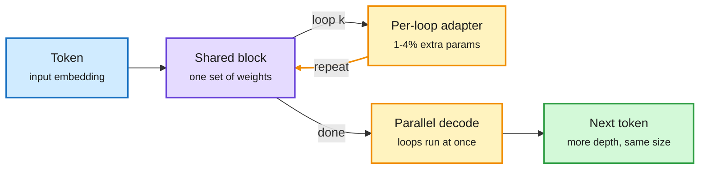

# Media Zone | 2026-11-03

> *Live draft: this window is still open. It is finalized with the 2026-11-03 digest at the 10:30 IST cutoff.*

> The US Monday's conversation so far: looped transformers that buy depth without parameters, a $115B bet that optics replaces copper inside AI racks, a financing split between GPU landlords and GPU lessors, and day two of DeepSeek's Super-agent blueprint going viral.

## Today's signal

- **Dominant story:** a Meta and MIT paper shows reusing a transformer's layers in loops beats a plain model at fixed size, and fixes parallel looped decoding.
- **Pattern:** compute financing is splitting. Cipher earns ~88% gross margin renting powered shells; CoreWeave, which owns the GPUs, pays ~15% on its bonds.
- **Pattern:** interconnect is the new memory. Marvell buying Lumentum for ~$115B follows a Week 44 where SK hynix posted an 80% operating margin on HBM.
- **Counter-signal:** the "leaked 14T Anthropic checkpoint" on Hugging Face looks fake; parts of the weights trace to a plain random number generator.
- **Momentum, not news:** the DeepSeek Super-agent post (covered 11-02) is now spreading in French and English creator threads; the new detail is the message queue and the 100-word reply cap.
- **Quiet area:** early in the US day. Two Following-feed captures so far (the 21:05 IST one found nothing new), no new bookmarks, YouTube or LinkedIn captures in this window, and HuggingFace has served no new papers since 10-31.

## Routing, KV cache, compression, GPU

### Depth without parameters: looped transformers

arXiv · Meta + MIT · parameter efficiency
<h4>How to Loop Your Transformer</h4>

Looping means running the same block of layers several times per token, so the model gets more effective depth without more weights. The catch is cost: each loop is another sequential pass during decoding. The authors trained dense models up to 1B parameters on up to 155B tokens and mapped where to loop and how often. Looping the whole stack gave the best quality at a fixed parameter count; looping only the middle layers paid off best when training compute was tight. Tiny per-loop adapters (1.1 to 4.3% extra parameters, versus 51.4% for doubling depth) helped more as loop count grew, and a repaired parallel-looping method lets loops run at once during decoding instead of back to back. For serving, this is a memory-for-compute trade: fewer weights to hold in HBM, more FLOPs per token, recovered partly by the parallel decode.

<a href="https://arxiv.org/abs/2610.40325">Read the paper →</a> · <a href="https://x.com/rohanpaul_ai/status/2117223679264473544">the thread</a>

Same weights, more passes

Adapters make each loop slightly different; parallel decode hides the extra passes.

Blue is input, purple is the shared weights, amber is the loop machinery, green is the output.

### Optics, memory and who carries the GPU risk

M&A · AI interconnect
<h4>Marvell to buy Lumentum in a ~$115B all-stock deal</h4>

Marvell's networking silicon plus Lumentum's lasers and optical transceivers, pitched at a $550B addressable market. The thesis: copper links inside and between racks are hitting bandwidth and reach limits as clusters grow, so optics moves closer to the chip. CEO Matt Murphy called it a once-in-a-generation opportunity. This is the industry pricing interconnect, not just compute, as the scaling bottleneck. Treat the figures as reported by a markets account until the filing lands.

<a href="https://x.com/StockSavvyShay/status/2117227565727543576">Read the thread →</a>

Compute financing
<h4>Landlords at 6%, lessors at 15%</h4>

Cipher's first HPC rent came in at ~88% cash gross margin versus ~30% on bitcoin mining. Cipher rents powered datacenter shells while tenants own and depreciate the GPUs, so its project debt priced at 6%. CoreWeave, which owns the GPUs, fell ~40% in October and its bonds now yield ~15% with CDS above 1,100bps. UBS kept a Buy, citing $100B+ backlog with two-thirds from investment-grade customers. The market is saying the risk is GPU depreciation, not demand.

<a href="https://x.com/StockSavvyShay/status/2117230746746409187">Cipher thread →</a> · <a href="https://x.com/StockSavvyShay/status/2117223881132142716">CoreWeave/UBS</a>

Newsletter · semiconductors
<h4>Week 44: HBM's record quarter and its yield math</h4>

SK hynix reported an 80% operating margin on 328% revenue growth and expects HBM4 to overtake HBM3E in its mix this quarter, with long-term deals covering over half of 2027-2028 output. The useful lens is stack yield: an 8-die stack at 95% die yield is only ~66% all-good before screening, so small die-yield gains move cost per sellable package a lot. Reuters puts CXMT's early HBM3E yields at an unverified 20-30% versus ~70% at SK hynix. Intel Foundry lost $1.85B on $6.70B segment revenue, while UMC ran at 92% utilization on mature nodes.

<a href="https://thesemiconductornewsletter.substack.com/p/week-44-2026">Read Week 44 →</a>

## LLMs, agents, safety

### DeepSeek's Super-agent, day two

Harness design · amplification
<h4>Router talks, workers work, a watchdog keeps it alive</h4>

The DeepSeek post from 11-02 (one person can supervise only 3-5 agent sessions, so a light Router handles chat and isolated Workers do the tasks) is now the most-shared agent item of the US day, in French and English. The summaries add details the first wave skipped: code rules drop noise before any model call, incoming messages queue and steer a running agent, chat replies are capped at 100 words with detail pushed to the PR, and memory lives outside the models so each role can swap models freely. The routing angle is direct: the Router is a cheap model, the best model runs only inside Workers. Claims that this "reveals every agent secret" are creator hype; it is a research prototype.

<a href="https://x.com/iamsupersocks/status/2116948152821428432">French breakdown →</a> · <a href="https://x.com/AlexFinn/status/2117127095038218733">Alex Finn's summary</a>

Open source · weights as a computer
<h4>Qwenputer: a RISC-V CPU compiled into Qwen 3.5-4B</h4>

The companion to QwenPU (in yesterday's tail). An 11-layer RV32IM CPU is compiled, not trained, into layers placed in front of Qwen, and the Gated DeltaNet state (a linear-attention memory) serves as exact read-write RAM for registers, program counter and stack. Arithmetic runs inside the forward pass with no tool call: DeepMind-style big-number multiplication reportedly jumps from 55% to 97.5%+, bit-exact over 230K+ steps. A curiosity today, but a concrete case of trading a tool call for in-weights compute. Code MIT, weights Apache-2.0.

<a href="https://github.com/divagr18/qwenputer">Repo →</a> · <a href="https://huggingface.co/divagr1925/Qwen3.5-4B-Qwenputer">weights</a>

Safety · provenance
<h4>The "leaked Anthropic 14T checkpoint" is almost certainly fake</h4>

A Hugging Face repo called burner22/numbat claims to be a mid-training checkpoint of Anthropic's next large model. The codename is real (it surfaced in the March 2026 Claude Code source leak), but the account is a week old and an independent check found parts of the weights came from a simple random number generator. A useful reminder that open-weight provenance is still unverifiable by default.

<a href="https://x.com/rohanpaul_ai/status/2117203349103874552">Read the thread →</a>

## Industry and business

- **OpenRouter dollar volume:** Opus alone is driving a GMV run rate above $5B a year, following yesterday's 10-quadrillion-token run-rate chart. Spend concentrates on the frontier model even as token volume spreads ([thread](https://x.com/deedydas/status/2117198564619366620)).
- **Particle-1 keeps circulating:** YC amplified Garry Tan's claim that it matches larger models on agentic retrieval at 1/23 the price. Covered 11-02: 91.4% vs Opus 5.5's 94.8% on LongMemEval, so "as good as" overstates it ([finding](https://github.com/garrytan/gbrain-evals/blob/b392700f2f647c201a8bedca71d43fd6a7fbb31c/docs/findings/2026-11-01-particle-1-longmemeval-w10b.md)).
- **SpaceX and Boost Mobile:** reported talks to buy Boost or access its 5G network for a US wireless service; Boost depends on AT&T and T-Mobile coverage ([thread](https://x.com/StockSavvyShay/status/2117204737477206258)).
- **Tempus Q3:** $412M revenue, data and applications up 33% YoY, FY26 guide $1.61B ([thread](https://x.com/StockSavvyShay/status/2117226490509304254)).

## Also crossed your feeds

[A 9B "uncensored" Qwen 3.5 GGUF claiming 7/7 wins over the 27B (community fine-tune, unverified)](https://huggingface.co/DavidAU/Qwen3.5-9B-The-Defiant-Fable-Uncensored-Heretic-NEO-IMATRIX-MAX-MTP-GGUF) · [LLM inference pipeline explainer](https://x.com/jithinvraj/status/2116984484629492175) · [Craft Anything: open-source "clone any site with Claude Code" tool](https://github.com/storytold/craft-anything) · [Google EmbeddingGemma 2 (covered last week)](https://x.com/Ronald_vanLoon/status/2117205829460128193) · [Turing Post's 10 harness sources (covered 11-02)](https://x.com/TheTuringPost/status/2117162364957307060) · [Sakana symposium report (covered 11-02)](https://sakana.ai/symposium-2026/#English) · [Altman: AI is now "mostly" as smart as top scientists, with caveats](https://x.com/VaibhavSisinty/status/2117197965681111137) · [Verge: CoreWeave's debt is the industry's problem](https://x.com/Ronald_vanLoon/status/2117226242235593156) · [Why AI consciousness won't be clear-cut](https://x.com/dioscuri/status/2117201865951822140) · [Patchy's AI engineering hub repo](https://github.com/patchy631/ai-engineering-hub) · Skipped: an Arabic "Google automates the PhD" ScientistTwo thread with no linked paper, a "135-page DeepMind+Meta+Amazon agent roadmap" post with no source, "Karpathy says delete everything, keep Graph" bait, a "free Claude skill made a 3D hummingbird" post, a $2M-GPUs lead-gen ad, procurement-AI sponsored posts, off-topic politics and music.
