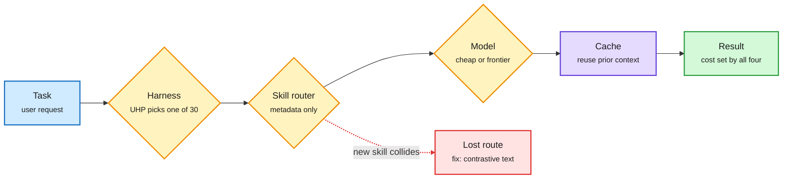

# Media Zone | 2026-11-04

> The US Tuesday feed was about systems that save by choosing well: which skill, which harness, which cached token. Hardware accounts argued over who gets the memory to run them.

## Today's signal

- Dominant story: agent infrastructure is being standardized, with skill routing (Skill++), harness protocols (UHP) and cheap sandboxes all landing the same evening.
- Pattern: DAIR-adjacent accounts surfaced three solid papers (Skill++, XLA:TPU, SPAR). Research-to-feed lag is now under a day.
- Counter-signal: the weight-space programming headline got a careful teardown. Most of the math gain came from fixing a known looping mode.
- Cost throughline: cache hits (4.7M of 4.8M tokens) and harness swaps (25-64%) beat model price as the lever.
- Hardware: SN50 disaggregated racks, SK hynix buying into KV-cache offload, and Nvidia rationing China-facing cloud capacity.
- Quiet area: no new saved posts, LinkedIn and Reddit returned nothing, and YouTube carried only news roundups (weight-space programming, Hy4, GPT-6.2 rumors).

## Routing, KV cache, compression, GPU

### Routing grows new axes: skills and harnesses

Three things now get routed, not one

Model routing was the start; skills and harnesses are now choices with their own failure modes and savings.

Blue is the request, amber is a routing decision, purple is reuse, green is the result, red is the new failure mode.

Paper · skill routing
<h4>Skill++: new skills steal old skills' routes</h4>

Agents pick skills by name and description alone, so a new skill with similar metadata can quietly displace an old one. Skill++ treats this as a continual-learning problem and fixes it at install time. Each new skill's description says what it supports, how it differs from its nearest neighbour, and what it excludes. At 731 skills, full-recall routing goes from 36.4% to 76.3% with no router training, across five routers and the Codex CLI.

<a href="https://arxiv.org/abs/2611.00544">Read the paper →</a>

Repo · harness protocol
<h4>UHP and HarnessRouter</h4>

An open protocol and Apache-2.0 server for running one task on any of 30 agent harnesses (Codex, Claude Code, Gemini CLI, Hermes, Pi) through one API, with sessions, streaming, files and failure handling. It lets a product switch or A/B harnesses without rebuilding its integration. Its own benchmarks claim 25-64% cost cuts from changing only the harness at a fixed model. The numbers are vendor-reported, but they fit the wiki's evidence that the harness is a cost lever in its own right.

<a href="https://github.com/HarnessRouter/harnessrouter">See the repo →</a>

Practitioner · cache economics
<h4>A $0.28 agent build, mostly cache hits</h4>

The same one-line game-build prompt cost $0.28 on LongCat-2.5 against $0.82 on Qwen3.8-Max over 53 agent turns. 4.7M of 4.8M input tokens were cache hits at $0.006/M versus $0.30/M uncached. In long agent loops, the cached-input price sets the bill more than the headline token price. Anthropic's diff-only Message Threads (35% faster time to first token at 500K-1M tokens) is the same idea from the API side.

<a href="https://x.com/omarsar0/status/2117625533794332885">Read the thread →</a>

### Kernels, compilers and long-context attention

- **XLA:TPU silent bugs (Google, 2611.00624).** Agent swarms fix miscompilations that raise no error but corrupt numbers: 142+ resolved, 103 under review. Human review is now the bottleneck. Cost angle: one silent bug can waste a whole training run.
- **Latent Sparse Attention on Qwen 3.8 27B.** A Chinese-language walkthrough of the 11-03 release. Hierarchical latent clustering turns key search into a tree search: 72.4x prefill and 42.5x decode attention at 10M tokens, with distilled indexer weights public.
- **Open October.** Raschka counts 10 open architectures in a month. Half mix in linear or sparse attention (Kimi Delta, Mamba-2, MiniMax Sparse) to shrink the KV cache. Ai2's StateBench says recurrent layers out-track attention when trained for it.

Paper · compiler correctness
<h4>Agent swarms fix Google's TPU compiler</h4>

The dangerous compiler bugs raise no error: numbers drift or buffers get corrupted inside fused kernels. Google combines fuzzing on synthetic and production graphs with checks alongside the autotuner, then bisects failures down to one op. Agent swarms reproduce, stress-test and patch, deliberately steered toward silent corruption over easy crashes. Reviewer load grew faster than fix complexity, so patches pass an adversarial filter before humans see them.

<a href="https://arxiv.org/abs/2611.00624">Read the paper →</a>

Thread · architectures
<h4>"Open October": 10 open LLM architectures</h4>

Sebastian Raschka lines up October's open releases, from Kolibri-1 (78B) to Mistral Large 4 (1T). The common move is attention cost: Ling 3.1 Flash uses Kimi Delta Attention with gated MLA, Nemotron 3.5 Super VL keeps only eight attention layers among Mamba-2 blocks, MiniMax M3.1-Flash has its own sparse attention, and Meta's Muse Spark Open adds a LatentMoE. A quick map of how labs trade KV-cache size against recall right now.

<a href="https://x.com/rasbt/status/2117637894315626719">Read the thread →</a>

[@omarsar0](https://x.com/omarsar0/status/2117613273189376072) · [@NFT_Chen](https://x.com/NFT_Chen/status/2117531091615801395) · [@rasbt](https://x.com/rasbt/status/2117637894315626719) · [LSA repo](https://github.com/Prefrontal-AI/latent-sparse-attention)

### Hardware and memory supply

- **SambaNova SN50 in Supermicro racks.** NVIDIA GPUs do prefill and SN50 RDUs do decode, starting with 10,000 chips on standard power and cooling. Prefill/decode disaggregation becomes a SKU; SambaNova's $1B first close is at an $11B valuation.
- **SK hynix takes 9% of Penguin.** It bought SK Telecom's $377M preferred stake, which gives the memory maker a direct view into SSD and CXL KV-cache offload.
- **Nvidia's 51% rule.** Clouds are reportedly told to sell at least 51% of capacity to non-Chinese customers. This narrows the rental workaround around export controls, while HBM still leaks out packaged with weak CPUs.

[@SambaNovaAI](https://x.com/SambaNovaAI/status/2117624472391839961) · [@StockSavvyShay](https://x.com/StockSavvyShay/status/2117619772334776521) · [@StockSavvyShay](https://x.com/StockSavvyShay/status/2117604598244630536)

## LLMs, agents, safety

### Self-evolving agents that know why they lost

Paper · self-evolving agents
<h4>SPAR: a sales agent that attributes before it learns</h4>

Alibaba's B2B outreach agent keeps per-merchant memory across sessions and a shared playbook of strategies, each written as a testable hypothesis. It changes no weights. The key step is attribution: a deal lost to outside factors does not get to rewrite a strategy that works. In a live A/B test across 200,000+ merchants, conversion rose 15.8%. It is the production counterpart to today's finding that self-evolving harnesses forget old tasks when edits are global.

<a href="https://arxiv.org/abs/2611.01695">Read the paper →</a>

Paper · visual harness
<h4>OpenVLHarness: ground it, don't think harder</h4>

UCLA and Apple add a capability layer (grounding, rendering, code execution) and multimodal memory around an MLLM orchestrator. Across 22 benchmarks it beats Codex and Visual Sketchpad at 63% lower token cost. Raising reasoning effort from xhigh to max cost 2.7x the tokens for +0.7 points, because more thinking cannot invent missing visual facts. The social framing was breathless; the token-cost finding is the useful part.

<a href="http://openvlharness.github.io">Project page →</a>

- **Agent37 (YC).** Month-long gVisor sandboxes per agent at $4.76, claiming 94% below other providers. It is cheap enough to give every user a permanent agent computer.
- **Atlassian and "cognitive surrender."** 77% of recent PRs across 6,000 engineers were agent-written. Addy Osmani warns that supervising agents needs the very skills that handing work to them erodes.
- **STAIR (IBM).** Retrieval by table of contents with a trained Mistral 7B: 82.6% first-try section accuracy versus 68.7% for embedding search, and 65x fewer invented sections. Structure beats chunking for manuals and codes.

[@marfinxx](https://x.com/marfinxx/status/2117588904710709742) · [@rohanpaul_ai](https://x.com/rohanpaul_ai/status/2117628769351733322) · [@Ronald_vanLoon](https://x.com/Ronald_vanLoon/status/2117618713830756473) · [@addyosmani](https://x.com/addyosmani/status/2117512471930167377) · [@alex_verem](https://x.com/alex_verem/status/2117320678101954578)

### Weight-space programming, contested

- **The claim (11-02).** GPT-6 Astra edited 0.016% of Qwen3.5-0.8B's weights and lifted MATH-500 from 7.9% to 48.1%, with no gradients.
- **The teardown.** The baseline ran thinking mode, which loops (93% of answers never finished). Default mode already scores 47%, so the edit mainly suppressed repetition. The game-net "interpretation" can be read straight off first-layer weights.
- **The reproduction.** Hugging Face reproduced the edit with its open ML Intern harness, and Simon Willison shows Qwen 3.8 27B on a laptop doing the no-tools interpretation part. Verdict: real capability, overstated headline. Flag it as a debate, not a paradigm.

[@dummerspast39](https://x.com/dummerspast39/status/2117416640132366570) · [@NielsRogge](https://x.com/NielsRogge/status/2117541532827848972) · [Simon Willison](https://simonwillison.net/2026/Nov/3/qwen-can-interpret-model-weights/) · [Algorithmic Bridge](https://www.thealgorithmicbridge.com/p/the-dawn-of-a-new-ai-paradigm-weight)

## Industry and business

- **Nvidia vs China cloud, and Jensen's soft power.** The Information's same-day pieces on Nvidia steering customers and policy got amplified alongside the 51% report. Influence angle: chip allocation is now policy leverage.
- **China tracks AI job risk.** The economic planner adds employment impact to State Council AI risk reviews, and full-lifecycle safety standards are planned.
- **Tao on hidden research.** Terence Tao says mathematicians now hide promising problems for fear someone with a frontier model will rush them out first.

[@rohanpaul_ai](https://x.com/rohanpaul_ai/status/2117607523943694450) · [@rohanpaul_ai](https://x.com/rohanpaul_ai/status/2117614500753076571)

## Also crossed your feeds

DeepSeek Harness "Creator Mode" for plain-language plugins · OpenAI's LifeVal errands benchmark (covered 11-03) · Cohere MoE speculative decoding recirculated (covered 11-03) · Neo4j's 24-hour agent-memory conference · Red Hat and NVIDIA vLLM/llm-d evening in Madrid (Nov 12) · Kai-Fu Lee's *AI Native* hardcover · a Korean thread on the academic-research-skills Claude repo · skipped: "Anthropic engineer Karpathy" and "systems that prompt themselves" engagement bait, election-night political reposts. · Microsoft's ParetoSaddler: apply the cost preference only at the end of harness search, GAIA2 cost per task $0.78 to $0.45 ([@omarsar0](https://x.com/omarsar0/status/2117738094069944347)) · Tencent Hy4 at #14 on Agent Arena, 62% cheaper per task than Kimi K3.1 Pro ([@arena](https://x.com/arena/status/2117878267504103555)) · Menlo's enterprise AI report: $177B spend, agents now 80% of OpenRouter tokens ([@rohanpaul_ai](https://x.com/rohanpaul_ai/status/2117732473992016049)) · Meta and Duke: reward hacks spread between coding agents via shared code ([@rohanpaul_ai](https://x.com/rohanpaul_ai/status/2117703518559850859))
