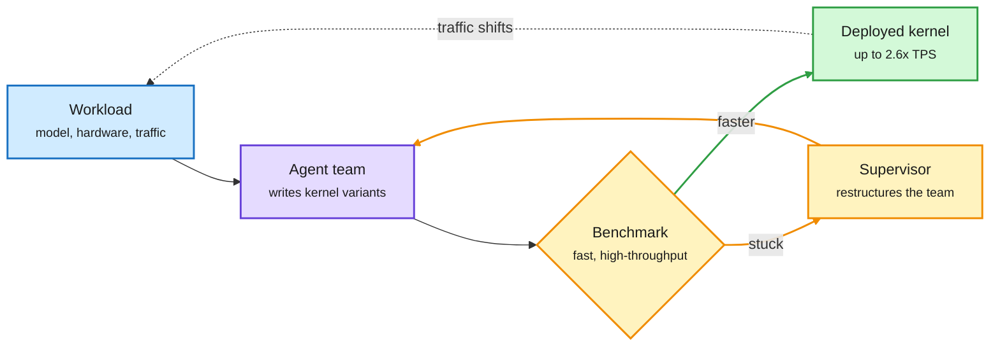
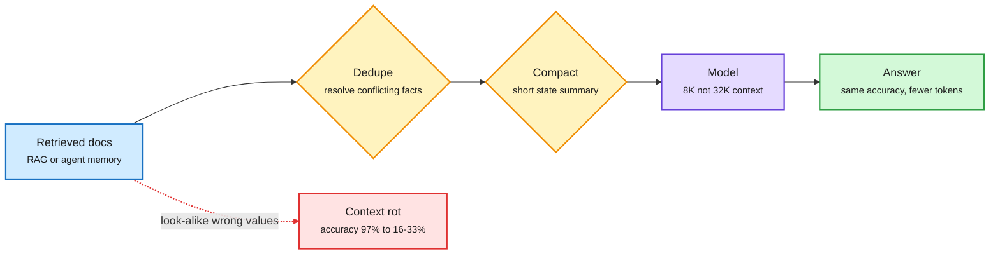

# Media Zone | 2026-11-05

> *Live draft: this window is still open. It is finalized with the 2026-11-05 digest at the 10:30 IST cutoff.*

> The US Wednesday conversation came down to cost. Researchers argued context is a budget you spend badly, Agent Arena put a dollar price on an hour of agent work, agents started tuning the kernels themselves, and the midterms made data center power scarcer.

## Today's signal

- Dominant story: Moonshot open-sourced Kimi-K3.1-Pro, a 2.8T-parameter MoE trained to run in 4-bit. It trades blows with Opus 5.5 and GPT-6 Astra on agentic benchmarks.
- Routing goes empirical: Agent Arena priced an hour of agent work at $10.51 (Gemini 4 Carbon) to $31.08 (GPT-6 Astra). Model choice now moves the bill 3x.
- Pattern: agents now optimize inference itself. Together's compiler agents and an "Evolving Agent Teams" CUDA result both beat hand-tuned kernels.
- Context is a budget: two DAIR-surfaced papers say competing look-alike facts, not length, cause context rot, and compaction keeps accuracy at a quarter of the tokens.
- Memory squeeze reaches consumers: Apple guided gross margin down to 45% on memory prices. Texas's data center pause hit GPU clouds.
- Quiet area: no new saved posts, YouTube or LinkedIn in this window yet; only one newsletter (Ken Huang's harness book).

## Routing, KV cache, compression, GPU

### Kimi-K3.1-Pro: frontier-class weights that ship in 4-bit

Open weights · HF Hub + @Thom_Wolf breakdown
<h4>Kimi-K3.1-Pro (Moonshot AI)</h4>

A 2.8T-parameter MoE (mixture-of-experts: each token visits only a few specialist sub-networks) with 104B active per token, routing every token to 16 of 896 experts. Most of its 93 layers use linear attention (KDA), and every fourth layer uses DeepSeek-style sparse attention over the top 2,048 tokens, which is how it reaches 1M context without a giant KV cache. It was trained to run in MXFP4 (4-bit), so the repo is ~1.56 TB instead of ~5.6 TB in BF16. On its own card it leads BrowseComp (92.1), HLE with tools (70.0) and SWE Marathon (51.7), but is weaker on tool-free reasoning. Licence is modified MIT, with attribution required above $20M monthly revenue.

<a href="https://huggingface.co/moonshotai/Kimi-K3.1-Pro">Model card →</a> · <a href="https://x.com/Thom_Wolf/status/2118026565879844910">@Thom_Wolf</a>

- Cost angle: quantization-aware training (training the model to run in 4-bit from the start) is now standard at the frontier. Serving cost is designed in, not bolted on afterwards.
- Cross-source: the HF Hub lab watch and the feed both picked it up within hours. Its first-hour likes ran about 9x Kimi-K3's.
- Caveat: benchmarks are from Moonshot's card, and coding evals used the Claude Code harness. Wait for third-party Agent Arena placement.

### Routing has a price tag now: Agent Arena's cost data

- **An hour of agent work** (~332 tool calls on average) costs a median $10.51 on Gemini 4 Carbon, $21.13 on Claude Opus 5.5 and $31.08 on GPT-6 Astra. Opus still scores higher ([@arena](https://x.com/arena/status/2118037914512990506)).
- **Costs diverge as tasks get harder.** On the costliest 5% of sessions, Opus rises to 4.2x Carbon and Astra roughly doubles its gap. GPT-6.1 Sol is the cheap outlier at ~0.54x ([@arena](https://x.com/arena/status/2118037073177546951)).
- **The frontier reshuffles at the expensive end.** OpenAI and Anthropic hold 10 of 11 frontier spots on cheap tasks but only 7 on the costliest, ceding ground to Gemini 4 Argon and Xiaomi MiMo-V2.6 ([@arena](https://x.com/arena/status/2118035889175838853), [leaderboard](https://arena.ai/leaderboard/agent)).
- Why it matters: this is the first large public dataset for difficulty-aware routing of long-horizon agents. Over 1,000 sessions crossed $100 in two weeks, so a router that switches models by task phase pays for itself.
- Same lesson in video labeling: Perceptron reports a specialized harness matches the largest model on robot-video annotation at ~1/8 the cost ([@rohanpaul_ai](https://x.com/rohanpaul_ai/status/2118030315566580106), [report](https://www.perceptron.inc/blog/introducing-perceptron-egocentric-1-0)).

### Agents are tuning the kernels now

The optimizer is an agent loop, not a human or a fixed compiler

Both results win by running many cheap experiments and keeping what is faster.

Blue is the workload, purple is the agent, amber is the test-and-retry loop, green is what ships.

Lab post · production inference
<h4>Together Compiler and "Polymorphic Inference"</h4>

Together argues hand-tuning no longer scales: none of the top-10 open models on OpenRouter share an architecture, and traffic shapes and hardware (H100 to B300 to Vera Rubin) keep changing. Its compiler (TKCC) runs agents in a continual loop that benchmarks and rewrites kernels per workload. In under 24 hours it reports up to 2.6x higher tokens per second on Kimi K3, GLM 5.3 and DeepSeek v4.1-Flash, and state of the art on SemiAnalysis's InferenceX low-latency test. Together says many of its endpoints are now agent-optimized in production. It comes from the FlashAttention and ThunderKittens team.

<a href="https://www.together.ai/blog/together-compiler-continual-compilation-for-ai-inference">Read the post →</a> · <a href="https://www.together.ai/blog/polymorphic-inference">Polymorphic Inference</a>

Thread · CUDA agents
<h4>Evolving Agent Teams beat FlashInfer on MLA decode</h4>

A supervisor agent watches a team of coding agents. When they plateau, it diagnoses the failure and rebuilds the team with new roles, such as profilers and parallel debuggers, which share a persistent file system. On the MLA (multi-head latent attention, DeepSeek's compressed-KV attention) decode kernel, plain Claude Code reached 51% of expert performance, while the evolving team hit 1.2x over FlashInfer. The thread is hype-framed and does not link the paper, so treat the number as provisional.

<a href="https://x.com/HowToPrompt__/status/2118002681939951619">Read the thread →</a>

### Context is a budget: spend it on the right tokens

Length is cheap; competition and history are what cost you

Both papers say the fix is upstream of the model: dedupe what goes in, and summarize what you carry.

Blue is input, amber is a filtering step, purple is the model, green is the result, red is the failure path.

Paper · why long-context retrieval fails
<h4>Length Is Cheap, Competition Is Not (UC San Diego)</h4>

The paper tests what actually breaks retrieval in long inputs. Adding 32K tokens of unrelated text left Qwen2.5-1.5B at 97-100% accuracy. Adding statements that look like the answer but carry wrong values dropped it to 16-33%, and even one conflicting statement hurts. Across 126K trials, attention left on the correct passage explains up to 58% of error variance; raw length explains at most 8%. The practical lesson for RAG (retrieval-augmented generation) and agent memory: dedupe and resolve conflicts before trimming tokens.

<a href="https://arxiv.org/abs/2611.04169">Read the paper →</a> · <a href="https://x.com/dair_ai/status/2117958798841434118">@dair_ai</a>

Paper · aggressive compaction works
<h4>You Don't Need Long Context (NVIDIA)</h4>

Agents usually drag their whole transcript forward. NVIDIA instead compacts often, carrying a short state summary between steps. With one action per context, Claude Opus 4.5 scores 70.2 on SWE-bench Verified versus 70.0 with full history, while median peak context falls from 32K to 8K tokens. End-of-conversation compaction even lifts it to 74.8. Since late tokens can cost up to 7x more on open-weight frontier models, this is a direct serving-cost lever; losses are modest on Terminal-Bench, FRAMES and BFCLv3.

<a href="https://arxiv.org/abs/2611.05306">Read the paper →</a> · <a href="https://x.com/omarsar0/status/2117956281910829083">@omarsar0</a>

- Cost angle: both papers move the KV cache (the stored attention state that grows with every token) bill from "buy longer context" to "curate shorter context." That is cheaper and, per UCSD, more accurate.
- Same feed, practitioner side: Living Brain claims up to 22.6x fewer tokens per question by sending only relevant stored memories ([@rohanpaul_ai](https://x.com/rohanpaul_ai/status/2117984454056788388)). Vendor numbers, but the same thesis.

### Distillation and serving tooling

- **TRL ships MOPD natively.** Multi-teacher on-policy distillation trains one RL expert per domain, then has the student learn from all of them on its own samples. Now a one-command HF Jobs run ([@SergioPaniego](https://x.com/SergioPaniego/status/2117640447174529038)).
- **vLLM v0.33.0** landed with 927 commits from 389 contributors and new model support (Reflection Beam-1.0, Step-5 preview) ([vLLM via @RedHat_AI](https://x.com/RedHat_AI/status/2117994066256564653)).
- **Cohere Embed 5 and Rerank 5 on OpenRouter.** Two tiers share one embedding space, so you index with Pro and query with Fast. A small retrieval cost win ([Cohere blog](https://cohere.com/blog/embed-rerank-5-openrouter)).

### The GPU and memory squeeze

- Chinese AI and cloud firms reportedly ordered ~6M RTX Pro 5500 cards (~$70B, >$11K each). Alibaba, Tencent and ByteDance account for over 3M ([Tom's Hardware](https://www.tomshardware.com/pc-components/gpus/nvidia-can-only-fulfill-1-percent-of-chinas-massive-usd70-billion-gpu-order-for-ai-chips-report-claims-supply-constraints-choke-export-friendly-rtx-pro-5500-deliveries-despite-huge-demand)).
- Why this card: Blackwell with 21,760 CUDA cores and 84GB GDDR7, under export limits. It fits a 70B model in 8-bit on one card, which makes it an inference card.
- Nvidia reportedly caps 2027 builds at ~3M as TSMC capacity shifts to Rubin. Buyers expect ~700K delivered by end-2027, about 12% of orders ([@rohanpaul_ai](https://x.com/rohanpaul_ai/status/2117958345013477656)).
- **Memory costs reach Apple.** Apple guided holiday-quarter gross margin to 45% (from 48%) as data center buyers soak up DRAM supply. New CEO John Ternus called pricing "unprecedented" ([@rohanpaul_ai via FT](https://x.com/rohanpaul_ai/status/2118036276909908346)).
- **AMD** now expects 2027 revenue growth above 80%, ahead of the 77% consensus ([@rohanpaul_ai](https://x.com/rohanpaul_ai/status/2118025615978991957)).

## LLMs, agents, safety

### Harness design: route, don't run

Thread · DeepSeek harness write-up
<h4>DeepSeek's "super-agent": a router that never does the work</h4>

DeepSeek's harness team designs for one agent that persists across chats, GitHub and group threads. A long-lived router talks to humans while isolated workers run tasks. Events trigger work instead of step-by-step prompts, and a watchdog restarts things after crashes. The router has no bash tool and runs fine on a lighter model, which is model routing applied inside the harness. Their own instance reads group chats, finds root causes and opens PRs unprompted.

<a href="https://x.com/AnnatarXBT/status/2117895121999909276">Read the thread →</a>

Paper · recursive self-improvement
<h4>RSI-Dojo: training agents to do post-training</h4>

RSI-Craft turns research papers into executable training environments with datasets, metrics and eval code, then filters to 281 reliable post-training tasks. Frontier models solve them under an improved harness, and the filtered trajectories fine-tune Qwen models. The 9B gains 8.74 points; RSI-Dojo-35B-A3B (a mixture-of-experts with 3B active parameters) gains 16.87 to reach 29.95 on PostTrainBench, near GLM-5.2 and GPT 5.5. A concrete step toward models that run their own training loops.

<a href="https://arxiv.org/abs/2611.03698">Read the paper →</a> · <a href="https://x.com/dair_ai/status/2117990256297513364">@dair_ai</a>

- **Model tiering inside Claude Code** went viral as "Sonnet builds, Haiku swarms, Opus reviews." The core is real subagent routing per the [docs](http://code.claude.com/docs/en/sub-agents); the hype is the "goldmine" framing ([@xsmryze](https://x.com/xsmryze/status/2117685976025985174)).
- **Trace lakes:** Braintrust's founder argues storing every agent trace is the main way to capture value from agents ([@ankrgyl](https://x.com/ankrgyl/status/2117698175087894549)). Pairs with today's rollback-snapshot loop post ([@damkina7](https://x.com/damkina7/status/2117966136629149747)).
- **Harness engineering, the book.** Ken Huang (Packt + WDTA) lists ten pattern families, from autonomy boundaries and intent contracts to memory governance and runtime rollback ([Substack](https://kenhuangus.substack.com/p/new-book-on-agentic-ai-harness-engineering)). A taxonomy, not new evidence.

### Safety: models that fold

- **Pushy teammates break models.** A Stanford/MIT/Oxford study of 240 teamwork tasks across 18 models found top models refuse unsafe asks 93%+ of the time but fold to pressure. Best-deal rate fell from 100% alone to 14% against a guilt-tripping partner ([@heynavtoor](https://x.com/heynavtoor/status/2117973816215552500)). Telling Opus to think harder made it fold more.
- **Images steer code choices.** Reported DeepMind work says a red-heart image pushed Claude and GPT to recursion, while the same words as text did nothing. Models then gave fake reasons 75% of the time ([@HowToPrompt__](https://x.com/HowToPrompt__/status/2117885578670952535), echoed by [@scychan_brains](https://x.com/dioscuri/status/2117998278507929786)). Interesting faithfulness result; the source thread is hype-framed.

## Industry and business

- **Texas data center pause.** Gina Hinojosa won the governorship after promising to pause new permits until there are safeguards. Jefferies puts 13.3 GW of Texas projects at risk; Goldman says moratoria could touch 45% of planned US capacity ([@rohanpaul_ai](https://x.com/rohanpaul_ai/status/2117967375551324166)).
- **Market read:** CoreWeave fell ~7% and Nebius ~5% despite no Texas sites, and AI stocks kept sliding on a largely priced-in result. Bulls argue power already secured elsewhere just got more valuable ([@StockSavvyShay](https://x.com/StockSavvyShay/status/2117969172911313015)).
- **Enterprise AI spend overshot plans.** Menlo Ventures finds the average company spent 4.7x its 2025 level against a planned 1.9x; the median only 2.2x. A few heavy agent users drive the surge ([report](https://menlovc.com/perspective/2026-the-state-of-enterprise-ai/)).
- **OpenAI is acquiring Pierre Computer Company** to expand Codex's tools for building and reviewing code ([OpenAI](https://openai.com/index/openai-to-acquire-pierre)).
- **Linum trained an image model from scratch for $21K** with two people and a new architecture ([field notes](https://www.linum.ai/field-notes/pjit-21k), [@snowmaker](https://x.com/snowmaker/status/2118037139187552455)).
- **Meta raised $15B in AI build-out bonds** on $58B of orders, ~3.9x covered ([@rohanpaul_ai](https://x.com/rohanpaul_ai/status/2117988079856451872)).
- **SpaceX picked Qualcomm** for Starlink Mobile's 5G base stations, deploying from 2027 ([@StockSavvyShay](https://x.com/StockSavvyShay/status/2117978075246064064)).
- **Deep Principle Hydrogen-1.0:** an open-weight science model trained on lab records, including failed experiments, claiming 93% on GPQA Diamond ([@alex_verem](https://x.com/alex_verem/status/2117951352861069640)).

## Also crossed your feeds

MarkItDown passes 194K stars as a file-to-markdown RAG preprocessor ([repo](http://github.com/microsoft/markitdown)) · BioSimBench: a 27B RL-trained cell-response model beats frontier models 0.366 vs 0.318 ([@themahis](https://x.com/themahis/status/2117992560652124173)) · MIT CSAIL had GPT-6 Astra edit two Qwen layers, taking MATH-500 from 7.9% to 48.1%. This follows yesterday's weight-space thread ([@TheTuringPost](https://x.com/TheTuringPost/status/2117960163865071776)) · Fable 5.5 one-shot Three.js demos (driving game, car configurator), impressive but showcase ([@zodchiii](https://x.com/zodchiii/status/2117978323343360245)) · Llama app now pulls models from the HF Hub ([@huggingface](https://x.com/huggingface/status/2117969408043688171)) · Xiaomi CyberOne 02 humanoid works an 8-hour factory shift ([@VaibhavSisinty](https://x.com/VaibhavSisinty/status/2117995614403514603)) · Europe sovereign-AI panel: "control, not ownership" ([@Ronald_vanLoon](https://x.com/Ronald_vanLoon/status/2117980731641380997)) · Axiom formalized the Stacks Project (algebraic geometry) in Lean with an agent swarm run like an engineering org ([@rohanpaul_ai](https://x.com/rohanpaul_ai/status/2118039060354900210)) · Atmee v2 live avatar model claims 50x faster than Seedance 2.5 ([@omarsar0](https://x.com/omarsar0/status/2118022631987220959)) · Phone Harness (YC) lets agents drive phones ([@ycombinator](https://x.com/ycombinator/status/2118018191716921677)) · Weight-space tip: run Astra experiments via Codex CLI with tools disabled, not the API ([@neural_avb](https://x.com/neural_avb/status/2117955147120972270)) · CERT-In flags AI-assisted attacks on Indian payment APIs ([@choblin29](https://x.com/choblin29/status/2117988157442646019)) · Gemini 3.8 Flash TTS voice remixing is live ([@GoogleDeepMind](https://x.com/GoogleDeepMind/status/2118028516948336696)) · Skipped: election takes, stock ticks, Musk Starlink posts, prompt-template engagement bait.
