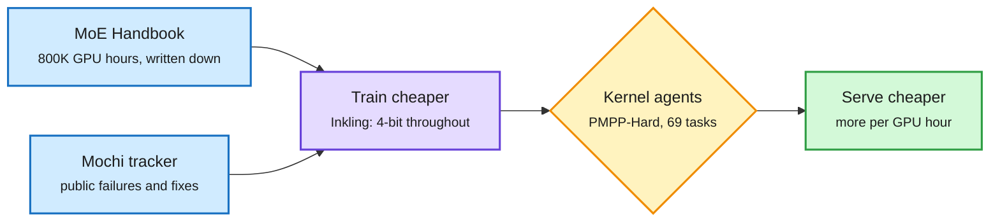

# Media Zone | 2026-11-06

> The US day's conversation split in two: markets panicked that new compute is getting harder to build, while builders showed how much more they can get from what exists. A small model trained in 4-bit, a free MoE playbook and agents that write kernels were the cost story under the selloff.

## Today's signal

- Dominant story: the chip rout. Semiconductors fell 12.3% on fear of moratoria covering about 45% of planned US capacity.
- Best launch: Inkling 2 Small. Practitioners respected its small training bill more than its scores, and that is the cost-optimization angle.
- Pattern: kernel optimization became a public scoreboard, across Inkling's launch tables and the KernelSeek paper on HF.
- Counter-signal: METR's Anthropic acceleration report is contested less for its 1.9x number than for what Anthropic redacted.
- Quiet area: TPUv7's AgentX results, likely the day's most consequential hardware story, barely crossed the feed. Read them in the digest.

*The saved-posts feed returned no new saves this window, and LinkedIn, YouTube and Reddit returned nothing, so this Media Zone is built from the X Following feed and newsletters.*

## Routing, KV cache, compression, GPU

### Agents and open playbooks for GPU work

The know-how for cheap models is becoming public

A training recipe, a kernel leaderboard and a public run log all arrived on one day.

Blue is open knowledge, purple is training, amber is the agent optimization step, green is the serving outcome.

Model launch · the day's most respected release
<h4>Inkling 2 Small</h4>

Thinking Machines' 594B mixture-of-experts model has 17B active parameters and trained every stage in NVFP4, a 4-bit float format. One pretraining phase took 68 hours and the full pretrain used about 12T tokens, far less than its rivals. Elie Bakouch says its base-model loss on internal code beats Kimi K3.1's. Arena says it would rank first among US open models on WebDev. Weights are promised next week after external safety tests.

<a href="https://thinkingmachines.ai/news/inkling-2-small/">Read the announcement →</a>

Handbook · high signal, long read
<h4>The Ultimate MoE Training Handbook</h4>

Hugging Face ran 800K GPU hours of experiments on the questions teams actually hit, such as how many experts to use, why a run is 25x slower with no error, and which router activation to pick. Thom Wolf reports 18 of the top 20 open models are MoEs, yet the know-how lives in a few teams. It runs about 70K words with 55 interactive figures. It is the most useful single artifact on the feed for anyone training or pruning experts.

<a href="https://huggingface.co/spaces/huggingface/moe-blogpost">Open the handbook →</a>

Benchmark · quietly high signal
<h4>Kernel optimization becomes a launch metric</h4>

Soumith Chintala's short post points to Inkling working for hours on GPU kernels. The launch tables put GPT-6 Astra at 63 of 69 PMPP-Hard tasks, Kimi K3.1 Pro at 60.5 and Claude Opus 5.5 at 60. On DeepSeek sparse-attention training kernels, Opus 5.5 reached 18.80x against an untuned baseline. Pair this with KernelSeek in the digest, which found questions beat added tools. Agent kernel skill is now something labs advertise.

<a href="https://thinkingmachines.ai/news/inkling-2-small/">See the tables →</a>

Open run · learning resource
<h4>Mochi 535B finishes pretraining in public</h4>

Marin and Open Athena finished an 18T-token pretrain of a 535B MoE. Its tracker records what most labs keep private, including a gradient spike traced to a single token with a nearly tied expert choice and a numerical error in attention gradients. Long context runs this weekend with fine-tuning to follow. Checkpoints are hoped for next week. It is a rare look at what goes wrong at this scale.

<a href="https://mumtracker.exe.xyz/hero-run-535b">Read the tracker →</a>

### Context as a budget, still traveling

- **NVIDIA's "You don't need long context" went international.** English, Korean and Chinese threads repeat that agents barely lose accuracy from restarting on a short note, while late tokens cost 3.6-7x more. Cost lens.
- **Claude Code's fix is the practitioner version.** Background subagents were re-reading the whole conversation every 30 seconds for a status line. The reported fix cuts that about 99%, which frees roughly 5% of a usage limit.
- **Decision models as cheap judges.** A RAG explainer lists routing, chunk filtering, and claim and answer checks as jobs for small classifiers. An Airbnb test reported on X found a fine-tuned Gemma 4 beat Jev, which cost about 5x at scale.
- **Copilot Fusion ships routing as a feature.** Users pick an effort level, and it picks among Single, Cascade and Critique patterns, including the cascade design the wiki flagged as a possible way to close Route Anything's oracle gap (11-05, where learned routers captured 0.3 of a possible 5.4 points).

[@itsharmanjot](https://x.com/itsharmanjot/status/2118252601519272332) · [@pinesun11](https://x.com/pinesun11/status/2118280067281498307) · [@Xudong07452910](https://x.com/Xudong07452910/status/2118544528856514698) · [@b1rkh0ff](https://x.com/b1rkh0ff/status/2118091433538166951) · [@kalyan_kpl](https://x.com/kalyan_kpl/status/2118316006661849408) · [@webbigdata](https://x.com/webbigdata/status/2118299371578265878) · [@github](https://x.com/github/status/2118431920295989588)

## LLMs, agents, safety

### Capability, measured and redacted

Launch · gated access
<h4>GPT-6 Cyber</h4>

OpenAI's security model is the one behind the Linux campaign, with 1,724 kernel bugs reproduced and 948 working exploits, against 166 for GPT-5.6 Sol. It also found 81 new serious Firefox bugs. Its most interesting number is scope discipline: it ignored planted bait in 99.93% of honeypot tests without a deployment prompt, up from 94.49%. It is rated Critical and limited to select Daybreak Red customers.

<a href="https://the-decoder.com/openais-gpt-6-cyber-can-both-break-into-systems-and-propose-how-to-fix-them/">Read The Decoder →</a>

Report · contested, flag as debate
<h4>METR on Anthropic's acceleration</h4>

After 11 weeks with internal data, METR estimates Anthropic's model progress accelerated about 1.9x, and guesses roughly 80% of that comes from Anthropic's own AI use. It sees no convincing bottleneck in the next 12 months, at low confidence. The feed argued about the redactions: Anthropic removed most of the evidence METR found most informative and canceled a compute-split check. The number is new, and the fight is over who gets to verify it.

<a href="https://metr.org/blog/2026-11-05-anthropic-ai-rd-acceleration-assessment/">Read the report →</a>

Benchmark · cross-source with HF
<h4>Research-grade benchmarks arrive together</h4>

Science's Last Exam gives agents a research goal and grades finished artifacts with hidden checks across 113 tasks. DeepSeek V4.1 Flash led hypothesis generation at 21.28%. FrontierPhysics on HF has 56 tasks from 42 physicists, and no setup passes more than 46 of 168 rollouts. DeepFinance adds 21 long-horizon finance problems. Together they say agents remain far from independent research.

<a href="https://arxiv.org/abs/2611.06910">Read FrontierPhysics →</a>

- **HarnessGrad treats the harness as the learner.** It crosses 8 harnesses, 19 improvement methods and 56 benchmarks with the model fixed. Influence lens: one shared testbed could settle which self-improvement claims hold.
- **Open-weight safety got a debate.** Soumith points to Thinking Machines' testing and its safe-path post, while Miles Brundage argues safety policy over-indexes on OpenAI and Anthropic as the frontier levels out.
- **Monofacts drive discovery.** A Johns Hopkins paper finds more discoveries when more training facts appear once, and hallucination rises with them. Repeat epochs erase the effect.
- **Dimitris Papailiopoulos on distillation.** "Everyone indirectly distills whether one likes it or not." It lands next to today's HF paper on what distillation fails to transfer.

[@zxlzr](https://x.com/zxlzr/status/2118388700124156016) · [@soumithchintala](https://x.com/soumithchintala/status/2118531321001591073) · [@Miles_Brundage](https://x.com/Miles_Brundage/status/2118553637354123509) · [@rohanpaul_ai](https://x.com/rohanpaul_ai/status/2118469622026604605) · [@DimitrisPapail](https://x.com/DimitrisPapail/status/2118494704316883106) · [@omarsar0](https://x.com/omarsar0/status/2118392657651057140)

## Multimodal / vision / audio

- **Muse Realtime Avatar opens to US users.** A student does in 2 passes what a teacher did in 120. With 4-bit weights, caching and batching, one GB200 serves 12 streams. Cost lens: a million concurrent calls would need about 83K GB200s.
- **Gemini Omni 1.2 Flash takes #1** on Arena in text-to-video and image-to-video, with 15-second clips.

[@AIatMeta](https://x.com/AIatMeta/status/2118412135340572850) · [@rohanpaul_ai](https://x.com/rohanpaul_ai/status/2118445350621171974) · [@arena](https://x.com/arena/status/2118420238756921648)

## Industry and business

Markets · the day's most-shared
<h4>The semiconductor rout</h4>

The Nasdaq fell 5.52% and the Philadelphia Semiconductor index 12.3%. Nvidia lost 9.3%, erasing its 2026 gains, and SanDisk fell 22%. Goldman says moratoria could touch about 45% of planned US capacity, and the WSJ reports Texas and Ohio could tighten too. Bulls note extreme selloffs have often come near bottoms, and that demand still exceeds supply. Gary Marcus sees cheaper DRAM and GPUs as the upside.

<a href="https://www.theinformation.com/articles/can-cheaper-ai-outrun-data-center-backlash">Read The Information's take →</a>

Compute deal · new financing shape
<h4>IREN's 90% prepayment contract</h4>

IREN signed a 5-year deal at about $22M per MW with the customer prepaying 90% of GPU costs, against 20% on its Microsoft tranches. If others match it, neoclouds need far less expensive debt, a pressure that has weighed on them. In the same window, a mystery seller shopped $500M of data center loans, per Bloomberg. Microsoft also requested a network design change at IREN's Horizon sites. Financing is becoming the real story beneath the chips.

<a href="https://x.com/StockSavvyShay/status/2118470111829045674">See the post →</a>

- **Anthropic's IPO price.** Gary Marcus says the prospective valuation slid from $2T toward $1T and shared a report of investors wanting it lower. Treat as commentary until a filing shows a range.
- **New money.** Isomorphic Labs is reportedly negotiating about $5B. YC counted 15 company rounds in two weeks, including Blacksmith at $66M. Google committed $17B to a Wyoming campus, and Reflex raised $14M.
- **Perplexity Teammates and OpenAI-JPMorganChase.** Personal work agents, and a bank partnership centered on security.

[@GaryMarcus](https://x.com/GaryMarcus/status/2118530396858053050) · [@rohanpaul_ai](https://x.com/rohanpaul_ai/status/2118486963259052440) · [@ycombinator](https://x.com/ycombinator/status/2118461459911045407) · [@StockSavvyShay](https://x.com/StockSavvyShay/status/2118391407627133146) · [@edzitron](https://x.com/edzitron/status/2118417108015231262) · [@gdb](https://x.com/gdb/status/2118410818933203038)

**Also crossed your feeds:** Agent Arena's Hy4 ranking, TwIL-8B's small open model, Ineffable's pure-RL pitch, NanoDC's solar micro data center, Zep's procedural memory skills, Voice Arena's phone-call speech benchmark, Cekura Bench for voice, DeepSeek's open agent stack (again), Karpathy's small-model thesis (recirculating), and the Nature piece on credit for OpenAI's Navier-Stokes claim.
