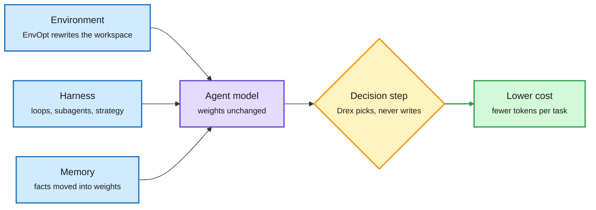

# Media Zone | 2026-11-07

> The US day's conversation moved from the selloff to the bill. Three papers on the feed cut agent cost without touching the model: one rewrites the agent's workspace, one stores user facts in weights, and one answers multiple-choice decisions without generating text.

## Today's signal

- Dominant story: agent cost is being optimized everywhere except the model. EnvOpt, weight memory and Drex all landed the same afternoon.
- Pattern: DAIR's curators picked all three papers, and omarsar0 and rohanpaul_ai amplified them. That is cross-source conviction from curation, not raw virality.
- Hardware: chips bounced 6 to 10% after Thursday's rout. NVIDIA reportedly asked TSMC to plan 3D DRAM, a first step by the foundry into memory.
- Counter-signal: only 1 of 40-plus US data center ballot proposals passed, and the Anthropic IPO talk slid toward $1T to $1.5T.
- Quiet area: KV cache and quantization had almost no original posts. One truncated repost on quantizing linear recurrences was the closest.

*No new saved posts were captured this window, and YouTube and LinkedIn had no captures. This Media Zone is built from the X Following feed and lab releases. The [2026-11-07 digest](../../daily-digest/2026-11/2026-11-07.md) carries the full research and industry picture, including the newsletter-only items.*

## Routing, KV cache, compression, GPU

### The model is no longer the only cost knob

Agent cost now has four knobs, and three skip the model

Each of today's papers attacks a different box around a fixed model.

Blue is what you can optimize around the model, purple is the fixed model, amber is the decision step, green is the cost outcome.

Paper · the day's sharpest cost result
<h4>EnvOpt: optimize the environment, not the agent</h4>

Many agents work in a shared space that stays fixed across tasks, like a company Slack or a pile of tickets. EnvOpt, from Berkeley's Sky lab, Chicago and Bespoke Labs, lets a coding agent rewrite what that space holds and how it is shown. It needs no graders or reference answers. On AutomationBench it cut Claude Haiku 4.5's cost by 72.7% and raised pass rate by 14.34%. The same environment cut Opus 5's cost by 68.1%. Stacked on Meta-Harness's tuned harness, it saved another 83.4%. One run costs about $150 and pays back more than ten times.

<a href="https://arxiv.org/abs/2611.07372">Read the paper →</a>

Paper · memory as distillation
<h4>Weight memory beats retrieval on user facts</h4>

Text memory makes every query pay to reread a growing history. Amazon's paper puts stable user facts into the weights with on-policy self-distillation (OPSD). The teacher is the same model reading the user's memory, and the student must answer without it. Plain fine-tuning recalls 36.9% of facts, while OPSD reaches 59.9%, above retrieval at 47.8%. The result holds at 4B, 9B and 27B. Weight memory forgets older facts and cannot say "never recorded", so a verify-then-regenerate router checks against the text store and adds 6.2 points.

<a href="https://arxiv.org/abs/2611.05636">Read the paper →</a>

Open models · routing the small choices
<h4>Drex: decision models that never generate</h4>

Nace AI's Drex reads a state, such as a document or an agent's context, plus a question with fixed options. It returns one probability per option in a single forward pass. The 27B Max model trails Claude Opus 5.5 by 1.6 points on Decision Bench v4 and ties GPT-6 Sol. It answers in 183 ms for about $0.06 per 1K decisions, against $10.17 and 3.5 s for Opus. Calibration is the useful part: confidence can gate when software acts alone and when it escalates, though Max runs 5 to 9 points over-confident in four of five domains.

<a href="https://arxiv.org/abs/2611.07854">Read the paper →</a> · <a href="https://huggingface.co/nace-ai/drex-max-v1">Weights</a> · <a href="../../ai-routing/2026-11-07-drex-open-decision-model-family.md">Wiki summary</a>

Repo · small model routes the big one
<h4>AgentPilot: a 9B strategist for frontier coders</h4>

HKU's AgentPilot splits the agent loop. A 9B model decides what to try next, where to spend the trial budget and when to stop. A frontier model such as DeepSeek V4 writes the code. The 9B model learns online from each trial's outcome. The claim is better solutions with fewer wasted tokens. It plugs into Codex, Claude Code and DeepSeek Harness. The repo shows no independent benchmark yet, so treat the speedup as the authors' claim.

<a href="https://github.com/HKUDS/AgentPilot">Open the repo →</a>

- **Harness work kept coming from Berkeley.** Reposts pointed to an agent that improves its own harness at deploy time (AlexKrentsel) and to evolving the harness alongside the solution (Ion Stoica), both pitched on cost and time. The posts were truncated, so the papers wait for the digest.
- **Subagents as the failure point.** A widely reposted thread argued most harness failures come from the main agent's lossy summary handed to subagents. This is the context-handoff problem the wiki's harness page tracks.
- **Memory stack explainers.** A practitioner thread laid out five memory layers and cited Mem0 at 1,800 tokens per query against 26,000. Zep shipped procedural memory skills. Both are vendor numbers, but they point the same way as the Amazon paper.

[@dair_ai](https://x.com/dair_ai/status/2118711759792144408) · [@omarsar0](https://x.com/omarsar0/status/2118693892300439722) · [@rohanpaul_ai](https://x.com/rohanpaul_ai/status/2118712420248207829) · [@huang_chao4969](https://x.com/huang_chao4969/status/2118571357323808779) · [@berkeley_ai](https://x.com/berkeley_ai/status/2118629241122377833) · [@harjtaggar](https://x.com/harjtaggar/status/2118719997841404412) · [@AnnatarXBT](https://x.com/AnnatarXBT/status/2118325709227557052)

### MoE routing, GPU efficiency and new decoders

- **Seven MoE routing strategies, explained.** Avi Chawla's thread compares token-choice, expert-choice, dynamic, balanced, hash, soft and group-limited routing. The key point: an even token split does not guarantee low latency, because small expert batches and cross-GPU transfers still cost time. Group-limited routing that follows hardware placement cuts that traffic.
- **Nebius found 1.13% more training throughput** on 192 B300 GPUs running DeepSeek V3 from one software change. Small, but it supports the thesis that the next margin is extracted from existing hardware.
- **Quantizing linear recurrences.** A repost from Christian Szegedy flagged work on quantizing Mamba-2, GDN and KDA layers, the recurrences replacing attention in hybrids. Only the opening line was captured, so look for the paper before trusting it.
- **Text diffusion goes MoE.** Posts described a Google DeepMind model that drafts 256 tokens at once and refines them, a 26B MoE with 3.8B active. The source link was a promo page, so the details are unconfirmed.
- **ByteDance Seed's Cola2** opened weights for a continuous-latent model: a compressing VAE, a roughly 4B diffusion transformer and a token decoder. It reports a 60.10 eight-task average on 346B tokens, 43x fewer than Llama-3-8B, though it still trails 7B to 8B autoregressive models.

[@_avichawla](https://x.com/_avichawla/status/2118619540213121450) · [@StockSavvyShay](https://x.com/StockSavvyShay/status/2118722192536195313) · [@ChrSzegedy](https://x.com/ChrSzegedy/status/2118589592249229789) · [@Ronald_vanLoon](https://x.com/Ronald_vanLoon/status/2118637277609877981) · [Cola2 on HF](https://huggingface.co/ByteDance-Seed/Cola2) · [Cola2 paper](https://arxiv.org/abs/2610.31305) · [MoE routing summary](../../inference-efficiency/2026-11-07-moe-routing-strategies-for-serving.md) · [Cola2 summary](../../llms-foundation-models/2026-11-07-cola2-continuous-latent-lm.md)

### Memory supply and the chip bounce

Semiconductors · memory supply chain
<h4>NVIDIA asks TSMC to explore 3D DRAM</h4>

With AI memory short, NVIDIA reportedly asked TSMC to look at 3D DRAM, beyond the usual Micron, SK hynix and Samsung. 3D DRAM is years from commercial scale, so this does nothing for today's HBM shortage. The signal is NVIDIA trying to add a fourth memory supplier and pull TSMC into memory. A separate post claimed Google bought a $548M Qualcomm stake for Gemini on Snapdragon. The filing shows something duller: Google Ventures received the shares because Qualcomm bought Modular, a compiler startup GV partly owned.

<a href="https://www.theinformation.com/articles/tsmc-weighs-making-advanced-memory-chips-capture-ai-spending">Read the report →</a> · <a href="../../hardware/2026-11-07-tsmc-3d-dram-and-the-rebound.md">Wiki summary</a>

Markets · the rebound
<h4>Chips claw back part of the rout</h4>

After Thursday's $3.2T US selloff, driven by fears of data center moratoria, chip names bounced. Credo rose 10%, Marvell, Lumentum and Coherent 9%, TSMC and AMD 7%, and Micron and ASML 6%. Traders called it a small fraction of the week's losses. US chip factories also posted their strongest hiring month since August 2022.

<a href="https://x.com/StockSavvyShay/status/2118693882577969579">See the post →</a>

## LLMs, agents, safety

- **Score centering for async RL.** Berkeley researchers report that score centering alone removes drift in asynchronous RL and often matches stacked fixes like truncated importance sampling or KL penalties. If it holds, it is a cheaper recipe for off-policy rollouts.
- **Mochi 535B-A23B finished main pretraining** on 18T tokens. Long context and SFT come next. Marin keeps the open run log public, and Hugging Face now supports streaming live training runs.
- **Science and safety threads.** A Johns Hopkins paper reports LLMs make more discoveries when more of their training facts are seen exactly once (the monofacts result the 11-06 digest covered). A Google paper says RAG poisoning mostly works by copying the query. A Stanford paper argues no tokenizer metric is agnostic in every sense.
- **Safety friction.** Dimitris Papailiopoulos said Opus flags his safety writing even on questions about existing work. It is a single report, but it is the cost of refusals for outside safety researchers.

[@berkeley_ai](https://x.com/berkeley_ai/status/2118630920265912812) · [@stanfordnlp](https://x.com/stanfordnlp/status/2118465025233068285) · [@huggingface](https://x.com/huggingface/status/2118715992343789911) · [@rohanpaul_ai](https://x.com/rohanpaul_ai/status/2118671841330081828) · [@DimitrisPapail](https://x.com/DimitrisPapail/status/2118726934867910772)

## Multimodal / vision / audio

- **Gemini Omni 1.2 Flash** shipped as a cheaper model with higher video generation and editing limits, reposted by Demis Hassabis.

## Industry and business

Funding · valuation repricing
<h4>Anthropic IPO expectations slide</h4>

Per WSJ, investors cut the expected Anthropic IPO valuation from about $2T to $1.5T, and some now say $1T. The driver is politics after the midterms, not Anthropic's numbers: its run rate topped $80B at the end of October and it held $146.6B in cash on September 30. OpenAI has raised $11B of a $30B target at $1.25T. A repriced IPO would hit Google, Amazon and NVIDIA too.

<a href="https://x.com/rohanpaul_ai/status/2118719195072659833">See the post →</a>

- **Data centers lost at the ballot box.** Only 1 of more than 40 US proposals passed. WSJ says half of planned additions could face tougher local review. Others framed it as a negotiation over terms, not a rejection of AI buildout.
- **Gary Marcus' five predictions.** He argues the high-valuation era may be over, and that use continues through harnessed tool-and-loop systems. He cites a Bank of England study finding weak AI productivity gains.
- **Jobs report.** US payrolls rose 165K against an expected 65K, used on the feed to push back on AI job-loss claims. December rate-hike odds hit 78%.
- **Domu (YC S24)** raised a $15M Series A for collections agents. It says its agents collect $186 for every $100 collected by human teams.
- **Elsewhere.** NVIDIA open-sourced Auto-Ontology, a metadata context layer for agents querying databases. NVIDIA is also offering Kimi K3.1 Pro free on its API. OpenAI's GPT-6 Cyber recirculated from yesterday.

[@GaryMarcus](https://x.com/GaryMarcus/status/2118650340060930552) · [Marcus on AI](https://garymarcus.substack.com/p/the-markets-dropped-25-trillion-yesterday) · [@rohanpaul_ai](https://x.com/rohanpaul_ai/status/2118687329242230811) · [@StockSavvyShay](https://x.com/StockSavvyShay/status/2118707264685289758) · [@ycombinator](https://x.com/ycombinator/status/2118725310963462580) · [NVIDIA Auto-Ontology](https://github.com/NVIDIA/auto-ontology)

**Also crossed your feeds:** PageIndex's vectorless tree-search RAG (98.7% FinanceBench, self-reported), VINCO's 0.5M-parameter model claim, TwIL-8B on Granite 4.2, Abstract Token Curriculum for CoT training, a 3,300-task RL environments release, a claimed David Silver model that skips pretraining, the AI 2027 authors rating progress at 70-90% of their pace, Weight Space Learning, NVIDIA's 6G open-source tools post, Inkling 2 Small's $426 self-training demo (recirculating), Thom Wolf's MoE handbook (recirculating), and the Bay Area concentration of $10K-a-month AI spenders.
