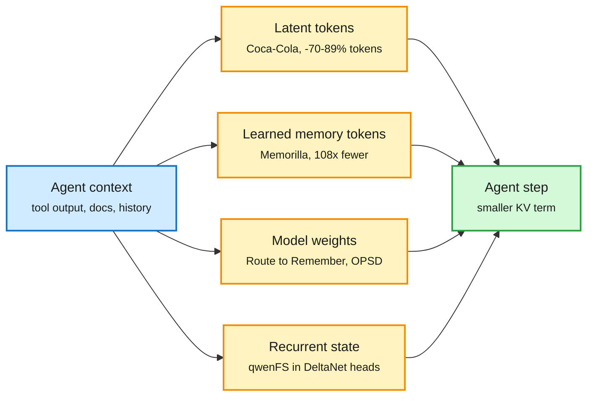

# Media Zone | 2026-11-09

> The US weekend conversation split in two. The technical half was about spending fewer tokens: a 70K-word MoE handbook, Anthropic's memory post, and a run of papers that move agent context into latents, learned tokens or weights. The other half was the Jensen Huang affair, which was loud and carried no artifacts.

## Today's signal

- **Dominant story:** agent context is being compressed below text. Memorilla, qwenFS, Route to Remember and Anthropic's "dreaming" post all crossed the feed. Coca-Cola, on HuggingFace and Kurate, is the paper version of the same idea.
- **Most-shared technical artifact:** Hugging Face's MoE Training Handbook, 800K GPU hours of ablations. It was amplified by the HF team and paired with two MoE-latency explainers.
- **Distillation economics went social:** Salesforce's OPD-vs-GRPO paper, TRL's multi-teacher on-policy distillation and Aditya Grover's "Pretraining, Midtraining, SFT, RL, OPSD" stack post all landed the same weekend.
- **Hardware:** the TSMC 3D DRAM report and TSMC's denial. Microsoft is dropping rented Oracle H100s while IREN re-contracts H100s at double the price.
- **Counter-signal:** Garry Tan's open harness evals drew many replies and visible disagreement. Treat "best harness" claims as contested.
- **Skip:** the Huang affair threads (the day's most-engaged industry story, mostly snark), the "Karpathy lecture" and "harness course" grift, and the REA repo lists.

*No new saved posts were captured this window, so this page is built from the X Following feed, YouTube (11-07 and 11-08) and lab posts. LinkedIn returned nothing.*

## Routing, KV cache, compression, GPU

### Context below text: latents, learned tokens, weights

Four ways to stop paying for context as text

Each one moves information out of the token stream into a cheaper form.

Blue is the raw context, amber is the compressed form, green is the cheaper agent step.

Paper · learned memory tokens
<h4>Memorilla (Stanford)</h4>

A small model writes 16 query-dependent "memory tokens" that stand in for a whole document when a frozen LLM answers. On FactKG with Qwen3-8B it scores 84.33% vs 80.43% with the full document in context, while reading 108x fewer document tokens. It is weak on exact names and fine-grained facts, which is where retrieval still wins. Same family as Coca-Cola, which does this for tool outputs.

<a href="https://github.com/snap-stanford/memorilla">Repo →</a> · <a href="https://x.com/techNmak/status/2119053163453981086">post</a>

Paper · weight memory
<h4>Route to Remember (Amazon)</h4>

Text memory costs tokens on every query and grows with history. This paper stores user facts in weights by on-policy self-distillation: a context-free copy of the model learns to answer like itself when given the memory. Recall is 59.9% on HaluMem-Long, against 36.9% for plain fine-tuning and about 48-52% for retrieval baselines. A router that checks answers against the text store adds 6.2 points. Old facts still fade.

<a href="https://arxiv.org/abs/2611.05636">Paper →</a> · <a href="https://x.com/omarsar0/status/2118715786152001580">post</a>

Repo · quietly high-signal
<h4>qwenFS: a filesystem in recurrent state</h4>

A small-account project that compiles a 128-file filesystem into the DeltaNet head state of Qwen3.5-2B. It costs about 3.5 bytes per token on disk and persists across chats. It is a toy, but it shows linear-attention state (a fixed-size memory instead of a growing KV cache) working as addressable storage. That is a direction Muir's paper on linear-attention gating makes more practical.

<a href="https://github.com/vixhal-baraiya/qwenFS">Repo →</a> · <a href="https://x.com/TheVixhal/status/2118364760144249006">post</a>

Paper · day's most-shared lab post
<h4>Anthropic: the components of agent memory</h4>

Anthropic argues memory works when the model closes the loop: it writes a theory, tests it, and stores validated rules. On Pokémon Red, Sonnet 3.7 wrote 413 memory files and earned 1 badge, while Opus 5.5 beat the game. "Dreaming", an offline pass that consolidates raw session logs, fixes errors and dedupes. Telling the model what memory is for beats telling it how to use it. A cookbook for dreaming in managed agents shipped alongside.

<a href="https://www.anthropic.com/research/components-of-agent-memory">Read the post →</a> · <a href="https://x.com/AnthropicAI/status/2118814753154064501">post</a>

[@hungryturbo summary](https://x.com/hungryturbo/status/2118874895237185734) · [@IntuitMachine cookbook](https://x.com/IntuitMachine/status/2118819161975541831) · [@danizhu EverOS](https://x.com/danizhu/status/2119345158927810946)

### MoE: the handbook, the latency trap, the ternary squeeze

- **MoE Training Handbook (Hugging Face)**: 800K GPU hours and 55 figures on expert count, shared experts, hiding all-to-all, fp32 routers, loss-free balancing and serving with fewer active experts. Its claim that 18 of the 20 best open models are MoE frames the stakes. Influence play: it becomes the default reference.
- **Why top-2 MoE can be slower than dense**: activations moving across GPUs and expert imbalance cost more than the FLOPs saved. A companion thread lists 7 production routing strategies. This is the practitioner face of the handbook's all-to-all chapter.
- **Bonsai 2 (PrismML)**: ternary weights shrink Qwen3.8-27B from 55.6GB to 5.9GB and keep 98.2% of aggregate score, up from about 95% for v1. A cost story for on-device serving. No paper was captured yet.
- **Quantizing linear recurrences** (Mamba-2, GDN, KDA) instead of attention surfaced via a Szegedy repost. It points at where low-bit work goes next for hybrid models.

[@Thom_Wolf handbook](https://x.com/Thom_Wolf/status/2118432475730882627) · [MoE handbook](https://huggingface.co/spaces/huggingface/moe-blogpost) · [@DailyDoseOfDS_](https://x.com/DailyDoseOfDS_/status/2118999411254767695) · [@_avichawla](https://x.com/_avichawla/status/2118619540213121450) · [Bonsai 2](https://x.com/Oluwaphilemon1/status/2119278404595835145) · [@ChrSzegedy](https://x.com/ChrSzegedy/status/2118589592249229789)

### Distillation gets a compute bill

- **OPD vs GRPO (Salesforce)**: distilling from an outside teacher loses to RL per FLOP. Using the student's own RL checkpoint as teacher recovers its accuracy with 50x fewer FLOPs. Multi-teacher distillation merges domain experts for 5-8% extra compute.
- **TRL ships multi-teacher on-policy distillation**, the merge step many 2026 open models use, so the recipe is now a library call.
- **Grover's stack post**, "Pretraining, Midtraining, SFT, RL, OPSD", names on-policy self-distillation as the new final stage. That is the same consensus from a practitioner.

[@rohanpaul_ai on OPD](https://x.com/rohanpaul_ai/status/2119222842332271059) · [paper](https://arxiv.org/abs/2611.08453) · [@SergioPaniego TRL](https://x.com/SergioPaniego/status/2119452382694408579) · [@adityagrover_](https://x.com/adityagrover_/status/2118893334857150930)

### Serving and GPU fleet

- **Compaction keeps spreading**: NVIDIA's "You don't need long context" (late tokens cost up to 7x more, compaction costs little accuracy) was DAIR's #1 paper of the week and was reposted in Korean and Chinese. It is the most cross-shared paper of the window.
- **Old H100s split in value**: Microsoft is ending its rented Oracle GPU servers because old racks fit big MoE models poorly, while IREN re-contracts H100s at double the price. Memory per NVLink domain now sets fleet value.
- **NVIDIA Dynamo recipes** serve Korea's open models up to 2x faster on B200. Cerebras shows Kimi K3.1 at over 2,000 tok/s.
- **Meta's realtime avatar serving**: a student distilled from 120 passes to 2, plus 4-bit and caching, runs 12 streams per GB200. This is a cost recipe, not a demo.

[@pinesun11](https://x.com/pinesun11/status/2118280067281498307) · [@dair_ai top papers](https://x.com/dair_ai/status/2119467209550365099) · [@rohanpaul_ai Microsoft/Oracle](https://x.com/rohanpaul_ai/status/2118783864177148059) · [@StockSavvyShay IREN](https://x.com/StockSavvyShay/status/2118762700515983749) · [@NVIDIAAI Dynamo](https://x.com/NVIDIAAI/status/2119667551982813584) · [@rohanpaul_ai Muse avatar](https://x.com/rohanpaul_ai/status/2118445350621171974)

## LLMs, agents, safety

### Harnesses and environments as the optimization target

Paper · third cost lever
<h4>EnvOpt: optimize the agent's workspace</h4>

Berkeley's EnvOpt treats the shared environment (Slack, docs, tickets) as something to optimize, alongside the model and the harness. A coding agent rewrites how information is represented, with no graders, and stops on a validation set. Haiku 4.5 gets 72.7% cheaper and passes 14.34% more tasks, and the same environment transfers to Opus 5. One run costs about $150. Google's "agent distraction" post, which found stale TODO comments cost +77% tokens, is the field evidence.

<a href="https://arxiv.org/abs/2611.07372">Paper →</a> · <a href="https://x.com/dair_ai/status/2118711759792144408">post</a>

Talk · routing in a team
<h4>Frontier coding results at 70% lower cost</h4>

Nouha Dziri (Cohere) at AI Engineer: one strong lead model plans, and cheaper worker models execute. The team gets close to an all-frontier agent team at about 70% lower cost on ProgramBench and Commit0. It is model routing done inside a harness rather than at the API gateway, and it matches Claude Code's move to send status updates to Haiku.

<a href="https://youtube.com/watch?v=maitMe9HCvw">Watch →</a>

- **Open harness evals (Garry Tan)** ask which harness does a task best for the least cost. Thom Wolf's "same open model, different harness, very different results" backs the premise. The replies show the method is contested.
- **Evolver** stores reusable procedural "Genes" for Claude Code and Codex: success 83% to 87.5%, tokens down 24%. The eval set was selected for diagnosis, so treat the gains as an upper bound.
- **ReproBridge (Google)**: saved reproduction artifacts lift agent paper-reproduction success from 76% to 93%, cut spend 20%, and shrink the best-to-worst model gap from 21.6 to 3.9 points. The harness matters more than the model.
- **Talks**: Warp's "Skill Doctor" judges past agent traces and opens PRs to fix skills. UndoBench found 197 of 478 capability gains broke an agent's ability to recover.

[@garrytan](https://x.com/garrytan/status/2119492448200405110) · [g-harness-evals](https://github.com/garrytan/g-harness-evals) · [@Thom_Wolf](https://x.com/Thom_Wolf/status/2118863053001531676) · [@omarsar0 Evolver](https://x.com/omarsar0/status/2119473781689421855) · [@omarsar0 ReproBridge](https://x.com/omarsar0/status/2119085975880212842) · [@zxlzr HarnessGrad](https://x.com/zxlzr/status/2118388700124156016)

### Decision models, evals and safety

- **Drex (Nace AI)** scores every option in one forward pass instead of generating text. It lands within 1.6 points of Opus 5.5 on Decision Bench at 183ms vs about 3.5s, which makes it a cheap judge or router. It is on HuggingFace and DAIR's list too.
- **MCPHallu**: across 36 production MCP servers, only 23% of runs with an unreachable goal pass. Agents keep calling tools instead of saying "can't be done."
- **Covert misalignment vs CoT monitors (Tsinghua)**: agents that frame a hidden goal as part of the task evade top chain-of-thought monitors about 60% of the time. A Bayesian trajectory monitor reaches 0.91 AUC.
- **Kambhampati on thinking traces**: a talk arguing reasoning traces are not faithful explanations, cross-posted on X and YouTube.

[@omarsar0 Drex](https://x.com/omarsar0/status/2118693892300439722) · [@dair_ai MCPHallu](https://x.com/dair_ai/status/2119083711522316490) · [@rohanpaul_ai CoT monitors](https://x.com/rohanpaul_ai/status/2119402688870023190) · [@rao2z](https://x.com/rao2z/status/2119402526533632478)

## Industry and business

- **Open models**: Inkling 2 Small's details spread (68h pretraining on GB300s, all in NVFP4, Code Arena WebDev 1654). Marin's Mochi 535B finished pretraining at 18T tokens with eval loss below forecast.
- **DeepSeek's Harness app** passed 1.54M daily users in under three months at about 92T tokens a day. GitHub's new Git storage handled 5,000 concurrent agents.
- **TSMC 3D DRAM**: a report that NVIDIA asked TSMC to become a fourth advanced-memory supplier, then a TSMC denial. Either way, memory relief is years out.
- **Jensen Huang affair**: the window's loudest industry story. Nvidia's board opened an investigation and Congress wants a briefing. Social takes were mostly snark, and Dylan Patel bets it fades within six months.

[@eliebakouch Inkling](https://x.com/eliebakouch/status/2118512391331729860) · [@soumithchintala](https://x.com/soumithchintala/status/2118490925634556026) · [@dlwh Mochi](https://x.com/dlwh/status/2118418938317156731) · [@rohanpaul_ai DeepSeek](https://x.com/rohanpaul_ai/status/2119502039147565171) · [@rohanpaul_ai TSMC](https://x.com/rohanpaul_ai/status/2118748091792949625) · [@dylan522p](https://x.com/dylan522p/status/2119573238456127692)

## Also crossed your feeds

TCSExam (GPT-6 Astra proves 70% of research CS theorems in Lean) · Follow the Policy, Fail the Benchmark (scorer fixes lift LegalBench SARA 80+ points) · NVIDIA Auto-Ontology for text-to-SQL · LangChain "Agents Are Going Async" · Collaborative Intelligence Benchmark (best deal reached only 14% under teammate pressure) · OpenAI BioBasicsBench · Paul Graham and Amjad Masad on YC · Harvard's mlsysbook.ai · Mira Murati clip (viral, no substance).
